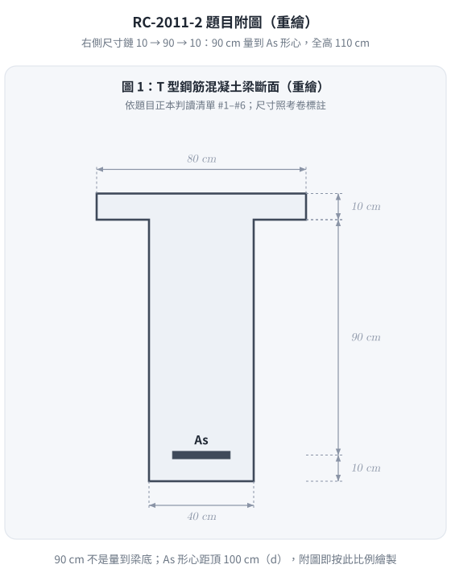
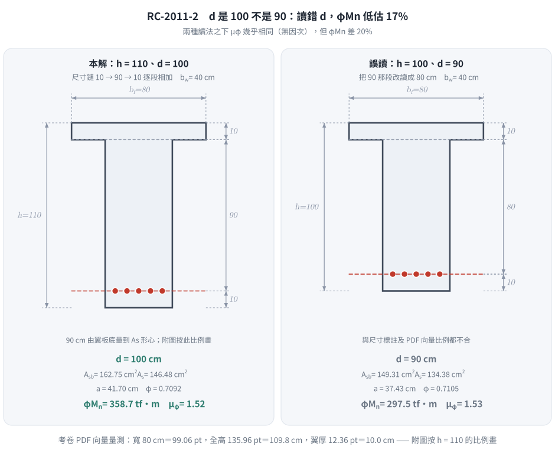
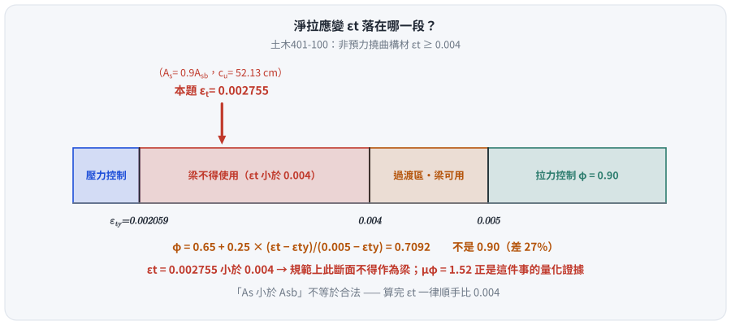
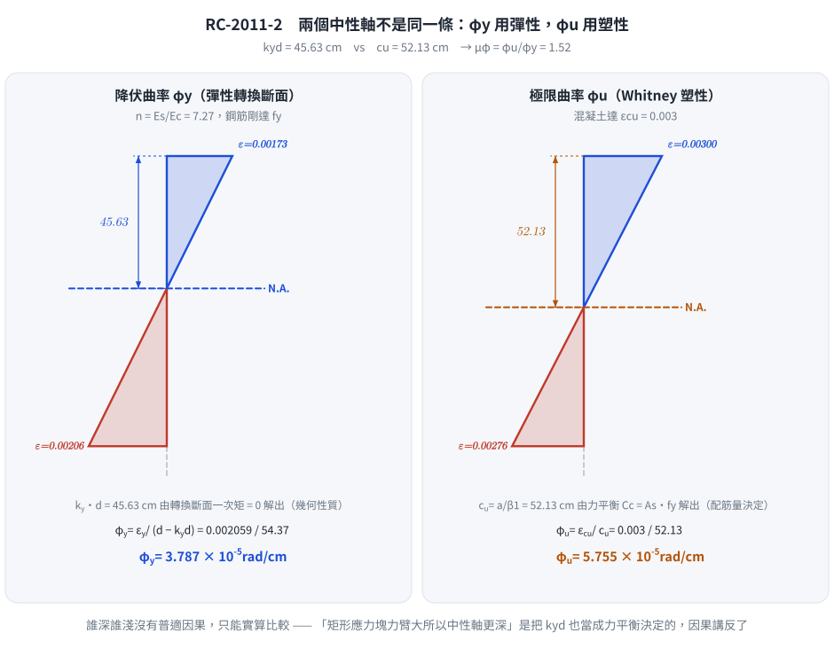

# 考題編號：RC-2011-2

**主分類：** `RC-U1-1` RC 梁彎矩強度分析與設計  
**副分類：** 無  
**設計法：** USD 強度設計法  
**標籤：** `T形梁` `平衡鋼筋量` `NA在腹板` `過渡區φ值` `斷面韌性容量` `曲率延展比` `降伏曲率` `極限曲率` `彈性中性軸` `As=0.9Asb` `超筋斷面` `εt<0.004` `圖面尺寸歧義` `尺寸鏈判讀` `d=100`

---

## 1. 題目（考卷原文見題目正本）

> 考卷原文、公式／附表、附圖與判讀清單（已確認）見 [`RC-2011-2-problem.md`](RC-2011-2-problem.md)。本節只列解題時最容易讀錯的地方與本解使用的記號；題意以題目正本為準。

*重繪自考卷圖 1，依題目正本判讀清單 #1–#6；右側尺寸鏈 10＋90＋10，90 cm 量到 $A_s$ 形心，故 $d=100$、$h=110$ cm。*

### 常見誤讀

| 項目 | 正確判讀 | 常見誤讀 |
|------|---------|---------|
| 有效深度 | $d = 10+90 = 100$ cm、$h = 110$ cm（判讀 #3–#5；考卷 PDF 向量按此比例繪製：寬 80 cm＝99.06 pt，全高 135.96 pt＝109.8 cm） | 以為附圖比例只合 $h=100$，改讀 $d=90$（本解 2026-08-21～11-12 即如此，$\phi M_n$ 低估 17%） |
| 所求㈠ | 設計彎矩強度 $\phi M_n$，$A_s = 0.9A_{sb}$，$A_{sb}$ 用 T 形斷面算 | 用 $\rho_b b_w d$ 當 $A_{sb}$ |
| $\phi$ | 依 $\varepsilon_t$ 內插（過渡區） | 逕取 0.90 |
| 考卷沒給 | $E_s$、$\varepsilon_{cu}$、$\beta_1$、$\phi$ 依規範自行假設（卷首注意事項㈢） | — |

**本解記號：** $b_f=80$、$h_f=10$、$b_w=40$、$d=100$、$h=110$ cm；$c_b$、$a_b$＝平衡時中性軸深度與應力塊深度；$c_u$＝極限狀態中性軸深度；$k_yd$＝降伏時彈性中性軸深度；$\phi_y$、$\phi_u$＝曲率（與強度折減係數 $\phi$ 同符號，依上下文區分）。

### 判讀圖解（解析自繪）

*圖 1　附圖尺寸的正讀與誤讀（向量重繪）。先把「$d$ 是 100 不是 90」講清楚再算，這張圖攔下「憑圖面印象改讀尺寸鏈」——兩種讀法的 $\phi M_n$ 差 20%。*

---

## 2. 考題核心精神與出題者意圖 (Core Concepts & Examiner's Intent)

**核心觀念：**
- **(一)**：T型梁平衡鋼筋量計算需考慮翼板額外壓力貢獻；$A_s = 0.9A_{sb}$ 表示輕微低配筋，中性軸仍在腹板（過渡區）。
- **(二)**：曲率延展比 = 極限曲率（Whitney 應力塊非線性中性軸）/ 降伏曲率（彈性轉換斷面中性軸）；重配筋比 → 低延性。

**出題者意圖：**
1. 測驗是否能正確判斷 T 型梁平衡條件下中性軸位置（翼板內 vs. 腹板中）
2. 測驗 $\phi$ 值過渡區插值是否會算
3. 測驗 $\phi_y$ 與 $\phi_u$ 採用不同中性軸（彈性 vs. 塑性）的觀念

---

## 3. 解題戰略地圖與陷阱分析 (Strategic Roadmap & Trap Analysis)

**作戰計畫：**
1. 確認材料常數（$\beta_1$、$\varepsilon_y$、$E_c$、$n$）
2. 求 T 型梁 $A_{sb}$：先算平衡 $c_b$、$a_b$，判斷翼板是否完全壓縮
3. 求 $A_s = 0.9A_{sb}$，再反算實際 $a$
4. 計算 $\varepsilon_t$，決定 $\phi$ 值
5. 對 $A_s$ 位置取矩，得 $M_n$；乘 $\phi$ 得 $\phi M_n$
6. 求彈性中性軸深度 → $\phi_y$
7. 用塑性中性軸 → $\phi_u$
8. 計算 $\mu_\phi = \phi_u/\phi_y$

**關鍵陷阱：**

| 陷阱 | 說明 | 應對 |
|------|------|------|
| ❶ $A_{sb}$ 須用 T 型梁公式 | 不能直接用 $\rho_b \cdot b_w \cdot d$，翼板多出壓力 $\to$ 多出鋼筋 | $A_{sb} = A_{sf} + A_{sw}$；或直接用壓力平衡 |
| ❷ $a_b$ 跨過翼板 | $a_b = 47.4$ cm $> h_f = 10$ cm，壓力區形狀是倒 T，**非矩形** | 壓力 = 翼板 + 腹板矩形塊，分開計算 |
| ❸ 過渡區 $\phi$ 值 | $\varepsilon_y < \varepsilon_t < 0.005$，$\phi$ 需線性插值，非直接 0.9 | $\phi = 0.65 + 0.25\dfrac{\varepsilon_t - \varepsilon_y}{0.005 - \varepsilon_y}$ |
| ❸' **漏檢 $\varepsilon_t \geq 0.004$** | 本題 $\varepsilon_t = 0.00276 < 0.004$，**規範上此斷面不得作為梁** | 算完 $\varepsilon_t$ 一律順手比 0.004，見 §5 ② |
| ❹ $\phi_y$ 用彈性中性軸，$\phi_u$ 用塑性中性軸 | 兩個中性軸概念不同，不可混用 | $\phi_y = \varepsilon_y/(d - k_y d)$；$\phi_u = \varepsilon_{cu}/c_u$ |

---

## 3.5 變數層次分析 (Variable Hierarchy Analysis)

### 最終目標

**(一)** 求 $\phi M_n$（T 型梁設計彎矩強度）；**(二)** 求 $\mu_\phi = \phi_u/\phi_y$（斷面韌性容量）

### 本題關鍵公式（依計算順序）

$$\text{Step 1：} \beta_1 = 0.85 - 0.05\cdot\frac{f'_c - 280}{70}$$

$$\text{Step 2：} a_b = \beta_1 \cdot \frac{6120}{6120+f_y}\cdot d \quad \Rightarrow \quad A_{sb} = \frac{0.85f'_c\bigl[b_f h_f + b_w(\boxed{a_b}-h_f)\bigr]}{f_y}$$

$$\text{Step 3：} 0.85f'_c\bigl[b_f h_f + b_w(a-h_f)\bigr] = 0.9\boxed{A_{sb}}\cdot f_y \quad \Rightarrow \quad a$$

$$\text{Step 4：} \varepsilon_t = \varepsilon_{cu}\cdot\frac{d - \boxed{a}/\beta_1}{\boxed{a}/\beta_1} \quad \Rightarrow \quad \phi$$

$$\text{Step 5：} M_n = 0.85f'_c\,(b_f-b_w)\,h_f\!\left(d - \tfrac{h_f}{2}\right) + 0.85f'_c\,b_w\,\boxed{a}\!\left(d - \tfrac{\boxed{a}}{2}\right)$$

$$\text{Step 6（}\phi_y\text{）：} 20x^2 + (n\cdot A_s + 400)\,x - \bigl[n\cdot A_s\cdot d + 2000\bigr] = 0 \quad \Rightarrow \quad \phi_y = \frac{\varepsilon_y}{d - \boxed{x}}$$

$$\text{Step 7（}\phi_u\text{）：} \phi_u = \frac{\varepsilon_{cu}}{\boxed{a}/\beta_1}$$

### L1：題目直接給定

| 符號 | 數值 | 說明 |
|------|------|------|
| $f'_c$ | 350 kgf/cm² | 混凝土抗壓強度 |
| $f_y$ | 4200 kgf/cm² | 鋼筋降伏強度 |
| $b_f$ | 80 cm | 翼板寬度 |
| $h_f$ | 10 cm | 翼板厚度 |
| $b_w$ | 40 cm | 腹板寬度 |
| $h$ | 110 cm | 全斷面高（10+90+10，圖上尺寸鏈） |
| $d$ | 100 cm | 有效深度（翼板厚 10 ＋ 翼板底到 $A_s$ 形心 90） |
| $A_s$ | $0.9A_{sb}$ | 拉力鋼筋量（以平衡量的倍數給定） |

### L2：需知識點推導

**▌ 材料常數**

| 符號 | 公式／來源 | 卡關? |
|------|-----------|-------|
| $\beta_1$ | $0.85 - 0.05\times(350-280)/70 = 0.80$ | |
| $\varepsilon_y$ | $f_y/E_s = 4200/2{,}040{,}000 = 0.002059$ | |
| $E_c$ | $15000\sqrt{f'_c} = 15000\sqrt{350} = 280{,}624$ kgf/cm² | |
| $n$ | $E_s/E_c = 2{,}040{,}000/280{,}624 = 7.27$ | |

**▌ T 型梁平衡鋼筋量 $A_{sb}$**

| 符號 | 公式／來源 | 卡關? |
|------|-----------|-------|
| $c_b$ | $6120/(6120+4200)\times 100 = 59.30$ cm | |
| $a_b$ | $0.80\times 59.30 = 47.44$ cm $> h_f$ → NA 在腹板 | |
| $C_c$ | $0.85\times350\times[80\times10 + 40\times(47.44-10)] = 683{,}558$ kgf | |
| $A_{sb}$ | $C_c/f_y = 683{,}558/4200 = 162.75$ cm² | |
| $A_s$ | $0.9\times162.75 = 146.48$ cm² | |

**▌ 實際中性軸 $a$**

| 符號 | 公式／來源 | 卡關? |
|------|-----------|-------|
| $a$ | 由 $0.85\times350\times[800+40(a-10)]=146.48\times4200$ 解得 41.70 cm | |
| $c_u$ | $a/\beta_1 = 41.70/0.80 = 52.13$ cm | |

**▌ φ 值（過渡區）**

| 符號 | 公式／來源 | 卡關? |
|------|-----------|-------|
| $\varepsilon_t$ | $0.003\times(100-52.13)/52.13 = 0.002755$ | |
| $\phi$ | $0.65 + 0.25\times(0.002755-0.002059)/(0.005-0.002059) = 0.7092$ | |

**▌ 韌性計算**

| 符號 | 公式／來源 | 卡關? |
|------|-----------|-------|
| $k_y d$ | 彈性裂縫斷面 NA（見 §4 Step 7）= 45.63 cm | |
| $\phi_y$ | $\varepsilon_y/(d-k_y d) = 0.002059/54.37 = 3.787\times10^{-5}$ rad/cm | |
| $\phi_u$ | $\varepsilon_{cu}/c_u = 0.003/52.13 = 5.755\times10^{-5}$ rad/cm | |
| $\mu_\phi$ | $\phi_u/\phi_y = 5.755/3.787 = 1.52$ | |

### L3：深層知識（不懂就卡住）

| 知識點 | 說明 | 卡關? |
|--------|------|-------|
| T 型梁 $A_{sb}$ 含翼板貢獻 | 翼板多出的壓力需由多出的鋼筋平衡，$A_{sb}$ 遠大於 $\rho_b\cdot b_w\cdot d$ | |
| $\phi_y$ 對應彈性中性軸（轉換斷面法） | 降伏瞬間鋼筋剛達 $f_y$，混凝土仍為彈性，需用轉換斷面（$n\times A_s$）計算 NA | |
| $\phi_u$ 對應 Whitney 塑性中性軸 | 極限狀態用等效矩形應力塊，$c_u = a/\beta_1$，與彈性 NA 位置完全不同 | |
| 重配筋 → 低延性 | $A_s = 0.9A_{sb}$ 表示接近平衡破壞，$\varepsilon_t$ 僅略高於 $\varepsilon_y$，曲率延展比 $\approx 1.5$ | |

---

## 4. 步驟化詳細計算過程 (Step-by-Step Detailed Calculation)

### Part (一)：設計彎矩強度 $\phi M_n$

---

#### Step 1：材料常數

$$\beta_1 = 0.85 - 0.05\times\frac{350-280}{70} = 0.85 - 0.05 = \boxed{0.80}$$

$$\varepsilon_y = \frac{f_y}{E_s} = \frac{4200}{2{,}040{,}000} = 0.002059$$

$$E_c = 15000\sqrt{350} = 15000 \times 18.71 = 280{,}624 \text{ kgf/cm}^2$$

$$n = \frac{E_s}{E_c} = \frac{2{,}040{,}000}{280{,}624} = 7.27$$

---

#### Step 2：T 型梁平衡鋼筋量 $A_{sb}$

**平衡中性軸深度：**

$$c_b = \frac{6120}{6120+4200}\times 100 = \frac{6120}{10320}\times 100 = 59.30 \text{ cm}$$

$$a_b = \beta_1\cdot c_b = 0.80\times 59.30 = 47.44 \text{ cm}$$

由於 $a_b = 47.44 \text{ cm} > h_f = 10 \text{ cm}$，**平衡時中性軸在腹板中**。

**平衡壓力（分兩部分）：**

$$C_c = 0.85f'_c\bigl[b_f\cdot h_f + b_w\cdot(a_b - h_f)\bigr]$$

$$= 0.85\times350\times\bigl[80\times10 + 40\times(47.44-10)\bigr]$$

$$= 297.5\times\bigl[800 + 40\times37.44\bigr] = 297.5\times2297.7 = 683{,}558 \text{ kgf}$$

$$\boxed{A_{sb} = \frac{C_c}{f_y} = \frac{683{,}558}{4200} = 162.75 \text{ cm}^2}$$

---

#### Step 3：計算 $A_s = 0.9 A_{sb}$

$$A_s = 0.9\times162.75 = \boxed{146.48 \text{ cm}^2}$$

---

#### Step 4：反算實際壓力塊深度 $a$

假設 $a > h_f$（待驗證）：

$$0.85f'_c\bigl[b_f\cdot h_f + b_w\cdot(a-h_f)\bigr] = A_s\cdot f_y$$

$$297.5\times\bigl[800 + 40(a-10)\bigr] = 146.48\times4200 = 615{,}202$$

$$800 + 40(a-10) = \frac{615{,}202}{297.5} = 2067.9$$

$$40(a-10) = 1267.9 \quad\Rightarrow\quad a = 10 + 31.70 = \boxed{41.70 \text{ cm}}$$

✅ 驗證：$a = 41.70 > h_f = 10$ cm，假設成立。

---

#### Step 5：$\varepsilon_t$ 與 $\phi$ 值

$$c_u = \frac{a}{\beta_1} = \frac{41.70}{0.80} = 52.13 \text{ cm}$$

$$\varepsilon_t = \varepsilon_{cu}\cdot\frac{d - c_u}{c_u} = 0.003\times\frac{100-52.13}{52.13} = 0.003\times0.9183 = 0.002755$$

**判斷區間：** $\varepsilon_y = 0.002059 < \varepsilon_t = 0.002755 < 0.005$ → **過渡區**

$$\phi = 0.65 + 0.25\times\frac{\varepsilon_t - \varepsilon_y}{0.005 - \varepsilon_y} = 0.65 + 0.25\times\frac{0.000696}{0.002941}$$

$$= 0.65 + 0.25\times0.2368 = 0.65 + 0.0592 = \boxed{0.7092}$$

> ⚠ **但這個斷面規範上不合格：** $\varepsilon_t = 0.002755 < 0.004$，見 §5 ② 的討論。
> 本題為純分析題（題目直接指定 $A_s = 0.9A_{sb}$），故仍照算 $\phi M_n$。

---

*圖 2　$\varepsilon_t$ 落在哪一段。$\phi$ 必須內插得 0.7092 而非 0.90，且 $\varepsilon_t = 0.002755$ 未達 0.004——這張圖攔下「$A_s < A_{sb}$ 就當合法」與「$\phi$ 逕取 0.9」兩個錯，本題真正的得分點在這裡。*

#### Step 6：計算 $M_n$（對 $A_s$ 形心取矩）

**策略：** 將壓力分為腹板矩形塊 + 翼板外挑矩形塊（均勻應力 $0.85f'_c$）：

$$C_{c,\text{web}} = 0.85\times350\times b_w\times a = 297.5\times40\times41.70 = 496{,}230 \text{ kgf}$$

$$\text{力臂}_{web} = d - \frac{a}{2} = 100 - 20.85 = 79.15 \text{ cm}$$

$$C_{c,\text{flange}} = 0.85\times350\times(b_f-b_w)\times h_f = 297.5\times40\times10 = 119{,}000 \text{ kgf}$$

$$\text{力臂}_{flange} = d - \frac{h_f}{2} = 100 - 5 = 95.00 \text{ cm}$$

**驗算平衡：** $C_{c,\text{web}} + C_{c,\text{flange}} = 496{,}230 + 119{,}000 = 615{,}230 \approx A_s\cdot f_y = 615{,}202$ kgf ✅（差 28 kgf 來自 $a$ 取兩位小數）

$$M_n = 496{,}230\times79.15 + 119{,}000\times95.00$$

$$= 39{,}276{,}605 + 11{,}305{,}000 = 50{,}581{,}605 \text{ kgf·cm} = 505.8 \text{ tf·m}$$

$$\boxed{\phi M_n = 0.7092\times505.8 = 358.7 \text{ tf·m}}$$

---

### Part (二)：斷面韌性容量 $\mu_\phi = \phi_u/\phi_y$

---

#### Step 7：降伏曲率 $\phi_y$（彈性轉換斷面法）

**求彈性裂縫斷面中性軸深度 $k_y d$（設 $x = k_y d$）：**

令 NA 在腹板（$x > h_f$），對 NA 取面積矩：

$$b_f\cdot h_f\left(x - \frac{h_f}{2}\right) + \frac{b_w\cdot(x-h_f)^2}{2} = n\cdot A_s\cdot(d-x)$$

代入數值（$b_f=80$，$h_f=10$，$b_w=40$，$n=7.27$，$A_s=146.48$，$d=100$）：

$$80\times10\times(x-5) + \frac{40\times(x-10)^2}{2} = 7.27\times146.48\times(100-x)$$

$$800(x-5) + 20(x-10)^2 = 1064.8(100-x)$$

展開：

$$800x - 4000 + 20x^2 - 400x + 2000 = 106{,}480 - 1064.8x$$

$$20x^2 + 1464.8x - 108{,}480 = 0$$

$$x^2 + 73.24x - 5424.0 = 0$$

$$x = \frac{-73.24 + \sqrt{73.24^2 + 4\times5424.0}}{2} = \frac{-73.24 + \sqrt{5364.1 + 21696.0}}{2} = \frac{-73.24 + 164.50}{2}$$

$$\boxed{k_y d = x = 45.63 \text{ cm}} \quad (> h_f \text{，假設成立})$$

$$\phi_y = \frac{\varepsilon_y}{d - k_y d} = \frac{0.002059}{100 - 45.63} = \frac{0.002059}{54.37} = 3.787\times10^{-5} \text{ rad/cm}$$

---

#### Step 8：極限曲率 $\phi_u$（Whitney 塑性中性軸）

極限狀態中性軸 $c_u$ 已由 Part (一) 算出：

$$c_u = 52.13 \text{ cm}$$

$$\phi_u = \frac{\varepsilon_{cu}}{c_u} = \frac{0.003}{52.13} = 5.755\times10^{-5} \text{ rad/cm}$$

---

#### Step 9：斷面韌性容量

$$\boxed{\mu_\phi = \frac{\phi_u}{\phi_y} = \frac{5.755\times10^{-5}}{3.787\times10^{-5}} = 1.52}$$

> **物理意義：** $A_s = 0.9A_{sb}$ 為高配筋（接近平衡破壞），$\varepsilon_t$ 僅略高於 $\varepsilon_y$，故延性極為有限（$\mu_\phi\approx1.52$）。相較而言，低配筋梁（$A_s\approx0.3A_{sb}$）的 $\mu_\phi$ 通常可達 5–10。

---

*圖 3　兩個中性軸不是同一條。$\phi_y$ 用彈性轉換斷面（幾何量）、$\phi_u$ 用 Whitney 塑性（力平衡量），圖上兩條 N.A. 深度不同——這張圖攔下「$\phi_y$ 與 $\phi_u$ 共用同一個 $c$」，也攔下「矩形應力塊力臂大所以中性軸更深」這種因果講反的說法。*

## 5. 關鍵爭議點與進階探討 (Critical Issues & Advanced Discussion)

**① $A_{sb}$ 為何遠大於單純腹板矩形梁？**

先算純腹板矩形梁的平衡鋼筋比：

$$\rho_b = 0.85\beta_1\frac{f'_c}{f_y}\cdot\frac{6120}{6120+f_y} = 0.85\times0.80\times\frac{350}{4200}\times0.5930 = 0.03360$$

$$A_{sb,\text{rect}} = 0.03360\times40\times100 = 134.40 \text{ cm}^2$$

T 型梁翼板外挑部分多提供 $C_{c,\text{overhang}} = 0.85\times350\times40\times10 = 119{,}000$ kgf 之壓力，折合鋼筋：

$$A_{sf} = \frac{119{,}000}{4200} = 28.33 \text{ cm}^2$$

$$A_{sb,T} = A_{sb,\text{rect}} + A_{sf} = 134.40 + 28.33 = 162.73 \text{ cm}^2 \;\checkmark\;(\text{與 Step 2 的 } 162.75 \text{ 相符，差為四捨五入})$$

翼板貢獻佔 $28.33/162.73 = 17\%$，不可忽略。

**② ⚠ 本斷面規範上不得作為梁使用（$\varepsilon_t < 0.004$）**

$$\varepsilon_t = 0.002755 < 0.004$$

依土木 401（及 ACI 318 §9.3.3.1），**非預力撓曲構材的最外緣受拉鋼筋淨拉應變不得小於 0.004**；
更早期的規定 $A_s \leq 0.75A_{sb}$ 同樣不通過（本題 $A_s = 0.9A_{sb}$）。也就是說：

> **$A_s = 0.9A_{sb}$ 是一個規範上禁止的超筋斷面。**

出題者刻意給 $0.9A_{sb}$，就是要看考生會不會發現「$A_s < A_{sb}$ 不等於合法」。
本題屬**純分析題**（直接指定 $A_s$，只問強度與韌性），故仍照算；
但若題目是「設計」，正確答案是**這個配筋不可採用**，必須加深斷面、加壓力鋼筋，或降低 $A_s$ 至 $\varepsilon_t \geq 0.004$。

Part (二) 算出的 $\mu_\phi = 1.52$ 正是這件事的量化證據——延性幾乎沒有。

**③ 過渡區 $\phi$ 值的考場處理**

$A_s < A_{sb}$ 不代表 $\phi = 0.9$，必須計算 $\varepsilon_t$ 後插值。本題 $\phi = 0.7092$，若直接取 0.9 將高估 $\phi M_n$ 約 27%，導致設計不安全。

**④ 彈性 vs. 塑性中性軸的深度比較**

| | 位置 | 由什麼決定 |
|-|------|------|
| 彈性 NA（$\phi_y$ 用） | $k_y d = 45.63$ cm | 轉換斷面一次矩＝0，是**幾何性質**，與載重大小無關 |
| 塑性 NA（$\phi_u$ 用） | $c_u = 52.13$ cm | $C_c = A_sf_y$ 的**力平衡**，與 $f'_c$、$f_y$、$A_s$ 都有關 |

兩者的定義完全不同，**誰深誰淺沒有普適的因果關係，只能實算比較**。
本題恰為 $c_u > k_yd$，但這不是通例——例如低配筋斷面（Part 二那類）就會反過來。

> ⚠ 常見的錯誤說法：「矩形應力塊比三角形提供更大力臂，所以中性軸要更深才能平衡。」
> 這是把 $k_yd$ 也當成由力平衡決定的量，因果講反了。

**⑤ 考場速解提示**

- 先判斷 $a_b$ 位置（翼板 or 腹板），免得後面全錯
- $\phi$ 值一定要算，不要假設
- 算完 $\varepsilon_t$ **順手比一下 0.004**，這是本題真正的得分點
- $\phi_y$ 和 $\phi_u$ 的中性軸完全不同，**不可混用**

**⑥ 判讀勘誤：$d = 100$ 不是 90（2026-11-12）**

本解 2026-08-21 曾依「PNG 像素比例約合 $h=100$」改讀 $h=100$、$d=90$。2026-11-12 建立題目正本時改量考卷 PDF 的**向量座標**：
斷面外框寬 99.06 pt＝80 cm（1.238 pt/cm），腹寬 49.56 pt＝40.0 cm、翼厚 12.36 pt＝10.0 cm、全高 135.96 pt＝**109.8 cm**。
附圖是按尺寸鏈 10＋90＋10＝110 的比例畫的，90 的下箭頭落在 $A_s$ 形心也是正確的，舊的像素量測有誤（使用者 2026-11-12 確認，題目正本判讀 #3–#5）。

兩種讀法對照（右欄為舊解誤讀，保留供比較）：

| | **本解：$h=110,\ d=100$** | 舊解誤讀：$h=100,\ d=90$ |
|---|---:|---:|
| $c_b$ | 59.30 cm | 53.37 cm |
| $A_{sb}$ | 162.75 cm² | 149.31 cm² |
| $A_s = 0.9A_{sb}$ | 146.48 cm² | 134.38 cm² |
| $a$ | 41.70 cm | 37.43 cm |
| $c_u$ | 52.13 cm | 46.79 cm |
| $\varepsilon_t$ | 0.002755 | 0.002771 |
| $\phi$ | 0.7092 | 0.7105 |
| $M_n$ | 505.8 tf·m | 418.7 tf·m |
| $\phi M_n$ | **358.7 tf·m** | 297.5 tf·m |
| $k_yd$ | 45.63 cm | 40.95 cm |
| $\mu_\phi$ | **1.52** | 1.53 |

$\mu_\phi$ 是無因次比值，兩種讀法幾乎相同；$\phi M_n$ 則差 20%。尺寸鏈上的每一段都要讀到它的兩個端點，不要憑圖面印象改讀。

---

*圖解補繪：2026-08-31（向量圖 3 張，腳本 `figs/gen_RC-2011-2.py`，可重跑；腳本檔尾對 §4／§5 公佈值做 assert）*

*修正日期：2026-11-12（§1 改為指向題目正本，重繪題目附圖 figs/RC-2011-2-fig-1-problem.svg；原 §1 圖 1 移到「判讀圖解（解析自繪）」）*

*修正日期：2026-11-12（勘誤：題意判讀錯誤，附圖尺寸鏈 10＋90＋10 應讀為 d = 100、h = 110 cm（舊解 d = 90、h = 100）；φMn 297.5 → 358.7 tf·m，μφ 1.53 → 1.52；§1、§3、§3.5、§4、§5 全部數值與 §5⑥ 改寫；figs/gen_RC-2011-2.py 改 H_MAIN = 110 重跑 3 張圖並更新 assert；驗證：考卷 PDF 向量座標量測，Python 獨立重算 MISMATCHES: 0）*
