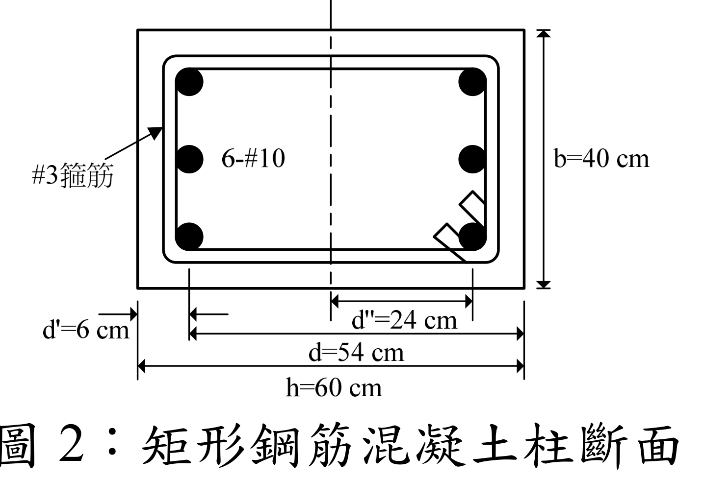

# RC-2011-3 題目正本

> 本檔只記錄**考卷上寫了什麼、圖上畫了什麼**，不含任何解法。解析見同資料夾 `RC-2011-3.md`。
> 判讀清單已經使用者確認（凍結）；本檔原則上不再修改（改動須回考卷原圖並記 log）。

| 項目 | 內容 |
|------|------|
| 考卷 | `raw/exams/RC-2011_鋼筋混凝土設計與預力.pdf` 第 1 頁（正面），第三題 |
| 考年 | 民國 100 年（2011） |
| 配分 | 25 分（㈠15 分、㈡10 分） |
| 附圖 | `RC-2011-3-fig-2.png`（圖 2，500 dpi 重新擷取）；既有 `RC-2011-3-fig-1.png` 解析度較低，保留不刪 |
| 判讀狀態 | **已確認**（2026-11-14 使用者確認；影響答案項目使用者選擇：#1 讀法②（作用標稱軸力 Pn＝0.9Pb）；#4 6-#10 為左右兩排各 3 根（d'＝6、d＝54 cm，無中排）；#2 照草稿判讀定案；轉錄 2026-11-14；PyMuPDF 110 dpi 全頁目視＋抽出文字核對，附圖 500 dpi 放大；盲讀後才比對既有解析） |

## 1. 考卷原文（逐字）

> 三、請針對圖 2 所示之矩形鋼筋混凝土柱斷面，回答下列問題：
> ㈠若此矩形柱斷面之 $f_c'$＝350 kgf/cm²，$f_y$＝4200 kgf/cm²，$A_{st}$＝6-#10，$P_u$＝0.9$P_b$，試求此柱斷面之設計彎矩強度，其中 $P_b$ 為此柱斷面平衡偏心破壞時之標稱軸壓強度，#10 鋼筋之 $A_s$＝8.143 cm²。（15 分）
> ㈡試求此柱斷面之斷面韌性容量 $\mu_\varphi$，$\mu_\varphi$＝$\varphi_u/\varphi_y$，其中 $\varphi_u$ 及 $\varphi_y$ 分別為此柱斷面之極限曲率及降伏曲率（假設載重係數 γ＝1.3）。（10 分）

## 2. 考卷給的公式、附表與參數

- 題文數值：$f'_c=350$、$f_y=4200$ kgf/cm²；6-#10，#10 $A_s=8.143$ cm²；$P_u=0.9P_b$；γ＝1.3；$\mu_\varphi=\varphi_u/\varphi_y$。
- **沒有給**：$E_s$、$\varepsilon_{cu}$、$\beta_1$、強度折減因數 $\phi$、γ＝1.3 用在哪一步、降伏曲率的定義細節。
- 卷首注意事項：㈠可以使用電子計算器。㈡不必抄題，作答時請將試題題號及答案依照順序寫在試卷上，於本試題上作答者，不予計分。㈢本試題之相關符號、公式、物理常數及設計參數未提及時，請依規範自行做合理推斷或假設。

## 3. 附圖

圖面文字照錄：「#3箍筋」「6-#10」「b=40 cm」「d'=6 cm」「d"=24 cm」「d=54 cm」「h=60 cm」「圖 2：矩形鋼筋混凝土柱斷面」。

## 4. 判讀清單

| # | 項目 | 判讀 | 圖上／題文依據 | 把握 |
|---|------|------|---------------|------|
| 1 | $P_u=0.9P_b$ 的意思 | $P_u$ 依㈠題文的用法屬**設計**（因數化）軸力、$P_b$ 為**標稱**平衡軸力。讀法①：$P_u=\phi P_n=0.9P_b$，即 $P_n=0.9P_b/\phi$；讀法②：作用標稱軸力 $P_n=0.9P_b$（命題者把 $P_u$ 當作用軸力的泛稱） | 題文「$P_u$＝0.9$P_b$」「$P_b$…標稱軸壓強度」 | 不確定（影響答案，請確認）；使用者確認 |
| 2 | γ＝1.3 的用途 | 考卷只寫「假設載重係數 γ＝1.3」，未說明用法；可能用於把設計軸力換成使用軸力（$P=P_u/\gamma$）後計算降伏曲率 | 題文㈡括號 | 不確定（解讀）（影響答案，請確認）；使用者確認 |
| 3 | 斷面尺寸 | $h=60$ cm（彎曲方向）、$b=40$ cm | 500 dpi：h=60 cm 尺寸線端點對齊左右外緣；b=40 cm 對齊上下緣 | 確定 |
| 4 | 鋼筋配置 | 左右兩排各 3-#10，$d'=6$ cm、$d=54$ cm（量至鋼筋中心）；$d''=24$ cm＝斷面中心線至一排鋼筋（$30-6$，與 $d'$ 一致） | 尺寸線端點；d" 自中心虛線量至右排 | 確定 |
| 5 | 受壓側 | $d=54$ 自右緣量至左排 → 圖上以右緣為最外壓力纖維；斷面對稱，受壓側不影響結果 | 尺寸線 | 確定 |
| 6 | 柱型式 | #3 箍筋（箍筋柱） | 圖面文字與右下角彎鉤 | 確定 |
| 7 | 「設計彎矩強度」 | $\phi M_n$（對斷面中心＝塑性中心） | 題文 | 確定（解讀） |
| 8 | 考卷沒有給 | $E_s$、$\varepsilon_{cu}$、$\beta_1$、$\phi$ 需依規範自行採用 | 題文 | 確定 |

---

*轉錄：2026-11-14（RC-U1-2 題目正本推廣・批 1）*

*確認：2026-11-14 使用者確認（RC-U1-2 題目正本推廣・批 1，關卡一）*
