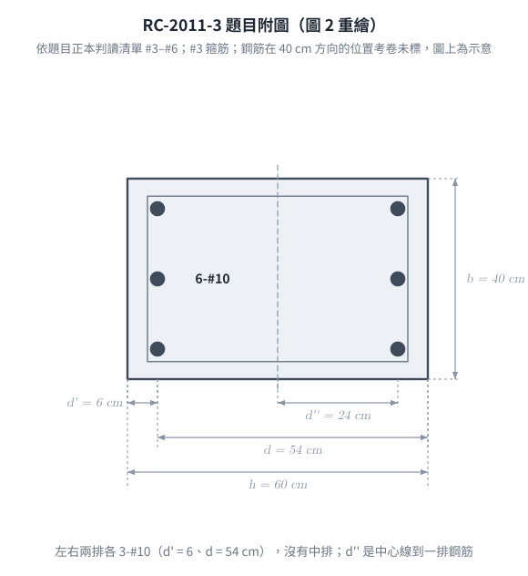
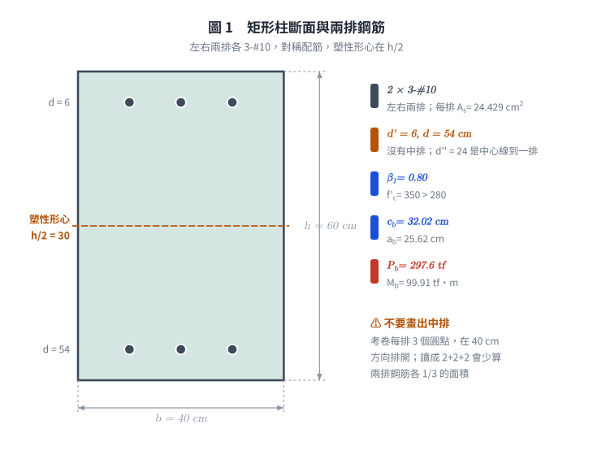
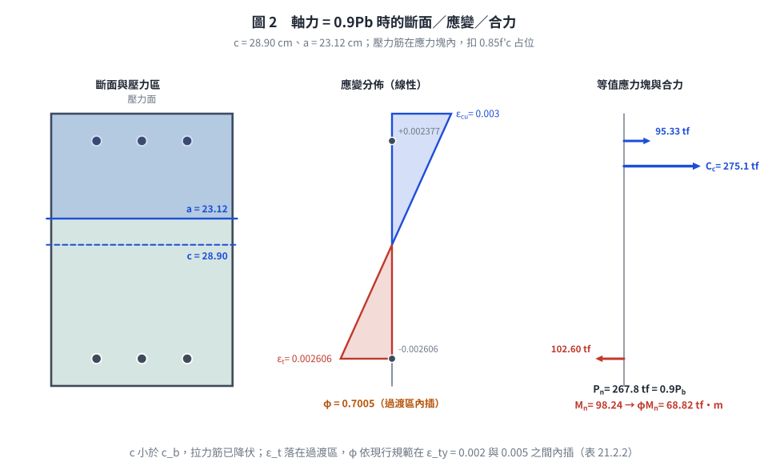
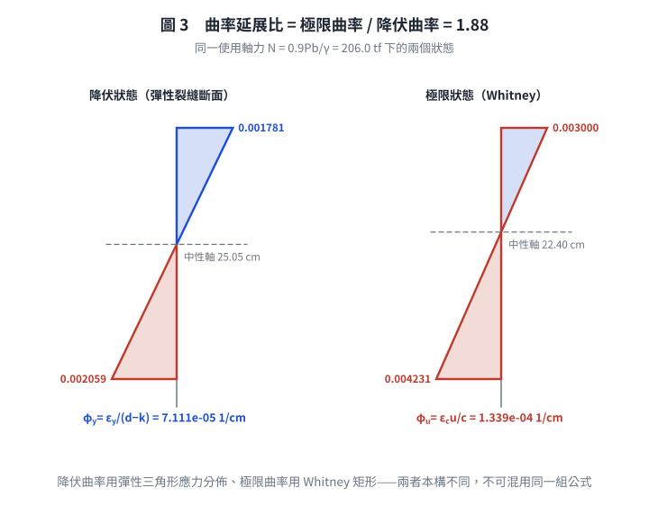

# 考題編號：RC-2011-3

**主分類：** `RC-U1-2` RC 柱強度分析與設計  
**副分類：** 無  
**設計法：** USD 強度設計法  
**標籤：** `矩形柱` `P-M互制` `平衡點` `兩排配筋` `過渡區φ值` `斷面韌性容量` `柱曲率延展比` `彈性中性軸` `載重係數γ`

---

## 1. 題目（考卷原文見題目正本）

> 考卷原文、公式／附表、附圖與判讀清單（已確認）見 [`RC-2011-3-problem.md`](RC-2011-3-problem.md)。本節只列解題時最容易讀錯的地方與本解使用的記號；題意以題目正本為準。

*重繪自考卷附圖，依題目正本判讀清單；攔下把 6-#10 讀成 2+2+2 三排、把 d'' 當成壓力筋到中排距離的錯誤。*

### 常見誤讀

| 項目 | 正確判讀 | 常見誤讀 |
|---|---|---|
| 鋼筋配置 | 左右兩排各 3-#10，$d'=6$、$d=54$ cm，**沒有中排**（判讀 #4） | 讀成 2+2+2 三排，中排在 $h/2=30$ cm |
| $d''=24$ cm | 斷面中心線到一排鋼筋（$30-6$）（判讀 #4） | 當成壓力筋到中排的距離 |
| $P_u=0.9P_b$ | 採讀法②：作用標稱軸力 $P_n=0.9P_b$（判讀 #1，使用者確認；讀法① $\phi P_n=0.9P_b$ 見 §5） | 未說明就混用標稱與設計值 |
| γ＝1.3 | 把設計軸力換成使用軸力 $N=0.9P_b/\gamma$；$\phi_u$、$\phi_y$ 都在 $N$ 下計算（判讀 #2，2026-11-14 使用者定案） | 把 γ 乘在強度上；或 $\phi_u$ 用 $0.9P_b$、$\phi_y$ 用 $N$ |
| φ 過渡區 | 本庫約定（SD420）：$\varepsilon_{ty}$ 至 0.005 內插（0.005 為規範 $\varepsilon_{ty}+0.003$ 對 SD420 的取值） | 以 0.002 為起點內插 |

**本解記號：** $h=60$ cm（彎曲方向）、$b=40$ cm；$A_s=A'_s=3\times8.143=24.43$ cm²，$d'=6$、$d=54$ cm；$P_b$ 為標稱平衡軸力；設計彎矩強度 $\phi M_n$ 對斷面中心取矩。

### 判讀圖解（解析自繪）

*圖 1　矩形柱斷面與兩排鋼筋。考卷每排 3 個圓點沿 40 cm 方向排開，$d''=24$ cm 是中心線到一排鋼筋；讀成 2+2+2 三排會虛構一排中排、兩排各少 1/3 面積（2026-11-14 依題目正本重畫）。*

---

## 2. 考題核心精神與出題者意圖 (Core Concepts & Examiner's Intent)

**核心觀念：** 同一根柱斷面的兩種強度觀：

1. **設計彎矩強度**：在指定軸力（$0.9P_b$）下，以應變相容求中性軸，得 $M_n$，再依最外拉力筋應變 $\varepsilon_t$ 決定 $\phi$
2. **斷面韌性容量**：同一使用軸力下，極限曲率 $\phi_u$（Whitney，$\varepsilon_{cu}=0.003$）與降伏曲率 $\phi_y$（彈性開裂斷面，最外拉力筋初降伏）的比值

**出題者意圖：**
- 測驗平衡點 $P_b$ 的計算（$c_b$ 由 $\varepsilon_{cu}$ 與 $\varepsilon_y$ 決定）
- $P_n<P_b$ → 拉力筋降伏、$\varepsilon_t$ 落在過渡區，$\phi$ 要內插
- 軸力對柱曲率韌性的影響：軸力愈大、$\mu_\varphi$ 愈小
- 載重係數 γ 的用途：把設計（因數化）軸力換回使用軸力

---

## 3. 解題戰略地圖與陷阱分析 (Strategic Roadmap & Trap Analysis)

**作戰計畫：**

| 步驟 | 動作 | 目的 |
|------|------|------|
| ① | $c_b=0.003d/(0.003+\varepsilon_y)$ → $P_b$ | 平衡點標稱軸力 |
| ② | $P_n=0.9P_b$ → 解 $c$（兩層鋼筋皆降伏，線性一次式） | 工作點中性軸 |
| ③ | $\varepsilon_t$ → $\phi$（過渡區內插，SD420 拉力控制界限取 0.005） | 強度折減因數 |
| ④ | 對形心取矩 → $M_n$ → $\phi M_n$ | ㈠答案 |
| ⑤ | $N=0.9P_b/\gamma$ | 使用軸力 |
| ⑥ | 彈性開裂斷面，$\varepsilon_s=\varepsilon_y$ → $k$ → $\phi_y$ | 降伏曲率 |
| ⑦ | Whitney，同一 $N$ → $c^*$ → $\phi_u$ | 極限曲率 |
| ⑧ | $\mu_\varphi=\phi_u/\phi_y$ | ㈡答案 |

**關鍵陷阱：**

| # | 陷阱 | 後果 |
|---|------|------|
| ① | 把 6-#10 讀成 2+2+2 三排 | 兩排鋼筋各少 1/3 面積，$P_b$、$M_n$ 全錯（舊版解析 $\phi M_n$ 少算 17%） |
| ② | $d''=24$ 當成壓力筋到中排 | 虛構出一排中排鋼筋 |
| ③ | 過渡區以 0.002 為起點 | 壓力控制界限是 $\varepsilon_{ty}=f_y/E_s=0.002059$；拉力控制界限本庫對 SD420 取 0.005 |
| ④ | $\phi_u$ 與 $\phi_y$ 用不同軸力 | 同一斷面的韌性容量要在同一軸力下比較；$\phi_u$ 用 $0.9P_b$ 會得 1.46，低估 |
| ⑤ | γ 乘在強度上 | γ 只用來換算使用軸力 |

---

## 3.5 變數層次分析 (Variable Hierarchy Analysis)

> 複習提示：第一次解題後，在每個卡住的知識點旁標記 `⚠`；第二次複習時只看有 `⚠` 的項目。

### 最終目標

㈠ 設計彎矩強度 $\phi M_n$（$P_n=0.9P_b$）　㈡ 斷面韌性容量 $\mu_\varphi=\phi_u/\phi_y$（使用軸力 $N=0.9P_b/\gamma$）

### 本題關鍵公式（依計算順序）

$$\text{Step 1：} c_b = \frac{0.003}{0.003+\varepsilon_y}\,d \;\Rightarrow\; P_b = 0.85f'_c\beta_1\boxed{c_b}\,b + A'_s(f_y-0.85f'_c) - A_sf_y$$

$$\text{Step 2：} 9520\,c + 24.43(4200-297.5) - 24.43\times4200 = 0.9\boxed{P_b} \;\Rightarrow\; c$$

$$\text{Step 3：} \varepsilon_t = 0.003\,\frac{d-\boxed{c}}{\boxed{c}},\quad \phi = 0.65+0.25\,\frac{\varepsilon_t-\varepsilon_{ty}}{0.003}$$

$$\text{Step 4：} M_n = C_c\left(\frac h2-\frac a2\right) + C_s\left(\frac h2-d'\right) + T\left(d-\frac h2\right)$$

$$\text{Step 5（}\phi_y\text{）：} \tfrac12E_c\varepsilon_y b\,k^2 + A'_s(E_s-E_c)\varepsilon_y(k-d') = (N + A_sf_y)(d-k) \;\Rightarrow\; \phi_y = \frac{\varepsilon_y}{d-\boxed{k}}$$

$$\text{Step 6（}\phi_u\text{）：} 9520\,c^* - 7{,}268 = N \;\Rightarrow\; \phi_u = \frac{\varepsilon_{cu}}{\boxed{c^*}}$$

### L1：題目直接給定

| 符號 | 數值 | 說明 |
|------|------|------|
| $f'_c$ | 350 kgf/cm² | |
| $f_y$ | 4200 kgf/cm² | |
| $b$ | 40 cm | 柱寬 |
| $h$ | 60 cm | 彎曲方向深度 |
| $d'$ | 6 cm | 壓力鋼筋層 |
| $d$ | 54 cm | 拉力鋼筋層 |
| 每排面積 | 24.43 cm² | $3\times8.143$ |
| $P_n$ | $0.9P_b$ | 讀法②（關卡一確認） |
| $\gamma$ | 1.3 | 載重係數（㈡用） |

### L2：需知識點推導

| 符號 | 公式／來源 | 卡關? |
|------|-----------|-------|
| $\beta_1$ | $0.85-0.05(350-280)/70=0.80$ | |
| $E_s$、$\varepsilon_y$ | 2.04×10⁶；0.002059 | |
| $c_b$ | $0.5930\times54=32.02$ cm | |
| $P_b$ | 297.6 tf | |
| $c$ | 28.90 cm（一次式） | |
| $\varepsilon_t$ | 0.002606（過渡區） | |
| $\phi$ | 0.697 | |
| $M_n$ | 98.24 tf·m | |
| $N$ | $267.8/1.3=206.0$ tf | |
| $E_c$ | $15000\sqrt{350}=280{,}624$ kgf/cm² | |
| $k$ | 25.05 cm | |
| $\phi_y$ | $7.111\times10^{-5}$ 1/cm | |
| $c^*$ | 22.40 cm | |
| $\phi_u$ | $1.339\times10^{-4}$ 1/cm | |

### L3：深層知識（不懂就卡住）

| 知識點 | 說明 | 卡關? |
|--------|------|-------|
| $P_b$ 是標稱值、$P_u$ 是設計值 | 題文 $P_u=0.9P_b$ 兩個層次混寫；本解採讀法② $P_n=0.9P_b$，讀法①見 §5 | ⚠ |
| φ 過渡區（本庫約定） | 壓力控制 $\varepsilon_t\le\varepsilon_{ty}$、拉力控制 $\varepsilon_t\ge0.005$（SD420） | |
| 韌性容量的軸力 | $\phi_u$ 與 $\phi_y$ 都在使用軸力 $N$ 下（2026-11-14 使用者定案） | ⚠ |
| 彈性 vs Whitney 中性軸 | $\phi_y$ 用彈性三角形分布；$\phi_u$ 用 Whitney 矩形 | |

---

## 4. 步驟化詳細計算過程 (Step-by-Step Detailed Calculation)

### Part (一)：設計彎矩強度 $\phi M_n$

#### Step 1：材料常數

$$\beta_1 = 0.80,\quad \varepsilon_y = 0.002059,\quad A_s=A'_s = 3\times8.143 = 24.43 \text{ cm}^2$$

---

#### Step 2：平衡標稱軸壓強度 $P_b$

$$c_b = \frac{0.003}{0.003+0.002059}\times54 = 32.02 \text{ cm},\quad a_b = 0.80\times32.02 = 25.62 \text{ cm}$$

$$C_c^b = 0.85\times350\times25.62\times40 = 304{,}861 \text{ kgf}$$

壓力鋼筋（$d'=6$ cm，在應力塊內）：
$$\varepsilon'_s = 0.003\times\frac{32.02-6}{32.02} = 0.002438 > \varepsilon_y \Rightarrow C_s^b = 24.43\times(4200-297.5) = 95{,}334 \text{ kgf}$$

拉力鋼筋（平衡時恰降伏）：$T^b = 24.43\times4200 = 102{,}602$ kgf

$$\boxed{P_b = 304{,}861 + 95{,}334 - 102{,}602 = 297{,}594 \text{ kgf} \approx 297.6 \text{ tf}}$$

$$M_b = 304{,}861\times(30-12.81) + 95{,}334\times24 + 102{,}602\times24 = 9{,}991{,}000 \text{ kgf·cm} = 99.91 \text{ tf·m}$$

---

#### Step 3：求 $c$ 使 $P_n = 0.9P_b = 267.8$ tf

$c<c_b$，拉力筋降伏；設壓力筋亦降伏：

$$P_n = \underbrace{9520\,c}_{C_c} + \underbrace{95{,}334}_{C_s} - \underbrace{102{,}602}_{T} = 267{,}834$$

$$\boxed{c = \frac{267{,}834 + 7{,}268}{9520} = 28.90 \text{ cm}},\qquad a = 0.80\times28.90 = 23.12 \text{ cm}$$

驗證：$\varepsilon'_s = 0.003\times(28.90-6)/28.90 = 0.002377 > \varepsilon_y$ ✓（壓力筋降伏）

---

#### Step 4：$\varepsilon_t$ 及 $\phi$ 值

$$\varepsilon_t = 0.003\times\frac{54-28.90}{28.90} = 0.002606$$

$\varepsilon_{ty} = 0.002059 < \varepsilon_t = 0.002606 < 0.005$ → **過渡區**

$$\phi = 0.65 + 0.25\times\frac{0.002606 - 0.002059}{0.005 - 0.002059} = 0.65 + 0.0465 = \boxed{0.697}$$

---

#### Step 5：$M_n$（對形心 $h/2 = 30$ cm 取矩）

| 力 | 大小（kgf） | 位置（cm，自壓力面） | 力臂（cm） | 力矩（kgf·cm） |
|----|------------|---------------------|------------|----------------|
| $C_c$ | 275,102 | $a/2 = 11.56$ | $18.44$ | 5,073,000 |
| $C_s$ | 95,334 | 6 | 24 | 2,288,000 |
| $T$ | 102,602 | 54 | 24 | 2,462,500 |

$$M_n = 5{,}073{,}000 + 2{,}288{,}000 + 2{,}462{,}500 = 9{,}823{,}600 \text{ kgf·cm} = 98.24 \text{ tf·m}$$

$$\boxed{\phi M_n = 0.6965\times98.24 = 68.42 \text{ tf·m}}$$

> 驗算偏心距：$e = M_n/P_n = 98.24/267.8 = 36.7$ cm $> e_b = 99.91/297.6 = 33.6$ cm ✅（$P_n<P_b$ 時偏心大於平衡偏心）

---

### Part (二)：斷面韌性容量 $\mu_\varphi = \phi_u/\phi_y$（$\gamma = 1.3$）

#### Step 6：使用軸力

$$N = \frac{0.9P_b}{\gamma} = \frac{267{,}834}{1.3} = 206{,}026 \text{ kgf} \approx 206.0 \text{ tf}$$

$\phi_u$ 與 $\phi_y$ 都在這個軸力下計算（同一斷面、同一軸力才能比較）。

---

#### Step 7：降伏曲率 $\phi_y$（彈性開裂斷面）

最外拉力筋恰達 $\varepsilon_y$，彈性中性軸深度 $k$；$E_c = 15000\sqrt{350} = 280{,}624$ kgf/cm²，壓力筋扣除被佔據的混凝土：

$$\tfrac12E_c\varepsilon_y b\,k^2 + A'_s(E_s-E_c)\varepsilon_y(k-6) = (N + A_sf_y)(54-k)$$

$$11{,}555\,k^2 + 88{,}488\,(k-6) = 308{,}628\,(54-k)$$

$$\boxed{k = 25.05 \text{ cm}}$$

$$\phi_y = \frac{\varepsilon_y}{d - k} = \frac{0.002059}{54 - 25.05} = 7.111\times10^{-5} \text{ 1/cm}$$

**驗核**：壓力緣 $\varepsilon_c = 7.111\times10^{-5}\times25.05 = 0.00178$；$C_c^y = 250{,}410$、$C_s^y = 58{,}219$、$T = 102{,}602$ kgf → $250{,}410 + 58{,}219 - 102{,}602 = 206{,}027 \approx N$ ✓

---

#### Step 8：極限曲率 $\phi_u$（Whitney，$N = 206.0$ tf）

設兩層鋼筋皆降伏：

$$9520\,c^* + 95{,}334 - 102{,}602 = 206{,}026 \;\Rightarrow\; \boxed{c^* = 22.40 \text{ cm}}$$

驗證：$\varepsilon'_s = 0.003\times(22.40-6)/22.40 = 0.00220 > \varepsilon_y$ ✓；$\varepsilon_t = 0.00423 > \varepsilon_y$ ✓

$$\phi_u = \frac{\varepsilon_{cu}}{c^*} = \frac{0.003}{22.40} = 1.339\times10^{-4} \text{ 1/cm}$$

---

#### Step 9：韌性容量

$$\boxed{\mu_\varphi = \frac{\phi_u}{\phi_y} = \frac{1.339\times10^{-4}}{7.111\times10^{-5}} = 1.88}$$

---

*圖 2　$P_n = 0.9P_b$ 的斷面／應變／合力。$c=28.90<c_b=32.02$，拉力筋已降伏；$\varepsilon_t=0.002606$ 落在過渡區，$\phi$ 在 $\varepsilon_{ty}$ 與 0.005 之間內插。*

*圖 3　曲率延展比的兩個狀態（同一使用軸力 206.0 tf）。左圖用彈性三角形應力分佈求 $\phi_y$、右圖用 Whitney 矩形求 $\phi_u$，兩者本構不同不可混用；中性軸 25.05 → 22.40 cm，極限曲率約為降伏曲率的 1.9 倍。*

## 5. 關鍵爭議點與進階探討 (Critical Issues & Advanced Discussion)

### ① 舊版解析的判讀錯誤（2026-11-14 勘誤）

舊版把 6-#10 讀成 2+2+2 三排（中排在 30 cm，每排 16.286 cm²），得 $P_b=306.3$ tf、$c=29.60$ cm、$\phi=0.685$、$\phi M_n=56.75$ tf·m、$\mu_\varphi=1.70$。題目正本（關卡一確認）為左右兩排各 3 根、沒有中排：$\phi M_n$ 增為 68.42 tf·m（+21%），$\mu_\varphi$ 為 1.88。

### ② 題意歧義：$P_u = 0.9P_b$ 當成標稱還是設計軸力？

原卷：「$P_u$＝$0.9P_b$，試求此柱斷面之**設計彎矩強度**，其中 $P_b$ 為此柱斷面平衡偏心破壞時之**標稱**軸壓強度」。同卷第一題又定義「$P_u$ 及 $M_u$ 分別為柱斷面之**設計**軸力強度及**設計**彎矩強度」。

| 解讀 | 式子 | $c$ (cm) | $\varepsilon_t$ | $\varphi$ | $P_n$ (tf) | $\varphi M_n$ (tf·m) |
|------|------|---------:|-----------------:|----------:|-----------:|---------------------:|
| **讀法②（本解採用，關卡一確認）** | $P_n = 0.9P_b$ | 28.90 | 0.002606 | 0.697 | 267.8 | **68.42** |
| 讀法①（照字面） | $\varphi P_n = 0.9P_b$ | 39.20 | 0.001133 | 0.650 | 412.1 | **58.41** |

讀法① 落在壓力控制區（$\varepsilon_t<\varepsilon_{ty}$），$\varphi$ 直接取 0.65。讀法② 是坊間解答的通行做法，也是 γ＝1.3 能自然用上的讀法（把 0.9Pb 視為設計軸力的層級再除以 γ）。

### ③ ㈡ 為何在使用軸力下比較 $\phi_u$ 與 $\phi_y$

韌性容量是「同一軸力下，斷面從降伏到極限能多轉多少」。若 $\phi_u$ 用 $0.9P_b$、$\phi_y$ 用 $N$，兩個狀態軸力不同，比值失去意義（該做法得 1.46）。本解兩者都在 $N=0.9P_b/\gamma=206.0$ tf 下計算（2026-11-14 使用者定案）。

### ④ 降伏曲率的混凝土模型

彈性模型下壓力緣應變 0.00178、應力 $E_c\varepsilon_c\approx500$ kgf/cm²，已超過 $f'_c=350$，線彈性假設偏離較大。對照：
- 不扣壓力筋位置的混凝土：$\mu_\varphi = 1.90$
- 混凝土改用 Hognestad 拋物線：$\mu_\varphi = 1.80$

考場以彈性開裂斷面為標準做法，答案約 1.8–1.9。

### ⑤ 規範版本

依現行建築物混凝土結構設計規範（2023，對應 ACI 318-19）：壓力控制界限 $\varepsilon_{ty}=f_y/E_s$，拉力控制界限 $\varepsilon_{ty}+0.003$；本庫對 SD420 統一取 0.005（2026-11-14 使用者定案）。若照 $\varepsilon_{ty}+0.003=0.005059$，$\phi=0.696$、$\phi M_n=68.33$ tf·m，差 0.1%。

### ⑥ γ＝1.3 的使用時機

$\gamma=1.3$ 只用於把設計軸力換回使用軸力（$N=P_u/\gamma$），**不能**把 $\phi M_n$ 再除以 γ。

*圖解補繪：2026-08-21（向量圖 3 張，腳本 `figs/gen_RC-2011-3.py`，可重跑；腳本檔尾對 §4 公佈值做 assert）*

*修正日期：2026-11-14（§1 改為指向題目正本，插入重繪附圖 figs/RC-2011-3-fig-1-problem.svg、改寫常見誤讀與本解記號；本行非答案勘誤）*

*修正日期：2026-11-14（解析勘誤：鋼筋由 2+2+2 三排改為左右兩排各 3-#10〔題目正本判讀 #4〕；φ 過渡區改依現行台灣規範（建築物混凝土結構設計規範 2023）；㈡ φu、φy 統一在使用軸力 N＝0.9Pb/γ 下（使用者定案）；$P_b$ 306.3 → 297.6 tf、$\phi M_n$ 56.75 → 68.33 tf·m、$\mu_\varphi$ 1.70 → 1.88；改寫 §2–§5，重畫圖 1–3（gen 腳本對帳 17 項通過）。驗證：Python 重算 MISMATCHES: 0，c 與 c* 以求根與一次式閉合解交叉、k 以求根與二次式閉合解交叉；依 RC-U1-2 批 1 盲解比對）*

*修正日期：2026-11-14（φ 過渡區改回本庫約定：SD420 拉力控制界限取 0.005〔使用者定案〕；φ 0.696 → 0.697、φMn 68.33 → 68.42 tf·m；μφ 不受影響；gen 腳本 phi_of 同步、圖 2 重產。驗證：腳本對帳通過）*
