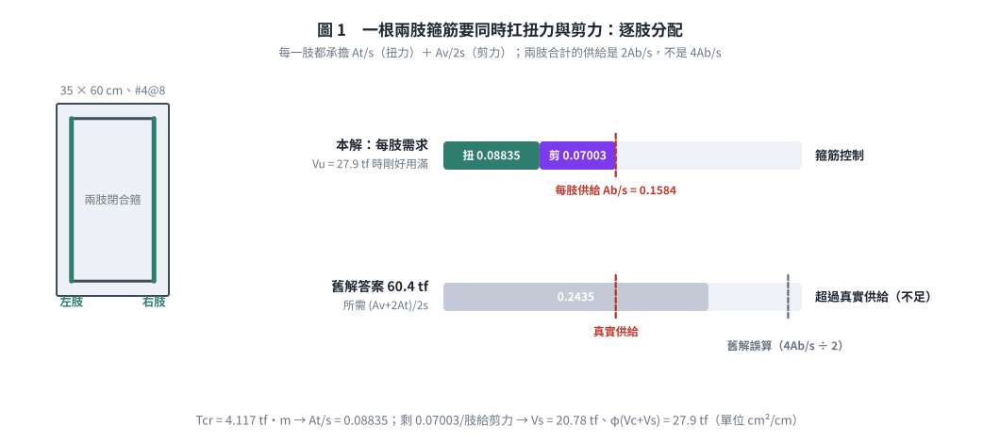

# 考題編號：RC-2011-4

**主分類：** `RC-U2-2` RC 扭力強度設計  
**副分類：** `RC-U2-1` RC 剪力強度分析與設計  
**設計法：** USD 強度設計法  
**標籤：** `矩形梁` `開裂扭矩` `扭矩剪力組合` `斷面適當性檢核` `空間桁架類比` `Aoh計算` `閉合箍筋` `Tu=Tcr條件`

---

## 1. 題目（考卷原文見題目正本）

> 考卷原文、公式／附表、附圖與判讀清單（已確認）見 [`RC-2011-4-problem.md`](RC-2011-4-problem.md)。本節只列解題時最容易讀錯的地方與本解使用的記號；題意以題目正本為準。

### 常見誤讀

| 項目 | 正確判讀 | 常見誤讀 |
|------|---------|---------|
| $T_u=T_{cr}$ | $T_{cr}$ 為標稱開裂扭矩（不乘 $\phi$） | $\phi T_{cr}$ |
| 所求 | 扭矩同時作用下「尚可承受」的最大設計剪力；受箍筋量與斷面尺寸上限兩者控制 | 只檢查其中一項 |
| 淨保護層 | 4 cm 量到箍筋外緣 | 量到縱筋中心 |
| 縱筋 | 考卷沒有給，不在題目範圍 | 自行假設並檢核 |
| $T_{cr}$ 係數 | kgf 制 $1.06\lambda\sqrt{f'_c}A_{cp}^2/p_{cp}$ | SI 制 $\tfrac{1}{3}\sqrt{f'_c}$（MPa）直接代 kgf/cm²，低估 3.19 倍（本庫 2026-11-15 前舊解，$T_{cr}$＝1.29 tf·m） |
| 箍筋共用 | 兩肢箍筋：每肢同時承擔 $A_t/s$ 與 $A_v/2s$，$(A_v+2A_t)/s$ 的供給量是 $2A_b/s$ | 把兩肢算成 $4A_b/s$（重複計算），誤判箍筋充足、答 60.4 tf |

**本解記號：** $A_{cp}$、$p_{cp}$＝全斷面面積與周長；$A_{oh}$、$p_h$＝箍筋中心線圍成面積與周長；$A_t/s$（單肢）、$A_v/s$（兩肢合計）＝扭、剪所需箍筋量。規範：建築物混凝土結構設計規範（內政部 2023 年版），kgf-cm 制，$\phi$＝0.75，$\theta$＝45°。

---

## 2. 考題核心精神與出題者意圖 (Core Concepts & Examiner's Intent)

**核心觀念：** 矩形實心斷面在扭矩與剪力**同時作用**下，受兩個限制：
1. **箍筋能力**：同一組閉合箍筋同時抵抗扭矩與剪力——扭矩先用掉每肢 $A_t/s$，剩下的才能給剪力
2. **斷面適當性**：混凝土斜壓撐不得壓碎，為**上限**

**出題者意圖：**
1. 開裂扭矩 $T_{cr}$ 的計算（注意單位制係數）
2. $A_{oh}$、$p_h$、$A_o$ 的幾何計算
3. 扭剪共用箍筋的分配與斷面適當性，兩者取小

---

## 3. 解題戰略地圖與陷阱分析 (Strategic Roadmap & Trap Analysis)

**作戰計畫：**
1. 求 $A_{cp}$、$p_{cp}$ → $T_{cr}=1.06\sqrt{f'_c}A_{cp}^2/p_{cp}$
2. 求 $A_{oh}$、$p_h$、$A_o$
3. 扭矩所需每肢 $A_t/s$；每肢供給 $A_b/s$；剩餘 × 2 肢 → $A_v/s$ → $V_s$ → $V_u=\phi(V_c+V_s)$
4. 斷面適當性反解 $V_u$
5. 兩者取小

**關鍵陷阱：**

| 陷阱 | 說明 | 應對 |
|------|------|------|
| ❶ SI 係數代 kgf 制 | $T_{cr}=\tfrac13\sqrt{f'_c}A_{cp}^2/p_{cp}$ 是 MPa、mm 制 | kgf/cm² 制係數 $\tfrac13\times3.19=1.06$ |
| ❷ 箍筋重複計算 | 兩肢箍筋的 $(A_v+2A_t)/s$ 供給量是 $2A_b/s$，不是 $4A_b/s$ | 逐肢分配：每肢 $A_b/s \ge A_t/s + A_v/2s$ |
| ❸ $A_{oh}$ 以箍筋中心線圍成 | 各邊扣淨保護層 + 箍筋半徑 | $4+0.635=4.635$ cm |
| ❹ 兩個控制條件 | 箍筋能力與斷面上限各自限制 $V_u$ | 兩個都算，取小 |
| ❺ $\phi = 0.75$ | 剪力與扭力 | — |

---

## 3.5 變數層次分析 (Variable Hierarchy Analysis)

### 最終目標

在 $T_u = T_{cr}$ 已固定之條件下，求此矩形梁斷面尚可承受的最大設計剪力 $V_u$。

### 本題關鍵公式（依計算順序）

$$\text{Step 1：} T_{cr} = 1.06\sqrt{f'_c}\cdot\frac{A_{cp}^2}{p_{cp}}$$

$$\text{Step 2：} A_{oh} = x_{oh}\cdot y_{oh},\quad p_h = 2(x_{oh}+y_{oh}),\quad A_o = 0.85A_{oh}$$

$$\text{Step 3（箍筋）：} \frac{A_t}{s} = \frac{\boxed{T_{cr}}}{2\phi A_o f_{yt}},\quad \frac{A_v}{s} = 2\!\left(\frac{A_b}{s}-\frac{A_t}{s}\right),\quad V_s = \frac{A_v}{s}f_{yt}d,\quad V_{u1} = \phi(V_c+V_s)$$

$$\text{Step 4（斷面）：} \sqrt{\left(\frac{V_{u2}}{b_w d}\right)^2 + \left(\frac{\boxed{T_{cr}}\,\boxed{p_h}}{1.7\,\boxed{A_{oh}}^2}\right)^2} = \phi\!\left(\frac{V_c}{b_w d} + 2.12\sqrt{f'_c}\right)$$

$$\text{Step 5：} V_u = \min(V_{u1},\,V_{u2})$$

### L1：題目直接給定

| 符號 | 數值 | 說明 |
|------|------|------|
| $b_w = b$ | 35 cm | 梁寬 |
| $d$ | 53 cm | 有效深度 |
| $h$ | 60 cm | 全高 |
| $f'_c$ | 280 kgf/cm² | |
| $f_{yt}$ | 2800 kgf/cm² | 箍筋降伏強度 |
| $A_b$（一根#4） | 1.267 cm² | |
| $d_b$（#4） | 1.27 cm | |
| $s$ | 8 cm | 箍筋間距 |
| $cc$ | 4 cm | 淨保護層 |

### L2：需知識點推導

| 符號 | 公式 | 卡關? |
|------|------|-------|
| $A_{cp}$、$p_{cp}$ | $2100$ cm²、$190$ cm | |
| $T_{cr}$ | $1.06\times16.733\times2100^2/190 = 411{,}680$ kgf·cm | ⚠ |
| $x_{oh}$、$y_{oh}$ | $35-9.27=25.73$、$60-9.27=50.73$ cm | |
| $A_{oh}$、$p_h$、$A_o$ | $1305.3$ cm²、$152.92$ cm、$1109.5$ cm² | |
| $A_t/s$ | $411{,}680/(2\times0.75\times1109.5\times2800) = 0.08835$ cm²/cm | |
| 每肢供給 | $1.267/8 = 0.15838$ cm²/cm | |
| $A_v/s$ | $2(0.15838-0.08835) = 0.14006$ cm²/cm | ⚠ |
| $V_s$、$V_c$ | $20{,}785$、$16{,}452$ kgf | |
| $V_{u1}$ | $0.75(16{,}452+20{,}785) = 27{,}928$ kgf | |
| $\tau_t$ | $411{,}680\times152.92/(1.7\times1305.3^2) = 21.74$ kgf/cm² | |
| $V_{u2}$ | $1855\sqrt{33.26^2-21.74^2} = 46{,}693$ kgf | |

### L3：深層知識（不懂就卡住）

| 知識點 | 說明 | 卡關? |
|--------|------|-------|
| $T_{cr}$ 的來源 | 薄壁管：剪力流 $q=T/2A_o$，取 $A_o\approx\tfrac23A_{cp}$、壁厚 $\tfrac34A_{cp}/p_{cp}$，主拉應力達 $\approx1.06\sqrt{f'_c}$（kgf/cm²）時開裂 | |
| 係數換算 | MPa → kgf/cm²：$\sqrt{f'_c}$ 項乘 $\sqrt{10.197}=3.19$；$\tfrac13\to1.06$、$\tfrac1{12}\to0.27$、$0.66\to2.12$ | ⚠ |
| 扭剪共用箍筋 | 扭力箍筋只計外圍閉合箍的**單肢**；剪力計所有肢；兩者疊加在同一肢上 | ⚠ |
| 斷面適當性 | 斜壓撐壓碎的絕對上限，箍筋再多也無法突破 | |

---

## 4. 步驟化詳細計算過程 (Step-by-Step Detailed Calculation)

### Step 1：開裂扭矩 $T_{cr}$

$$A_{cp} = 35\times60 = 2100 \text{ cm}^2,\qquad p_{cp} = 2(35+60) = 190 \text{ cm}$$

$$T_{cr} = 1.06\sqrt{f'_c}\,\frac{A_{cp}^2}{p_{cp}} = 1.06\times16.733\times\frac{4{,}410{,}000}{190} = 17.737\times23{,}210.5 = \boxed{411{,}680 \text{ kgf·cm} = 4.117\ \text{tf·m}}$$

$T_u = T_{cr}$ 遠大於 $\phi T_{th} = \phi T_{cr}/4 = 0.77$ tf·m → 須做扭力設計。

### Step 2：箍筋中心線幾何

$$x_{oh} = 35 - 2(4+0.635) = 25.73 \text{ cm},\qquad y_{oh} = 60 - 9.27 = 50.73 \text{ cm}$$

$$\boxed{A_{oh} = 25.73\times50.73 = 1305.3 \text{ cm}^2},\qquad p_h = 2(25.73+50.73) = 152.92 \text{ cm},\qquad A_o = 0.85\times1305.3 = 1109.5 \text{ cm}^2$$

### Step 3：箍筋控制的 $V_u$

扭矩所需（每肢）：
$$\frac{A_t}{s} = \frac{T_u}{2\phi A_o f_{yt}\cot\theta} = \frac{411{,}680}{2\times0.75\times1109.5\times2800} = \frac{411{,}680}{4{,}659{,}900} = 0.08835 \text{ cm}^2/\text{cm}$$

每肢供給 $A_b/s = 1.267/8 = 0.15838$ cm²/cm；剩餘給剪力（兩肢）：
$$\frac{A_v}{s} = 2\times(0.15838 - 0.08835) = 0.14006 \text{ cm}^2/\text{cm}$$

$$V_s = \frac{A_v}{s}f_{yt}d = 0.14006\times2800\times53 = 20{,}785 \text{ kgf}\quad(\le 2.12\sqrt{f'_c}b_wd = 65{,}800\ ✓)$$

$$V_c = 0.53\sqrt{280}\times35\times53 = 16{,}452 \text{ kgf}$$

$$V_{u1} = \phi(V_c+V_s) = 0.75\times(16{,}452+20{,}785) = \boxed{27{,}928 \text{ kgf} = 27.9\ \text{tf}}$$

*圖 1　兩肢閉合箍筋的逐肢分配。本圖攔下的錯：把兩肢箍筋的 $(A_v+2A_t)/s$ 供給算成 $4A_b/s$（同一肢重複計算），誤判箍筋足夠。*

### Step 4：斷面適當性控制的 $V_u$

$$\tau_t = \frac{T_{cr}\,p_h}{1.7A_{oh}^2} = \frac{411{,}680\times152.92}{1.7\times1305.3^2} = \frac{62{,}954{,}000}{2{,}896{,}500} = 21.74 \text{ kgf/cm}^2$$

$$\phi\!\left(\frac{V_c}{b_wd} + 2.12\sqrt{f'_c}\right) = 0.75\times(8.87+35.47) = 33.26 \text{ kgf/cm}^2$$

$$\frac{V_{u2}}{b_wd} = \sqrt{33.26^2 - 21.74^2} = \sqrt{1106.2-472.6} = 25.17 \text{ kgf/cm}^2 \Rightarrow V_{u2} = 25.17\times1855 = 46{,}693 \text{ kgf}$$

### Step 5：控制條件

$$V_u = \min(27.9,\ 46.7) = \boxed{27.9\ \text{tf}}\quad（\text{箍筋控制}）$$

間距檢核：$s=8 \le \min(p_h/8=19.1,\ 30)$；$\le d/2 = 26.5$ ✓；最少箍筋 $2A_b/s = 0.317 \ge 3.5b_w/f_{yt} = 0.044$ ✓。

---

## 5. 關鍵爭議點與進階探討 (Critical Issues & Advanced Discussion)

**① 舊解的兩個錯誤**

| 項目 | 舊解（2026-11-15 前） | 正確 |
|------|------|------|
| $T_{cr}$ | $\tfrac13\sqrt{f'_c}A_{cp}^2/p_{cp}$＝129,444 kgf·cm（SI 係數直接代 kgf 制） | $1.06\sqrt{f'_c}A_{cp}^2/p_{cp}$＝411,680 kgf·cm |
| 箍筋檢核 | $(A_v+2A_t)/s$ 供給量算成 $4A_b/s$＝0.634 → 判箍筋充足，答案由斷面上限 60.4 tf 控制 | 兩肢箍筋供給 $2A_b/s$＝0.317；即使用舊解的 $T_{cr}$，60.4 tf 需要 $(A_v+2A_t)/s$＝0.487 > 0.317，不成立 |

**② 為何箍筋才是控制條件？**

$T_u=T_{cr}$ 已用掉每肢供給量的 56%（0.0884/0.1584），剩下給剪力的 $V_s$ 只有 20.8 tf。斷面上限 46.7 tf 要到箍筋約 #4@5 cm 才會控制。

**③ $2.12\sqrt{f'_c}$（kgf/cm² 系統）的來源**

| 單位系統 | 公式 | f'c=280 kgf/cm² 時 |
|----------|------|---------------------|
| SI（MPa） | $0.66\sqrt{f'_c\text{[MPa]}}$ | $0.66\times\sqrt{27.46} = 3.46$ MPa $= 35.3$ kgf/cm² |
| 美制（psi） | $8\sqrt{f'_c\text{[psi]}}$ | $8\times\sqrt{3984} = 505$ psi $= 35.5$ kgf/cm² |
| 台灣（kgf/cm²） | $2.12\sqrt{f'_c\text{[kgf/cm²]}}$ | $2.12\times16.73 = 35.5$ kgf/cm² |

同理 $T_{cr}$：SI $\tfrac13\sqrt{f'_c}$ ＝ 英制 $4\sqrt{f'_c}$ ＝ kgf 制 $1.06\sqrt{f'_c}$。

**④ 考試當年規範（$\phi$＝0.85）對照**

若扭剪 $\phi$ 取 0.85：$A_t/s$＝0.07795、$V_s$＝23.87 tf，$V_u = 0.85\times(16.45+23.87) = 34.3$ tf。

**⑤ 考場速解提示**

$T_{cr}$ → $A_o$ → 每肢扭力需求 → 剩餘給剪力 → $\phi(V_c+V_s)$；再用斷面上限圓方程 $\tau_v^2+\tau_t^2\le R^2$ 驗算，取小。

*修正日期：2026-11-15（§1 改為指向題目正本；舊 §1 重述改寫為常見誤讀與本解記號；本行非答案勘誤）*

*修正日期：2026-11-15（解析勘誤：Tcr 係數由 SI 制 √f'c/3 改為 kgf 制 1.06√f'c（現行台灣規範，建築物混凝土結構設計規範 2023 年版），Tcr 1.29 → 4.12 tf·m；箍筋檢核改為逐肢分配（原把兩肢算成 4Ab/s 重複計算）；控制條件由斷面上限改為箍筋，Vu 60.4 → 27.9 tf；驗證：盲解比對 + 勘誤腳本重算 MISMATCHES: 0）*

*修正日期：2026-11-15（圖解補繪（非勘誤）：新增 figs/RC-2011-4-fig-1-legs.svg，腳本 figs/gen_RC-2011-4.py，可重跑；答案不變）*
