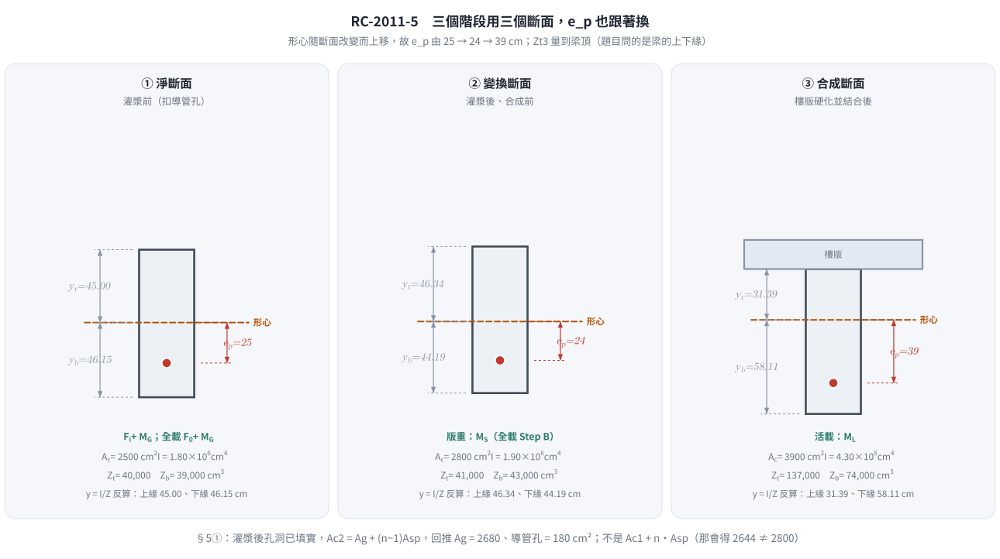
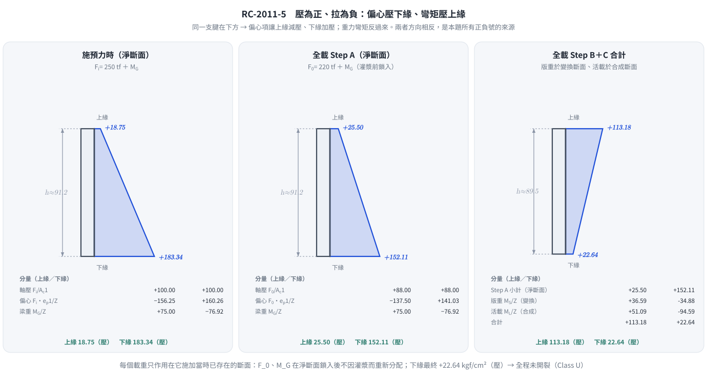
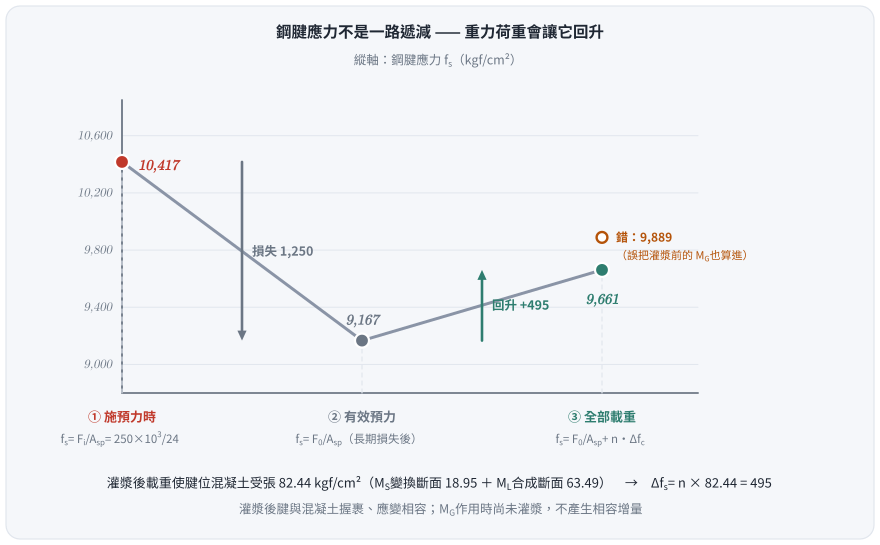

# 考題編號：RC-2011-5

**主分類：** `RC-U4-1` 預力梁斷面應力分析  
**副分類：** 無  
**設計法：** WSD 工作應力設計法  
**標籤：** `後拉法` `有黏結腱` `合成斷面` `三斷面分析` `淨斷面` `變換斷面` `鋼腱應力` `上下緣應力` `施預力階段` `全載重階段` `n值相容性`

---

## 1. 題目（考卷原文見題目正本）

> 考卷原文、公式／附表、附圖與判讀清單（已確認）見 [`RC-2011-5-problem.md`](RC-2011-5-problem.md)。本節只列解題時最容易讀錯的地方與本解使用的記號；題意以題目正本為準。

### 常見誤讀

| 項目 | 正確判讀 | 常見誤讀 |
|------|---------|---------|
| 三組斷面的使用時機（#1） | 施預力時用淨斷面；版重（合成前）用變換斷面（梁單獨）；活載重用合成斷面 | 整題只用一組 $Z$ |
| 施預力時（#2） | $F_i$＋梁重 $M_G$ | 加入版重 |
| 全部載重（#3） | $F_0$＋$M_G$＋$M_S$＋$M_L$；$F_0$、$M_G$ 仍在**淨斷面**（灌漿前鎖入），$M_S$ 用變換、$M_L$ 用合成 | 漏 $M_G$ 或 $M_S$；或全載時把 $F_0+M_G$ 改放到變換斷面重算 |
| 全載鋼腱應力 | 只計灌漿後施加的 $M_S$、$M_L$ 造成的相容增量 | 把灌漿前已作用的 $M_G$ 也算進 $n\,\Delta\sigma_c$ |
| 合成斷面 $Z_{t3}$（#4） | 指合成形心至**梁頂**的斷面模數（題目問梁的上下緣） | 當成版頂 |

**本解記號：** $n=E_p/E_c=6$；$A_{sp}=24$ cm²；三組斷面性質照考卷數值（題目正本 §2 表），不另行重算。本題為純分析題，考卷未給容許應力、不含驗算。

---

## 2. 考題核心精神與出題者意圖 (Core Concepts & Examiner's Intent)

**核心觀念：**
- 後拉法複合（合成）斷面預力梁，荷重分三階段施加，各階段用不同斷面：
  1. **灌漿前**：淨斷面 → 施預力時 $F_i + M_G$；全載時預力降為 $F_0$，仍作用在淨斷面（$F_0 + M_G$）
  2. **灌漿後、合成前**：變換斷面 → 版重 $M_S$
  3. **合成後**：合成斷面 → $M_L$
  - 每個載重只作用在它施加當時已存在的斷面；已鎖入的應力不會因為斷面改變而重新分配

- **鋼腱應力計算**：後拉法鋼腱灌漿後才與混凝土握裹，鋼腱應力 = 基礎值（$F_0/A_{sp}$）+ $n \times$ **灌漿後**載重（$M_S$、$M_L$）在腱位造成的混凝土應力變化

**出題者意圖：**
1. 測驗三種斷面的正確使用時機
2. 測驗預力梁彈性應力疊加（壓正拉負）的符號判斷
3. 測驗鋼腱相容性公式求腱應力（不能直接用 $F/A_{sp}$）

---

## 3. 解題戰略地圖與陷阱分析 (Strategic Roadmap & Trap Analysis)

**作戰計畫：**
1. **施預力時**：用淨斷面 + $F_i$ + $M_G$ → 算 fc_top、fc_bot；腱應力 = $F_i/A_{sp}$
2. **全部載重時**：
   - Step A：淨斷面，$F_0 + M_G$（灌漿前鎖入）
   - Step B：變換斷面，$M_S$
   - Step C：合成斷面，$M_L$
   - 疊加：fc_top_total、fc_bot_total
   - 腱應力：$F_0/A_{sp}$ + $n \times$（$M_S$、$M_L$ 在腱位的混凝土應力變化）

**關鍵陷阱：**

| 陷阱 | 說明 | 應對 |
|------|------|------|
| ❶ 施預力用淨斷面，非全截面 | 後拉法灌漿前，導管孔洞需扣除 | 用 $A_{c1}$, $Z_{t1}$, $Z_{b1}$, $I_1$, $e_{p1}$ |
| ❷ 三個偏心距不同 | $e_{p1}=25$（淨）, $e_{p2}=24$（變換）, $e_{p3}=39$（合成） | 各階段用對應 $e_p$ |
| ❸ 腱應力≠單純 $F/A_{sp}$ | 全載重下腱應力 = $F_0/A_{sp}$ + 灌漿後載重（$M_S$、$M_L$）引起之相容應力；$M_G$ 灌漿前已作用，不計 | 用 $n \times \Delta\sigma_c$ 修正 |
| ❹ 各載重只用施加當時的斷面 | $F_0$、$M_G$ 在淨斷面（灌漿前）、$M_S$ 在變換斷面、$M_L$ 在合成斷面；全載時不可把 $F_0+M_G$ 改放到變換斷面重算 | 分清楚各載重的「時間點」 |
| ❻ 鋼腱相容增量的起算點 | $M_G$ 作用時尚未灌漿，鋼腱與混凝土無握裹 | 增量只計 $M_S$、$M_L$ |
| ❺ 偏心引起的上下緣應力符號 | 偏心在下 → 上緣拉（負）、下緣壓（正）；重力 → 上緣壓（正）、下緣拉（負） | 逐項判斷，不要記符號，要用物理直覺 |

---

## 3.5 變數層次分析 (Variable Hierarchy Analysis)

### 最終目標

求梁在**施預力時**（$F_i$, $M_G$, 淨斷面）和**全部載重時**（$F_0 + M_G$ 在淨斷面、$M_S$ 在變換斷面、$M_L$ 在合成斷面）的上下緣混凝土應力及鋼腱應力。

### 本題關鍵公式（依計算順序）

$$\text{施預力 — 上緣：} f_{c,top}^{(1)} = \frac{F_i}{A_{c1}} - \frac{F_i e_{p1}}{Z_{t1}} + \frac{M_G}{Z_{t1}}$$

$$\text{施預力 — 下緣：} f_{c,bot}^{(1)} = \frac{F_i}{A_{c1}} + \frac{F_i e_{p1}}{Z_{b1}} - \frac{M_G}{Z_{b1}}$$

$$\text{施預力 — 腱應力：} f_{s}^{(1)} = \frac{F_i}{A_{sp}}$$

$$\text{全載 Step A（淨斷面）— 上緣：} f_A^{top} = \frac{F_0}{A_{c1}} - \frac{F_0 e_{p1}}{Z_{t1}} + \frac{M_G}{Z_{t1}}$$

$$\text{全載 Step A（淨斷面）— 下緣：} f_A^{bot} = \frac{F_0}{A_{c1}} + \frac{F_0 e_{p1}}{Z_{b1}} - \frac{M_G}{Z_{b1}}$$

$$\text{全載 Step B（變換斷面）：} f_B^{top} = +\frac{M_S}{Z_{t2}},\quad f_B^{bot} = -\frac{M_S}{Z_{b2}}$$

$$\text{全載 Step C（合成斷面）：} f_C^{top} = +\frac{M_L}{Z_{t3}},\quad f_C^{bot} = -\frac{M_L}{Z_{b3}}$$

$$\text{腱位混凝土應力（灌漿後載重）：} \sigma_{c,p} = -\frac{M_S\,e_{p2}}{I_2} - \frac{M_L\,e_{p3}}{I_3}$$

$$\text{全載 — 腱應力：} f_s^{(2)} = \frac{F_0}{A_{sp}} + n \left|\sigma_{c,p}\right|$$

### L1：題目直接給定

| 符號 | 數值 | 說明 |
|------|------|------|
| $F_i$ | 250 tf | 起始預力 |
| $F_0$ | 220 tf | 有效預力（含所有損失） |
| $M_G$ | 3,000,000 kgf·cm | 梁重 |
| $M_S$ | 1,500,000 kgf·cm | 版重 |
| $M_L$ | 7,000,000 kgf·cm | 活載重 |
| $n$ | 6 | $E_p/E_c$ |
| $A_{sp}$ | 24 cm² | 鋼腱面積 |
| 三組斷面性質 | 詳見題目 | 淨/變換/合成 |

### L2：需知識點推導

**▌ 施預力時（淨斷面）**

| 符號 | 計算 | 卡關? |
|------|------|-------|
| $F_i/A_{c1}$ | $250{,}000/2500 = 100$ kgf/cm² | |
| $F_i e_{p1}/Z_{t1}$ | $250{,}000\times25/40{,}000 = 156.25$ kgf/cm² | |
| $F_i e_{p1}/Z_{b1}$ | $250{,}000\times25/39{,}000 = 160.26$ kgf/cm² | |
| $M_G/Z_{t1}$ | $3{,}000{,}000/40{,}000 = 75$ kgf/cm² | |
| $M_G/Z_{b1}$ | $3{,}000{,}000/39{,}000 = 76.92$ kgf/cm² | |

**▌ 全載 Step A（淨斷面，$F_0+M_G$）**

| 符號 | 計算 | 卡關? |
|------|------|-------|
| $F_0/A_{c1}$ | $220{,}000/2500 = 88.00$ kgf/cm² | |
| $F_0 e_{p1}/Z_{t1}$ | $220{,}000\times25/40{,}000 = 137.50$ kgf/cm² | |
| $F_0 e_{p1}/Z_{b1}$ | $220{,}000\times25/39{,}000 = 141.03$ kgf/cm² | |
| $M_G/Z_{t1}$、$M_G/Z_{b1}$ | 75.00、76.92 kgf/cm² | |

**▌ 全載 Step B（變換斷面，$M_S$）**

| 符號 | 計算 | 卡關? |
|------|------|-------|
| $M_S/Z_{t2}$ | $1{,}500{,}000/41{,}000 = 36.59$ kgf/cm² | |
| $M_S/Z_{b2}$ | $1{,}500{,}000/43{,}000 = 34.88$ kgf/cm² | |

**▌ 全載 Step C（合成斷面，$M_L$）**

| 符號 | 計算 | 卡關? |
|------|------|-------|
| $M_L/Z_{t3}$ | $7{,}000{,}000/137{,}000 = 51.09$ kgf/cm² | |
| $M_L/Z_{b3}$ | $7{,}000{,}000/74{,}000 = 94.59$ kgf/cm² | |

**▌ 腱應力（全載時）**

| 符號 | 計算 | 卡關? |
|------|------|-------|
| $F_0/A_{sp}$ | $220{,}000/24 = 9{,}167$ kgf/cm² | |
| $M_S e_{p2}/I_2$ | $1{,}500{,}000\times24/1{,}900{,}000 = 18.95$ kgf/cm²（張） | |
| $M_L e_{p3}/I_3$ | $7{,}000{,}000\times39/4{,}300{,}000 = 63.49$ kgf/cm²（張） | |
| $\sigma_{c,p}$ | $-(18.95+63.49) = -82.44$ kgf/cm²（張） | |
| $\Delta f_s$ | $n\times82.44 = 6\times82.44 = 495$ kgf/cm² | |
| $f_s^{(2)}$ | $9{,}167 + 495 = 9{,}661$ kgf/cm² | |

### L3：深層知識（不懂就卡住）

| 知識點 | 說明 | 卡關? |
|--------|------|-------|
| 後拉法三斷面的使用時機 | 淨斷面（灌漿前）→ 變換斷面（灌漿後）→ 合成斷面（含版） | |
| 腱應力計算：不是 $F/A_{sp}$，是相容性 | 灌漿後的載重使腱位混凝土張力增大 → 混凝土拉伸 → 腱也拉伸 → 腱拉力增加；灌漿前的 $M_G$ 不產生相容增量 | |
| 已鎖入的應力不重新分配 | 斷面在灌漿、合成時改變，但之前施加的 $F_0$、$M_G$ 造成的應力已存在，後續只疊加新載重在新斷面上的應力 | |
| 三個偏心距代表不同斷面的幾何 | $e_{p1}$ = 距淨斷面形心；$e_{p2}$ = 距變換斷面形心；$e_{p3}$ = 距合成斷面形心 | |
| 壓力正、拉力負的符號規則 | 軸壓 → 正；偏心→上緣張（負）、下緣壓（正）；重力→上緣壓（正）、下緣張（負） | |

---

## 4. 步驟化詳細計算過程 (Step-by-Step Detailed Calculation)

> **符號規定：壓力 = 正，拉力 = 負**  
> 單位：kgf·cm（力矩），kgf/cm²（應力）

*圖 1　三個階段各用哪一組斷面性質。同一支梁在施拉、灌漿後、樓版合成後是三個不同的斷面——這張圖攔的是「整題只用一組 $Z$ 值」這個最常見的失分點：$Z_{b}$ 從 39,000 一路長到 74,000，用錯一組，下緣應力可以差到一倍。*

---

### 施預力時（Initial Prestress Stage）

**使用淨斷面**（$A_{c1}$, $Z_{t1}$, $Z_{b1}$, $I_1$, $e_{p1}$）

作用載重：$F_i = 250{,}000$ kgf + $M_G = 3{,}000{,}000$ kgf·cm

---

#### ① 混凝土上緣應力

$$f_{c,top}^{(1)} = \underbrace{\frac{F_i}{A_{c1}}}_{\text{軸壓}} - \underbrace{\frac{F_i\,e_{p1}}{Z_{t1}}}_{\text{偏心→上緣張}} + \underbrace{\frac{M_G}{Z_{t1}}}_{\text{重力→上緣壓}}$$

$$= \frac{250{,}000}{2500} - \frac{250{,}000\times25}{40{,}000} + \frac{3{,}000{,}000}{40{,}000}$$

$$= 100 - 156.25 + 75 = \boxed{18.75 \text{ kgf/cm}^2 \text{（壓）}}$$

---

#### ② 混凝土下緣應力

$$f_{c,bot}^{(1)} = \frac{F_i}{A_{c1}} + \frac{F_i\,e_{p1}}{Z_{b1}} - \frac{M_G}{Z_{b1}}$$

$$= 100 + \frac{250{,}000\times25}{39{,}000} - \frac{3{,}000{,}000}{39{,}000}$$

$$= 100 + 160.26 - 76.92 = \boxed{183.34 \text{ kgf/cm}^2 \text{（壓）}}$$

---

#### ③ 鋼腱應力（施預力時）

後拉法施拉時，腱應力由千斤頂直接決定：

$$\boxed{f_s^{(1)} = \frac{F_i}{A_{sp}} = \frac{250{,}000}{24} = 10{,}417 \text{ kgf/cm}^2 \text{（拉）}}$$

---

### 全部載重作用時（Full Loading Stage）

需三步疊加：**Step A**（有效預力＋梁重，淨斷面）＋ **Step B**（版重，變換斷面）＋ **Step C**（活載，合成斷面）。
每個載重只作用在它施加當時已存在的斷面；$F_0$、$M_G$ 在灌漿前已作用於淨斷面，灌漿與合成之後這部分應力不會重新分配。

---

#### Step A：淨斷面，$F_0 + M_G$

**上緣：**
$$f_A^{top} = \frac{F_0}{A_{c1}} - \frac{F_0\,e_{p1}}{Z_{t1}} + \frac{M_G}{Z_{t1}} = 88.00 - 137.50 + 75.00 = +25.50 \text{ kgf/cm}^2$$

**下緣：**
$$f_A^{bot} = \frac{F_0}{A_{c1}} + \frac{F_0\,e_{p1}}{Z_{b1}} - \frac{M_G}{Z_{b1}} = 88.00 + 141.03 - 76.92 = +152.11 \text{ kgf/cm}^2$$

---

#### Step B：變換斷面，$M_S$（灌漿後、合成前）

$$f_B^{top} = +\frac{M_S}{Z_{t2}} = +\frac{1{,}500{,}000}{41{,}000} = +36.59 \text{ kgf/cm}^2,\qquad f_B^{bot} = -\frac{M_S}{Z_{b2}} = -\frac{1{,}500{,}000}{43{,}000} = -34.88 \text{ kgf/cm}^2$$

---

#### Step C：合成斷面，$M_L$（僅活載重）

$$f_C^{top} = +\frac{M_L}{Z_{t3}} = +\frac{7{,}000{,}000}{137{,}000} = +51.09 \text{ kgf/cm}^2,\qquad f_C^{bot} = -\frac{M_L}{Z_{b3}} = -\frac{7{,}000{,}000}{74{,}000} = -94.59 \text{ kgf/cm}^2$$

---

#### 全部載重時合計混凝土應力

$$\boxed{f_{c,top}^{(2)} = 25.50 + 36.59 + 51.09 = 113.18 \text{ kgf/cm}^2 \text{（壓）}}$$

$$\boxed{f_{c,bot}^{(2)} = 152.11 - 34.88 - 94.59 = 22.64 \text{ kgf/cm}^2 \text{（壓）}}$$

*圖 2　應力沿三個斷面逐段疊加。偏心項在上緣是張、在下緣是壓，重力項則相反；$F_0$、$M_G$ 留在淨斷面，不因灌漿而改用變換斷面重算——這張圖攔兩件事：偏心項正負號寫反，以及把已鎖入的應力搬到新斷面重算（那樣下緣會算成 2.12，差一個數量級）。*

---

#### 全部載重時鋼腱應力（相容性法）

有黏結後拉法**灌漿後**，腱與混凝土相容。灌漿後施加的 $M_S$、$M_L$ 使腱位混凝土**受張**，腱隨之**拉伸**，腱應力增加；$M_G$ 在施拉當下已作用、當時導管尚未灌漿，不產生相容增量。

**基礎腱應力（有效預力）：**
$$f_{s,base} = \frac{F_0}{A_{sp}} = \frac{220{,}000}{24} = 9{,}167 \text{ kgf/cm}^2$$

**腱位混凝土因灌漿後載重產生之張力：**

變換斷面（$M_S$，$e_{p2} = 24$ cm）：
$$\sigma_{c,p}^{S} = -\frac{M_S\,e_{p2}}{I_2} = -\frac{1{,}500{,}000\times24}{1{,}900{,}000} = -18.95 \text{ kgf/cm}^2 \text{（張）}$$

合成斷面（$M_L$，$e_{p3} = 39$ cm）：
$$\sigma_{c,p}^{L} = -\frac{M_L\,e_{p3}}{I_3} = -\frac{7{,}000{,}000\times39}{4{,}300{,}000} = -63.49 \text{ kgf/cm}^2 \text{（張）}$$

合計：$\sigma_{c,p} = -18.95 + (-63.49) = -82.44$ kgf/cm²（張）

$$\Delta f_s = n \times \left|\sigma_{c,p}\right| = 6 \times 82.44 = +495 \text{ kgf/cm}^2$$

$$\boxed{f_s^{(2)} = f_{s,base} + \Delta f_s = 9{,}167 + 495 = 9{,}661 \text{ kgf/cm}^2 \text{（拉）}}$$

*圖 3　腱應力不是單調下降的。$10{,}417 \to 9{,}167$ 是預力損失，$9{,}167 \to 9{,}661$ 是灌漿後載重使腱位混凝土受張、腱跟著拉長——這張圖攔兩個錯：「加載後腱應力一定更低」，以及把灌漿前的 $M_G$ 也算進相容增量（得 9,889）。*

---

### 彙整成果表

| 時間點 | 上緣 $f_c$ | 下緣 $f_c$ | 鋼腱 $f_s$ |
|--------|-----------|-----------|-----------|
| **施預力時**（$F_i + M_G$，淨斷面） | 18.75 kgf/cm²（壓） | 183.34 kgf/cm²（壓） | 10,417 kgf/cm²（拉） |
| **全部載重時**（$F_0+M_G$ 淨、$M_S$ 變換、$M_L$ 合成，疊加） | 113.18 kgf/cm²（壓） | 22.64 kgf/cm²（壓） | 9,661 kgf/cm²（拉） |

---

## 5. 關鍵爭議點與進階探討 (Critical Issues & Advanced Discussion)

**① 三種斷面的使用邏輯**

| 斷面 | 組成 | 使用時機 |
|------|------|---------|
| 淨斷面（$A_{c1}=2500$） | 全斷面混凝土 − 導管孔 | 後拉法施拉時（灌漿前） |
| 變換斷面（$A_{c2}=2800$） | **全斷面混凝土**（孔已灌漿填實）＋ $(n-1)A_{sp}$ | 灌漿後，合成前（版重 $M_S$ 作用） |
| 合成斷面（$A_{c3}=3900$） | 梁變換斷面 ＋ 轉換樓版 | 版澆置並達強度後（活載作用） |

> ⚠ **勘誤（2026-08-22）：** 舊版本頁寫「$A_{c2} = A_{c1} + n\,A_{sp}$」，代入即 $2500 + 6\times24 = 2644 \ne 2800$，**與題給數字矛盾**。
> 正確關係是 $A_{c2} = A_g + (n-1)A_{sp}$，其中 $A_g$ 為**含導管孔在內**的全斷面積：
> $A_g = A_{c2} - (n-1)A_{sp} = 2800 - 5\times24 = 2680$ cm²，回推導管孔面積 $= 2680 - 2500 = 180$ cm²（合理）。
> 兩個要點：① 灌漿後孔洞已被漿體填實，**要把孔加回來**；② 轉換鋼腱只加 $(n-1)A_{sp}$，
> 因為鋼腱佔的那塊混凝土已經算過一次，不能重複計入（$nA_{sp}$ 是先拉法「不扣佔位」時的錯誤寫法）。

**② 腱應力的物理直覺**

| 狀態 | 腱應力 | 原因 |
|------|--------|------|
| 施拉時 $f_s = F_i/A_{sp}$ | 10,417 kgf/cm² | 千斤頂直接拉伸 |
| 有效預力 $f_{s,0} = F_0/A_{sp}$ | 9,167 kgf/cm² | 長期損失（潛變/收縮/鬆弛）後 |
| 全載重 $f_s^{(2)}$ | 9,661 kgf/cm² | 灌漿後載重（$M_S$、$M_L$）使腱位混凝土拉伸，腱應力回升 |

**③ 載重與斷面的對應：舊版解析的錯誤（2026-11-14 勘誤）**

舊版在「全部載重」階段把 $F_0$ 與 $M_G$ 改放到**變換斷面**重算（上緣 59.55、下緣 96.71），再加活載得上緣 110.64、下緣 2.12；腱應力增量也把 $M_G$ 算進去（$n\times120.33=722$，得 9,889）。這有兩個問題：

- 施預力階段已用淨斷面承受 $F_i+M_G$。斷面在灌漿後雖然改變，**先前鎖入的應力不會重新分配**；前後兩階段若用不同斷面算同一個 $M_G$，模型自相矛盾。
- $M_G$ 在施拉當下已作用，當時導管未灌漿，鋼腱與混凝土沒有握裹，$M_G$ 不會讓鋼腱再伸長。

本解：$F_0$、$M_G$ 用淨斷面，$M_S$ 用變換斷面，$M_L$ 用合成斷面 → 上緣 113.18、下緣 22.64、鋼腱 9,661。

**另一種合理假設（對照）：** 若預力損失 $\Delta F = F_0 - F_i = -30$ tf 視為灌漿後才發生（作用在變換斷面），則上緣 113.28、下緣 26.40 kgf/cm²（壓）。題目只給 $F_0$，本解採「$F_0$ 作用於淨斷面」的常見做法；作答時寫明假設即可。

**④ 全載下緣應力的意義**

$f_{c,bot}^{(2)} = 22.64$ kgf/cm²（壓），全斷面在全部載重下仍受壓、始終未開裂，因此整題採未開裂全斷面性質是合法的。
**注意單位制**——下列係數為 **kgf/cm² 制**：

| 控制條件 | kgf/cm² 制 | 對應 SI（MPa）制 |
|---|---|---|
| 傳遞後底纖維壓應力 | $\le 0.60f'_{ci}$（簡支構材端部 $0.70f'_{ci}$） | 同 |
| 傳遞後頂纖維拉應力 | $\le 0.80\sqrt{f'_{ci}}$（端部 $1.60\sqrt{f'_{ci}}$） | $0.25\sqrt{f'_{ci}}$／$0.50\sqrt{f'_{ci}}$ |
| 使用時底纖維拉應力（Class U） | $\le 2.0\sqrt{f'_c}$（Class T 上限 $3.2\sqrt{f'_c}$） | $0.62\sqrt{f'_c}$／$1.0\sqrt{f'_c}$ |
| 使用時頂纖維壓應力 | 持續載重 $\le 0.45f'_c$；含瞬時活載 $\le 0.60f'_c$ | 同 |

**⑤ 考場速解提示**

本題計算量大，建議：
1. 先整理各分量表格（每行對應一個效應）
2. 符號方向判斷後統一方向再代入，不要每項都重推
3. 腱應力計算只需：$F_0/A_{sp}$ + $n \times$ 灌漿後載重（$M_S$、$M_L$）在腱位的張應力
4. 最後彙整成果表（上下緣 + 腱應力），得分率最高

---

## 6. 依最新規範對照（土木 401-112／ACI 318-19）

**結論：現行規範不改變計算方式。** 本題是純彈性疊加分析，不涉及任何強度公式，
最新規範改動的是「容許應力的分級」與「條文編號」，不是應力計算方式。

| 項目 | 原解所用 | 土木 401-112／ACI 318-19 | 影響 |
|---|---|---|---|
| 彈性應力疊加 $f = F/A \pm Fe/Z \mp M/Z$ | 同 | §24.5 未改（材料力學式） | 無 |
| 三斷面時序（淨→變換→合成） | 同 | §24.5.2.1 及解說未改 | 無 |
| 有黏結腱之應變相容 $\Delta f_s = n\Delta f_c$ | 同 | 未改 | 無 |
| 傳遞後容許壓應力 | $0.60f'_{ci}$ | $0.60f'_{ci}$，簡支構材**端部** $0.70f'_{ci}$（§24.5.3.1） | 本題未要求驗算 |
| 傳遞後容許拉應力 | — | $0.80\sqrt{f'_{ci}}$；端部 $1.60\sqrt{f'_{ci}}$（kgf/cm² 制） | 同上 |
| 使用階段拉應力 | 舊制單一上限 | 改為 **Class U／T／C 三級**：$\le 2.0\sqrt{f'_c}$（U，未開裂分析有效）／$\le 3.2\sqrt{f'_c}$（T）／超過為 C（須開裂斷面分析） | 本題下緣為壓（+22.64），屬 Class U，未開裂彈性分析成立 ✓ |
| 使用階段壓應力 | — | 持續載重 $0.45f'_c$、含瞬時活載 $0.60f'_c$（§24.5.4） | 本題未給 $f'_c$，無法驗算 |
| 條文編號 | ACI 318-99 §18.4 | ACI 318-19 §24.5（使用性）、§20.3.2.5（腱應力上限） | 僅編號 |

**唯一值得補寫的一句：** 全載下緣 $+22.64$ kgf/cm²（壓）代表斷面**始終未開裂**，
故整題採未開裂全斷面性質（$Z$、$I$）是合法的——這正是 318-19 Class U 的成立條件。
若下緣算出的是拉應力且超過 $2.0\sqrt{f'_c}$，本題這套「三斷面彈性疊加」就整個失效，必須改用開裂斷面。

---

*圖解補繪：2026-08-31（向量圖 3 張，腳本 `figs/gen_RC-2011-5.py`，可重跑；腳本檔尾對 §4／§5 公佈值做 assert）*

*修正日期：2026-11-14（§1 改為指向題目正本（本題無附圖））*

*修正日期：2026-11-14（解析勘誤：全部載重階段 $F_0$、$M_G$ 改回淨斷面（舊解改放變換斷面重算，與施預力階段矛盾）、$M_S$ 用變換斷面、$M_L$ 用合成斷面；鋼腱相容增量只計灌漿後的 $M_S$、$M_L$；全載上緣 110.64 → 113.18、下緣 2.12 → 22.64 kgf/cm²（壓）、鋼腱 9,889 → 9,661 kgf/cm²；§1、§2、§3、§3.5、§4、§5 及圖 2、圖 3（gen 腳本重跑）同步；verify 腳本重算 MISMATCHES: 0，第二路徑為損失作用於變換斷面之對照）*

*修正日期：2026-11-14（解析勘誤（數值不變）：落實檢查殘留——§3 陷阱 ❸「重力引起之相容應力」改為「灌漿後載重（$M_S$、$M_L$）引起」，與 §4 鋼腱相容增量一致）*
