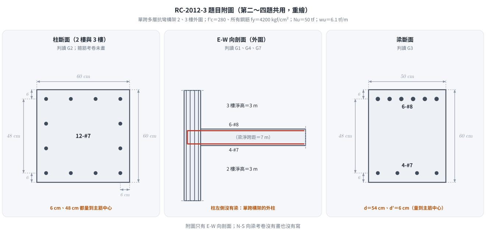
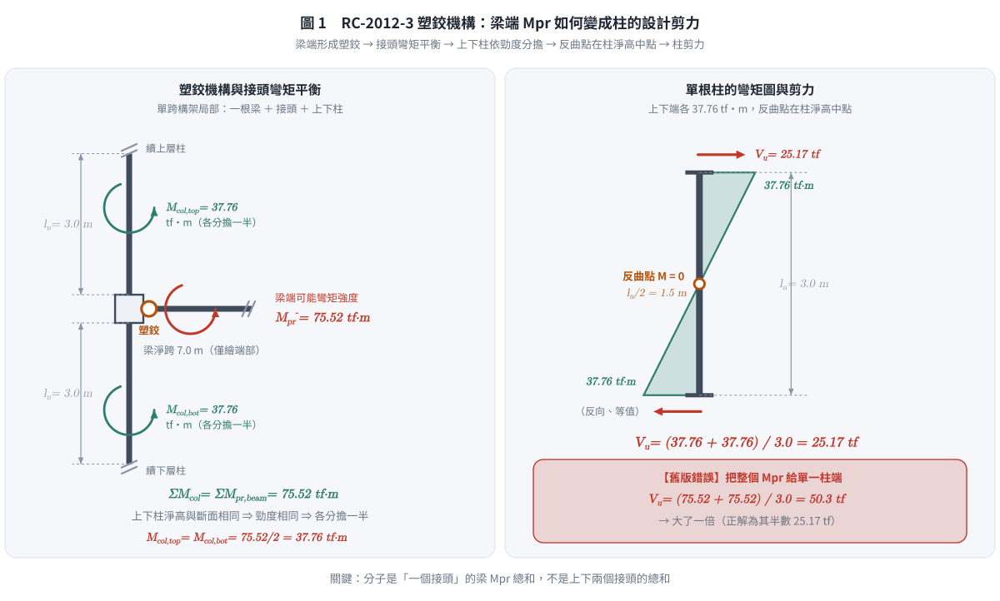
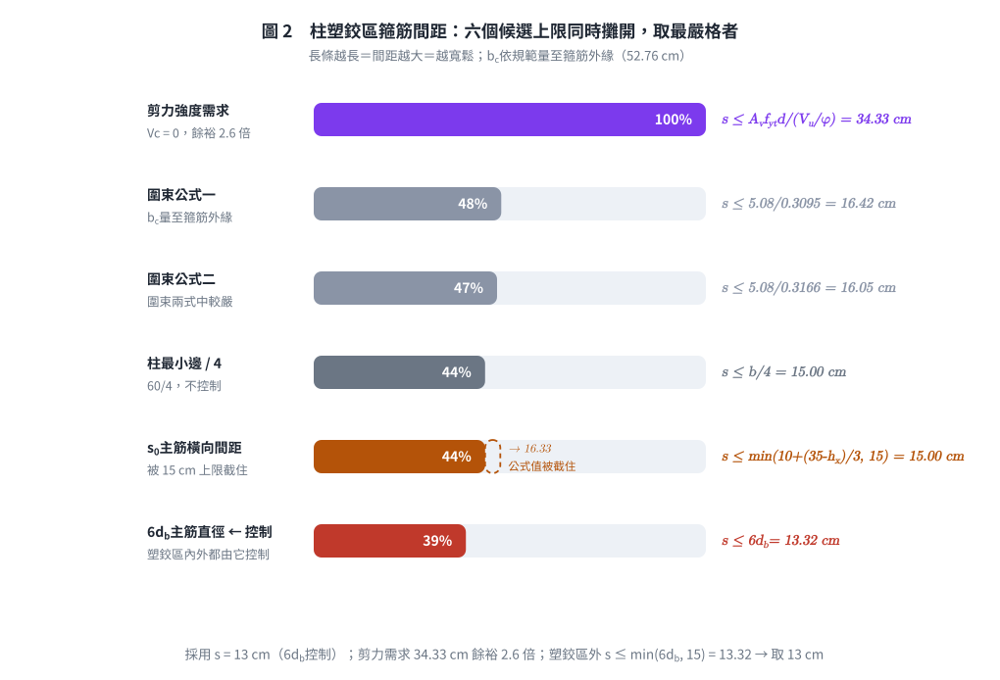
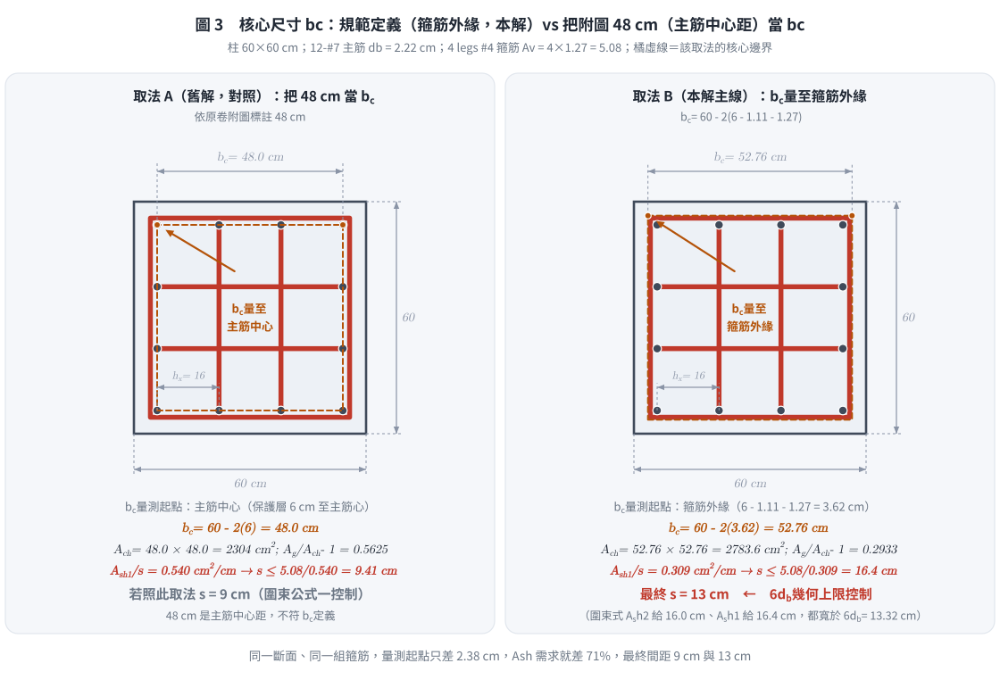

# 考題編號：RC-2012-3

**主分類：** `RC-U3-3` 韌性要求與耐震設計
**副分類：** `RC-U2-1` RC 剪力強度分析與設計
**設計法：** USD 強度設計法
**標籤：** `強柱弱梁` `塑鉸機構` `柱塑鉸區` `接頭彎矩分擔` `柱地震設計剪力` `圍束箍筋` `Ash` `特殊矩形框架柱` `耐震箍筋設計` `Vc=0條件` `lo`

---

## 1. 題目（考卷原文見題目正本）

> 考卷原文、公式／附表、附圖與判讀清單（已確認）見 [`RC-2012-3-problem.md`](RC-2012-3-problem.md)。本節只列解題時最容易讀錯的地方與本解使用的記號；題意以題目正本為準。


*重繪自考卷附圖，依題目正本判讀清單 G1–G7。本圖攔下的讀錯：柱斷面的 48 cm 是**主筋中心距**，不是 $b_c$；$b_c$ 須量到箍筋外緣。*

### 常見誤讀

| 項目 | 正確判讀 | 常見誤讀 |
|------|---------|---------|
| 48 cm | 柱主筋中心距（判讀 G2） | 當成核心尺寸 $b_c$（本庫舊解主線，s 被壓到 9 cm） |
| $b_c$ | 依規範量至箍筋外緣：$60-2(6-1.11-1.27)=52.76$ cm（2026-11-14 使用者確認） | 直接用 48 |
| 柱箍筋 | 每向 4 股 #4，$f_{yt}=4200$（所有號數鋼筋） | 用 2800 |
| 柱剪力 | 接頭的梁 $M_{pr}$ 由上下柱分擔 | 兩端各給一個完整 $M_{pr}$ |

**本解記號與延用數值：**

| 項目 | 數值 |
|------|------|
| 柱斷面 | 60×60 cm，12-#7，主筋中心距柱面 6 cm |
| $f'_c$ | 280 kgf/cm² |
| $f_{yt}$（箍筋） | 4200 kgf/cm² |
| 柱淨高 $l_n$ | 3 m = 300 cm |
| 柱設計極限軸力 $N_u$ | 50 tf = 50,000 kgf |
| 柱箍筋 | 4 legs #4（每根 $A_b = 1.27\ \text{cm}^2$） |
| #7 主筋 | $d_b = 2.22\ \text{cm}$ |

**由第二題得（已獨立複算相符）：**
- $M_{pr}^- = 75.52\ \text{tf·m}$（頂筋 6-#8，$a = 13.42$ cm）
- $M_{pr}^+ = 41.11\ \text{tf·m}$（底筋 4-#7，$a = 6.83$ cm）

---

## 2. 考題核心精神與出題者意圖 (Core Concepts & Examiner's Intent)

**核心精神：**
特殊矩形框架（SMF）的強柱弱梁設計：地震能量由**梁端塑鉸**消散，柱必須保持彈性。因此：
1. **柱設計剪力**由梁端 $M_{pr}$ 反推，而非由地震側力直接計算。
2. **柱塑鉸區箍筋**必須同時滿足：（a）圍束鋼筋（$A_{sh}$）、（b）剪力需求。

**出題者意圖：**
1. 測試「以塑鉸機構計算柱剪力」的正確做法：$V_u = (M_{pr,\text{top}} + M_{pr,\text{bot}}) / l_n$
2. 測試圍束箍筋兩個公式（取大值）的計算過程
3. 測試 $V_c = 0$ 的耐震條件判斷（$N_u \leq 0.05 f'_c A_g$）
4. 測試塑鉸區長度 $l_o$ 的規定

---

## 3. 解題戰略地圖與陷阱分析 (Strategic Roadmap & Trap Analysis)

**作戰計畫：**
```
Step 1：柱地震設計剪力 Vu（梁端塑鉸機構）
Step 2：塑鉸區長度 lo
Step 3：橫向箍筋最大間距（幾何限制）
Step 4：圍束箍筋需求 Ash → 反推最大 s
Step 5：剪力需求（Vc = 0 條件判斷）→ 確認間距
Step 6：最終設計：取最嚴格間距（本題 6db 控制），驗證 Ash 足夠
```

**關鍵陷阱：**

| # | 陷阱 | 應對策略 |
|---|------|---------|
| 1 | **用側力或 ΣFx 計算柱剪力**：塑鉸機構下應用 Mpr 反推 | $V_u = (M_{pr,\text{top}} + M_{pr,\text{bot}}) / l_n$，以最大 Mpr⁻ 控制 |
| 2 | **忘記接頭處的梁彎矩要由上下柱分擔** ← 本題舊版最大錯誤 | $\Sigma M_{col} = \Sigma M_{pr,beam}$；上下柱等勁度時各半，故 $V_u = \dfrac{\Sigma M_{pr,beam}}{l_n} = \dfrac{75.52}{3.0} = \mathbf{25.17\ \text{tf}}$，不是 50.33 |
| 3 | **Vc 不歸零**：$N_u = 50\ \text{tf} \approx 0.05 f'_c A_g = 50.4\ \text{tf}$，已達 Vc = 0 條件 | 取 $V_c = 0$，全由 Vs 承擔 |
| 4 | **bc、Ach 用毛斷面或主筋中心距**：圍束公式用量到箍筋外緣的核心 | 附圖 48 cm 是主筋中心距；$b_c = 60-2(6-1.11-1.27) = 52.76\ \text{cm}$，$A_{ch} = 2783.6\ \text{cm}^2$（取 48 的對照見 §5④） |
| 5 | **以 Ash 取較小值**：兩公式應取**較大值** | $A_{sh} = \max(A_{sh1},\ A_{sh2})$ |

---

## 3.5 變數層次分析 (Variable Hierarchy Analysis)

> 複習提示：第一次解題後，在每個卡住的知識點旁標記 `⚠`；第二次複習時只看有 `⚠` 的項目。

### 最終目標
`設計柱塑鉸區（lo 範圍內）的 4-leg #4 箍筋間距 s，同時滿足圍束與剪力需求`

### 本題關鍵公式（依計算順序）

$$\text{Step 1:}\quad V_u = \frac{M_{pr,\text{top}} + M_{pr,\text{bot}}}{l_n}$$

$$\text{Step 2:}\quad l_o = \max\!\left(\frac{l_n}{6},\ b_{\max},\ 45\ \text{cm}\right)$$

$$\text{Step 3:}\quad s_0 = 10 + \frac{35 - h_x}{3}\ \text{（cm）}$$

$$\text{Step 4a:}\quad A_{sh1} = 0.3 \times s \times b_c \times \frac{f'_c}{f_{yt}} \times \left(\frac{A_g}{A_{ch}} - 1\right)$$

$$\text{Step 4b:}\quad A_{sh2} = 0.09 \times s \times b_c \times \frac{f'_c}{f_{yt}}$$

$$\text{Step 5:}\quad V_s = \frac{A_v \cdot f_{yt} \cdot d}{s} \geq \frac{\boxed{V_u}}{\phi}\ \text{（Vc = 0 時）}$$

### L1：題目直接給定

| 符號 | 數值 | 說明 |
|------|------|------|
| 柱斷面 | 60×60 cm | 方形柱 |
| $f'_c$ | 280 kgf/cm² | |
| $f_{yt}$ | 4200 kgf/cm² | 箍筋降伏強度 |
| $N_u$ | 50 tf | 設計極限軸力 |
| $l_n$ | 300 cm | 柱淨高 |
| 箍筋 | 4-leg #4，$A_b = 1.27\ \text{cm}^2$ | |
| 主筋 | 12-#7，$d_b = 2.22\ \text{cm}$ | |

### L2：需知識點推導

**▌柱地震設計剪力**

| 符號 | 公式／來源 | 卡關? |
|------|----------|:-----:|
| $V_u$ | $\Sigma M_{pr,\text{beam}}/l_n = 75.52/3.0 = \mathbf{25.17\ \text{tf}}$（接頭梁彎矩由上下柱各半分擔） | |

**▌塑鉸區長度**

| 符號 | 公式／來源 | 卡關? |
|------|----------|:-----:|
| $l_o$ | $\max(300/6,\ 60,\ 45) = 60\ \text{cm}$ | |

**▌斷面核心尺寸**

| 符號 | 公式／來源 | 卡關? |
|------|----------|:-----:|
| $b_c$ | $60 - 2(6-1.11-1.27) = 52.76\ \text{cm}$（量至**箍筋外緣**；附圖 48 cm 是主筋中心距，對照見 §5④） | |
| $d$ | $60 - 6 = 54\ \text{cm}$ | |
| $A_g$ | $60\times60 = 3600\ \text{cm}^2$ | |
| $A_{ch}$ | $52.76^2 = 2783.6\ \text{cm}^2$ | |
| $A_v$ | $4\times1.27 = 5.08\ \text{cm}^2$ | |

**▌間距上限（幾何）**

| 符號 | 公式／來源 | 卡關? |
|------|----------|:-----:|
| $h_x$ | $48/3 = 16\ \text{cm}$（相鄰被支撐主筋中心距） | |
| $s_0$ | $10+(35-16)/3 = 16.3\ \text{cm}$，取上限 15 cm | |
| $s_{\text{geom}}$ | $\min(60/4,\ 6\times2.22,\ 15) = \min(15,\ 13.3,\ 15) = 13.3\ \text{cm}$ | |

**▌圍束需求 → 控制間距**

| 符號 | 公式／來源 | 卡關? |
|------|----------|:-----:|
| $s$ 從 $A_{sh1}$ | $5.08/0.3095 = 16.4\ \text{cm}$ | |
| $s$ 從 $A_{sh2}$ | $5.08/0.3166 = 16.0\ \text{cm}$（圍束兩式中較嚴） | |
| 採用 | $\min(16.0,\ s_{\text{geom}} = 13.3) \Rightarrow s = 13\ \text{cm}$（$6d_b$ 控制） | |
| $A_{sh1}$、$A_{sh2}$（驗證 s=13） | $4.02$、$4.12\ \text{cm}^2 < 5.08\ \text{cm}^2\ ✓$ | |

**▌剪力需求（Vc = 0）**

| 符號 | 公式／來源 | 卡關? |
|------|----------|:-----:|
| $V_c = 0$ 條件 | $N_u = 50\ \text{tf} \leq 0.05 f'_c A_g = 50.4\ \text{tf}$ ✓ | |
| $s_{\text{shear}}$ | $5.08\times4200\times54/\,(25.17\times10^3/0.75) = \mathbf{34.3\ \text{cm}}$（遠寬鬆） | |

### L3：深層知識（不懂就卡住）

| 知識點 | 說明 | 卡關? |
|--------|------|:-----:|
| **塑鉸機構柱剪力** | 接頭處 $\Sigma M_{col} = \Sigma M_{pr,\text{beam}}$，上下柱依勁度分擔（等高等斷面各半），反曲點在柱中點 $\Rightarrow V_u = \Sigma M_{pr,\text{beam}}/l_n$。**分子是「一個接頭」的梁彎矩總和** | |
| **取最大 Mpr 方向** | 同一柱線在某搖擺方向下，梁端為 Mpr⁻（頂筋受拉）= 75.52 > Mpr⁺ = 41.11，故以 Mpr⁻ 控制 | |
| **Vc = 0 的耐震條件** | ACI 318 特殊框架：當 (a) 地震剪力 ≥ 1/2 設計剪力，且 (b) $N_u \leq 0.05 f'_c A_g$ 時，取 $V_c = 0$（保守，確保柱剪力完全由箍筋承擔） | |
| **Ash 取兩式較大值** | 公式一控制最小圍束量（防止核心爆裂），公式二控制最小配箍率。必取 max，不可取較小 | |
| **bc vs d** | 規範定義 $b_c$／$A_{ch}$ 量至**橫向鋼筋外緣**（不是主筋中心線）；$d$ 是有效深度（剪力用）。附圖 48 cm 是主筋中心距，不能直接當 $b_c$，見 §5④ | |
| **lo 的三取大** | 淨高/6、最大柱邊、450 mm（18 in）—任何一個都要滿足 | |

---

## 4. 步驟化詳細計算過程 (Step-by-Step Detailed Calculation)

### Step 1：柱地震設計剪力（2026-08-22 全面改正）

> ⚠ **舊版寫 $V_u = (75.5+75.5)/3.0 = 50.33$ tf，把一根柱的上下兩端各給了一個「完整的」梁 $M_{pr}$。**
> 這少了關鍵的一步：**接頭處梁傳來的彎矩，是由接頭上、下兩根柱依勁度分擔的**，不是整個給某一根柱。

**正確推導（三步）：**

**① 接頭彎矩平衡。** 本構架為**單跨**，每個外圍接頭只有**一根**梁：

$$\Sigma M_{col} = \Sigma M_{pr,\text{beam}} = M_{pr}^- = 75.52\ \text{tf·m}$$

（取 $M_{pr}^-$ 而非 $M_{pr}^+$：同一柱線在某一搖擺方向下，梁端為頂筋受拉之負彎矩，值較大者控制。）

**② 上下柱分擔。** 各層柱淨高、斷面均相同 ⇒ 勁度相同 ⇒ 各分擔一半：

$$M_{col,\text{top}} = M_{col,\text{bot}} = \frac{75.52}{2} = 37.76\ \text{tf·m}$$

**③ 柱剪力（反曲點在柱淨高中點）：**

$$V_u = \frac{M_{col,\text{top}} + M_{col,\text{bot}}}{l_n} = \frac{37.76 + 37.76}{3.0} = \boxed{25.17\ \text{tf}}$$

**等價的快速寫法：**

$$V_u = \frac{\Sigma M_{pr,\text{beam at joint}}}{l_n} = \frac{75.52}{3.0} = 25.17\ \text{tf}$$



*圖 1　梁端塑鉸把 $M_{pr}^-$ 送進接頭後，如何經「接頭彎矩平衡 → 上下柱依勁度分擔 → 反曲點在柱淨高中點」變成單根柱的 $V_u$。攔的是把一根柱的上下兩端各給一個完整的梁 $M_{pr}$、使 $V_u$ 高估一倍（圖右把錯值與正解並排）。*

> 📝 **記憶點：** 分子是「**一個接頭**的梁 $M_{pr}$ 總和」，不是「上下兩個接頭的總和」。
> 之所以看起來像「上下兩端相加」，是因為 $M_{col,\text{top}}$ 與 $M_{col,\text{bot}}$ 各只有梁彎矩的一半，加起來剛好等於一個 $M_{pr}$。
>
> **本題最終設計 $s = 13$ cm 由 $6d_b$ 控制，不受此更正影響**（剪力需求本來就寬鬆），
> 但這個觀念**直接影響 RC-2012-4 的接頭剪力檢核**（$V_{col}$ 是 $V_{jh}$ 的減項）——
> 該題已於 **2026-09-07 依本頁更正值重解**：$V_{jh}$ 由 109.4 改為 **134.5 tf**，利用率由 57% 升到 82%，
> 結論（足夠）不變但餘裕大幅縮小。

---

### Step 2：塑鉸區（圍束區）長度 $l_o$

$$l_o = \max\!\left(\frac{l_n}{6},\ b_{\max},\ 450\ \text{mm}\right) = \max\!\left(\frac{300}{6},\ 60,\ 45\right) = \max(50,\ 60,\ 45)$$

$$\boxed{l_o = 60\ \text{cm}}$$

---

### Step 3：斷面核心尺寸

原卷附圖的 6 cm 量到**主筋中心**，48 cm 是**主筋中心至主筋中心**；規範的 $b_c$、$A_{ch}$ 量到**橫向鋼筋外緣**。#7 半徑 1.11 cm、#4 箍筋直徑 1.27 cm，箍筋外緣距柱面 $6-1.11-1.27=3.62$ cm（取 48 cm 的對照見 §5④）：

$$b_c = 60 - 2 \times 3.62 = \boxed{52.76\ \text{cm}}$$

$$A_g = 60 \times 60 = 3{,}600\ \text{cm}^2, \quad A_{ch} = 52.76^2 = \boxed{2{,}783.6\ \text{cm}^2}$$

$$A_v = 4 \times 1.27 = \boxed{5.08\ \text{cm}^2}\ \text{（4 leg \#4）}$$

---

### Step 4：橫向箍筋間距上限（幾何）

**主筋分布：** 12-#7 分布於 60×60 柱，頂底面各 4 根，側面各 2 根（不含角筋）。頂底面上相鄰主筋中心距：

$$h_x = \frac{b_c}{n-1} = \frac{48}{3} = 16\ \text{cm}$$

（48 cm 面上 4 根主筋，3 個間格，且 4-leg 設計含橫向 cross-tie，各主筋均受支撐。）

**公式間距：**

$$s_0 = 10 + \frac{35 - h_x}{3} = 10 + \frac{35 - 16}{3} = 10 + 6.3 = 16.3\ \text{cm}$$

取上限 15 cm（ACI 318 規定 $s_0 \leq 150\ \text{mm}$）：$s_0 = 15\ \text{cm}$

**綜合間距上限：**

$$s_{\max,\text{geom}} = \min\!\left(\frac{b}{4},\ 6d_b,\ s_0\right) = \min\!\left(\frac{60}{4},\ 6\times2.22,\ 15\right) = \min(15,\ 13.3,\ 15)$$

$$\boxed{s_{\max,\text{geom}} = 13.3\ \text{cm}}$$

---

### Step 5：圍束箍筋需求（Ash）→ 反推間距

設 $A_{sh,\text{prov}} = 5.08\ \text{cm}^2$ ≥ $A_{sh,\text{req}}$，求最大可用 s。

**公式一：**

$$A_{sh1} = 0.3 \times s \times b_c \times \frac{f'_c}{f_{yt}} \times \left(\frac{A_g}{A_{ch}} - 1\right) = 0.3 \times s \times 52.76 \times \frac{280}{4{,}200} \times \left(\frac{3{,}600}{2{,}783.6} - 1\right)$$

$$= 0.3 \times s \times 52.76 \times 0.06667 \times 0.2933 = 0.3095\,s \implies s \leq \frac{5.08}{0.3095} = 16.4\ \text{cm}$$

**公式二：**

$$A_{sh2} = 0.09 \times s \times b_c \times \frac{f'_c}{f_{yt}} = 0.09 \times s \times 52.76 \times 0.06667 = 0.3166\,s \implies s \leq \frac{5.08}{0.3166} = 16.0\ \text{cm}$$

**圍束兩式中公式二較嚴，$s_{\max,\text{conf}} = 16.0\ \text{cm}$，仍寬於幾何上限 13.3 cm。**

---

### Step 6：剪力需求（$V_c = 0$ 條件）

**檢核是否取 $V_c = 0$：**

$$0.05 f'_c A_g = 0.05 \times 280 \times 3{,}600 = 50{,}400\ \text{kgf} = 50.4\ \text{tf}$$

$$N_u = 50\ \text{tf} \leq 50.4\ \text{tf} \quad \checkmark$$

→ **軸壓力剛好落在門檻以下，取 $V_c = 0$（保守）。**

所需 $V_s$：

$$V_s = \frac{V_u}{\phi} = \frac{25.17}{0.75} = 33.56\ \text{tf} = 33{,}560\ \text{kgf}$$

由此推算間距：

$$s_{\text{shear}} = \frac{A_v \cdot f_{yt} \cdot d}{V_s} = \frac{5.08 \times 4{,}200 \times 54}{33{,}560} = \frac{1{,}152{,}144}{33{,}560} = \boxed{34.3\ \text{cm}}$$

剪力間距要求（34.3 cm）**遠寬鬆於**圍束要求（16.0 cm）與幾何上限（13.3 cm）。
（舊版因 $V_u$ 高估一倍而得 17.2 cm，雖然一樣不控制，但數字是錯的。）

---

### Step 7：控制間距彙整

| 條件 | 最大間距 |
|------|---------|
| 柱最小邊 / 4 | 15.0 cm |
| $6 d_b$（主筋） | **13.3 cm ←控制** |
| $s_0$（主筋橫向間距） | 15.0 cm |
| 圍束 $A_{sh1}$ | 16.4 cm |
| 圍束 $A_{sh2}$ | 16.0 cm |
| 剪力（$V_c = 0$） | 34.3 cm |

**採用間距：$\boxed{s = 13\ \text{cm}}$**



*圖 2　塑鉸區箍筋間距的六個候選上限同時攤開，長條越長代表越寬鬆。攔的是誤以為剪力或圍束需求控制——$b_c$ 依規範量至箍筋外緣後，圍束兩式都寬於 $6d_b$，控制的是間距上限。*

---

### Step 8：驗算（s = 13 cm）

$$A_{sh1} = 0.3095 \times 13 = 4.02\ \text{cm}^2 \leq A_v = 5.08\ \text{cm}^2 \quad \checkmark$$

$$A_{sh2} = 0.3166 \times 13 = 4.12\ \text{cm}^2 \leq A_v = 5.08\ \text{cm}^2 \quad \checkmark$$

$$V_s = \frac{5.08 \times 4{,}200 \times 54}{13} = \frac{1{,}152{,}144}{13} = 88{,}626\ \text{kgf} = 88.6\ \text{tf}$$

$$\phi V_s = 0.75 \times 88.6 = 66.5\ \text{tf} \geq V_u = 25.17\ \text{tf} \quad \checkmark\ (\text{餘裕 } 2.6\text{ 倍})$$

---

### 結論

$$\boxed{\text{柱塑鉸區：4 腳 \#4 箍筋 @ } s = 13\ \text{cm，自梁柱接頭面起 } l_o = 60\ \text{cm；塑鉸區外亦 @ } 13\ \text{cm}}$$

**設計摘要**

| 項目 | 值 | 依據 |
|---|:---:|---|
| 柱地震設計剪力 $V_u$ | **25.17 tf** | $\Sigma M_{pr,\text{beam}}/l_n$（上下柱各分擔一半） |
| 塑鉸區長度 $l_o$ | 60 cm | $\max(l_n/6,\ b_{\max},\ 45)$ |
| 圍束需求 | $A_{sh2}/s = 0.3166$ → $s \le 16.0$ cm（$A_{sh1}$：16.4 cm） | $b_c = 52.76$ cm 量至箍筋外緣 |
| 幾何間距上限（控制） | 13.3 cm | $\min(b/4,\ 6d_b,\ s_0)$ |
| 剪力需求（$V_c=0$） | $s \le 34.3$ cm | 不控制 |
| **採用（塑鉸區）** | **13 cm** | $6d_b$ 控制 |
| **採用（塑鉸區外）** | **13 cm** | $\min(6d_b,\ 15)$ |

---

## 5. 關鍵爭議點與進階探討 (Critical Issues & Advanced Discussion)

**① $N_u$ 剛好在 $V_c = 0$ 門檻附近的處理**

$N_u = 50\ \text{tf}$，而門檻 $0.05 f'_c A_g = 50.4\ \text{tf}$，差距僅 0.4 tf（< 1%）。嚴格而言已滿足 $V_c = 0$ 條件。考場上若不確定，可改用題目所給有軸力的 $V_c$ 公式：

$$V_c = 0.53\left(1 + \frac{N_u}{140 A_g}\right)\!\sqrt{f'_c}\,b_w\,d = 0.53\left(1 + \frac{50{,}000}{140\times3{,}600}\right)\!\times16.733\times60\times54 = 31.6\ \text{tf}$$

$$\phi V_c = 0.75 \times 31.6 = 23.7\ \text{tf} \ <\ V_u = 25.17\ \text{tf}\ \text{（幾乎相當，只差 6\%）}$$

即使計入 $V_c$，箍筋僅需承擔 $(25.17-23.7)/0.75 = 1.96$ tf，間距上限遠超過幾何限制。
**無論採哪種做法，$6d_b$ 幾何上限均控制，最終 $s = 13$ cm 不變。**

**② 為何圍束箍筋是 max 而非 min**

兩式均為下限（required ≤ provided），設計者需提供至少 $\max(A_{sh1}, A_{sh2})$。$A_{sh1}$ 針對斷面形狀（$A_g/A_{ch}$），$A_{sh2}$ 針對單純配箍率。兩式均不足時都可能發生核心混凝土爆裂破壞。

**③ 塑鉸區箍筋 vs 一般箍筋**

塑鉸區（lo 範圍內）同時須滿足：
- 圍束（$A_{sh}$）：防止軸壓下核心爆裂，提供韌性
- 剪力（$V_s$）：抵抗地震引入的柱剪力
- 間距（$s_{\max}$）：防止主筋壓屈、確保圍束效果

三者中最嚴格者控制設計，本題為間距上限 $6d_b$。

---

**④ $b_c$／$A_{ch}$ 的定義與敏感度（本題最值得留檔的判讀）**

規範定義：$b_c$ 與 $A_{ch}$ 均量至**橫向鋼筋外緣**（out-to-out of transverse reinforcement）。
但原卷附圖標的「48 cm」是**主筋中心到主筋中心**（保護層 6 cm 量至主筋心）。兩種取法差很多：

| 取法 | $b_c$ | $A_{ch}$ | $A_g/A_{ch}-1$ | $A_{sh1}/s$ | 圍束容許 $s$ | **最終 $s$** |
|---|:---:|:---:|:---:|:---:|:---:|:---:|
| A（舊解主線）把附圖 48 cm 當 $b_c$ | 48.0 | 2,304 | 0.5625 | 0.540 | 9.41 cm | 9 cm（圍束控制） |
| **B（本解主線）依規範量至箍筋外緣**<br>$= 60-2(6-1.11-1.27)$ | 52.76 | 2,784 | 0.2933 | 0.309（$A_{sh2}$：0.317） | 16.0 cm | **13 cm**（$6d_b$ 幾何控制） |



*圖 3　同一個柱斷面、同一組 4 腳箍筋，$b_c$ 量到主筋中心與量到箍筋外緣兩種取法的核心邊界與後續數值對照。攔的是把附圖的 48 cm（主筋中心距）直接當 $b_c$——量測起點只差 2.38 cm，$A_{sh}$ 需求就差約七成，間距由 13 cm 被壓到 9 cm。*

**採 B 的理由（2026-11-14 使用者確認）：** ① 附圖的 6 cm、48 cm 量的是**主筋中心**（題目正本判讀 G2），不是核心尺寸；
② 規範 $A_{sh}$ 式中的 $b_c$、$A_{ch}$ 定義為量至橫向鋼筋外緣，由主筋中心 6 cm 扣主筋半徑與箍筋直徑即可得到，不需另外假設保護層；
③ A 把 $A_{sh}$ 需求高估約 71%，屬定義錯用而非「合理保守」。
**作答時可加一句**「若把 48 cm 直接當 $b_c$，圍束式控制得 $s=9$ cm，偏保守」，顯示知道兩者差異。

**⑤ 密箍區以外的間距（原文未提）**

$$s_{\text{outside}} \le \min(6d_b,\ 15\ \text{cm}) = \min(6\times2.22,\ 15) = \boxed{13.3\ \text{cm}} \Rightarrow \text{取 } 13\ \text{cm}$$

（土木 401-112 §15.4.4／ACI 318-19 §18.7.5.5。注意 $6d_b$ 與 150 mm **兩個都要查**。）

## 6. 依最新規範對照（土木 401-112／ACI 318-19）

原卷（101 年）未指定版本，當時為 **土木 401-100**（ACI 318-05 世代）。
現行為 **土木 401-112**（2023 年 8 月，ACI 318-19 世代）。

| 項目 | 401-100（原卷世代） | 401-112／ACI 318-19 | 影響 |
|---|---|---|---|
| 柱設計剪力 $V_e$ | 由梁 $M_{pr}$ 反推（接頭分擔） | 同（§18.7.6.1.1）；並明訂 $V_e$ 不必超過由**接頭強度**推得之值 | **不變**（25.17 tf） |
| $A_{sh}$ | 兩式取大 | **三式**取大（Table 18.7.5.4），新增 $0.2k_fk_n\dfrac{P_u}{f_{yt}A_{ch}}$ | 觸發門檻 $0.3A_gf'_c = \mathbf{302\ tf}$；本題 $N_u = 50$ tf ⇒ **不觸發** |
| $b_c,\ A_{ch}$ 定義 | 量至橫向鋼筋外緣 | 同 | 見 §5④ 之敏感度留檔 |
| 密箍區間距 | $\min(b/4,\ 6d_b,\ s_0)$ | 同；$6d_b$ 明訂為「**最小**縱筋」直徑，Grade 550 改 $5d_b$ | 本題 Grade 420 ⇒ 不變（13.3 cm） |
| $s_0$ | $10+\dfrac{35-h_x}{3}$，$10\sim15$ cm | 同（§18.7.5.3(c)） | 不變（15 cm） |
| $l_o$ | $\max(l_n/6,\ b_{\max},\ 45\ \text{cm})$ | 同（§18.7.5.1） | 不變（60 cm） |
| $l_o$ 以外間距 | $\min(6d_b,\ 15\ \text{cm})$ | 同（§18.7.5.5） | **原文未提，已補**（13 cm） |
| $V_c = 0$ 條件 | (a) 地震剪力 $\ge$ 需求之半、(b) $P_u < A_gf'_c/20$ | 同（§18.7.6.2.1） | $50 < 50.4$ tf ✓ **踩線通過** |
| 含軸壓之 $V_c$（若不取 0） | $0.53\!\left(1+\dfrac{N_u}{140A_g}\right)\!\sqrt{f'_c}b_wd$（原卷印出） | **已廢除**；改為 $\left[0.53\lambda\sqrt{f'_c} + \dfrac{N_u}{6A_g}\right]b_wd$ | 318-19 式：$\left[8.868 + \dfrac{50{,}000}{6\times3600}\right]\!\times3240 = 36.2$ tf（舊式 31.6 tf） |
| 強柱弱梁 | $\Sigma M_{nc} \ge \frac65 \Sigma M_{nb}$ | 同（§18.7.3.2） | 本題未問，但是「梁端塑鉸」假設的前提 |

**兩個值得記住的結論：**
1. 本題 $N_u = 50$ tf 與門檻 $A_gf'_c/20 = 50.4$ tf 只差 0.8%，是典型的「踩線題」。
   若軸力再大一點就不能取 $V_c = 0$，剪力需求會鬆一些——但**間距上限仍控制，答案照樣是 13 cm**。
2. 318-19 把含軸壓的 $V_c$ 由「乘法修正」改成「加法項 $N_u/(6A_g)$」，本題兩式差 15%，
   但因為取 $V_c = 0$ 而完全用不到。同庫 `RC-2014-3` 才是這條改動真正改變答案的題目。

*圖解補繪：2026-09-07（向量圖 3 張，腳本 `figs/gen_RC-2012-3.py`，可重跑；腳本檔尾對 §4 公佈值做 assert）*

*修正日期：2026-11-14（§1 改為指向題目正本；重繪題目附圖 figs/RC-2012-3-fig-1-problem.svg）*

*修正日期：2026-11-14（解析勘誤（b_c 量測基準，使用者確認）：附圖 48 cm 為主筋中心距，b_c 改依規範量至箍筋外緣 52.76 cm、A_ch 2783.6 cm²；圍束控制間距 9.41 → 16.0 cm（A_sh2），最終塑鉸區箍筋 4-leg #4 @ 9 → @ 13 cm（6d_b 控制），φVs 96.0 → 66.5 tf；§5④ 取法 A／B 主從互換，圖 2、圖 3 重產；驗證：verify_RC-2012-3.py 重算 20 值 MISMATCHES: 0，gen_RC-2012-3.py 檔尾 36 項 assert 全過）*
