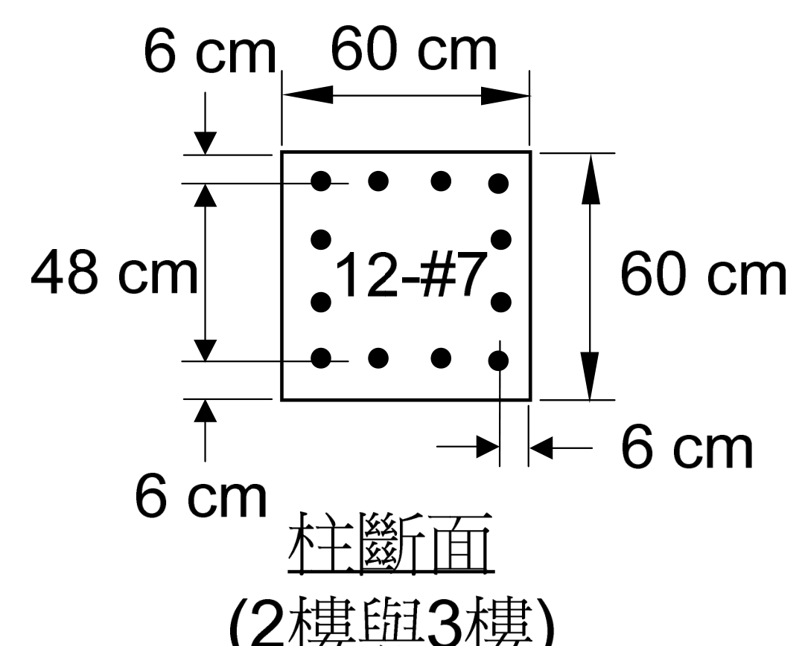
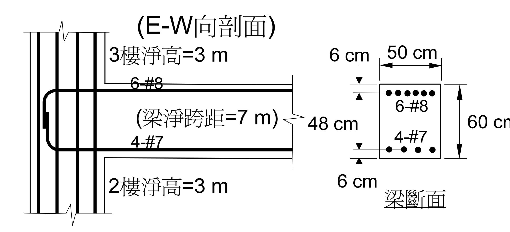

# RC-2012-4 題目正本

> 本檔只記錄**考卷上寫了什麼、圖上畫了什麼**，不含任何解法。解析見同資料夾 `RC-2012-4.md`。
> 判讀清單已經使用者確認（凍結）；本檔原則上不再修改（改動須回考卷原圖並記 log）。

| 項目 | 內容 |
|------|------|
| 考卷 | `raw/exams/RC-2012_鋼筋混凝土設計與預力.pdf` 第 1 頁（正面）第四題；背景敘述、公式與附圖在第 2 頁（背面） |
| 考年 | 民國 101 年（2012） |
| 配分 | 20 分 |
| 附圖 | `RC-2012-4-fig-1.png`（柱斷面）、`RC-2012-4-fig-2.png`（E-W 向剖面與梁斷面）；2026-11-14 由考卷 500 dpi 擷取（與第二題共用附圖） |
| 判讀狀態 | **已確認**（2026-11-14 使用者確認；轉錄 2026-11-14；PyMuPDF 110 dpi 全頁目視＋抽出文字核對，附圖 400–500 dpi；盲讀後才比對既有解析） |

## 1. 考卷原文（逐字）

> 四、承第三題，接頭區箍筋配筋同柱箍筋之配置，附圖中之柱是屬於結構角隅邊柱，試檢核此梁柱外接頭剪力是否足夠？若不足夠，應說明如何改善。（20 分）

## 2. 考卷給的公式、附表與參數

第一頁第一題後印「第二題至第四題請依試題背面敘述及附圖作答：」，背面敘述照錄：

> 所設計之某一單跨多層 RC 建築抗彎構架（moment-resisting frame），取其中 2 樓與 3 樓結構外圍之梁柱配置如下圖所示。所提供之設計參數與公式如下：
> 所有樓層柱淨高為 3 m，單跨之梁淨跨距為 7 m。
> 梁與柱混凝土 $f'_c$ = 280 kgf/cm²，所有號數鋼筋 $f_y$ = 4200 kgf/cm²。
> 柱設計極限軸力為 $N_u$ = 50 tf，梁設計垂直極限載重為 $w_u$ = 6.1 tf/m，設計時不考慮樓版貢獻。
> 梁箍筋使用 #3（面積為 0.71 cm²），柱箍筋使用 #4（面積為 1.27 cm²），梁與柱主筋使用 #7（面積為 3.87 cm²）與 #8（面積為 5.07 cm²）。
>
> 部分相關規範公式與規定節錄如下：
> 柱閉合箍筋面積公式：$A_{sh1} = 0.3 \times s \times b_c \dfrac{f'_c}{f_{yt}}\left[\dfrac{A_g}{A_{ch}} - 1\right]$ 或 $A_{sh2} = 0.09 \times s \times b_c \times \dfrac{f'_c}{f_{yt}}$
> 柱橫向箍筋間距公式：$s_0 = 10 + \left(\dfrac{35 - h_x}{3}\right)$
> 混凝土抗剪強度（有軸壓力）：$V_c = 0.53\left(1 + \dfrac{N_u}{140A_g}\right)\sqrt{f'_c}\,b_w d$
> 梁柱接頭剪力強度規定：$5.3\sqrt{f'_c}A_j$（接頭四面接受圍束）或 $3.9\sqrt{f'_c}A_j$（三面或一雙對面受圍束）或 $3.2\sqrt{f'_c}A_j$（其他），$A_j$ 為接頭有效斷面積
>
> 附圖：2 樓與 3 樓外圍結構 E-W（東西）向剖面之梁、柱與接頭配置情形

- 卷首注意事項：㈠可以使用電子計算器。㈡不必抄題，作答時請將試題題號及答案依照順序寫在試卷上，於本試題上作答者，不予計分。㈢答題所需公式或參數若未提供，請自行作合理假設。

## 3. 附圖

圖面文字照錄：`6 cm`、`60 cm`、`48 cm`、`12-#7`、`60 cm`、`6 cm`、`6 cm`、`柱斷面 (2樓與3樓)`。

圖面文字照錄：`(E-W向剖面)`、`3樓淨高=3 m`、`6-#8`、`(梁淨跨距=7 m)`、`4-#7`、`2樓淨高=3 m`、`6 cm`、`50 cm`、`6-#8`、`48 cm`、`4-#7`、`60 cm`、`6 cm`、`梁斷面`。

## 4. 判讀清單

「把握」標**不確定**者請優先確認；解讀類項目（題目用字的意思）另標「解讀」。第二～四題共用的判讀以 G 編號列出（三題相同）。

| # | 項目 | 判讀 | 圖上／題文依據 | 把握 |
|---|------|------|---------------|------|
| 1 | 柱位置 | 結構角隅邊柱（corner column）；E-W 向只有一側有梁（圖示），N-S 向梁的有無、尺寸**考卷沒有畫也沒有寫** | 題文；附圖只有 E-W 向剖面 | 確定（解讀） |
| 2 | 接頭箍筋 | 同第三題柱箍筋配置（數值由第三題設計結果而來，考卷未給） | 題文 | 確定 |
| 3 | 所求 | 檢核外接頭剪力是否足夠；不足則說明改善方法 | 題文「梁柱外接頭」 | 確定 |
| 4 | 沒有給 | 接頭所在樓層是否為頂層（題述為 2、3 樓之間）、接頭剪力 $\phi$、N-S 向梁 | 全題 | 確定 |
| G1 | 構架 | 單跨多層抗彎構架；圖示柱為外柱（E-W 向只有一側有梁） | 背面敘述「單跨」；立面柱左側無梁 | 確定 |
| G2 | 柱斷面 | $60 \times 60$ cm，12-#7（每邊 4 根）；鋼筋**中心**距柱面 6 cm，上下排中心距 48 cm | 柱斷面圖：6 cm 尺寸線端點落在柱面與鋼筋中心線；48 cm 量兩排鋼筋中心 | 確定 |
| G3 | 梁斷面 | $50 \times 60$ cm；頂 6-#8 一排、底 4-#7 一排；鋼筋**中心**距梁頂、梁底各 6 cm → $d = 54$ cm，$d' = 6$ cm | 梁斷面圖：6 cm 尺寸線端點落在梁面與鋼筋中心線；48 cm 量兩排鋼筋中心 | 確定 |
| G4 | 淨高與淨跨 | 2 樓、3 樓柱淨高皆 3 m；梁淨跨 7 m | 背面敘述；立面標註 | 確定 |
| G5 | 載重 | 柱 $N_u = 50$ tf；梁 $w_u = 6.1$ tf/m（設計值）；不考慮樓版 | 背面敘述 | 確定 |
| G6 | 材料 | $f'_c = 280$、所有鋼筋 $f_y = 4200$ kgf/cm²（含箍筋） | 背面敘述「所有號數鋼筋」 | 確定 |
| G7 | 梁筋錨定 | 梁上下筋伸入柱內以彎折相連（立面畫成 U 形） | 立面圖 | 確定（解讀） |
| G8 | 梁柱接頭強度式 | 考卷印 $5.3$／$3.9$／$3.2\sqrt{f'_c}A_j$，標題為「梁柱接頭**剪力強度**規定」，未寫「設計」或「標稱」，未給 $\phi$ | 背面公式節錄 | 確定 |

---

*轉錄：2026-11-14（RC-U3-3 題目正本推廣・批 1）*

*確認：2026-11-14 使用者確認（RC-U3-3 題目正本推廣・批 1，關卡一）*
