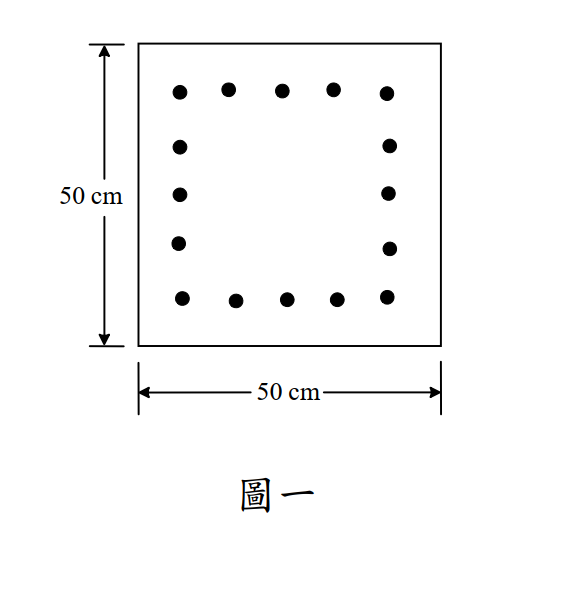

# RC-2013-2 題目正本

> 本檔只記錄**考卷上寫了什麼、圖上畫了什麼**，不含任何解法。解析見同資料夾 `RC-2013-2.md`。
> 判讀清單已經確認（凍結）；本檔原則上不再修改（改動須回考卷原圖並記 log）。

| 項目 | 內容 |
|------|------|
| 考卷 | `raw/exams/RC-2013_鋼筋混凝土設計與預力.pdf` 第 1 頁（正面），第二題 |
| 考年 | 民國 102 年（2013） |
| 配分 | 25 分 |
| 附圖 | `RC-2013-2-fig-1.png`（圖一：方形柱斷面） |
| 判讀狀態 | **已確認**（2026-11-15 使用者授權依 Claude 建議確認；轉錄 2026-11-15；PyMuPDF 110 dpi 全頁目視，附圖 400–450 dpi 局部放大；文字以 PDF 文字層核對（公式以影像為準）；盲讀後才比對既有解析） |

## 1. 考卷原文（逐字）

> 二、一方形柱配置 16 支 D32 主筋如圖一所示，請依耐震設計特別規定配置橫向鋼筋，並繪圖說明。已知橫向鋼筋降伏強度 $f_y$＝2800 kgf/cm²，$f'_c$＝280 kgf/cm²，設保護層厚度為 4 cm。（25 分）
>
> 參考公式：$0.3sh_c\left(\dfrac{A_g}{A_{ch}}-1\right)\dfrac{f'_c}{f_{yh}}$；$0.09sh_c\dfrac{f'_c}{f_{yh}}$

## 2. 考卷給的公式、附表與參數

- 題文數值：16-D32；橫向鋼筋 $f_y$＝2800 kgf/cm²；$f'_c$＝280 kgf/cm²；保護層 4 cm。
- 卷首鋼筋資料：D10 $d_b$＝0.96 cm、$A_b$＝0.71 cm²；D13 1.27 cm、1.27 cm²；D25 2.54 cm、5.07 cm²；D29 2.87 cm、6.47 cm²；D32 3.22 cm、8.14 cm²。
- 參考公式（照錄，兩式並列、考卷未寫「取大」或 $A_{sh}\ge$）：$0.3sh_c(A_g/A_{ch}-1)f'_c/f_{yh}$；$0.09sh_c f'_c/f_{yh}$。
- 作答規範（卷首）：內政部營建署「混凝土結構設計規範」（內政部 100.6.9 臺內營字第 1000801914 號令）；中國土木水利學會「混凝土工程設計規範」（土木 401-100）。未依上述規範作答，不予計分。
- **沒有給**：柱軸力 $P_u$、柱淨高、橫向鋼筋（箍筋、繫筋）號數、主筋 $f_y$、保護層量到箍筋或主筋、梁柱構架型式。
- 卷首注意事項：㈠可以使用電子計算器。㈡不必抄題，作答時請將試題題號及答案依照順序寫在試卷上，於本試題上作答者，不予計分。㈢本試題之相關公式、物理常數、符號意義及設計參數未提及時，請自行合理推斷與假設。

## 3. 附圖

圖面文字照錄：`50 cm`、`50 cm`、`圖一`。

## 4. 判讀清單

「把握」標**不確定**者優先列；解讀類項目（題目用字的意思）另標「解讀」。標「依 Claude 建議確認」者，為使用者 2026-11-15 授權「要我確認的請依你建議」後定案。

| # | 項目 | 判讀 | 圖上／題文依據 | 把握 |
|---|------|------|---------------|------|
| 1 | 保護層 4 cm 量到哪裡 | **量到最外層鋼筋（箍筋）外緣**；箍筋外緣圍成 50－2×4＝42 cm 見方（本庫量法慣例：$h_c$、$A_{ch}$ 量到箍筋外緣） | 題文「設保護層厚度為 4 cm」未說明；圖上未畫箍筋。規範保護層定義為至最外層鋼筋 | 確定（解讀）；依 Claude 建議確認 |
| 2 | 橫向鋼筋號數 | 考卷沒有給，須自行選用並明列（題目要求「配置橫向鋼筋」本身即設計） | 題文只給 $f_y$＝2800 | 確定 |
| 3 | 柱軸力、淨高 | 考卷沒有給；與軸力有關的規範條款（現行版高軸壓的第三式、$l_o$ 長度）只能條件式說明或自行假設 | 全題 | 確定 |
| 4 | 斷面 | 方形 50×50 cm | 左側垂直、下方水平兩條 50 cm 尺寸線，端點對齊斷面外緣 | 確定 |
| 5 | 主筋排列 | 16-D32 沿周邊，每面 5 根（含角筋）：上排 5、下排 5、左右各 3 根中間筋；同面大致等距 | 450 dpi 數點：上 5、下 5、左 3、右 3（角筋計入上下排） | 確定 |
| 6 | 所求 | 依耐震特別規定設計橫向鋼筋（號數、腳數、間距、繫筋配置）並**繪圖說明** | 題文「配置橫向鋼筋，並繪圖說明」 | 確定 |
| 7 | 規範版本 | 考卷指定 401-100；依根目錄 CLAUDE.md 主線用現行規範，考卷印出的兩式屬規範式、依現行規範換用 | 卷首作答規範 | 確定 |

---

*轉錄：2026-11-15（RC-U3-3 批 2＋U1-3＋U2-3 題目正本推廣）*

*確認：2026-11-15 使用者授權依 Claude 建議確認（RC-U3-3 批 2＋U1-3＋U2-3 題目正本推廣，關卡一）*
