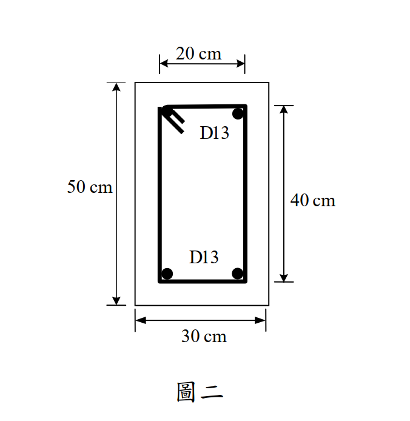

# RC-2013-3 題目正本

> 本檔只記錄**考卷上寫了什麼、圖上畫了什麼**，不含任何解法。解析見同資料夾 `RC-2013-3.md`。
> 判讀清單已經使用者確認（凍結）；本檔原則上不再修改（改動須回考卷原圖並記 log）。

| 項目 | 內容 |
|------|------|
| 考卷 | `raw/exams/RC-2013_鋼筋混凝土設計與預力.pdf` 第 2 頁（背面），第三題 |
| 考年 | 民國 102 年（2013） |
| 配分 | 30 分 |
| 附圖 | `RC-2013-3-fig-1.png`（圖二：構件斷面） |
| 判讀狀態 | **已確認**（2026-11-15 使用者確認；影響答案項目使用者選擇：#1 20×40 量到箍筋外緣（中心線 19.04×39.04）；轉錄 2026-11-15；PyMuPDF 110 dpi 全頁目視，附圖 450 dpi 局部放大；附圖為向量圖，尺寸以 PDF drawings 座標核對；盲讀後才比對既有解析） |

## 1. 考卷原文（逐字）

> 三、一鋼筋混凝土構件承受扭矩 $T_u$=1.5 tf-m，閉合箍筋採用 D10，如圖二所示，試求箍筋間距，並檢核斷面之鋼筋配置是否恰當。（已知 $f_c'$=280 kgf/cm²，$f_y$=2800 kgf/cm²）（30 分）

## 2. 考卷給的公式、附表與參數

- 卷首依據與作答規範：內政部營建署「混凝土結構設計規範」（內政部 100.6.9 臺內營字第 1000801914 號令；中國土木水利學會「混凝土工程設計規範」（土木 401-100）。未依上述規範作答，不予計分。
- 卷首鋼筋表（照錄）：D10，$d_b$＝0.96 cm，$A_b$＝0.71 cm²；D13，$d_b$＝1.27 cm，$A_b$＝1.27 cm²；D25，$d_b$＝2.54 cm，$A_b$＝5.07 cm²；D29，$d_b$＝2.87 cm，$A_b$＝6.47 cm²；D32，$d_b$＝3.22 cm，$A_b$＝8.14 cm²。
- 題文數值：$T_u$＝1.5 tf-m；閉合箍筋 D10；$f'_c$＝280、$f_y$＝2800 kgf/cm²。
- **沒有給**：剪力 $V_u$、扭矩屬平衡或諧和扭矩、保護層數值（只能由圖上尺寸推得）、強度折減因數、混凝土種類（常重／輕質）。
- 卷首注意事項：可以使用電子計算器；不必抄題，作答時請將試題題號及答案依照順序寫在試卷上，於本試題上作答者，不予計分；本試題之相關公式、物理常數、符號意義及設計參數未提及時，請自行合理推斷與假設。

## 3. 附圖

圖面文字照錄：`20 cm`、`D13`（上）、`50 cm`、`40 cm`、`D13`（下）、`30 cm`、`圖二`。

## 4. 判讀清單

「把握」標**不確定**者請優先確認；解讀類項目（題目用字的意思）另標「解讀」。

| # | 項目 | 判讀 | 圖上／題文依據 | 把握 |
|---|------|------|---------------|------|
| 1 | 20 cm、40 cm 量測基準 | 20 cm、40 cm 的延伸線落在**箍筋外緣**（粗線外側）：箍筋外緣尺寸 20×40 cm；箍筋中心線尺寸則為 $20-0.96$＝19.04、$40-0.96$＝39.04 cm。使用者定案：量到**箍筋外緣**，中心線尺寸 19.04×39.04 cm | PDF 座標：箍筋粗線（線寬 2.65 pt）外框 x 339.4–393.8、y 322.7–434.1；20cm 延伸線 x＝339.2、393.4，40cm 延伸線 y＝322.3、434.4，皆對齊粗線外緣 | 不確定（解讀）（影響答案）；使用者確認 |
| 2 | 斷面外形 | $b$＝30 cm、$h$＝50 cm | 30cm 延伸線 x＝323.7、406.8 對齊外框；50cm 延伸線 y＝307.6、449.2 對齊外框 | 確定 |
| 3 | 保護層 | 箍筋外緣四周各 5 cm（$(30-20)/2$、$(50-40)/2$）；考卷沒有直接給保護層 | 由 #1、#2 推得；箍筋上下距外框各約 15 pt、左右約 13–16 pt（圖約略置中） | 確定（解讀） |
| 4 | 縱筋 | 四角各 1 根 D13，共 4 根；`D13` 標的是縱筋 | 圖上四角黑點；上下各一個 `D13` 標註 | 確定 |
| 5 | 箍筋 | D10 閉合箍筋（兩肢），左上角 135° 彎鉤；間距為所求 | 題文「閉合箍筋採用 D10」；圖左上角彎鉤 | 確定 |
| 6 | 材料 | $f'_c$＝280、$f_y$＝2800 kgf/cm²（箍筋與縱筋共用） | 題文 | 確定（解讀） |
| 7 | 載重 | 只給扭矩 $T_u$＝1.5 tf-m，沒有剪力 | 題文 | 確定 |
| 8 | 所求 | 箍筋間距；檢核斷面鋼筋配置（縱筋量、號數、間距等）是否恰當 | 題文 | 確定（解讀） |
| 9 | 考卷沒有給 | $V_u$、平衡／諧和扭矩、保護層數值、$\phi$、混凝土種類 | 全題 | 確定 |

---

*轉錄：2026-11-15（RC-U2-1／U2-2 題目正本推廣・批 1）*

*確認：2026-11-15 使用者確認（RC-U2-1／U2-2 題目正本推廣・批 1，關卡一）*
