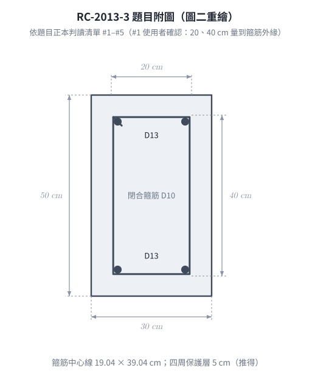
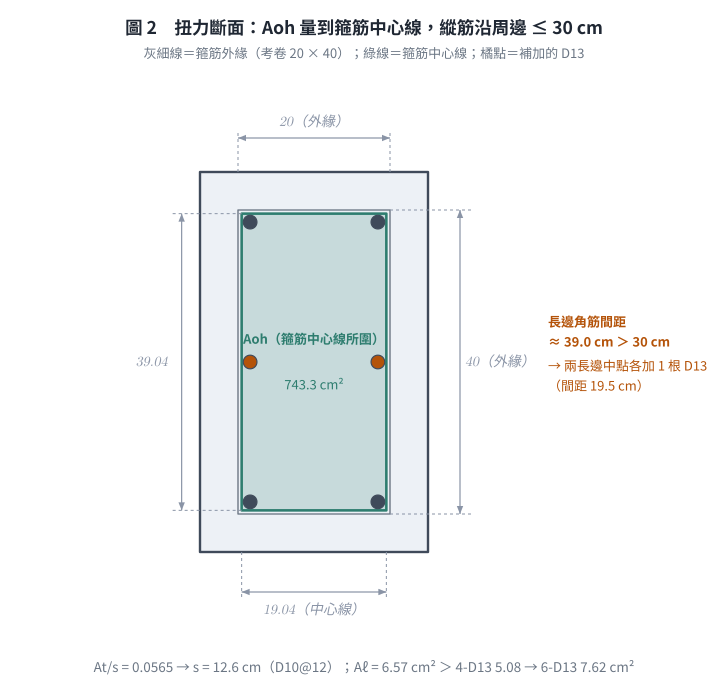

# 考題編號：RC-2013-3

**主分類：** `RC-U2-2` RC 扭力強度設計
**副分類：** （無）
**設計法：** USD 強度設計法
**標籤：** `扭矩強度` `閉合箍筋` `空間桁架類比` `Ao計算` `ph最大間距` `縱向扭力筋Al` `斷面壓碎驗算` `D10箍筋`

---

## 1. 題目（考卷原文見題目正本）

> 考卷原文、公式／附表、附圖與判讀清單（已確認）見 [`RC-2013-3-problem.md`](RC-2013-3-problem.md)。本節只列解題時最容易讀錯的地方與本解使用的記號；題意以題目正本為準。

*重繪自考卷圖二，依題目正本判讀清單 #1–#5。本圖攔下的讀錯：20、40 cm 量到箍筋**外緣**（中心線 19.04×39.04 cm），不是中心線尺寸。*

### 常見誤讀

| 項目 | 正確判讀 | 常見誤讀 |
|------|---------|---------|
| 20×40 cm | 箍筋外緣尺寸（使用者確認）；中心線 $x_o$＝19.04、$y_o$＝39.04 cm | 當中心線尺寸 20×40（本庫 2026-11-15 前舊解，答 15 cm） |
| D13 | 四角縱筋 | 當箍筋號數 |
| 載重 | 只有扭矩，沒有剪力 | 自行加剪力 |
| 強度折減因數 | 依現行規範扭力 $\phi$＝0.75 | 0.85（舊規範；本庫舊解） |
| 門檻係數 | kgf 制 $T_{th}=0.27\sqrt{f'_c}A_{cp}^2/p_{cp}$ | SI 制 $\sqrt{f'_c}/12$ 直接代 kgf/cm²（舊解得 0.167 tf·m，低估 3.19 倍；不影響「需設計扭力」結論） |

**本解記號：** $x_o$、$y_o$＝箍筋中心線尺寸；$A_{oh}$；$A_o=0.85A_{oh}$；$p_h$；$A_\ell$＝縱向扭力筋。規範：建築物混凝土結構設計規範（內政部 2023 年版），kgf-cm 制，$\theta$＝45°；箍筋與縱筋 $f_y$＝2800 kgf/cm²。

---

## 2. 考題核心精神與出題者意圖 (Core Concepts & Examiner's Intent)

**核心精神：**
扭力設計採**空間桁架類比法**：扭矩由閉合箍筋（抗拉腹桿）與斜向混凝土壓力帶（斜壓桿）共同抵抗，縱向鋼筋平衡水平拉力分量。

**兩項主要驗算：**
1. **橫向箍筋**：$A_t/s \geq T_u/(2\phi A_o f_{yt})$，由此定 $s$，並檢核 $s\le p_h/8$、30 cm
2. **縱向鋼筋**：$A_\ell \geq (A_t/s)\,p_h\,(f_{yt}/f_y)$，並檢核圖示 4-D13 的面積與間距（≤ 30 cm、每角一根）

**出題陷阱：** 20×40 cm 量到箍筋外緣；「檢核配置」包含縱筋面積與間距兩件事。

---

## 3. 解題戰略地圖與陷阱分析 (Strategic Roadmap & Trap Analysis)

| 步驟 | 工作 |
|------|------|
| 1 | 由外緣 20×40 扣箍筋直徑得中心線 19.04×39.04 → $A_{oh}$、$p_h$、$A_o$ |
| 2 | 門檻 $\phi T_{th}$ → 確認須設計扭力 |
| 3 | 斷面上限檢核 |
| 4 | $A_t/s$ → $s$；與 $p_h/8$、30 cm 比較 |
| 5 | $A_\ell$、$A_{\ell,\min}$；與 4-D13 比較；縱筋間距 |

**關鍵陷阱：**

| 陷阱 | 說明 |
|------|------|
| ⚠ 尺寸基準 | 20、40 cm 量到箍筋外緣 → 中心線各扣 $d_b$＝0.96 cm |
| ⚠ $\phi$ | 現行規範扭力 0.75（舊規範 0.85） |
| ⚠ 門檻係數 | kgf 制 0.27，不是 $1/12$ |
| ⚠ 縱筋間距 | 長邊中心距 39 cm > 30 cm，即使面積夠也要加筋 |

---

## 3.5 變數層次分析 (Variable Hierarchy Analysis)

### 最終目標
`求 D10 閉合箍筋間距 s，並檢核 4-D13 縱筋是否恰當`

### 本題關鍵公式（依計算順序）

$$\text{Step 1：}x_o = 20-0.96,\ y_o = 40-0.96,\ A_{oh}=x_oy_o,\ p_h=2(x_o+y_o),\ A_o=0.85A_{oh}$$

$$\text{Step 2：}\phi T_{th} = \phi\,0.27\sqrt{f'_c}\,A_{cp}^2/p_{cp}$$

$$\text{Step 3：}\frac{A_t}{s} = \frac{T_u}{2\phi \boxed{A_o} f_{yt}\cot\theta},\qquad s = \frac{A_b}{A_t/s}\le\min(p_h/8,\ 30)$$

$$\text{Step 4：}A_\ell = \frac{A_t}{s}\boxed{p_h}\frac{f_{yt}}{f_y}\cot^2\theta \ \ge A_{\ell,\min}$$

### L1：題目直接給定

| 符號 | 數值 | 說明 |
|------|------|------|
| $b, h$ | 30, 50 cm | 斷面外輪廓 |
| 箍筋外緣 | 20 × 40 cm | 圖示（使用者確認量到外緣） |
| D10 | $d_b$＝0.96 cm、$A_b$＝0.71 cm² | 閉合箍筋 |
| D13 | $A_b$＝1.27 cm² × 4 | 四角縱筋 |
| $f'_c$ | 280 kgf/cm² | |
| $f_y$ | 2800 kgf/cm² | 箍筋、縱筋共用 |
| $T_u$ | 150,000 kgf·cm | 無剪力 |

### L2：需知識點推導

| 符號 | 公式／來源 | 卡關? |
|------|----------|:-----:|
| $x_o$、$y_o$ | $19.04$、$39.04$ cm | ⚠ |
| $A_{oh}$ | $19.04\times39.04 = 743.3$ cm² | |
| $p_h$ | $2(19.04+39.04) = 116.16$ cm | |
| $A_o$ | $0.85\times743.3 = 631.8$ cm² | |
| $A_{cp}$、$p_{cp}$ | $1500$ cm²、$160$ cm | |
| $\phi T_{th}$ | $0.75\times0.27\times16.733\times14{,}062.5 = 47{,}650$ kgf·cm | |
| $A_t/s$ | $150{,}000/(2\times0.75\times631.8\times2800) = 0.05653$ cm²/cm | |
| $s$ | $0.71/0.05653 = 12.6$ cm；$p_h/8 = 14.5$ cm | |
| $A_\ell$ | $0.05653\times116.16 = 6.57$ cm² | |

### L3：深層知識（不懂就卡住）

| 知識點 | 說明 | 卡關? |
|--------|------|:-----:|
| **$A_o = 0.85 A_{oh}$** | 剪力流路徑面積小於箍筋中心線圍成面積，0.85 為規範簡化 | |
| **$\theta = 45°$** | 非預力構材可取 45°；規範允許 30°–60° | |
| **扭力箍筋間距 $p_h/8$** | 每段 45° 斜裂縫至少穿過一支箍筋 | |
| **縱筋 ≤ 30 cm、每角一根** | 縱筋須沿周長分布以平衡剪力流的軸向分量；角筋提供斜壓桿的錨定 | |
| **量測基準** | $A_{oh}$、$p_h$ 一律以箍筋**中心線**計 | |

---

## 4. 步驟化詳細計算過程 (Step-by-Step Detailed Calculation)

### Step 1：斷面幾何

圖示 20×40 cm 為箍筋外緣，中心線各扣一個箍筋直徑（0.96 cm）：

$$x_o = 20-0.96 = 19.04\ \text{cm},\qquad y_o = 40-0.96 = 39.04\ \text{cm}$$

$$A_{oh} = 19.04 \times 39.04 = \boxed{743.3\ \text{cm}^2},\qquad A_o = 0.85 \times 743.3 = \boxed{631.8\ \text{cm}^2},\qquad p_h = 2(19.04 + 39.04) = \boxed{116.16\ \text{cm}}$$

$$A_{cp} = 30 \times 50 = 1500\ \text{cm}^2 \qquad p_{cp} = 2(30+50) = 160\ \text{cm}$$

---

### Step 2：門檻值檢查（是否需要扭力鋼筋）

$$\phi T_{th} = 0.75 \times 0.27\sqrt{280} \times \frac{1500^2}{160} = 0.75 \times 4.518 \times 14{,}062.5 = \boxed{47{,}650\ \text{kgf·cm} = 0.477\ \text{tf·m}}$$

$$T_u = 1.5\ \text{tf·m} > 0.477\ \text{tf·m} \quad \Rightarrow \quad \textbf{需設計扭力鋼筋} ✓$$

（題目未說明平衡或諧和扭矩，以 $T_u$＝1.5 tf·m 全額設計。）

---

### Step 3：斷面壓碎驗算

純扭力（$V_u = 0$）：

$$\text{左側：} \frac{T_u\,p_h}{1.7\,A_{oh}^2} = \frac{150{,}000 \times 116.16}{1.7 \times 743.3^2} = \frac{17{,}424{,}000}{939{,}240} = \boxed{18.55\ \text{kgf/cm}^2}$$

$$\text{右側：} \phi\left(\frac{V_c}{b_w d} + 2.12\sqrt{f'_c}\right) = 0.75\times(8.87 + 35.47) = \boxed{33.26\ \text{kgf/cm}^2}$$

$$18.55 < 33.26 \quad \Rightarrow \quad \textbf{斷面尺寸足夠} ✓$$

（保守略去 $V_c/b_wd$ 項時右側 26.60，仍通過。）

---

### Step 4：閉合箍筋間距（求解 s）

$$\frac{A_t}{s} = \frac{T_u}{2\phi A_o f_{yt}} = \frac{150{,}000}{2 \times 0.75 \times 631.8 \times 2800} = \frac{150{,}000}{2{,}653{,}560} = \boxed{0.05653\ \text{cm}^2/\text{cm}}$$

$$s_{\text{calc}} = \frac{0.71}{0.05653} = 12.56\ \text{cm},\qquad s_{\max} = \min\!\left(\frac{116.16}{8},\ 30\right) = 14.52\ \text{cm}$$

強度控制：

$$\boxed{s = 12\ \text{cm}} \quad \text{（D10@12 cm 閉合箍筋；計算值 12.6 cm）}$$

最少扭力箍筋：$2A_t/s = 2\times0.71/12 = 0.118 \ge \max(0.2\sqrt{f'_c},3.5)\,b_w/f_{yt} = 3.5\times30/2800 = 0.0375$ ✓

---

### Step 5：縱向扭力筋需求

$$A_\ell = \frac{A_t}{s} \times p_h \times \frac{f_{yt}}{f_y} \times \cot^2 45° = 0.05653 \times 116.16 \times 1.0 = \boxed{6.57\ \text{cm}^2}$$

最少縱向扭力筋（兩式取較小者）：
$$A_{\ell,\min} = \frac{1.33\sqrt{f'_c}A_{cp}}{f_y} - \max\!\left(\frac{A_t}{s},\ \frac{1.75b_w}{f_{yt}}\right)p_h\frac{f_{yt}}{f_y} = \frac{1.33\times16.733\times1500}{2800} - \max(0.05653,\ 0.01875)\times116.16 = 11.92 - 6.57 = 5.36\ \text{cm}^2$$

$A_\ell = 6.57 > 5.36$ → $A_\ell = 6.57$ cm² 控制。

---

### Step 6：檢核斷面鋼筋配置（圖二）

#### 縱向扭力筋面積

$$A_{\ell,\text{prov}} = 4 \times 1.27 = 5.08\ \text{cm}^2 < A_{\ell,\text{req}} = 6.57\ \text{cm}^2 \quad \Rightarrow \quad \textbf{面積不足 ❌}$$

#### 縱向扭力筋間距

- 短邊：$x_o = 19.04$ cm → 角筋間距 ≤ 30 ✓
- 長邊：$y_o = 39.04$ cm → 角筋間距 39 cm > 30 cm ❌

兩長邊中點各加 1 根 D13：長邊間距 19.5 cm ≤ 30 ✓

$$A_{\ell,\text{prov,revised}} = 6 \times 1.27 = \boxed{7.62\ \text{cm}^2} > 6.57\ ✓$$

縱筋號數 D13（1.27 cm）≥ $0.042s$＝0.50 cm 且 ≥ D10 ✓

---

*圖 2　$A_{oh}$ 取箍筋中心線，縱向扭力筋沿周邊間距 ≤ 30 cm。本圖攔下的錯：直接以外緣 20×40 計 $A_{oh}$，以及只配四角縱筋而長邊間距超限。*

### 結論彙整

| 項目 | 需求 | 圖示提供（4 D13）| 修正後（6 D13）| 結論 |
|------|:---:|:-------:|:------:|:---:|
| 箍筋 $A_t/s$ | 0.0565 cm²/cm | D10 → $s$＝12.6 cm | D10@12 cm | ✓ |
| 箍筋間距上限 | ≤ 14.5 cm | — | 12 cm ✓ | ✓ |
| $A_\ell$ | 6.57 cm² | 5.08 cm² ❌ | 7.62 cm² ✓ | 需增設 |
| 縱筋間距 | ≤ 30 cm | 長邊 39 > 30 ❌ | 19.5 cm ✓ | 需增設 |

$$\boxed{\text{箍筋 D10@12 cm（計算 12.6 cm）；縱向 D13 需由 4 根增為 6 根（兩長邊中點各加 1 根）}}$$

---

## 5. 關鍵爭議點與進階探討 (Critical Issues & Advanced Discussion)

**① 尺寸基準與規範版本的影響**

| 讀法 | $\phi$ | $A_{oh}$ | $p_h$ | $A_t/s$ | $s$ | $A_\ell$ |
|---|---|---|---|---|---|---|
| **外緣 20×40（本解）** | **0.75** | 743.3 | 116.16 | 0.05653 | **12.6 cm** | 6.57 cm² |
| 外緣 20×40 | 0.85 | 743.3 | 116.16 | 0.04988 | 14.2 cm | 5.79 cm² |
| 中心線 20×40 | 0.75 | 800 | 120 | 0.05252 | 13.5 cm | 6.30 cm² |
| 中心線 20×40（舊解） | 0.85 | 800 | 120 | 0.04635 | 15 cm（$p_h/8$ 控制） | 5.56 cm² |

縱筋結論（4 根 → 6 根）四種讀法相同。

**② $\theta = 45°$ vs 其他角度**

$\theta < 45°$（如 36°）：$A_t/s$ 減少、$A_\ell$ 增加；規範限制 $30° \leq \theta \leq 60°$。本題縱筋已不足，取 $\theta<45°$ 更不利。

**③ kgf 制係數的由來**

規範 SI 式 $\sqrt{f'_c}$（MPa）換為 kgf/cm² 時乘 $\sqrt{10.197}=3.19$：門檻 $\tfrac1{12}\to0.27$、斷面上限 $0.66\to2.12$。舊解門檻用 $\sqrt{f'_c}/12$ 直接代 kgf/cm²，得 0.167 tf·m（應為 0.477），本題不影響結論，但在接近門檻的題目會誤判。

**④ 扭矩遠大於門檻的工程意義**

$T_u$ 約為 $\phi T_{th}$ 的 3.1 倍，需完整扭力配筋；若扭矩屬諧和扭矩，可依規範折減至 $\phi T_{cr}$（＝$4\phi T_{th}$＝1.91 tf·m > 1.5，本題不適用折減）。

*修正日期：2026-11-15（§1 改為指向題目正本，插入重繪附圖 figs/RC-2013-3-fig-1-problem.svg；舊 §1 重述改寫為常見誤讀與本解記號；本行非答案勘誤）*

*修正日期：2026-11-15（解析勘誤：20×40 cm 改讀為箍筋外緣（中心線 19.04×39.04，使用者定案）；改依現行台灣規範（建築物混凝土結構設計規範 2023 年版）扭力 φ＝0.75、門檻 kgf 制 0.27√f'c（原 √f'c/12 誤代）；s 15 cm → 12.6 cm（取 D10@12）、Aℓ 5.56 → 6.57 cm²，縱筋 4 → 6 根 D13 結論不變；驗證：盲解比對 + 勘誤腳本重算 MISMATCHES: 0）*

*修正日期：2026-11-15（圖解補繪（非勘誤）：新增 figs/RC-2013-3-fig-2-section.svg，腳本 figs/gen_RC-2013-3.py，可重跑；答案不變）*
