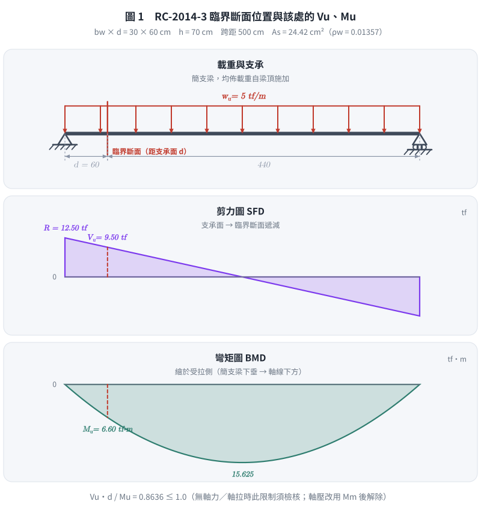
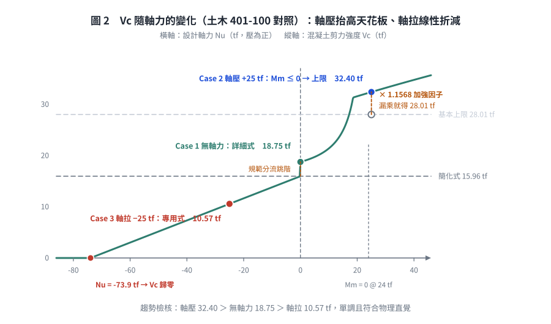
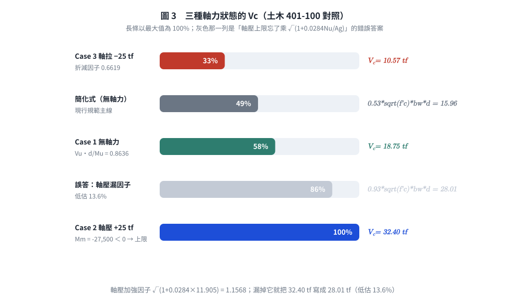

# 考題編號：RC-2014-3

**主分類：** `RC-U2-1` RC 剪力強度分析與設計
**副分類：** （無）
**設計法：** USD 強度設計法
**標籤：** `臨界斷面` `Vc最大混凝土剪力強度` `軸力影響` `等效彎矩Mm` `詳細公式` `軸壓梁` `軸拉梁` `軸壓Vc上限加強` `軸拉專用式` `規範分流`

---

## 1. 題目（考卷原文見題目正本）

> 考卷原文、公式／附表、附圖與判讀清單（已確認）見 [`RC-2014-3-problem.md`](RC-2014-3-problem.md)。本節只列解題時最容易讀錯的地方與本解使用的記號；題意以題目正本為準。

### 常見誤讀

| 項目 | 正確判讀 | 常見誤讀 |
|------|---------|---------|
| 均佈載重 | 「均佈設計載重 5 tf」讀為 $w_u$＝5 tf/m（使用者確認） | 全跨合計 5 tf |
| 所求 | 標稱 $V_c$（題文「計算強度」，不乘 $\phi$） | $\phi V_c$ |
| 臨界斷面 | 距支承**面** $d$＝60 cm | 距支承中心 |
| 「最大」 | 現行規範兩式（$0.53\sqrt{f'_c}$ 式與 $2.1\rho_w^{1/3}\sqrt{f'_c}$ 式）取大，軸力以 $N_u/6A_g$ 併入 | 只用簡化式 |
| 規範 | 考卷指定土木 401-100 並印出詳細式與 $M_m$ 式；依本庫規則改用現行台灣規範（已刪除 $M_m$ 法與軸拉專用式） | 照考卷 401-100 作主線（本庫 2026-11-15 前舊解：18.75／32.40／10.57 tf） |

**本解記號：** $N_u$＝設計軸力（壓為正、拉為負）；$\rho_w=A_s/(b_wd)$；$M_m$＝舊規範軸壓修正彎矩（僅 §5 對照用）。規範：建築物混凝土結構設計規範（內政部 2023 年版），假設 $A_v\ge A_{v,\min}$、常重混凝土。

#### 判讀圖解（解析自繪）



*圖 1　臨界斷面位置與該處的 $V_u$、$M_u$。臨界斷面自**支承面**起算 $d$（不是支承中心）。現行規範的 $V_c$ 式不含 $V_ud/M_u$；圖中 $M_u$ 只供 §5 的 401-100 對照（$V_ud/M_u$＝0.8636）。*

---

---

## 2. 考題核心精神與出題者意圖 (Core Concepts & Examiner's Intent)

**核心精神：** 軸力對混凝土剪力強度的影響——軸壓抑制斜裂縫、提高 $V_c$；軸拉促進開裂、降低 $V_c$。

現行規範（2023，ACI 318-19 世代）把 $V_c$ 改寫為表列兩式，軸力以單一線性項 $N_u/(6A_g)$ 處理壓與拉：

$$A_v\ge A_{v,\min}:\quad V_c=\max\!\left\{\left[0.53\lambda\sqrt{f'_c}+\frac{N_u}{6A_g}\right]b_wd,\ \left[2.1\lambda\rho_w^{1/3}\sqrt{f'_c}+\frac{N_u}{6A_g}\right]b_wd\right\}$$

$$\frac{N_u}{6A_g}\le0.05f'_c,\qquad 0\le V_c\le1.33\lambda\sqrt{f'_c}\,b_wd$$

**出題者意圖（考卷依 401-100 命題）：** 測試三種軸力狀態的規範分流（詳細式、$M_m$ 法與軸壓加強上限、軸拉專用式）。依本庫「規範版本」規則，主線改用現行規範，401-100 的分流解法完整保留於 §5 對照。

---

## 3. 解題戰略地圖與陷阱分析 (Strategic Roadmap & Trap Analysis)

**作戰計畫：**

```
共用前置：ρw、√f'c、Ag、bw·d、臨界斷面位置（距支承面 d）
三案例：Nu/(6Ag)（壓正拉負，≤0.05f'c）
  → 式(a) [0.53√f'c + Nu/6Ag]bw·d
  → 式(b) [2.1 ρw^(1/3) √f'c + Nu/6Ag]bw·d
  → 取大者，檢查 0 ≤ Vc ≤ 1.33√f'c·bw·d
```

**關鍵陷阱：**

| # | 陷阱 | 應對策略 |
|---|------|---------|
| 1 | 照考卷印出的 401-100 詳細式／$M_m$ 法作主線 | 現行規範已刪除；只在 §5 對照 |
| 2 | **$N_u$ 符號搞混** | 壓力 $N_u > 0$，拉力 $N_u < 0$ |
| 3 | $A_g$ 用 $b\,d$ | $A_g=b\,h=2100$ cm² |
| 4 | 以為 $\rho_w^{1/3}$ 式一定較大 | 本題 $\rho_w$＝0.0136 → 式(b) 較小，由式(a) 控制 |
| 5 | **臨界斷面位置錯誤**：取支承中心起算 | 自**支承面**起算 $d$（三條件成立）；現行式 $V_c$ 與位置無關，但 $V_u$ 檢核仍取此處 |

---

## 3.5 變數層次分析 (Variable Hierarchy Analysis)

> 複習提示：第一次解題後，在每個卡住的知識點旁標記 `⚠`；第二次複習時只看有 `⚠` 的項目。

### 最終目標
`三種軸力條件下，臨界斷面之最大混凝土剪力計算強度 Vc（標稱）`

### 本題關鍵公式（依計算順序）

> $\boxed{\cdot}$ = 需由前步驟推導，非題目直接給定的變數

$$\text{Step 1:}\quad \rho_w = \frac{A_s}{b_w d},\quad A_g = bh,\quad \frac{N_u}{6A_g}$$

$$\text{Step 2:}\quad V_{c,a} = \left[0.53\sqrt{f'_c}+\frac{\boxed{N_u}}{6A_g}\right]b_wd,\qquad V_{c,b} = \left[2.1\boxed{\rho_w}^{1/3}\sqrt{f'_c}+\frac{\boxed{N_u}}{6A_g}\right]b_wd$$

$$\text{Step 3:}\quad V_c=\min\!\left(\max(V_{c,a},V_{c,b}),\ 1.33\sqrt{f'_c}\,b_wd\right)\ge0$$

### L1：題目直接給定

| 符號 | 數值 | 說明 |
|------|------|------|
| $b$ | 30 cm | 梁寬 |
| $d$ | 60 cm | 有效深度 |
| $h$ | 70 cm | 梁高 |
| $f'_c$ | 280 kgf/cm² | 混凝土強度 |
| $A_s$ | 24.42 cm² | 拉力鋼筋量（3-D32） |
| $L$ | 500 cm | 跨距 |
| $w_u$ | 5 tf/m = 50 kgf/cm | 均布設計載重 |
| $N_{u,2}$ | +25,000 kgf | Case 2 軸壓力（正） |
| $N_{u,3}$ | −25,000 kgf | Case 3 軸拉力（負） |

### L2：需知識點推導

| 符號 | 公式／來源 | 卡關? |
|------|----------|:-----:|
| $\rho_w$ | $24.42/(30\times60) = 0.01357$；$\rho_w^{1/3}=0.2385$ | |
| $\sqrt{f'_c}$ | $\sqrt{280} = 16.733$ | |
| $b_w d$ | $30\times60 = 1800\ \text{cm}^2$ | |
| $A_g$ | $30\times70 = 2100\ \text{cm}^2$ | |
| $N_u/6A_g$ | $\pm25{,}000/12{,}600 = \pm1.984$ kgf/cm²（≤ 14） | |
| 式(a) 係數 | $0.53\times16.733 = 8.868$ kgf/cm² | |
| 式(b) 係數 | $2.1\times0.2385\times16.733 = 8.381$ kgf/cm²（< 8.868） | |
| 臨界斷面 $V_u$ | $50\times(250-60) = 9{,}500$ kgf（題目未要求，供檢核） | |

### L3：深層知識（不懂就卡住）

| 知識點 | 說明 | 卡關? |
|--------|------|:-----:|
| **現行規範刪除 $M_m$ 法** | ACI 318-19／台灣 2023 版以 $N_u/6A_g$ 線性項取代 $M_m$ 與 $\sqrt{1+0.0284N_u/A_g}$ 上限加強，壓拉共用一式 | |
| **兩式取其一** | $A_v\ge A_{v,\min}$ 時可用式(a) 或式(b)，「最大」即取較大者；$A_v<A_{v,\min}$ 須用式(b) 並乘尺寸效應 $\lambda_s$ | |
| **$V_c$ 歸零點** | $8.868 + N_u/12{,}600 = 0 \Rightarrow N_u = -111.7$ tf | |

---

## 4. 步驟化詳細計算過程 (Step-by-Step Detailed Calculation)

### 前置計算（三案例共用）

$$\rho_w = \frac{24.42}{30\times60} = \boxed{0.01357},\qquad \rho_w^{1/3} = 0.2385$$

$$\sqrt{f'_c} = \sqrt{280} = 16.733,\qquad b_w d = 1800\ \text{cm}^2,\qquad A_g = 30\times70 = 2100\ \text{cm}^2$$

**臨界斷面**：距支承面 $d$＝60 cm（簡支支承提供壓力、均佈載重自梁頂施加、區間內無集中載重）。$V_u = 50\times(250-60) = 9{,}500$ kgf、$M_u = 660{,}000$ kgf·cm（現行式不需要，供 §5 對照）。

**兩式的無軸力部分：**

$$\text{(a)}\ 0.53\sqrt{f'_c} = 8.868\ \text{kgf/cm}^2,\qquad \text{(b)}\ 2.1\rho_w^{1/3}\sqrt{f'_c} = 2.1\times0.2385\times16.733 = 8.381\ \text{kgf/cm}^2$$

式(a) 較大，三案例皆由式(a) 控制。上限 $1.33\sqrt{f'_c}\,b_wd = 1.33\times16.733\times1800 = 40{,}059$ kgf。

---

### Case 1：無軸力（$N_u = 0$）

$$V_{c,a} = 8.868\times1800 = 15{,}963\ \text{kgf},\qquad V_{c,b} = 8.381\times1800 = 15{,}086\ \text{kgf}$$

$$\boxed{V_c = 15{,}963\ \text{kgf} = 15.96\ \text{tf}}$$

---

### Case 2：設計軸壓力 $N_u = +25\ \text{tf}$

$$\frac{N_u}{6A_g} = \frac{25{,}000}{6\times2100} = 1.984\ \text{kgf/cm}^2 \le 0.05f'_c = 14\ ✓$$

$$V_{c,a} = (8.868+1.984)\times1800 = 10.852\times1800 = 19{,}534\ \text{kgf}\quad(V_{c,b} = 18{,}657)$$

$$\boxed{V_c = 19{,}534\ \text{kgf} = 19.53\ \text{tf}}\quad(<40{,}059\ ✓)$$

---

### Case 3：設計軸拉力 $N_u = -25\ \text{tf}$

$$\frac{N_u}{6A_g} = \frac{-25{,}000}{12{,}600} = -1.984\ \text{kgf/cm}^2$$

$$V_{c,a} = (8.868-1.984)\times1800 = 6.884\times1800 = 12{,}391\ \text{kgf}\quad(V_{c,b} = 11{,}514)$$

$$\boxed{V_c = 12{,}391\ \text{kgf} = 12.39\ \text{tf}}$$

---

### 彙總比較表

| 案例 | $N_u$ (kgf) | $N_u/6A_g$ | 控制式 | $V_c$ (kgf) | $V_c$ (tf) |
|------|:-----------:|:---:|---------|:-----------:|:----------:|
| Case 1 無軸力 | 0 | 0 | (a) | **15,963** | **15.96** |
| Case 2 軸壓 | +25,000 | +1.984 | (a) | **19,534** | **19.53** |
| Case 3 軸拉 | −25,000 | −1.984 | (a) | **12,391** | **12.39** |

**趨勢檢核：** 軸壓（19.53）> 無軸力（15.96）> 軸拉（12.39）✓；壓、拉對稱各 ±22%。

---

## 5. 關鍵爭議點與進階探討 (Critical Issues & Advanced Discussion)

**① 考卷指定的土木 401-100 解法（對照）**

考卷印出詳細式 $V_c=\left(0.50\sqrt{f'_c}+175\rho_w\frac{V_ud}{M_u}\right)b_wd\le0.93\sqrt{f'_c}\,b_wd$ 與 $M_m=M_u-N_u\frac{4h-d}{8}$。401-100 對三種軸力分流：

| 案例 | 401-100 路徑 | 關鍵中間值 | $V_c$ |
|------|---------|-----------|:---:|
| 無軸力 | 詳細式 | $V_ud/M_u = 9{,}500\times60/660{,}000 = 0.8636\le1$ → $(8.366+175\times0.01357\times0.8636)\times1800$ | 18.75 tf |
| 軸壓 | $M_m = 660{,}000-25{,}000\times27.5 = -27{,}500<0$ → 取軸壓加強上限 $0.93\sqrt{f'_c}b_wd\sqrt{1+0.0284N_u/A_g}$ | $28{,}011\times\sqrt{1.3381} = 28{,}011\times1.1568$ | 32.40 tf |
| 軸拉 | 軸拉專用式 $0.53(1+0.0284N_u/A_g)\sqrt{f'_c}b_wd$ | $1-0.3381 = 0.6619$ | 10.57 tf |

401-100 的易錯點：軸壓上限忘了乘 $\sqrt{1+0.0284N_u/A_g}$（寫成 28.01 tf，低估 13.5%）；$M_m<0$ 仍代詳細式得負值；軸拉硬套 $M_m$（得 16.87 tf，比無軸力簡化式還高，不合理）。



*圖 2　**401-100（考卷當年規範）**下 $V_c$ 隨軸力的變化，供對照；現行規範為斜率 $b_wd/6A_g$ 的直線（$N_u$＝0 時 15.96 tf）。*



*圖 3　**401-100** 下三種軸力狀態的 $V_c$ 與常見錯誤答案，供對照。*

**② 現行規範與 401-100 的差異**

| 案例 | 401-100（考卷指定） | 現行規範（本解主線） | 差異 |
|------|:---:|:---:|:---:|
| 無軸力 | 18.75 tf | **15.96 tf** | −14.9% |
| 軸壓 +25 tf | 32.40 tf | **19.53 tf** | −39.7% |
| 軸拉 −25 tf | 10.57 tf | **12.39 tf** | +17.2% |

1. 現行式取消 $\rho_w$ 與 $V_ud/M_u$ 交互作用的詳細式，改用 $\rho_w^{1/3}$，**不再需要斷面的 $M_u$**。
2. 軸力效應由「$M_m$ ＋ 開根號上限」改成**線性的 $N_u/(6A_g)$**，壓與拉共用一式；軸壓加成與軸拉折減都溫和許多。
3. 現行規範另有尺寸效應因數 $\lambda_s=\sqrt{2/(1+0.04d)}\le1$（$d$ 以 cm 計），只在 $A_v<A_{v,\min}$ 時適用；本題假設腹筋充足不觸發。若腹筋不足：$\lambda_s=\sqrt{2/3.4}=0.767$，式(b) 乘 0.767 後無軸力 $V_c$＝11.57 tf。

**③ 「最大混凝土剪力計算強度」該怎麼讀**

「最大」＝規範允許的路徑中取最大者。現行規範下即式(a)、式(b) 取大（本題式(a) 控制）；401-100 下為詳細式與上限式。

**④ 舊規範係數的來源（對照用）**

401-100 軸壓上限因子 $0.0284$＝ACI 英制 $0.002\times14.223$；軸拉專用式 $0.53(1+N_u/35A_g)$ 來自英制 $2(1+N_u/500A_g)$。

*圖解補繪：2026-09-02（向量圖 3 張，腳本 `figs/gen_RC-2014-3.py`，可重跑；腳本檔尾對 §4 公佈值做 assert）*

*修正日期：2026-11-15（§1 改為指向題目正本；舊 §1 重述改寫為常見誤讀與本解記號；本行非答案勘誤）*

*修正日期：2026-11-15（解析勘誤：改依現行台灣規範（建築物混凝土結構設計規範 2023 年版），主線改為表列兩式取大＋Nu/6Ag：無軸力 18.75 → 15.96 tf、軸壓 32.40 → 19.53 tf、軸拉 10.57 → 12.39 tf；考卷指定 401-100 的 Mm 分流解法降為 §5 對照，圖 2、圖 3 改標為 401-100 對照圖；驗證：盲解比對 + 勘誤腳本重算 MISMATCHES: 0）*

*修正日期：2026-11-15（落實檢查殘留修正（非勘誤）：圖 2、圖 3 標題加註「土木 401-100 對照」、圖 3「簡化式」副標「保守估算用」改為「現行規範主線」並重產；答案不變）*
