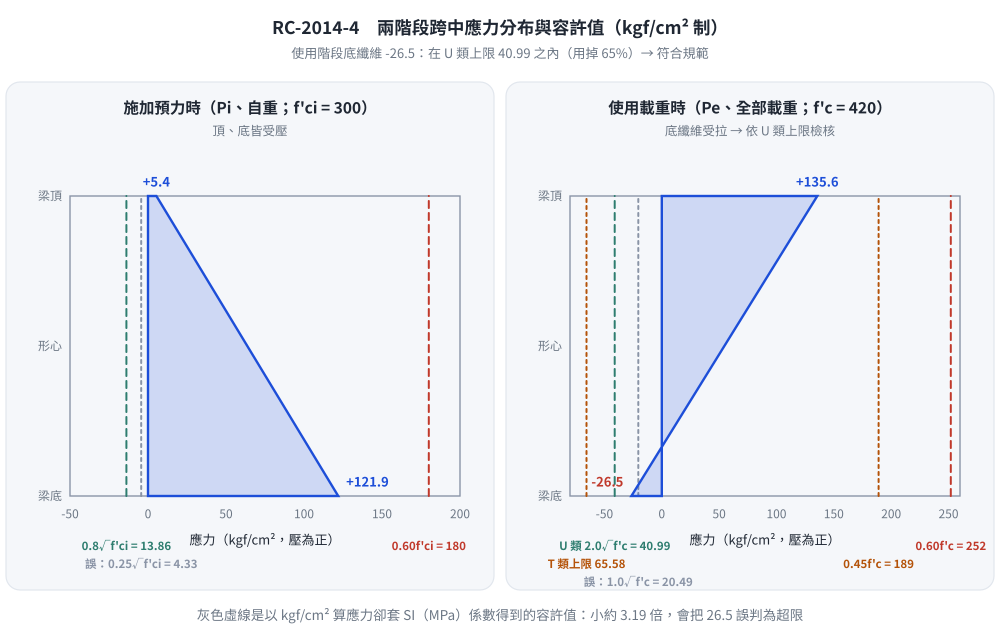

# 考題編號：RC-2014-4

**主分類：** `RC-U4-1` 預力梁斷面應力分析
**副分類：** （無）
**設計法：** WSD 工作應力法（彈性理論）
**標籤：** `預力梁斷面應力` `兩階段分析` `施加預力階段` `服務載重階段` `對稱I形斷面` `容許應力檢核` `簡支預力梁` `U類未開裂`

---

## 1. 題目（考卷原文見題目正本）

> 考卷原文、公式／附表、附圖與判讀清單（已確認）見 [`RC-2014-4-problem.md`](RC-2014-4-problem.md)。本節只列解題時最容易讀錯的地方與本解使用的記號；題意以題目正本為準。

### 常見誤讀

| 項目 | 正確判讀 | 常見誤讀 |
|------|---------|---------|
| 斷面模數 $S$（#1） | 考卷印 $15.63\times10^4$，依 $I_c/c=4.69\times10^5/30$ 修正為 $1.563\times10^4=15{,}633$ cm³（使用者確認） | 照印值 156,300，彎曲應力小 10 倍 |
| 工作載重（#4） | 1.1 tf/m 為自重以外的外加載重，使用階段合計 1.364 tf/m（使用者確認） | 1.1 已含自重 |
| 兩個階段（#3） | ① $P_i$＋自重，用 $f'_{ci}=300$；② $P_e$＋自重＋工作載重，用 $f'_c=420$ | 兩階段共用同一強度 |
| U 類（#5） | 使用階段拉應力依 U 類上限 $2.0\sqrt{f'_c}$ 檢核 | 忽略分類 |
| 容許拉應力的單位制 | kgf/cm² 制：傳遞 $0.8\sqrt{f'_{ci}}$、U 類 $2.0\sqrt{f'_c}$（SI 制 $0.25\sqrt{f'_{ci}}$、$0.62\sqrt{f'_c}$ 乘 $\sqrt{10.2}\approx3.19$） | 以 kgf/cm² 算應力卻套 SI（MPa）係數 $0.25\sqrt{\cdot}$、$0.5\sqrt{\cdot}$、$1.0\sqrt{\cdot}$，容許值小約 3 倍，誤判「不符合規範」 |

**本解記號：** $c_1=c_2=30$ cm（全深 60 cm，對稱）；$r^2=I_c/A_c=426$ cm²；$e=19.8$ cm（形心下方，全跨固定）。容許應力考卷未給，依現行台灣規範（建築物混凝土結構設計規範 2023，kgf/cm² 制）。

---

## 2. 考題核心精神與出題者意圖 (Core Concepts & Examiner's Intent)

**核心精神：**
預力混凝土設計的工作應力法（WSD）核心是「**疊加**」——在梁中點，斷面承受三個來源的應力（均布預力 + 偏心引起的彎矩預應力 + 外力彎矩），依據彈性理論逐項計算後代數疊加。

**兩階段的本質差異：**
- **Stage 1（施加預力時）**：預力最大（$P_i$），外力彎矩最小（僅自重）。頂纖維可能受拉，底纖維大壓。
- **Stage 2（服務載重後）**：預力已損失（$P_e$），外力彎矩最大（自重＋活載重）。底纖維可能出現過大拉應力。

**出題者意圖：**
1. 測試兩階段的正確「換料」（Stage 1 用 $P_i$、$f'_{ci}$；Stage 2 用 $P_e$、$f'_c$）
2. 驗算規範容許應力（尤其是 Stage 2 底纖維拉應力是否在 U 類上限內）

---

## 3. 解題戰略地圖與陷阱分析 (Strategic Roadmap & Trap Analysis)

**作戰計畫：**

```
前置計算：
  → S = I_c/c₁，各力項 (P/A)、(Pe/S)、(M/S) 逐一算出

Stage 1（施加預力時）：P = Pi，M = Md（僅自重）
  f_top_1 = Pi/Ac - Pi×e/S + Md/S
  f_bot_1 = Pi/Ac + Pi×e/S - Md/S

Stage 2（服務載重後）：P = Pe，M = MT（自重＋活載重）
  f_top_2 = Pe/Ac - Pe×e/S + MT/S
  f_bot_2 = Pe/Ac + Pe×e/S - MT/S

規範驗算：分別對照 Stage 1（f'ci）和 Stage 2（f'c）的容許壓/拉應力
```

**關鍵陷阱：**

| # | 陷阱 | 應對策略 |
|---|------|---------|
| 1 | **Stage 1 和 Stage 2 混用 P 或 f'c** | Stage 1 用 $P_i$、$f'_{ci}$；Stage 2 用 $P_e$、$f'_c$——兩組數據完全分開 |
| 2 | **忘記 Stage 1 只有自重（無活載重）** | "施加預力時"表示在此時刻，活載重尚未施加；$M = w_d L^2/8$ only |
| 3 | **偏心項符號搞錯**：e 在形心下方 | 偏心在下方 → 底纖維受壓（+）、頂纖維受拉（−）；再加 M 對頂面是壓、底面是拉 |
| 4 | **S 數值計算錯誤**：直接用題目誤植的 $S$ | 須由 $I_c/c$ 計算 $S$，驗算與 $r^2$ 一致性 |
| 5 | **容許應力用錯**：Stage 1 拿 $f'_c$ 當基準 | Stage 1 用 $f'_{ci} = 300$；Stage 2 用 $f'_c = 420$ |
| 6 | **容許拉應力單位制混用** | kgf/cm² 制係數為 $0.8$（傳遞）、$2.0$（U 類）；SI 係數要乘 $\sqrt{10.2}\approx3.19$ |

---

## 3.5 變數層次分析 (Variable Hierarchy Analysis)

> 複習提示：第一次解題後，在每個卡住的知識點旁標記 `⚠`；第二次複習時只看有 `⚠` 的項目。

### 最終目標
`兩階段（施加預力、服務載重）之梁中點上下纖維應力；各與規範容許值比較`

### 本題關鍵公式（依計算順序）

> $\boxed{\cdot}$ = 需由前步驟推導，非題目直接給定的變數

$$\text{Step 1:}\quad S = I_c/c,\quad M_d = w_d L^2/8,\quad M_T = (w_d+w_l)\,L^2/8$$

$$\text{Step 2（Stage 1）:}\quad
f_{\text{top},1} = \frac{P_i}{A_c} - \frac{P_i\,e}{\boxed{S}} + \frac{\boxed{M_d}}{\boxed{S}},\quad
f_{\text{bot},1} = \frac{P_i}{A_c} + \frac{P_i\,e}{\boxed{S}} - \frac{\boxed{M_d}}{\boxed{S}}$$

$$\text{Step 3（Stage 2）:}\quad
f_{\text{top},2} = \frac{P_e}{A_c} - \frac{P_e\,e}{\boxed{S}} + \frac{\boxed{M_T}}{\boxed{S}},\quad
f_{\text{bot},2} = \frac{P_e}{A_c} + \frac{P_e\,e}{\boxed{S}} - \frac{\boxed{M_T}}{\boxed{S}}$$

$$\text{Step 4:}\quad \text{與規範容許值比較（壓：}0.6f'_{ci}/0.60f'_c\text{；拉：}0.8\sqrt{f'_{ci}}/2.0\sqrt{f'_c}\text{，kgf/cm}^2\text{ 制）}$$

### L1：題目直接給定

| 符號 | 數值 | 說明 |
|------|------|------|
| $L$ | 1200 cm | 跨距 |
| $I_c$ | 469,000 cm⁴ | 斷面慣性矩 |
| $A_c$ | 1100 cm² | 斷面面積 |
| $c_1 = c_2$ | 30 cm | 形心至頂／底纖維距離 |
| $e$ | 19.8 cm | 鋼腱偏心（形心下方） |
| $P_i$ | 70,000 kgf | 初施預力 |
| $P_e$ | 60,000 kgf | 有效預力（損失後） |
| $w_d$ | 0.264 tf/m | 梁自重 |
| $w_l$ | 1.1 tf/m | 工作載重 |
| $f'_{ci}$ | 300 kgf/cm² | 施加預力時混凝土強度 |
| $f'_c$ | 420 kgf/cm² | 28天抗壓強度 |

### L2：需知識點推導

**前置：斷面模數與彎矩**

| 符號 | 公式／來源 | 卡關? |
|------|----------|:-----:|
| $S$ | $I_c/c = 469{,}000/30 = 15{,}633\ \text{cm}^3$ | |
| $r^2$ 驗算 | $I_c/A_c = 469{,}000/1100 = 426.4 \approx 426$ ✓ | |
| $M_d$ | $0.264\times12^2/8 = 4.752\ \text{tf·m} = 475{,}200\ \text{kgf·cm}$ | |
| $M_T$ | $(0.264+1.1)\times18 = 24.552\ \text{tf·m} = 2{,}455{,}200\ \text{kgf·cm}$ | |

**Stage 1 應力項**

| 符號 | 公式／來源 | 卡關? |
|------|----------|:-----:|
| $P_i/A_c$ | $70{,}000/1100 = 63.64\ \text{kgf/cm}^2$ | |
| $P_i\,e/S$ | $70{,}000\times19.8/15{,}633 = 88.66\ \text{kgf/cm}^2$ | |
| $M_d/S$ | $475{,}200/15{,}633 = 30.40\ \text{kgf/cm}^2$ | |

**Stage 2 應力項**

| 符號 | 公式／來源 | 卡關? |
|------|----------|:-----:|
| $P_e/A_c$ | $60{,}000/1100 = 54.55\ \text{kgf/cm}^2$ | |
| $P_e\,e/S$ | $60{,}000\times19.8/15{,}633 = 76.00\ \text{kgf/cm}^2$ | |
| $M_T/S$ | $2{,}455{,}200/15{,}633 = 157.05\ \text{kgf/cm}^2$ | |

### L3：深層知識（不懂就卡住）

| 知識點 | 說明 | 卡關? |
|--------|------|:-----:|
| **兩階段為何用不同 P 與 f'c** | 預力損失發生在施加預力後；混凝土強度也從 $f'_{ci}$ 隨時間增長至 $f'_c$。兩階段各選最不利者驗算 | |
| **偏心應力的符號方向** | e 在形心**下方** → 預力對底纖維產生**壓**（+），對頂纖維產生**拉**（−）；與彎矩效果相反 | |
| **容許拉應力限制的物理意義** | U 類上限 $2.0\sqrt{f'_c}$ 約等於開裂模數 $f_r$，在此之內斷面視為未開裂、可用全斷面彈性分析；超過即進入 T 類（$\le3.2\sqrt{f'_c}$，撓度要用開裂斷面） | |
| **單位制換算** | $k\sqrt{f'_c}$ 型限值換單位時係數要乘 $\sqrt{10.2}\approx3.19$：SI $0.25\to0.8$、$0.5\to1.6$、$0.62\to2.0$ | |

---

## 4. 步驟化詳細計算過程 (Step-by-Step Detailed Calculation)

### 前置：斷面與彎矩計算

$$S = \frac{I_c}{c_1} = \frac{4.69\times10^5}{30} = \boxed{15{,}633\ \text{cm}^3}$$

驗算：$r^2 = I_c/A_c = 469{,}000/1100 = 426.4 \approx 426\ \text{cm}^2\ ✓$

$$M_d = \frac{w_d\,L^2}{8} = \frac{0.264\times144}{8} = \boxed{4.752\ \text{tf·m} = 475{,}200\ \text{kgf·cm}}$$

$$M_T = \frac{(w_d + w_l)\,L^2}{8} = \frac{(0.264+1.100)\times144}{8} = \frac{1.364\times144}{8} = \boxed{24.552\ \text{tf·m} = 2{,}455{,}200\ \text{kgf·cm}}$$

---

### 應力公式說明

對稱簡支預力梁，以**壓應力為正**，鋼腱偏心 $e$ 在形心**下方**，中點彎矩為正（下緣受拉）：

$$f_{\text{頂}} = \frac{P}{A_c} - \frac{P\,e}{S} + \frac{M}{S}$$

$$f_{\text{底}} = \frac{P}{A_c} + \frac{P\,e}{S} - \frac{M}{S}$$

---

### Stage 1：施加預力時（$P = P_i = 70\ \text{tf}$，$M = M_d$）

$$\frac{P_i}{A_c} = \frac{70{,}000}{1100} = 63.64\ \text{kgf/cm}^2$$

$$\frac{P_i\,e}{S} = \frac{70{,}000\times19.8}{15{,}633} = \frac{1{,}386{,}000}{15{,}633} = 88.66\ \text{kgf/cm}^2$$

$$\frac{M_d}{S} = \frac{475{,}200}{15{,}633} = 30.40\ \text{kgf/cm}^2$$

$$\boxed{f_{\text{頂},1} = 63.64 - 88.66 + 30.40 = +5.38\ \text{kgf/cm}^2 \quad \text{（壓C）}}$$

$$\boxed{f_{\text{底},1} = 63.64 + 88.66 - 30.40 = +121.90\ \text{kgf/cm}^2 \quad \text{（壓C）}}$$

---

### Stage 2：服務載重後（$P = P_e = 60\ \text{tf}$，$M = M_T$）

$$\frac{P_e}{A_c} = \frac{60{,}000}{1100} = 54.55\ \text{kgf/cm}^2$$

$$\frac{P_e\,e}{S} = \frac{60{,}000\times19.8}{15{,}633} = \frac{1{,}188{,}000}{15{,}633} = 76.00\ \text{kgf/cm}^2$$

$$\frac{M_T}{S} = \frac{2{,}455{,}200}{15{,}633} = 157.05\ \text{kgf/cm}^2$$

$$\boxed{f_{\text{頂},2} = 54.55 - 76.00 + 157.05 = +135.60\ \text{kgf/cm}^2 \quad \text{（壓C）}}$$

$$\boxed{f_{\text{底},2} = 54.55 + 76.00 - 157.05 = -26.50\ \text{kgf/cm}^2 \quad \text{（拉T）}}$$

---

### 兩階段彙總表

| 纖維位置 | Stage 1 ($P_i$, $M_d$) | Stage 2 ($P_e$, $M_T$) |
|---------|:--------------------:|:--------------------:|
| **頂纖維** | $+5.38\ \text{kgf/cm}^2$（C） | $+135.60\ \text{kgf/cm}^2$（C） |
| **底纖維** | $+121.90\ \text{kgf/cm}^2$（C） | $-26.50\ \text{kgf/cm}^2$（**T**） |

（C = 壓；T = 拉）

---

### 規範容許應力驗算

#### Stage 1（$f'_{ci} = 300\ \text{kgf/cm}^2$）

| 限制類型 | 計算限值 | 頂纖維 | 底纖維 | 判定 |
|---------|:--------:|:------:|:------:|:----:|
| 壓應力 ≤ $0.60\,f'_{ci}$ | $0.60\times300 = 180\ \text{kgf/cm}^2$ | $5.38 \leq 180$ | $121.90 \leq 180$ | ✅ |
| 拉應力 ≤ $0.8\sqrt{f'_{ci}}$ | $0.8\times\sqrt{300} = 13.86\ \text{kgf/cm}^2$ | 無拉應力 | 無拉應力 | ✅ |

$$\sqrt{f'_{ci}} = \sqrt{300} = 17.32\ \text{kgf/cm}^2$$

**→ Stage 1 兩纖維均符合規範 ✅**

---

#### Stage 2（$f'_c = 420\ \text{kgf/cm}^2$）

$$\sqrt{f'_c} = \sqrt{420} = 20.49\ \text{kgf/cm}^2$$

| 限制類型 | 計算限值 | 頂纖維 | 底纖維 | 判定 |
|---------|:--------:|:------:|:------:|:----:|
| 壓應力 ≤ $0.60\,f'_c$（有效預力＋全部載重） | $0.60\times420 = 252\ \text{kgf/cm}^2$ | $135.60 \leq 252$ | — | ✅ |
| 壓應力 ≤ $0.45\,f'_c$（有效預力＋持續載重） | $0.45\times420 = 189\ \text{kgf/cm}^2$ | 持續載重（$P_e$＋自重）頂緣 $8.95$；即使全部載重視為持續，$135.60 \leq 189$ | — | ✅ |
| 拉應力 ≤ $2.0\sqrt{f'_c}$（U 類） | $2.0\times20.49 = 40.99\ \text{kgf/cm}^2$ | — | $26.50 \leq 40.99$ | ✅ |

$$\boxed{\text{Stage 2 底纖維拉應力 } 26.50\ \text{kgf/cm}^2 \le 2.0\sqrt{f'_c} = 40.99\ \text{kgf/cm}^2 \Rightarrow \textbf{符合規範（U 類）} ✅}$$

**→ 兩階段上下纖維均符合現行規範（底纖維拉應力用掉 U 類上限的 65%）。**



*圖 1　兩階段應力分布與 kgf/cm² 制容許值。灰色虛線是以 kgf/cm² 算應力卻套 SI 係數得到的容許值——這張圖攔的是單位制混用：容許值小約 3.19 倍，會把 $-26.5$ 誤判為超限。*

---

## 5. 關鍵爭議點與進階探討 (Critical Issues & Advanced Discussion)

**① Stage 2 底纖維受拉的工程分析（符合 U 類）**

底纖維出現拉應力（$-26.50\ \text{kgf/cm}^2$）的原因是：

$$\frac{M_T}{S} = 157.05 > \frac{P_e}{A_c} + \frac{P_e\,e}{S} = 54.55 + 76.00 = 130.55\ \text{kgf/cm}^2$$

外力彎矩項 $(M_T/S)$ 超過預力總效果約 **26.5 kgf/cm²**，但仍在 U 類上限 $2.0\sqrt{f'_c}=40.99$ 之內（題目稱「U 類型預力梁」即指此），斷面視為未開裂。

**容許拉應力的單位制陷阱：** 規範的 $k\sqrt{f'_c}$ 型限值，SI（MPa）與 kgf/cm² 制係數不同，換算要乘 $\sqrt{10.2}\approx3.19$：

| 限值 | SI（MPa） | kgf/cm² | 本題值 |
|------|:--:|:--:|:--:|
| 傳遞階段拉應力 | $0.25\sqrt{f'_{ci}}$ | $0.8\sqrt{f'_{ci}}$ | 13.86 |
| U 類上限 | $0.62\sqrt{f'_c}$ | $2.0\sqrt{f'_c}$ | 40.99 |
| T 類上限 | $1.0\sqrt{f'_c}$ | $3.2\sqrt{f'_c}$ | 65.58 |

若以 kgf/cm² 算應力卻套 SI 係數（如 $1.0\sqrt{f'_c}=20.49$），會把合格斷面誤判為超限。本題舊版解析即曾如此判「不符合規範」（2026-11-14 勘誤）。

**若要增加餘裕（工程設計角度）：**

| 方法 | 效果 | 備註 |
|------|------|------|
| 增加有效預力 $P_e$ | 提升 $P_e/A_c$ 和 $P_e\,e/S$ | 受鋼腱許可應力與傳遞階段頂纖維限制 |
| 增加偏心距 $e$ | 提升 $P_e\,e/S$ | 受斷面幾何與傳遞階段頂纖維限制 |
| 增加斷面尺寸（增大 $S$） | 降低 $M_T/S$ | 自重也增加 |
| 提高混凝土強度 $f'_c$ | 放寬容許拉應力 | $2.0\sqrt{f'_c}$ 隨 $f'_c$ 增加 |

**② Stage 1 頂纖維低壓應力（5.38 kgf/cm²）的意涵**

Stage 1 頂纖維僅 5.38 kgf/cm² 壓應力，說明偏心預力對頂部的「反彎矩」效果（88.66 kgf/cm² 拉）幾乎抵銷了均布預壓（63.64 kgf/cm² 壓），再由自重彎矩（30.40 kgf/cm² 壓）拉回正值。

這是典型的「**大偏心預力設計**」—— 偏心率 $e/c = 19.8/30 = 0.66$，幾乎接近容許最大偏心。

**③ 兩階段預力損失的影響**

預力從 $P_i = 70\ \text{tf}$ 損失至 $P_e = 60\ \text{tf}$（損失率 14.3%），應力影響：

$$\Delta(P/A_c) = (63.64 - 54.55) = 9.09\ \text{kgf/cm}^2 \quad \Delta(Pe/S) = (88.66 - 76.00) = 12.66\ \text{kgf/cm}^2$$

底纖維因預力損失，壓應力貢獻減少 $9.09 + 12.66 = 21.75\ \text{kgf/cm}^2$。搭配活載重引入的大量拉應力（$M_l/S = 1.1\times18\times10^5/15{,}633 = 126.65\ \text{kgf/cm}^2$），底纖維從 Stage 1 的 +121.9 kgf/cm² 壓應力「翻轉」至 Stage 2 的 -26.5 kgf/cm² 拉應力，反差達 **148.4 kgf/cm²**。

*修正日期：2026-11-14（§1 改為指向題目正本（本題無附圖）；S 指數筆誤說明併入常見誤讀）*

*修正日期：2026-11-14（解析勘誤：容許拉應力誤用 SI 制係數——傳遞 $0.25\sqrt{f'_{ci}}=4.33$ → $0.8\sqrt{f'_{ci}}=13.86$、使用 $1.0\sqrt{f'_c}=20.49$ → U 類 $2.0\sqrt{f'_c}=40.99$；使用階段壓應力改依現行規範 $0.60f'_c$（全部載重）／$0.45f'_c$（持續）；結論「Stage 2 底纖維超限、不符合規範」→「符合規範（U 類）」，應力值不變；依現行台灣規範（建築物混凝土結構設計規範 2023）；verify 腳本重算 MISMATCHES: 0）*

*圖解補繪：2026-11-14（向量圖 1 張 `figs/RC-2014-4-fig-1-stress.svg`，腳本 `gen_RC-2014-4.py`，可重跑；腳本檔尾對 §4／§5 公佈值做 assert）*
