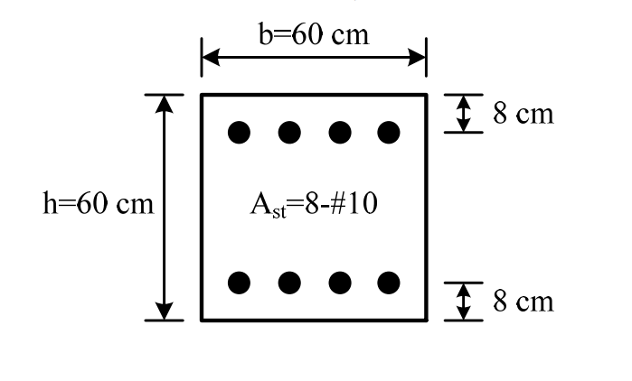

# RC-2015-1 題目正本

> 本檔只記錄**考卷上寫了什麼、圖上畫了什麼**，不含任何解法。解析見同資料夾 `RC-2015-1.md`。
> 判讀清單已經使用者確認（凍結）；本檔原則上不再修改（改動須回考卷原圖並記 log）。

| 項目 | 內容 |
|------|------|
| 考卷 | `raw/exams/RC-2015_鋼筋混凝土設計與預力.pdf` 第 1 頁（正面），第一題 |
| 考年 | 民國 104 年（2015） |
| 配分 | 20 分 |
| 附圖 | `RC-2015-1-fig-1.png`（柱斷面） |
| 判讀狀態 | **已確認**（2026-11-14 使用者確認；不確定項照草稿判讀定案（#1 最大設計彎矩 φMn）；轉錄 2026-11-14；PyMuPDF 110 dpi 全頁目視＋抽出文字核對，附圖 450 dpi 放大；盲讀後才比對既有解析） |

## 1. 考卷原文（逐字）

> 一、下圖所示為一 R.C.方形柱斷面，b=h=60cm，d'=8cm，材料強度 $f'_c$=350 kgf/cm²，$f_y$=4200 kgf/cm²，縱向鋼筋採用 $A_{st}$=8-#10，請依國內設計規範規定，分析此柱斷面在適當調整軸壓載重後，可承受之最大極限彎矩載重。（20 分）

## 2. 考卷給的公式、附表與參數

- 題文數值：$b=h=60$ cm；$d'=8$ cm；$f'_c=350$、$f_y=4200$ kgf/cm²；8-#10。
- 同頁第二題下方附表（全卷共用）：

| 鋼筋號數 | #7 | #8 | #9 | #10 |
|---|---|---|---|---|
| 鋼筋斷面積（cm²） | 3.971 | 5.067 | 6.469 | 8.143 |

- **沒有給**：$E_s$、$\varepsilon_{cu}$、$\beta_1$、箍筋或螺筋型式、強度折減因數。
- 卷首注意事項：㈠可以使用電子計算器。㈡不必抄題，作答時請將試題題號及答案依照順序寫在試卷上，於本試題上作答者，不予計分。

## 3. 附圖

圖面文字照錄：「b=60 cm」「h=60 cm」「8 cm」「8 cm」「Ast=8-#10」。

## 4. 判讀清單

| # | 項目 | 判讀 | 圖上／題文依據 | 把握 |
|---|------|------|---------------|------|
| 1 | 「最大極限彎矩載重」 | 「極限…載重」指設計（因數化）彎矩 $M_u$，所求為設計交互曲線上 $\phi M_n$ 的最大值（「適當調整軸壓載重」＝軸力可自由選）；另一讀法為標稱 $M_n$ 的最大值（約在平衡點） | 題文 | 不確定（解讀）（影響答案，請確認）；使用者確認 |
| 2 | 斷面 | 60×60 cm 方形 | 尺寸線 | 確定 |
| 3 | 鋼筋配置 | 上下兩排各 4-#10，距上下緣 8 cm（量至鋼筋中心），$d=52$ cm | 450 dpi：右側 8 cm 尺寸線端點對齊鋼筋圓心水平線 | 確定 |
| 4 | 彎曲方向 | 繞水平軸彎曲（深度 $h=60$，兩排鋼筋為受壓／受拉層） | 鋼筋分上下兩層、題文給 $d'$ | 確定（解讀） |
| 5 | #10 截面積 | 8.143 cm²（同頁附表） | 第二題下方附表 | 確定 |
| 6 | 柱型式 | 圖上未畫箍筋，考卷未說明 → 以一般箍筋柱看待 | 附圖無橫向鋼筋 | 確定（解讀）（螺筋柱的 $\phi$ 不同） |
| 7 | 考卷沒有給 | $E_s$、$\varepsilon_{cu}$、$\beta_1$、$\phi$ 需依規範自行採用 | 題文 | 確定 |

---

*轉錄：2026-11-14（RC-U1-2 題目正本推廣・批 1）*

*確認：2026-11-14 使用者確認（RC-U1-2 題目正本推廣・批 1，關卡一）*
