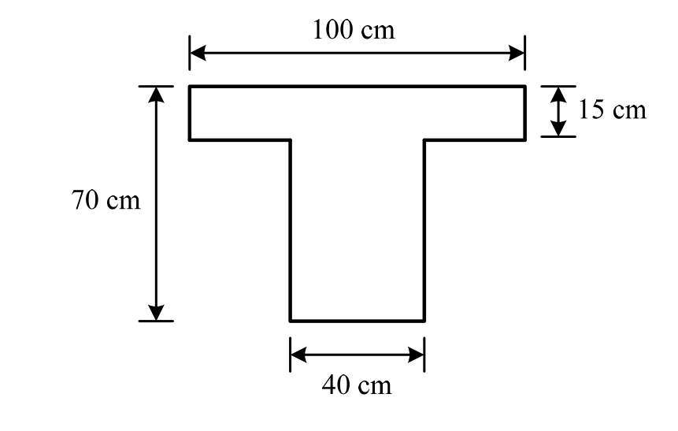

# RC-2015-3 題目正本

> 本檔只記錄**考卷上寫了什麼、圖上畫了什麼**，不含任何解法。解析見同資料夾 `RC-2015-3.md`。
> 判讀清單已經使用者確認（凍結）；本檔原則上不再修改（改動須回考卷原圖並記 log）。

| 項目 | 內容 |
|------|------|
| 考卷 | `raw/exams/RC-2015_鋼筋混凝土設計與預力.pdf` 第 1 頁（全一張之正面），第三題 |
| 考年 | 民國 104 年（2015） |
| 配分 | 20 分 |
| 附圖 | `RC-2015-3-fig-1.png`（T 型梁斷面） |
| 判讀狀態 | **已確認**（2026-11-12 使用者確認；轉錄 2026-11-12，PyMuPDF 110 dpi 全頁目視＋抽出文字核對；盲讀後才比對既有解析） |

## 1. 考卷原文（逐字）

> 三、下圖所示 T 型 R.C.梁斷面，$b_f$=100 cm，$t_f$=15 cm，$b_w$=40 cm，h=70 cm，d'=7 cm，材料強度 f'c=350 kgf/cm²，fy=4200 kgf/cm²，請設計此梁斷面在承受極限負彎矩 Mu=-150 tf-m 時之抗彎鋼筋。（20 分）

## 2. 考卷給的公式、附表與參數

- 題文數值：$b_f=100$、$t_f=15$、$b_w=40$、$h=70$、$d'=7$ cm；$f'_c=350$、$f_y=4200$ kgf/cm²；$M_u=-150$ tf-m。
- 同頁第二題附有鋼筋斷面積表（#7 3.971、#8 5.067、#9 6.469、#10 8.143 cm²），版面位於第二題下方。
- **沒有給**：$d$（題文與圖都只有 $d'$）、$\phi$、$\beta_1$、$E_s$、鋼筋號數限制、保護層。
- 卷首注意事項：㈠可以使用電子計算器；㈡不必抄題。

## 3. 附圖

圖面文字照錄：`100 cm`、`15 cm`、`70 cm`、`40 cm`。

## 4. 判讀清單

「把握」標**不確定**者請優先確認；解讀類項目（題目用字的意思）另標「解讀」。

| # | 項目 | 判讀 | 圖上／題文依據 | 把握 |
|---|------|------|---------------|------|
| 1 | 翼板 | 寬 100 cm、厚 15 cm，在斷面**上方** | 圖：100 cm 尺寸線對齊翼板兩側、15 cm 夾翼板頂底面 | 確定 |
| 2 | 腹板 | 寬 40 cm | 圖底 40 cm 尺寸線 | 確定 |
| 3 | 全高 | 70 cm（翼板頂到腹板底） | 左側 70 cm 尺寸線 | 確定 |
| 4 | 彎矩方向 | 負彎矩：**上緣（翼板）受拉、下緣（腹板底）受壓**，壓力區寬度為 $b_w=40$ cm | 題文「負彎矩 Mu=-150 tf-m」 | 確定 |
| 5 | $d'$ 的意義 | 7 cm 為受拉側（頂面）到拉力筋形心的距離，故 $d = 70-7 = 63$ cm，由腹板底量起 | 題文只給 $d'$、未給 $d$；負彎矩拉力筋在頂部 | 確定（解讀） |
| 6 | 鋼筋 | 圖上未畫鋼筋；拉力筋（及是否需壓力筋）由考生設計 | 圖 | 確定 |
| 7 | 考卷沒有給 | $d$、$\phi$、$\beta_1$、$E_s$、鋼筋號數 | 全題 | 確定 |

---

*轉錄：2026-11-12（RC-U1-1 題目正本推廣・批 1）*

*確認：2026-11-12 使用者確認（RC-U1-1 題目正本推廣・批 1，關卡一）*
