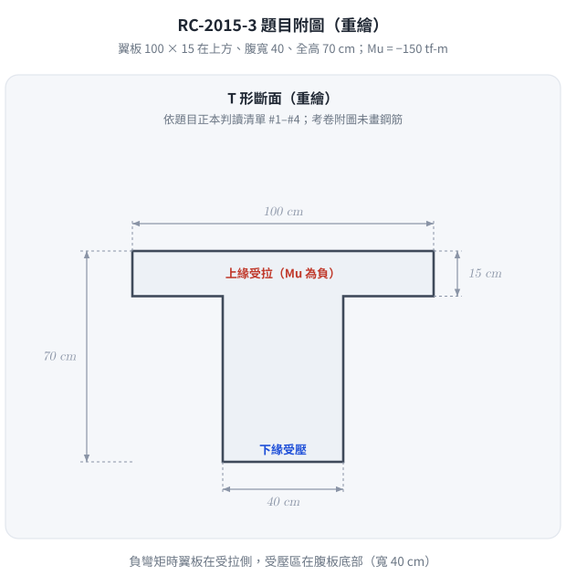
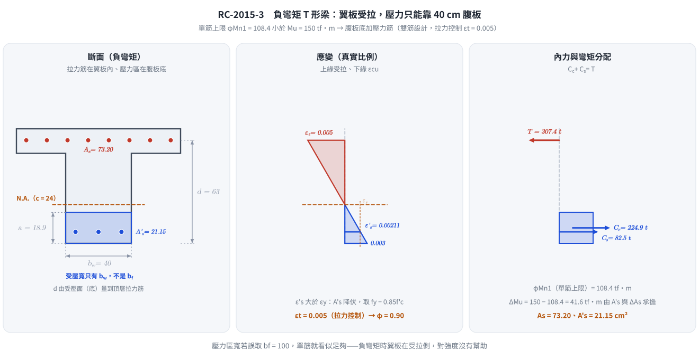

# 考題編號：RC-2015-3

**主分類：** `RC-U1-1` RC 梁彎矩強度分析與設計  
**副分類：** （無）  
**設計法：** USD強度設計法  
**標籤：** `T型梁` `負彎矩` `雙筋梁` `腹板矩形等效` `壓縮區在腹板` `梁須拉力控制` `分步設計法`

---

## 1. 題目（考卷原文見題目正本）

> 考卷原文、公式／附表、附圖與判讀清單（已確認）見 [`RC-2015-3-problem.md`](RC-2015-3-problem.md)。本節只列解題時最容易讀錯的地方與本解使用的記號；題意以題目正本為準。


*重繪自考卷附圖，依題目正本判讀清單 #1–#4；負彎矩時翼板在受拉側，受壓區在寬 40 cm 的腹板底部。*

### 常見誤讀

| 項目 | 正確判讀 | 常見誤讀 |
|------|---------|---------|
| 受壓區 | 負彎矩：上緣（翼板）受拉、下緣受壓，壓力區寬 $b_w=40$ cm（判讀 #4） | 照正彎矩 T 形梁讓翼板受壓 |
| $d'$ 與 $d$ | $d'=7$ cm 為頂面到拉力筋形心，$d = 70-7 = 63$ cm（判讀 #5） | 把 $d'$ 當保護層淨距 |
| 所求 | 設計「抗彎鋼筋」；是否需要壓力筋是解題結果，不是題目條件 | 題目要求雙筋 |
| 考卷沒給 | $d$、$\phi$、$\beta_1$、$E_s$、鋼筋號數（判讀 #7）；同頁第二題附鋼筋面積表 | — |

**本解記號：** $b_f=100$、$t_f=15$、$b_w=40$、$h=70$ cm；$d=63$ cm（由頂面量）；若需壓力筋，本解假設其形心距底面亦為 7 cm（考卷未給）；$A_s$＝上緣拉力筋、$A'_s$＝下緣壓力筋。

---

## 2. 考題核心精神與出題者意圖（Core Concepts & Examiner's Intent）

**核心觀念：** T 型梁在**負彎矩**下，壓力區在腹板（下方），翼板在拉力側（不參與受壓）。此時設計等效為**矩形梁 b = bw = 40 cm**。由於 Mu = 150 tf·m 超過單筋矩形梁（b=40, d=63）的最大設計彎矩，需設計雙筋梁，在底面加入壓力鋼筋 A's。

**出題者意圖：**
- 測驗考生是否知道「T 型梁負彎矩 = 矩形腹板受壓」的關鍵判斷
- 測驗雙筋梁設計流程（分步法：先單筋設計到規範上限，剩餘彎矩由壓力鋼筋承擔）
- 現行 112 年版 §9.3.3.1：非預力梁須拉力控制，單筋上限取 εt = 0.005（φ = 0.90）；考卷當年規範為 εt ≥ 0.004（φ = 0.817），見 §5

---

## 3. 解題戰略地圖與陷阱分析（Strategic Roadmap & Trap Analysis）

**關鍵判斷：負彎矩下的等效壓縮區**

```
Mu = -150 tf·m（負彎矩）
→ 翼板在上方（拉力側）→ 不貢獻壓力
→ 壓力區：腹板（矩形，b = bw = 40 cm）
→ 等效為矩形梁：b = 40 cm，d = 63 cm
```

**作戰計畫（三步驟）：**

```
Step 1  確認等效斷面（b = bw = 40 cm）
        計算單筋最大彎矩 φMn,1（拉力控制 εt = 0.005）
        → 108.4 tf·m < Mu = 150 tf·m → 需雙筋
   ↓
Step 2  計算壓力鋼筋 A's（由剩餘彎矩設計）
        確認壓力鋼筋降伏（ε's > εy）
   ↓
Step 3  計算總拉力鋼筋 As = As,1 + ΔAs
        驗算 φMn ≥ Mu
```

**關鍵陷阱（四個）：**

| # | 陷阱 | 正確做法 |
|---|------|---------|
| ① | 負彎矩仍用全翼板寬 100 cm 計算壓力 | 壓力在腹板，b = **bw = 40 cm** |
| ② | 中性軸在翼板（正彎矩邏輯套用負彎矩） | 負彎矩下翼板在拉力側，壓力區是腹板 |
| ③ | 壓力鋼筋淨力未扣混凝土占位 | $C'_s = A'_s(f'_s - 0.85f'_c)$ |
| ④ | 單筋上限沿用舊規範 εt = 0.004 | 現行規範梁須拉力控制：εt ≥ 0.005（SD420，§9.3.3.1、§21.2.2.1），此時 φ = 0.90 |

---

## 3.5 變數層次分析（Variable Hierarchy Analysis）

> 複習提示：第一次解題後，在每個卡住的知識點旁標記 `⚠`；第二次複習時只看有 `⚠` 的項目。

### 最終目標

設計 T 型梁（負彎矩下等效矩形腹板）的雙筋斷面：求 As（拉力，上方）與 A's（壓力，下方）。

### 本題關鍵公式（依計算順序）

$$\text{Step 1:}\quad c_{\max} = \frac{3}{7}\,d,\quad a_{\max} = \beta_1\,\boxed{c_{\max}}$$

$$\text{Step 2:}\quad \varphi M_{n,1} = \varphi\,C_c\!\left(d - \tfrac{a_{\max}}{2}\right),\quad C_c = 0.85\,f'_c\,\boxed{a_{\max}}\,b_w$$

$$\text{Step 3:}\quad \Delta M_u = M_u - \varphi M_{n,1}$$

$$\text{Step 4:}\quad A'_s = \frac{\Delta M_u}{\varphi\,(f'_y - 0.85f'_c)(d - d')}$$

$$\text{Step 5:}\quad A_s = \underbrace{\frac{C_c}{f_y}}_{A_{s,1}} + \underbrace{\frac{A'_s(f'_y - 0.85f'_c)}{f_y}}_{\Delta A_s}$$

### L1：題目直接給定

| 符號 | 數值 | 說明 |
|------|------|------|
| $b_f, t_f$ | 100, 15 cm | 翼板幾何（負彎矩時在拉力側） |
| $b_w$ | 40 cm | 腹板寬（負彎矩時的壓縮寬度） |
| $h$ | 70 cm | 梁總深 |
| $d'$ | 7 cm | 從受力面到鋼筋形心距離 |
| $d$ | 63 cm | 有效深度（70−7） |
| $f'_c, f_y$ | 350, 4200 kgf/cm² | 材料強度 |
| $M_u$ | 150 tf·m（取絕對值） | 負彎矩設計值 |

### L2：需知識點推導

**▎負彎矩等效斷面判斷**

| 符號 | 公式／來源 | 卡關? |
|------|-----------|-------|
| 等效壓縮寬度 | $b_w = 40$ cm（翼板在拉力側，不貢獻壓力） | |
| $\beta_1$ | $0.85 - 0.05 \times (350-280)/70 = 0.80$ | |

**▎單筋最大彎矩（Step 1-2）**

| 符號 | 公式／來源 | 卡關? |
|------|-----------|-------|
| $c_{\max}$ | $3d/8 = 23.63$ cm（拉力控制 εt = 0.005） | |
| $a_{\max}$ | $0.80 \times 23.63 = 18.90$ cm | |
| $C_c$ | $0.85 \times 350 \times 18.90 \times 40$ | |
| $\varphi M_{n,1}$ | $0.90 \times C_c(d - a_{\max}/2)$ | |

**▎壓力鋼筋設計（Step 3-5）**

| 符號 | 公式／來源 | 卡關? |
|------|-----------|-------|
| $\Delta M_u$ | $M_u - \varphi M_{n,1}$ | |
| $\varepsilon'_s$ | $0.003(c_{\max} - d')/c_{\max}$（驗算是否降伏） | |
| $A'_s$ | $\Delta M_u / [\varphi(f_y - 0.85f'_c)(d-d')]$ | |
| $\Delta A_s$ | $A'_s(f_y - 0.85f'_c)/f_y$（對應壓力鋼筋的額外拉力鋼筋） | |
| $A_s$ | $C_c/f_y + \Delta A_s$ | |

### L3：深層知識（不懂就卡住）

| 知識點 | 說明 | 卡關? |
|--------|------|-------|
| 負彎矩下 T 型梁 = 矩形腹板 | 翼板在拉力側，混凝土不計拉力，壓縮區退化為 b = bw 的矩形梁 | |
| 雙筋梁「分步設計法」 | Step 1：單筋承擔到規範上限（現行：拉力控制 εt=0.005），Step 2：剩餘由壓力鋼筋承擔，總 c 不變 | |
| 壓力鋼筋降伏驗算 | 加入 A's 後，NA 不變（c=23.63 cm），故 ε's 不變，需再確認 ε's ≥ εy | |
| 為何 c 不變 | 分步設計法中，壓力鋼筋提供額外力矩，NA 保持在 c=23.63 cm，εt 仍為 0.005 | |

---

## 4. 步驟化詳細計算過程（Step-by-Step Detailed Calculation）

### Step 0：確認負彎矩下之等效斷面

> **策略關鍵：** 負彎矩 → 翼板（上）在拉力側 → 壓力區僅腹板（矩形，b = bw = 40 cm）。

$$\beta_1 = 0.85 - 0.05 \times \frac{350-280}{70} = \boxed{0.80},\quad \varepsilon_y = \frac{4200}{2{,}040{,}000} = 0.00206$$

等效計算斷面：$b = b_w = 40$ cm，$d = 63$ cm，$d' = 7$ cm

---

### Step 1：單筋最大彎矩（拉力控制 εt = 0.005）

現行 112 年版 §9.3.3.1：非預力梁應符合表 21.2.2 拉力控制，$\varepsilon_t \ge \varepsilon_{ty}+0.003$；SD420 依 §21.2.2.1 取 $\varepsilon_{ty}=0.002$，故 $\varepsilon_t \ge 0.005$、$\varphi = 0.90$。

$$c_{\max} = \frac{0.003}{0.003+0.005} \times 63 = \frac{3}{8}\times63 = \boxed{23.63 \text{ cm}},\quad a_{\max} = 0.80 \times 23.625 = \boxed{18.90 \text{ cm}}$$

$$C_c = 0.85 \times 350 \times 18.90 \times 40 = 297.5 \times 18.90 \times 40 = \boxed{224{,}910 \text{ kgf}}$$

$$\varphi M_{n,1} = 0.90 \times 224{,}910 \times \left(63 - \frac{18.90}{2}\right) = 0.90 \times 224{,}910 \times 53.55 = 0.90 \times 12{,}043{,}931 = 10{,}839{,}538 \text{ kgf·cm} = \boxed{108.4 \text{ tf·m}}$$

**判斷：** $\varphi M_{n,1} = 108.4$ tf·m $< M_u = 150$ tf·m → **需加壓力鋼筋（雙筋梁設計）**

---

### Step 2：壓力鋼筋 A's 設計

剩餘設計彎矩：
$$\Delta M_u = 150.0 - 108.4 = 41.6 \text{ tf·m} = 4{,}160{,}462 \text{ kgf·cm}$$

先確認壓力鋼筋是否降伏（c = 23.63 cm 不變）：
$$\varepsilon'_s = 0.003 \times \frac{23.625 - 7}{23.625} = 0.002111 > \varepsilon_y = 0.00206 \quad(\text{只多 } 2.5\%)$$

$$\Rightarrow \boxed{f'_s = f_y = 4{,}200 \text{ kgf/cm}^2 \text{（壓力鋼筋降伏）}}$$

由壓力鋼筋力矩求 A's：
$$\varphi \cdot A'_s \cdot (f_y - 0.85f'_c) \cdot (d - d') = \Delta M_u$$

$$0.90 \times A'_s \times 3{,}902.5 \times 56 = 4{,}160{,}462 \quad\Rightarrow\quad 196{,}686 \times A'_s = 4{,}160{,}462$$

$$\boxed{A'_s = 21.15 \text{ cm}^2 \text{（壓力鋼筋，位於底面以上 } d' = 7 \text{ cm）}}$$

---

### Step 3：總拉力鋼筋 As

對應單筋部分之拉力鋼筋：
$$A_{s,1} = \frac{C_c}{f_y} = \frac{224{,}910}{4{,}200} = 53.55 \text{ cm}^2$$

對應壓力鋼筋之額外拉力鋼筋（力平衡）：
$$\Delta A_s = \frac{A'_s \cdot (f_y - 0.85f'_c)}{f_y} = \frac{21.15 \times 3{,}902.5}{4{,}200} = 19.65 \text{ cm}^2$$

$$\boxed{A_s = A_{s,1} + \Delta A_s = 53.55 + 19.65 = 73.20 \text{ cm}^2 \text{（拉力鋼筋，位於頂面以下 } d' = 7 \text{ cm）}}$$

---

### Step 4：驗算

力平衡：
$$C_c + A'_s(f_y - 0.85f'_c) = 224{,}910 + 21.15 \times 3{,}902.5 = 224{,}910 + 82{,}549 = 307{,}459 \text{ kgf} \approx A_s f_y = 73.20 \times 4{,}200 = 307{,}440 \quad \checkmark$$

設計彎矩：
$$\varphi M_n = 0.90 \times \left[224{,}910 \times 53.55 + 21.15 \times 3{,}902.5 \times 56\right] = 0.90 \times \left[12{,}043{,}931 + 4{,}622{,}736\right]$$

$$= \boxed{15{,}000{,}000 \text{ kgf·cm} = 150.0 \text{ tf·m} \geq M_u = 150 \text{ tf·m} \quad \checkmark}$$

拉力控制：$\varepsilon_t = 0.003\times(63-23.625)/23.625 = 0.005$ ✓（§9.3.3.1）



*圖 2　負彎矩時翼板在受拉側，壓力只能靠 40 cm 寬的腹板底部，$d$ 也要由受壓面（底面）量到頂層拉力筋。這張圖攔下三個錯：壓力區寬誤取 $b_f = 100$（單筋看似就夠）、拉力筋畫在底部，以及沒驗算壓力筋是否降伏。*

---

### 設計結果彙整

| 鋼筋 | 面積 | 位置 | 說明 |
|------|------|------|------|
| 拉力鋼筋 $A_s$ | **73.20 cm²** | 頂部，$d' = 7$ cm 以下 | 分佈於頂部翼板區 |
| 壓力鋼筋 $A'_s$ | **21.15 cm²** | 底部，$d' = 7$ cm 以上 | 位於腹板底端 |
| 中性軸深度 $c$ | 23.63 cm | — | $\varepsilon_t = 0.005$，拉力控制 |
| 強度折減係數 $\varphi$ | 0.90 | — | 拉力控制 |

> 依考卷當年規範（$\varepsilon_t \ge 0.004$、$\varphi = 0.817$）的舊解：$c = 27$ cm、$\varphi M_{n,1} = 109.6$ tf·m、$A'_s = 22.63$、$A_s = 82.22$ cm²（本解 2026-11-21 前的答案）。現行規範的拉力控制設計反而少用 10% 拉力筋——因為 $\varphi$ 從 0.817 回到 0.90。

---

## 5. 關鍵爭議點與進階探討（Critical Issues & Advanced Discussion）

### 爭議 1：負彎矩時翼板可否計入受壓？

對於正彎矩（翼板受壓），T 型梁的有效壓縮翼板寬度按規範取值，可大幅增加壓縮面積。  
對於**負彎矩（翼板受拉）**，翼板不計入壓縮，壓縮區僅為矩形腹板（b = bw），設計彎矩容量大幅縮小。

### 爭議 2：拉力鋼筋 As = 73.20 cm² 的實際配置

負彎矩的拉力鋼筋通常分佈在頂部（連續梁支承區），包含：
- **翼板拉力筋：** 分布於翼板寬度（bf = 100 cm）內，承擔翼板拉力
- ACI 規定：在有效翼板寬度範圍內分佈鋼筋（細部規定見 ACI 318-19 §9.7.3）

實際分配時，73.20 cm² 的拉力筋應均勻分布在頂部翼板區，以確保有效承拉。

### 單筋設計的容量上限（對照）

| 設計方式 | 壓縮寬度 | 最大 φMn（拉力控制 εt=0.005） |
|---------|---------|:---:|
| 負彎矩（腹板受壓） | bw = 40 cm | 108.4 tf·m |
| 正彎矩（翼板受壓，假設 a ≤ tf） | bf = 100 cm | >> 150 tf·m |

T 型梁在正彎矩下容量遠大於負彎矩，這是連續梁設計中的典型不對稱性。

*修正日期：2026-11-12（§1 改為指向題目正本，重繪題目附圖 figs/RC-2015-3-fig-1-problem.svg；刪除「（As 與 A's）」「從各受力面量起」加字）*

*圖解補繪：2026-11-13（圖 2 負彎矩斷面／應變／內力三聯圖；向量圖，腳本 `gen_RC-2015-3.py`，可重跑，檔尾對 §4 公佈值 assert；非勘誤）*

*修正日期：2026-11-21（解析勘誤，改依現行台灣規範（建築物混凝土結構設計規範 2023）：單筋上限由 εt = 0.004 改為 §9.3.3.1 拉力控制 εt = 0.005（φ = 0.90）；c 27 → 23.63 cm、φMn,1 109.6 → 108.4 tf·m、A's 22.63 → 21.15 cm²、As 82.22 → 73.20 cm²；gen 腳本與圖 2 重產）*
