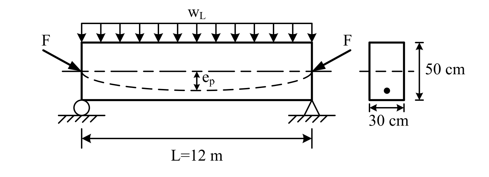

# RC-2015-4 題目正本

> 本檔只記錄**考卷上寫了什麼、圖上畫了什麼**，不含任何解法。解析見同資料夾 `RC-2015-4.md`。
> 判讀清單已經確認（凍結）；本檔原則上不再修改（改動須回考卷原圖並記 log）。

| 項目 | 內容 |
|------|------|
| 考卷 | `raw/exams/RC-2015_鋼筋混凝土設計與預力.pdf` 第 2 頁（背面），第四題 |
| 考年 | 民國 104 年（2015） |
| 配分 | 20 分 |
| 附圖 | `RC-2015-4-fig-1.png`（簡支梁立面＋斷面） |
| 判讀狀態 | **已確認**（2026-11-15 使用者授權依 Claude 建議確認；轉錄 2026-11-15；PyMuPDF 110 dpi 全頁＋附圖向量圖目視、文字層逐字核對；盲讀後才比對既有解析） |

## 1. 考卷原文（逐字）

> 四、下圖所示為採後拉法之預力混凝土簡支矩形梁，梁斷面 b=30cm，h=50cm，材料強度 f'c=350 kgf/cm²，梁跨度 L=12m，鋼鍵為端部無偏心之拋物線配置，若適當設計施加之預力 F 值及梁中央斷面之鋼鍵偏心量 $e_p$ 值，則此預力簡支梁可承受最大之均佈活載重 $w_{L\max}$，假設在施預力時及全部載重作用時，混凝土之容許壓應力均為 $f_{ca}$=140 kgf/cm²，容許拉應力均為 $f_{ta}$=0 kgf/cm²，請分析此 F 值、$e_p$ 值及 $w_{L\max}$ 值。（20 分）

## 2. 考卷給的公式、附表與參數

- 後拉法簡支矩形梁：$b=30$、$h=50$ cm；$L=12$ m；$f'_c=350$ kgf/cm²。
- 鋼鍵：拋物線，端部無偏心；跨中偏心 $e_p$ 待求；預力 $F$ 待求。
- 容許應力（兩階段相同）：壓 $f_{ca}=140$、拉 $f_{ta}=0$ kgf/cm²。
- 所求：$F$、$e_p$、$w_{L\max}$。
- **沒有給**：混凝土單位重、預力損失（題文與附圖只有一個 $F$）、$f'_{ci}$、鋼鍵保護層或最大可行偏心。
- 卷首注意事項：可以使用電子計算器。不必抄題，作答時請將試題題號及答案依照順序寫在試卷上，於本試題上作答者，不予計分。（本卷未指定規範版本。）

## 3. 附圖

圖面文字照錄：w_L、F（兩端）、e_p、50 cm、30 cm、L=12 m。

## 4. 判讀清單

| # | 項目 | 判讀 | 圖上／題文依據 | 把握 |
|---|------|------|---------------|------|
| 1 | 兩階段預力 | 施預力時與全部載重作用時皆用同一個 $F$（考卷未給損失比） | 題文「施加之預力 F」；附圖兩端只標 F | 確定（解讀；2026-11-15 使用者授權依 Claude 建議確認） |
| 2 | 自重 | 施預力時有自重彎矩，全部載重＝自重＋$w_L$；單位重考卷沒有給，須明列假設（常用 2.4 tf/m³） | 題文「全部載重」 | 確定（解讀） |
| 3 | 容許應力 | 140（$=0.4f'_c$）與 0 比現行規範嚴，視為題目設計條件照用（依本庫容許值例外規則） | 題文 | 確定 |
| 4 | 支承 | 左端滾支承（圓圈）、右端鉸支承（三角形）；簡支 | 附圖 | 確定 |
| 5 | 鋼鍵線形 | 端部偏心 0（F 作用於形心高度），拋物線下垂，跨中偏心 $e_p$（形心以下） | 題文「端部無偏心之拋物線」；附圖虛線 | 確定 |
| 6 | 載重 | $w_L$ 全跨均佈 | 附圖箭頭布滿全跨 | 確定 |
| 7 | 考卷沒有給 | 單位重、損失、$f'_{ci}$、保護層 | 全題 | 確定（作答須明列假設；$e_p$ 結果須自行檢查幾何可行） |

---

*轉錄：2026-11-15（RC-U4-2+U4-3+U4-4 題目正本推廣・批 1）*

*確認：2026-11-15 使用者授權依 Claude 建議確認（RC-U4-2+U4-3+U4-4 題目正本推廣・批 1，關卡一）*
