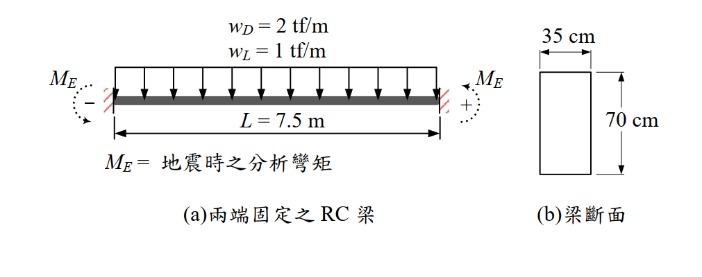

# RC-2016-1 題目正本

> 本檔只記錄**考卷上寫了什麼、圖上畫了什麼**，不含任何解法。解析見同資料夾 `RC-2016-1.md`。
> 判讀清單已經使用者確認（凍結）；本檔原則上不再修改（改動須回考卷原圖並記 log）。

| 項目 | 內容 |
|------|------|
| 考卷 | `raw/exams/RC-2016_鋼筋混凝土設計與預力.pdf` 第 1 頁（全一張之正面），第一題 |
| 考年 | 民國 105 年（2016） |
| 配分 | 30 分 |
| 附圖 | `RC-2016-1-fig-1.png`（(a) 兩端固定之 RC 梁、(b) 梁斷面） |
| 判讀狀態 | **已確認**（2026-11-13 使用者確認；轉錄 2026-11-13，PyMuPDF 110 dpi 全頁目視＋抽出文字核對，附圖 400 dpi；盲讀後才比對既有解析） |

## 1. 考卷原文（逐字）

> 一、下圖為兩端均為固定端之矩形斷面（35 cm 寬 × 70 cm 深）RC 梁，梁淨跨度長 L = 7.5 m，平常受垂直均佈載重：靜載重 wD = 2 tf/m（含梁自重）與活載重 wL = 1 tf/m；以及梁受地震時，所分析之左右兩端彎矩：ME = 16.5 tf-m（成一組雙曲度彎矩）。計算垂直均佈載重 w 之分析彎矩，固定端點彎矩採用 wL²/12，梁跨中點彎矩採用 wL²/24。拉力鋼筋之有效深度，統一取 63 cm 作計算。混凝土 f'c = 280 kgf/cm²，梁主筋 fy = 4200 kgf/cm²。整跨梁頂部與底部鋼筋均配置一致，試設計該梁頂部與底部之鋼筋量。（30 分）

## 2. 考卷給的公式、附表與參數

卷首（全卷共用）：

- 本科目作答參考規範：中國土木水利工程學會「混凝土工程設計規範（土木 401-100）」。
- 可能使用公式：$E_c=15000\sqrt{f'_c}$ kgf/cm²；$E_s=2.04\times10^6$ kgf/cm²；$f_r=2\sqrt{f'_c}$ kgf/cm²；$kl_u/r\le 34-12M_1/M_2$；$\delta_{ns}=C_m/(1-P_u/0.75P_c)\ge1.0$；$C_m=0.6+0.4M_1/M_2\ge0.4$；$P_c=\pi^2EI/(kl_u)^2$（後四式為柱用，本題用不到）。
- 鋼筋表：

| 鋼筋 | D10 (#3) | D22 (#7) | D29 (#9) |
|---|---|---|---|
| 鋼筋斷面積（cm²） | 0.71 | 3.87 | 6.47 |

- 題文數值：$b=35$、$h=70$、$d=63$ cm（統一）；$L=7.5$ m（淨跨）；$w_D=2$ tf/m（含自重）、$w_L=1$ tf/m；$M_E=16.5$ tf-m；$f'_c=280$、$f_y=4200$ kgf/cm²；固定端 $wL^2/12$、跨中 $wL^2/24$。
- **沒有給**：載重組合、$\phi$、壓力筋位置 $d'$。
- 卷首注意事項：㈠可以使用電子計算器；㈡不必抄題。

## 3. 附圖

圖面文字照錄：`wD = 2 tf/m`、`wL = 1 tf/m`、`ME`（兩端各一）、`−`、`+`、`L = 7.5 m`、`ME = 地震時之分析彎矩`、`(a)兩端固定之 RC 梁`、`35 cm`、`70 cm`、`(b)梁斷面`。

## 4. 判讀清單

「把握」標**不確定**者請優先確認；解讀類項目（題目用字的意思）另標「解讀」。

| # | 項目 | 判讀 | 圖上／題文依據 | 把握 |
|---|------|------|---------------|------|
| 1 | 支承 | 兩端固定端 | 題文「兩端均為固定端」；圖 (a) 兩端畫斜線牆 | 確定 |
| 2 | 跨度 | $L=7.5$ m 為淨跨 | 題文「梁淨跨度長」；圖 (a) 尺寸線兩端對齊兩支承面 | 確定 |
| 3 | 垂直載重 | 全跨均佈 $w_D=2$（含自重）、$w_L=1$ tf/m | 題文；圖 (a) 箭頭布滿全跨 | 確定 |
| 4 | 地震彎矩 | 兩端各 16.5 tf-m，方向使梁成雙曲度（一端負、一端正，地震反向時兩端互換） | 題文「成一組雙曲度彎矩」；圖 (a) 左端標「−」、右端標「+」 | 確定（解讀） |
| 5 | 垂直載重分析彎矩 | 固定端 $wL^2/12$（負）、跨中 $wL^2/24$（正），由題目指定，不另做分析 | 題文 | 確定 |
| 6 | 斷面 | 矩形 $b=35$、$h=70$ cm；$d=63$ cm 頂、底筋統一採用 | 題文與圖 (b) | 確定 |
| 7 | 所求 | 頂部與底部各一組鋼筋量（整跨配置一致），須涵蓋端點與跨中、各種載重組合的包絡 | 題文「整跨梁頂部與底部鋼筋均配置一致」 | 確定（解讀） |
| 8 | 考卷沒有給 | 載重組合（由考生依規範選用）、$\phi$、$d'$ | 全題 | 確定 |

---

*轉錄：2026-11-13（RC-U1-1 題目正本推廣・批 2）*

*確認：2026-11-13 使用者確認（RC-U1-1 題目正本推廣・批 2，關卡一）*
