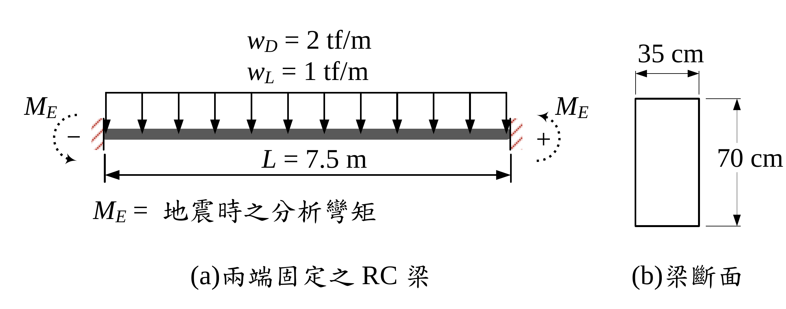

# RC-2016-2 題目正本

> 本檔只記錄**考卷上寫了什麼、圖上畫了什麼**，不含任何解法。解析見同資料夾 `RC-2016-2.md`。
> 判讀清單已經確認（凍結）；本檔原則上不再修改（改動須回考卷原圖並記 log）。

| 項目 | 內容 |
|------|------|
| 考卷 | `raw/exams/RC-2016_鋼筋混凝土設計與預力.pdf` 第 1 頁（正面），第二題（承第一題） |
| 考年 | 民國 105 年（2016） |
| 配分 | 25 分 |
| 附圖 | `RC-2016-2-fig-1.png`（第一題附圖 (a) 兩端固定之 RC 梁、(b) 梁斷面；第二題「承第一題之梁結構」；2026-11-15 由考卷擷取 500 dpi） |
| 判讀狀態 | **已確認**（2026-11-15 使用者授權依 Claude 建議確認；轉錄 2026-11-15；PyMuPDF 110 dpi 全頁目視，附圖 400–450 dpi 局部放大；文字以 PDF 文字層核對（公式以影像為準）；盲讀後才比對既有解析） |

## 1. 考卷原文（逐字）

第二題：

> 二、承第一題之梁結構，梁斷面與淨跨度長、靜載重與活載重均一樣。若整跨梁斷面配筋均一致，結果頂部梁筋為 3-D29，而底部梁筋為 3-D22，拉力鋼筋之有效深度為 63 cm。參考規範耐震設計規定，試以 3 股(3 legs)-D10 作梁端塑性鉸區之橫向箍筋設計。計算彎矩強度時，請以單筋斷面方式進行，其中混凝土 $f'_c$＝280 kgf/cm²，所有鋼筋 $f_y$＝4200 kgf/cm²。（25 分）

第一題（被承接的部分）：

> 一、下圖為兩端均為固定端之矩形斷面（35 cm 寬 × 70 cm 深）RC 梁，梁淨跨度長 $L$＝7.5 m，平常受垂直均佈載重：靜載重 $w_D$＝2 tf/m（含梁自重）與活載重 $w_L$＝1 tf/m；以及梁受地震時，所分析之左右兩端彎矩：$M_E$＝16.5 tf-m（成一組雙曲度彎矩）。計算垂直均佈載重 $w$ 之分析彎矩，固定端點彎矩採用 $wL^2/12$，梁跨中點彎矩採用 $wL^2/24$。拉力鋼筋之有效深度，統一取 63 cm 作計算。混凝土 $f'_c$＝280 kgf/cm²，梁主筋 $f_y$＝4200 kgf/cm²。整跨梁頂部與底部鋼筋均配置一致，試設計該梁頂部與底部之鋼筋量。（30 分）

## 2. 考卷給的公式、附表與參數

- 第二題數值：頂筋 3-D29、底筋 3-D22（整跨一致）；$d$＝63 cm；橫向箍筋 3 股 D10；$f'_c$＝280；所有鋼筋 $f_y$＝4200 kgf/cm²；彎矩強度以單筋斷面計算。
- 承第一題：斷面 35 cm 寬 × 70 cm 深；淨跨 $L$＝7.5 m；$w_D$＝2 tf/m（含梁自重）、$w_L$＝1 tf/m；兩端固定。（第一題的 $M_E$＝16.5 tf-m 與 $wL^2/12$、$wL^2/24$ 分析彎矩屬第一題設計用）
- 鋼筋表（卷首）：D10（#3）0.71 cm²；D22（#7）3.87 cm²；D29（#9）6.47 cm²。
- 卷首「可能使用公式」（供全卷）：$E_c=15000\sqrt{f'_c}$；$E_s=2.04\times10^6$；$f_r=2\sqrt{f'_c}$；$kl_u/r\le34-12M_1/M_2$；$\delta_{ns}=C_m/(1-P_u/0.75P_c)\ge1.0$；$C_m=0.6+0.4M_1/M_2\ge0.4$；$P_c=\pi^2EI/(kl_u)^2$（本題用不到）。
- 作答參考規範（卷首）：中國土木水利工程學會「混凝土工程設計規範（土木 401-100）」。
- **沒有給**：D10 的 $d_b$、保護層、柱寬、塑性鉸區長度、載重組合與 $\phi$、箍筋位置（是否含繫筋）。
- 卷首注意事項：㈠可以使用電子計算器。㈡不必抄題，作答時請將試題題號及答案依照順序寫在試卷上，於本試題上作答者，不予計分。

## 3. 附圖

圖面文字照錄：`wD = 2 tf/m`、`wL = 1 tf/m`、`ME`、`ME`、`−`、`+`、`L = 7.5 m`、`ME = 地震時之分析彎矩`、`35 cm`、`70 cm`、`(a)兩端固定之 RC 梁`、`(b)梁斷面`。

## 4. 判讀清單

「把握」標**不確定**者優先列；解讀類項目（題目用字的意思）另標「解讀」。標「依 Claude 建議確認」者，為使用者 2026-11-15 授權「要我確認的請依你建議」後定案。

| # | 項目 | 判讀 | 圖上／題文依據 | 把握 |
|---|------|------|---------------|------|
| 1 | 3 股 D10 | 三肢箍（外箍兩肢＋一支繫筋或等效），$A_v$＝3×0.71＝2.13 cm² | 題文「3 股(3 legs)-D10」 | 確定 |
| 2 | $d$＝63 cm 用於頂筋與底筋 | 頂、底筋受拉時有效深度皆取 63 cm（題文「拉力鋼筋之有效深度為 63 cm」，且第一題「統一取 63 cm」） | 題文 | 確定（解讀） |
| 3 | 單筋斷面 | 算 $M_{pr}$ 時不計壓力筋 | 題文「請以單筋斷面方式進行」 | 確定 |
| 4 | 重力載重 | $w_D$＝2（含自重）、$w_L$＝1 tf/m，作用全跨；組合與係數考卷沒有給（依現行規範） | 題文「靜載重與活載重均一樣」 | 確定 |
| 5 | 支承 | 兩端固定（柱面），淨跨 7.5 m | 第一題文字與圖 (a) 兩端斜線剖面 | 確定 |
| 6 | $M_E$ | 第一題地震分析彎矩；第二題的塑性鉸箍筋設計依容量設計，不直接用 $M_E$ | 第二題題文未提 $M_E$ | 確定（解讀） |
| 7 | 斷面 | 寬 35 cm × 深 70 cm | 第一題文字「35 cm 寬 × 70 cm 深」；圖 (b) 35 cm 水平、70 cm 垂直尺寸對齊外緣 | 確定 |
| 8 | 所求 | 梁端塑性鉸區橫向箍筋（間距、範圍） | 題文 | 確定 |
| 9 | 考卷沒有給 | D10 $d_b$、保護層、塑性鉸區長度、載重組合與 $\phi$、柱寬 | 全題 | 確定 |

---

*轉錄：2026-11-15（RC-U3-3 批 2＋U1-3＋U2-3 題目正本推廣）*

*確認：2026-11-15 使用者授權依 Claude 建議確認（RC-U3-3 批 2＋U1-3＋U2-3 題目正本推廣，關卡一）*
