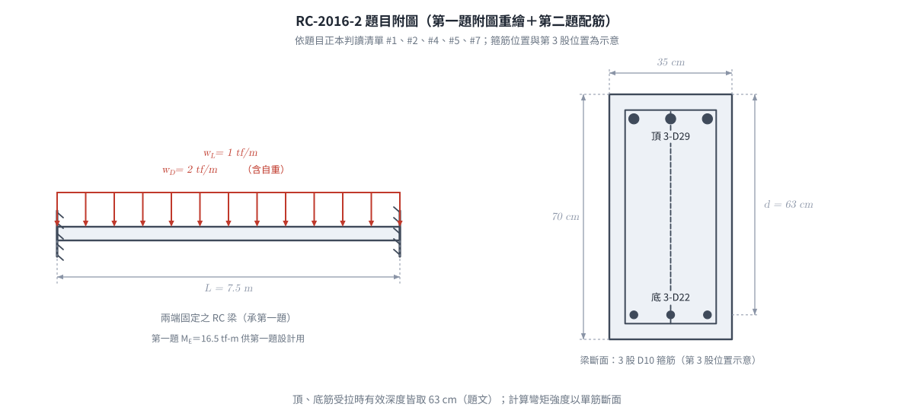
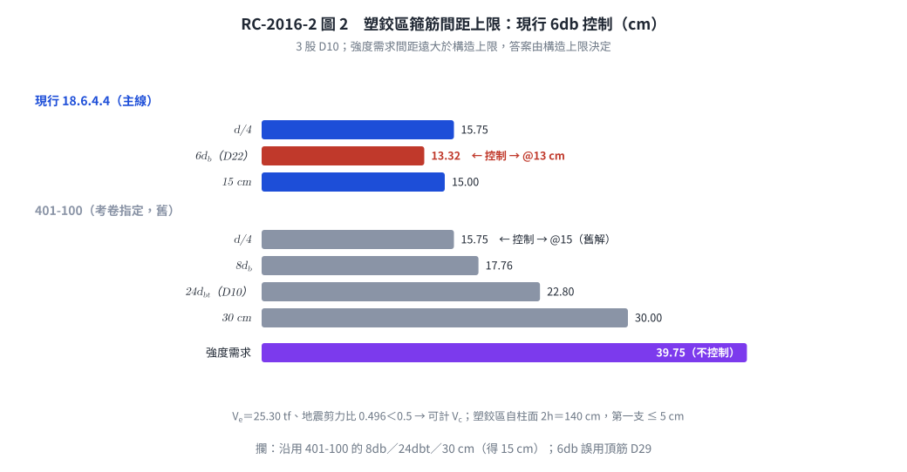

# 考題編號：RC-2016-2

**主分類：** `RC-U3-3` 韌性要求與耐震設計
**副分類：** `RC-U2-1` RC 剪力強度分析與設計
**設計法：** USD強度設計法
**標籤：** `特殊矩形框架梁` `塑性鉸區` `可能彎矩強度Mpr` `密箍區間距` `6db間距` `耐震箍筋設計` `Vc判斷` `強度設計剪力Ve`

---

## 1. 題目（考卷原文見題目正本）

> 考卷原文、公式／附表、附圖與判讀清單（已確認）見 [`RC-2016-2-problem.md`](RC-2016-2-problem.md)。本節只列解題時最容易讀錯的地方與本解使用的記號；題意以題目正本為準。


*重繪自考卷第一題附圖並加入第二題配筋，依題目正本判讀清單 #1、#2、#4、#5、#7。本圖攔下的讀錯：把第二題當無附圖而漏看兩端固定；頂筋受拉時另算有效深度。*

### 常見誤讀

| 項目 | 正確判讀 | 常見誤讀 |
|------|---------|---------|
| 附圖 | 第二題「承第一題之梁結構」，第一題附圖（兩端固定梁、35×70 斷面）即本題附圖 | 當成無附圖 |
| 有效深度 | 頂、底筋受拉皆取 $d$＝63 cm（題文） | 頂筋受拉時另行推算 |
| 彎矩強度 | 以單筋斷面計算（題文指定） | 計入壓力筋 |
| 3 股 D10 | $A_v$＝3×0.71＝2.13 cm² | 當成 2 肢或 4 肢 |
| $M_E$ | 第一題地震分析彎矩，第二題依容量設計不直接使用 | 以 $M_E$ 加重力剪力當設計剪力 |
| 塑鉸區間距上限 | 現行 18.6.4.4：$\min(d/4,\ 6d_b,\ 15\text{ cm})$，$d_b$ 取最小主筋 D22 → $6d_b$＝13.3 cm 控制 | 401-100 舊式 $d/4$、$8d_b$、$24d_{bt}$、30 cm（本庫舊解 → 15 cm） |
| 塑鉸區長度 | 梁：自柱面起 $2h$ | 套柱的 $\ell_o=\max(h,\ \ell_n/6,\ 45)$ 類型公式 |

**本解記號：** $b$＝35、$h$＝70、$d$＝63 cm；$\ell_n$＝7.5 m；$A_s^{top}$＝3×6.47＝19.41、$A_s^{bot}$＝3×3.87＝11.61 cm²；$w_D$＝2、$w_L$＝1 tf/m；$f'_c$＝280、$f_y$＝4200 kgf/cm²。規範：建築物混凝土結構設計規範（2023 年版，ACI 318-19 世代）18.6.4、18.6.5、22.5、9.6.3。

---

## 2. 考題核心精神與出題者意圖（Core Concepts & Examiner's Intent）

**核心觀念：**
1. **可能彎矩強度（$M_{pr}$）**：耐震設計使用 $f_s = 1.25f_y$、$\phi=1.0$，以反映鋼筋超強效應，是求設計剪力的關鍵
2. **梁端塑性鉸區設計剪力**：$V_e = (M_{pr,\text{left}} + M_{pr,\text{right}}) / \ell_n$（地震剪力）加上重力剪力
3. **$V_c = 0$ 判斷**：地震剪力 $\geq V_e/2$ 且 $P_u < A_g f'_c / 20$ 時，塑鉸區取 $V_c = 0$
4. **塑鉸區間距上限**：現行 $\min(d/4,\ 6d_b,\ 15\text{ cm})$；第一支箍筋距柱面 ≤ 5 cm

**出題者意圖：**
- 考驗考生能否正確計算 $M_{pr}$（1.25fy vs fy 的差異）
- 驗證地震剪力組合與 $V_c$ 取捨的判斷能力（本題剛好在 50% 臨界）
- 確認塑鉸區間距上限的掌握（現行規範由 $6d_b$ 控制）

---

## 3. 解題戰略地圖與陷阱分析（Strategic Roadmap & Trap Analysis）

### 作戰計畫

```
Step 1：計算梁端可能彎矩強度 Mpr（1.25fy，φ=1.0，單筋斷面）
Step 2：計算塑性鉸剪力機構下的設計剪力 Ve
Step 3：判斷 Vc = 0 條件（地震剪力比）
Step 4：計算 Vc（若不為零）
Step 5：計算箍筋需求間距（強度需求）
Step 6：確定塑鉸區長度 2h
Step 7：確定塑鉸區間距上限 min(d/4, 6db, 15 cm)
Step 8：驗證 φVn ≥ Ve、Vs ≤ Vs,max
Step 9：最少剪力筋與縱筋規定
```

### 關鍵陷阱

| # | 陷阱 | 說明 | 應對策略 |
|---|------|------|---------|
| ① | $M_{pr}$ 使用 $1.25f_y$，不是 $f_y$ | 耐震設計刻意放大鋼筋強度以設計最保守剪力 | $M_{pr}$ → $f_s=1.25f_y$，$\phi=1.0$ |
| ② | 「單筋斷面」的意涵 | 計算 $M_{pr}$ 時忽略壓力鋼筋貢獻 | 分別以頂筋（負彎矩）和底筋（正彎矩）計算 |
| ③ | $V_c = 0$ 判斷的臨界值 | 本題 49.6%，極接近 50% | 精確計算；最終間距由構造上限控制，不影響答案 |
| ④ | 間距上限用舊規範 | 現行為 $6d_b$、15 cm（ACI 318-14 起），不是 $8d_b$、$24d_{bt}$、30 cm | 記現行三項：$d/4$、$6d_b$、15 cm |
| ⑤ | $6d_b$ 用哪支筋 | 取最小主筋 D22（$d_b$＝2.22 cm） | $6\times2.22=13.3$ cm |
| ⑥ | $V_{s,\max}$ 寫成 $2V_c$ | 正確為 $2.12\sqrt{f'_c}b_wd$（＝$4V_c$） | 本庫舊解誤寫 39.1 tf |
| ⑦ | $A_{v,\min}$ 用 SI 係數 | kgf 制為 $\max(0.2\sqrt{f'_c},\ 3.5)b_ws/f_{yt}$ | 本庫舊解用 0.35，小 10 倍 |

---

## 3.5 變數層次分析（Variable Hierarchy Analysis）

> 複習提示：第一次解題後，在每個卡住的知識點旁標記 `⚠`；第二次複習時只看有 `⚠` 的項目。

### 最終目標
`計算 Mpr → 求設計剪力 Ve → 判斷 Vc → 求箍筋間距 s（強度需求與構造上限取小）`

### 本題關鍵公式（依計算順序）

> $\boxed{\cdot}$ = 需由前步驟推導，非題目直接給定的變數

$$\text{Step 1: } a_{pr} = \frac{A_s \times 1.25 f_y}{0.85 f'_c b}$$

$$\text{Step 2: } M_{pr} = A_s \times 1.25 f_y \left(d - \frac{\boxed{a_{pr}}}{2}\right)$$

$$\text{Step 3: } V_e = \frac{\boxed{M_{pr,\text{neg}}} + \boxed{M_{pr,\text{pos}}}}{\ell_n} + \frac{w_u \ell_n}{2}$$

$$\text{Step 4（Vc判斷）: } \text{若}\ \frac{V_{e,\text{seis}}}{V_e} \geq 0.5 \Rightarrow V_c = 0$$

$$\text{Step 5: } s_{\text{strength}} = \frac{A_v f_{yt} d}{\boxed{V_s}}$$

$$\text{Step 6: } s \leq \min\!\left(\frac{d}{4},\ 6d_{b,\min},\ 15\text{ cm}\right)$$

### L1：題目直接給定

| 符號 | 數值 | 說明 |
|------|------|------|
| $b$ | 35 cm | 梁寬 |
| $d$ | 63 cm | 有效深度 |
| $h$ | 70 cm | 梁全深 |
| $\ell_n$ | 7.5 m | 淨跨度 |
| $A_{s,\text{top}}$ | 19.41 cm²（3-D29） | 頂部鋼筋面積 |
| $A_{s,\text{bot}}$ | 11.61 cm²（3-D22） | 底部鋼筋面積 |
| $A_v$ | 2.13 cm²（3-D10） | 三股箍筋面積 |
| $f'_c$ | 280 kgf/cm² | 混凝土強度 |
| $f_y$ | 4200 kgf/cm² | 所有鋼筋強度 |
| $w_D$、$w_L$ | 2、1 tf/m | 靜載重（含自重）、活載重 |

### L2：需知識點推導

| 符號 | 公式/來源 | 卡關? |
|------|----------|:-----:|
| $M_{pr,\text{neg}}$ | $101{,}903\times(63-6.115) = 57.97$ tf-m | |
| $M_{pr,\text{pos}}$ | $60{,}953\times(63-3.659) = 36.17$ tf-m | |
| $w_u$ | $1.2w_D + 1.0w_L = 3.4$ tf/m（地震組合） | |
| $V_e$ | $94.14/7.5 + 3.4\times7.5/2 = 12.55 + 12.75 = 25.30$ tf | |
| 地震剪力比 | $12.55/25.30 = 0.496 < 0.5$ → 可計 $V_c$ | |
| $V_c$ | $0.53\sqrt{280}\times35\times63 = 19.56$ tf | |
| $s_{\text{strength}}$ | $2.13\times4200\times63/14{,}180 = 39.75$ cm | |
| $s_{\max}$ | $\min(15.75,\ 13.32,\ 15) = 13.32$ cm → 13 cm | |
| 塑鉸區長度 | $2h = 140$ cm | |

### L3：深層知識（不懂就卡住）

| 知識點 | 說明 | 卡關? |
|--------|------|:-----:|
| $M_{pr}$ vs $M_n$ | $M_n$ 以 $f_y$ 計（設計時乘 $\phi$）；$M_{pr}$ 以 $1.25f_y$、$\phi=1.0$ 計，專用於耐震容量設計 | |
| 剪力機構（sway mechanism） | 地震時梁兩端同時形成塑性鉸，地震剪力 $V_{seis} = (M_{pr,L}+M_{pr,R})/\ell_n$ | |
| $V_c = 0$ 的物理意義 | 地震剪力主導時，混凝土在往復作用下劣化，保守取 $V_c=0$ | |
| 為何 $6d_b$ | 塑鉸區縱筋受壓時箍筋要防止其挫屈；ACI 318-14 起由 $8d_b$ 收緊為 $6d_b$，並把 30 cm 改為 15 cm | |

---

## 4. 步驟化詳細計算過程（Step-by-Step Detailed Calculation）

### Step 1：計算可能彎矩強度 $M_{pr}$

$$f_s = 1.25 \times f_y = 1.25 \times 4200 = 5250 \text{ kgf/cm}^2$$

**① 負彎矩（頂筋受拉，$A_{s,\text{top}} = 19.41 \text{ cm}^2$）：**

$$a_{pr,\text{neg}} = \frac{19.41 \times 5250}{0.85 \times 280 \times 35} = \frac{101{,}903}{8{,}330} = 12.23 \text{ cm}$$

$$M_{pr,\text{neg}} = 101{,}903 \times \left(63 - 6.115\right) = 5{,}797{,}400 \text{ kgf-cm} = \boxed{57.97 \text{ tf-m}}$$

**② 正彎矩（底筋受拉，$A_{s,\text{bot}} = 11.61 \text{ cm}^2$）：**

$$a_{pr,\text{pos}} = \frac{11.61 \times 5250}{8{,}330} = \frac{60{,}953}{8{,}330} = 7.317 \text{ cm}$$

$$M_{pr,\text{pos}} = 60{,}953 \times (63 - 3.659) = 3{,}617{,}100 \text{ kgf-cm} = \boxed{36.17 \text{ tf-m}}$$

---

### Step 2：塑性鉸設計剪力 $V_e$

$$w_u = 1.2 w_D + 1.0 w_L = 1.2 \times 2 + 1.0 \times 1 = 3.4 \text{ tf/m}$$

$$V_{e,\text{seis}} = \frac{57.97 + 36.17}{7.5} = \frac{94.14}{7.5} = 12.55 \text{ tf},\qquad V_{e,\text{grav}} = \frac{3.4 \times 7.5}{2} = 12.75 \text{ tf}$$

$$V_e = 12.55 + 12.75 = \boxed{25.30 \text{ tf}}$$

---

### Step 3：判斷 $V_c = 0$ 條件（規範 18.6.5.2）

**條件（一）：** 地震剪力 $\geq V_e / 2$

$$\frac{V_{e,\text{seis}}}{V_e} = \frac{12.55}{25.30} = 0.496 < 0.5 \quad \text{（未滿足，差 0.10 tf）}$$

**條件（二）：** $P_u < A_g f'_c / 20$（梁 $P_u \approx 0$）→ 滿足

**結論：** 兩條件須同時成立，條件（一）未達 → $V_c$ 可計入。

---

### Step 4：混凝土剪力強度 $V_c$

$$V_c = 0.53\sqrt{f'_c}\,b\,d = 0.53 \times 16.733 \times 35 \times 63 = 19{,}555 \text{ kgf} = \boxed{19.56 \text{ tf}},\qquad \phi V_c = 14.67 \text{ tf}$$

---

### Step 5：強度需求間距

$$V_s = \frac{V_e}{\phi} - V_c = \frac{25.30}{0.75} - 19.56 = 33.73 - 19.56 = 14.18 \text{ tf}$$

$$s_{\text{strength}} = \frac{A_v f_{yt} d}{V_s} = \frac{2.13 \times 4200 \times 63}{14{,}180} = \frac{563{,}634}{14{,}180} = 39.75 \text{ cm}$$

---

### Step 6：塑性鉸區長度

規範 18.6.4.1：梁兩端自柱面起 $2h$ 範圍內須配置閉合箍筋：

$$2h = 2 \times 70 = \boxed{140 \text{ cm}}$$

第一支閉合箍筋距柱面 ≤ 5 cm（18.6.4.4）。

---

### Step 7：塑性鉸區間距上限（規範 18.6.4.4）

| 控制條件 | 計算 | 結果 |
|---------|------|------|
| $d/4$ | $63/4$ | 15.75 cm |
| $6d_{b}$（最小主筋 D22） | $6 \times 2.22$ | **13.32 cm** ← 控制 |
| 15 cm | — | 15 cm |

$$s \leq \min(39.75,\ 13.32) = 13.32 \text{ cm} \Rightarrow \boxed{s = 13 \text{ cm}}$$

> 📌 強度需求間距 39.75 cm 遠大於構造上限，由 $6d_b$ 控制。



*圖 2　強度需求間距（39.75 cm）遠大於所有構造上限，答案完全由塑鉸區構造規定決定。攔的是沿用 401-100 的 $8d_b$／$24d_{bt}$／30 cm（得 15 cm），以及 $6d_b$ 誤用頂筋 D29 的直徑（應取最小縱筋 D22）。*

---

### Step 8：驗算

$$V_s = \frac{563{,}634}{13} = 43{,}354 \text{ kgf} = 43.35 \text{ tf}$$

**斷面上限（22.5.1.2）：**

$$V_{s,\max} = 2.12\sqrt{f'_c}\,b\,d = 2.12 \times 16.733 \times 35 \times 63 = 78.2 \text{ tf} \ge 43.35 \text{ tf} \quad \checkmark$$

$$\phi V_n = 0.75 \times (19.56 + 43.35) = 47.18 \text{ tf} \geq V_e = 25.30 \text{ tf} \quad \checkmark$$

---

### Step 9：最小剪力筋與縱筋規定

**最小剪力筋（9.6.3.4，kgf 制）：**

$$A_{v,\min} = \max\!\left(0.2\sqrt{f'_c},\ 3.5\right)\frac{b\,s}{f_{yt}} = 3.5 \times \frac{35 \times 13}{4200} = 0.379 \text{ cm}^2 \le A_v = 2.13 \text{ cm}^2 \quad \checkmark$$

**柱面處正彎矩強度 ≥ 負彎矩強度之 1/2（18.6.3.2）：** $A_{s,\text{bot}} = 11.61 \geq 19.41/2 = 9.71$ cm² ✓

**任一斷面頂、底筋 ≥ 柱面最大鋼筋量之 1/4：** $11.61 \geq 19.41/4 = 4.85$ cm² ✓

---

### 最終答案

$$\boxed{
\begin{aligned}
&\text{塑性鉸區箍筋：3 股 D10，間距}\ s = 13\ \text{cm}\\
&\text{塑鉸區長度：自柱面起}\ 2h = 140\ \text{cm}\\
&\text{第一支箍筋：距柱面} \leq 5\ \text{cm}\\
&\phi V_n = 47.18\ \text{tf} \geq V_e = 25.30\ \text{tf} \quad \checkmark
\end{aligned}
}$$

---

## 5. 關鍵爭議點與進階探討（Critical Issues & Advanced Discussion）

### 爭議點一：規範版本（考卷指定 401-100）對照

| 項目 | 401-100（考卷指定，舊） | **現行 2023 年版（主線）** |
|------|------|------|
| 塑鉸區間距上限 | $\min(d/4,\ 8d_b,\ 24d_{bt},\ 30\text{ cm})$＝15.75 → 15 cm | $\min(d/4,\ 6d_b,\ 15\text{ cm})$＝13.32 → **13 cm** |
| $V_c=0$ 條件、$M_{pr}$、$2h$ | 同 | 同 |

依舊規範答 15 cm（本庫舊解）；現行規範答 13 cm。差異來自 ACI 318-14 起收緊的塑鉸區間距。

### 爭議點二：$V_c = 0$ 的臨界判斷與載重組合

| 情況 | 地震剪力比 | $V_c$ | $s_{\text{strength}}$ |
|------|:---:|:---:|:---:|
| **$1.2D+1.0L$（主線）** | 0.496 | 19.56 tf | 39.75 cm |
| 保守取 $V_c=0$ | — | 0 | 16.71 cm |
| $1.2D+0.5L$（活載可折減時，$w_u$＝2.9） | 0.536 | 0 | 18.04 cm |

三種情況強度需求都大於 13.32 cm，**最終間距皆由 $6d_b$ 控制，答案不變（13 cm）**。

### 爭議點三：舊解其他兩處錯誤（不影響答案）

- $V_{s,\max}$：舊解寫 $2\times0.53\sqrt{f'_c}bd$＝39.1 tf，正確為 $2.12\sqrt{f'_c}bd$＝78.2 tf（$=4V_c$）
- $A_{v,\min}$：舊解用 $0.35bs/f_y$＝0.0438 cm²（SI 係數配 kgf 單位，小 10 倍），正確為 $3.5bs/f_{yt}$（$s$＝15 時 0.4375、$s$＝13 時 0.379 cm²）

### 爭議點四：塑性鉸區長度

- 梁：18.6.4.1 自柱面起 $2h$＝140 cm（舊解寫成 $\max(2h,\ \ell_n/6,\ 45)$，那是柱圍束區 $\ell_o$ 的型式；本題數值相同）
- 部分教材採 $2d = 126$ cm，不符規範

### 進階觀念：耐震設計的「能量耗散」哲學

1. **圍束混凝土**：密箍提升混凝土延性，使塑性鉸能反覆承受大變形
2. **防止縱筋挫屈**：間距 $6d_b$ 確保受壓縱筋不向外挫屈
3. **剪力承擔**：地震往復作用下混凝土裂縫擴展，地震剪力主導時由箍筋承擔全部剪力

*修正日期：2026-11-15（§1 改為指向題目正本，插入重繪附圖 figs/RC-2016-2-fig-1-problem.svg；舊 §1 重述改寫為常見誤讀與本解記號；本行非答案勘誤）*

*修正日期：2026-11-15（改依現行台灣規範（建築物混凝土結構設計規範 2023／耐震規範 111）：塑鉸區間距上限由 401-100 的 $\min(d/4,8d_b,24d_{bt},30)$＝15.75 改為 18.6.4.4 $\min(d/4,6d_b,15)$＝13.32 → 間距 15 → **13 cm**（3 股 D10）；$V_{s,\max}$ 2$V_c$＝39.1 → $2.12\sqrt{f'_c}bd$＝78.2 tf；$A_{v,\min}$ 係數 0.35 → 3.5；塑鉸區長度改寫為 18.6.4.1 的 $2h$；$\phi V_n$ 42.85 → 47.18 tf；驗證：`.work/u33b2c/check_errata_U3_3_B2.py` 重算 MISMATCHES: 0）*

*圖解補繪：2026-11-15（向量圖 `figs/RC-2016-2-fig-2-spacing.svg`，腳本 `figs/gen_RC-2016-2.py`，可重跑；數值由常數現算並於檔尾 assert 對 §4；DIAG-RC-U3-3-B2）*
