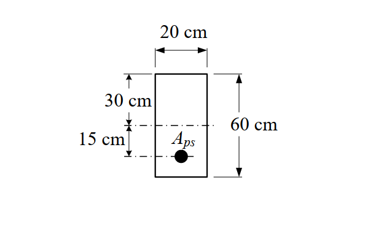

# RC-2016-4 題目正本

> 本檔只記錄**考卷上寫了什麼、圖上畫了什麼**，不含任何解法。解析見同資料夾 `RC-2016-4.md`。
> 判讀清單已經確認（凍結）；本檔原則上不再修改（改動須回考卷原圖並記 log）。

| 項目 | 內容 |
|------|------|
| 考卷 | `raw/exams/RC-2016_鋼筋混凝土設計與預力.pdf` 第 2 頁（背面），第四題 |
| 考年 | 民國 105 年（2016） |
| 配分 | 25 分 |
| 附圖 | `RC-2016-4-fig-1.png`（預力梁斷面） |
| 判讀狀態 | **已確認**（2026-11-15 使用者授權依 Claude 建議確認；轉錄 2026-11-15；PyMuPDF 110 dpi 全頁目視＋文字層逐字核對；盲讀後才比對既有解析） |

## 1. 考卷原文（逐字）

> 四、下圖為某一預力梁斷面，預力鋼鍵偏心距為 15 cm（離斷面中心），預力鋼鍵總面積 $A_{ps}$ = 3.95 cm²，預力鋼鍵抗拉強度 $f_{pu}$ = 19000 kgf/cm²，混凝土設計強度 $f'_c$ = 350 kgf/cm²，彈性模數比值取 $n$ = 6。若鋼鍵之初施預力 $f_{pi}$ = 0.7 $f_{pu}$，在初施預力時混凝土強度 $f'_{ci}$ = 0.7$f'_c$，試計算初施預力時，造成混凝土彈性收縮之預力損失，以及彈性收縮後混凝土頂部與底部之應力。其中，應力計算結果應判斷混凝土是否開裂與受壓過多。（25 分）

## 2. 考卷給的公式、附表與參數

- 斷面（附圖）：寬 20 cm、深 60 cm；鋼鍵距斷面中心 15 cm（在中心以下）。
- $A_{ps}=3.95$ cm²；$f_{pu}=19000$ kgf/cm²；$f'_c=350$ kgf/cm²；$n=6$；$f_{pi}=0.7f_{pu}$；$f'_{ci}=0.7f'_c$。
- 卷首「可能使用公式」（照錄）：$E_c=15000\sqrt{f'_c}$ kgf/cm²；$E_s=2.04\times10^6$ kgf/cm²；$f_r=2\sqrt{f'_c}$ kgf/cm²；$\dfrac{kl_u}{r}\le 34-12\dfrac{M_1}{M_2}$；$\delta_{ns}=\dfrac{C_m}{1-\dfrac{P_u}{0.75P_c}}\ge1.0$；$C_m=0.6+0.4\dfrac{M_1}{M_2}\ge0.4$；$P_c=\dfrac{\pi^2EI}{(kl_u)^2}$。另附鋼筋面積表 D10 0.71、D22 3.87、D29 6.47 cm²。
- **沒有給**：施預力方法（先拉／後拉）、跨度與自重、容許應力。
- 卷首：本科目作答參考規範：中國土木水利工程學會「混凝土工程設計規範(土木 401-100)」。注意事項：㈠可以使用電子計算器。㈡不必抄題，作答時請將試題題號及答案依照順序寫在試卷上，於本試題上作答者，不予計分。

## 3. 附圖

圖面文字照錄：20 cm、30 cm、15 cm、60 cm、A_ps。

## 4. 判讀清單

| # | 項目 | 判讀 | 圖上／題文依據 | 把握 |
|---|------|------|---------------|------|
| 1 | 斷面 | 矩形 20（寬）×60（深）cm | 附圖尺寸 | 確定 |
| 2 | 斷面中心 | 距頂 30 cm（點劃線）＝形心 | 附圖 30 cm 尺寸線由頂面到點劃線 | 確定 |
| 3 | 鋼鍵位置 | 斷面中心以下 15 cm（距頂 45、距底 15） | 題文「偏心距為 15 cm（離斷面中心）」；附圖 15 cm 尺寸線由點劃線到黑點 | 確定 |
| 4 | 施預力方法 | 考卷沒有寫；題目要算「初施預力時造成混凝土彈性收縮之預力損失」，採先拉法讀法（放張時全部鋼鍵隨混凝土同時縮短）；單一鋼鍵後拉時錨碇前已完成彈性縮短，無此損失 | 題文 | 確定（解讀；2026-11-15 使用者授權依 Claude 建議確認） |
| 5 | 自重 | 考卷沒有給跨度，應力只計預力效應（不計自重彎矩），須明寫 | 題文無跨度 | 確定（解讀） |
| 6 | $n$ | 照題給 $n=6$ 使用（即使 $f'_{ci}=0.7f'_c$） | 題文「彈性模數比值取 n＝6」 | 確定（解讀） |
| 7 | $f_{pi}$ | $0.7f_{pu}$ 為彈性收縮前的鋼鍵應力 | 題文 | 確定（解讀） |
| 8 | 開裂判斷 | 拉應力與破裂模數比較；卷首 $f_r=2\sqrt{f'_c}$，傳遞階段以 $f'_{ci}$ 代入 | 卷首公式 | 確定（解讀） |
| 9 | 受壓過多 | 容許壓應力考卷沒有給，依現行規範傳遞階段之值判斷 | 題文 | 確定（解讀；依本庫「規範版本」規則） |

---

*轉錄：2026-11-15（RC-U4-2+U4-3+U4-4 題目正本推廣・批 1）*

*確認：2026-11-15 使用者授權依 Claude 建議確認（RC-U4-2+U4-3+U4-4 題目正本推廣・批 1，關卡一）*
