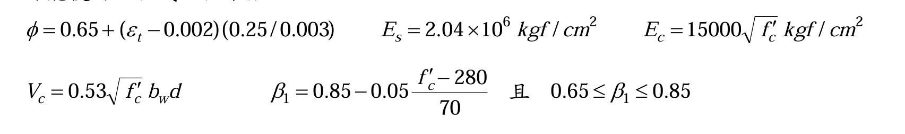
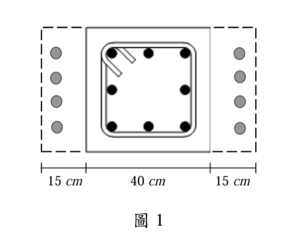
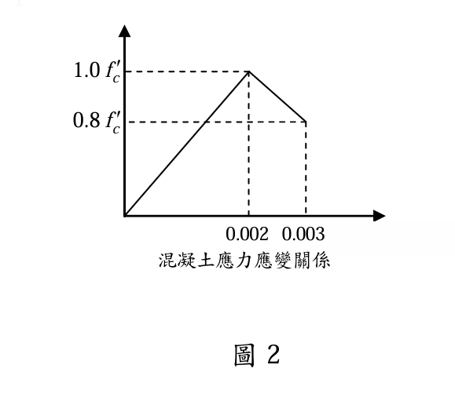

# RC-2017-1 題目正本

> 本檔只記錄**考卷上寫了什麼、圖上畫了什麼**，不含任何解法。解析見同資料夾 `RC-2017-1.md`。
> 判讀清單已經使用者確認（凍結）；本檔原則上不再修改（改動須回考卷原圖並記 log）。

| 項目 | 內容 |
|------|------|
| 考卷 | `raw/exams/RC-2017_鋼筋混凝土設計與預力.pdf` 第 1 頁（全一頁），第一題 |
| 考年 | 民國 106 年（2017） |
| 配分 | 25 分 |
| 附圖 | `RC-2017-1-fig-1.png`（圖 1，擴柱斷面）、`RC-2017-1-fig-2.png`（圖 2，混凝土應力應變關係）；卷首公式 `RC-2017-1-eqn-1.png` |
| 判讀狀態 | **已確認**（2026-11-14 使用者確認；影響答案項目使用者選擇：#1 擴柱後共 16 根（原 8＋新 8）；#2 保護層 6.5 cm 量至鋼筋中心；#3 原柱鋼筋位置須自行假設；轉錄 2026-11-14；PyMuPDF 110 dpi 全頁目視＋抽出文字核對，圖 1 以 450 dpi 放大；盲讀後才比對既有解析） |

## 1. 考卷原文（逐字）

> 一、柱斷面為 40cm×40cm，配置 8 根 D25（#8）鋼筋（$f_y$= 4,200 kgf/cm²，$A_b$= 5.067cm²），如圖 1 所示。混凝土強度 $f'_c$= 210 kgf/cm²，經耐震評估後，發現必須擴柱為 40cm×70cm，使用常重混凝土，$f'_c$= 210 kgf/cm²，鋼筋為 8 根 D25（#8），分布於長向之兩邊，保護層 6.5cm，試求偏心 e = 0 時的軸力強度與適當軸力下長邊所能承受最大可能彎矩。混凝土之應力應變關係可簡化如圖 2。（25 分）

## 2. 考卷給的公式、附表與參數

- 題文數值：原柱 40×40 cm、8-D25（#8），$f_y=4200$ kgf/cm²，$A_b=5.067$ cm²，$f'_c=210$ kgf/cm²；擴柱後 40×70 cm，新混凝土 $f'_c=210$ kgf/cm²，新增鋼筋 8 根 D25（#8）分布於長向之兩邊，保護層 6.5 cm。
- 卷首：「使用規範：土木水利 401-100，否則不計分。」
- 卷首「可能使用之公式，但不限於」（`RC-2017-1-eqn-1.png`）：$\phi=0.65+(\varepsilon_t-0.002)(0.25/0.003)$；$E_s=2.04\times10^6$ kgf/cm²；$E_c=15000\sqrt{f'_c}$ kgf/cm²；$V_c=0.53\sqrt{f'_c}b_wd$；$\beta_1=0.85-0.05\dfrac{f'_c-280}{70}$ 且 $0.65\le\beta_1\le0.85$。

  
- 圖 2 給混凝土應力應變關係（見 §3）。
- **沒有給**：原柱 8 根鋼筋在 40×40 內的位置（保護層）、新增鋼筋的垂直間距、保護層 6.5 cm 量到哪裡（淨保護層或至鋼筋中心）、新增部分的箍筋、擴柱後總鋼筋數是否包含原柱鋼筋。
- 卷首注意事項：㈠可以使用電子計算器。㈡不必抄題，作答時請將試題題號及答案依照順序寫在試卷上，於本試題上作答者，不予計分。㈢本科目除專門名詞或數理公式外，應使用本國文字作答。

## 3. 附圖

圖面文字照錄：「15 cm」「40 cm」「15 cm」「圖 1」。

圖面文字照錄：「1.0 f'c」「0.8 f'c」「0.002」「0.003」「混凝土應力應變關係」「圖 2」。

## 4. 判讀清單

| # | 項目 | 判讀 | 圖上／題文依據 | 把握 |
|---|------|------|---------------|------|
| 1 | 擴柱後的總鋼筋 | 圖 1 同時畫出原柱 8 根（黑）與新增 8 根（灰），題文「鋼筋為 8 根 D25…分布於長向之兩邊」描述新增鋼筋 → 判讀擴柱後共 **16 根**（原 8＋新 8）參與；另一讀法為只計新增 8 根 | 圖 1、題文 | 不確定（影響答案，請確認）；使用者確認 |
| 2 | 保護層 6.5 cm 的量測基準 | 未說明是淨保護層（鋼筋中心距外緣 $6.5+2.54/2=7.77$ cm，若另有箍筋再加箍筋直徑）或量至鋼筋中心（6.5 cm）；圖未依比例，灰色鋼筋中心約在距外緣 5 cm 處，無法佐證 | 題文；圖 1 無尺寸 | 不確定（影響答案，請確認）；使用者確認 |
| 3 | 原柱鋼筋位置 | 考卷未給原柱保護層；圖上原柱每邊 3 根（四角＋中點），距原柱面約 8.6 cm（量圖，不依比例） | 圖 1 量測 | 不確定（解讀）（若計入原柱鋼筋則影響答案）；使用者確認 |
| 4 | 擴柱方向與尺寸 | 原柱左右各加 15 cm → 40（高）×70（寬）cm；長向＝70 cm 方向 | 圖 1 下方 15／40／15 cm | 確定 |
| 5 | 新增鋼筋 | 左右擴柱部分各 1 縱列 4 根 #8，位於長向兩端 | 圖 1 灰色圓點 4＋4 | 確定 |
| 6 | 「長邊所能承受最大可能彎矩」 | 沿長向（深度 70 cm）彎曲；「適當軸力下…最大可能彎矩」＝標稱交互曲線上 $M_n$ 的最大值（軸力可自由選）；是否乘 $\phi$ 題文未說明 | 題文 | 確定（解讀） |
| 7 | 「偏心 e = 0 時的軸力強度」 | 同心軸力強度（標稱 $P_0$；是否再取規範上限 $0.80\phi P_0$ 題文未說明） | 題文 | 確定（解讀） |
| 8 | 混凝土應力應變關係 | 以圖 2 取代矩形應力塊：$0\to f'_c$ 線性至 $\varepsilon=0.002$，再線性降至 $0.8f'_c$ 於 $\varepsilon_{cu}=0.003$ | 圖 2 | 確定 |
| 9 | 新舊混凝土 | 強度同為 210 kgf/cm²，視為一體（第二題才處理介面） | 題文 | 確定（解讀） |
| 10 | 新增部分的橫向鋼筋 | 圖上未畫箍筋；考卷未給 | 圖 1 | 確定 |

---

*轉錄：2026-11-14（RC-U1-2 題目正本推廣・批 1）*

*確認：2026-11-14 使用者確認（RC-U1-2 題目正本推廣・批 1，關卡一）*
