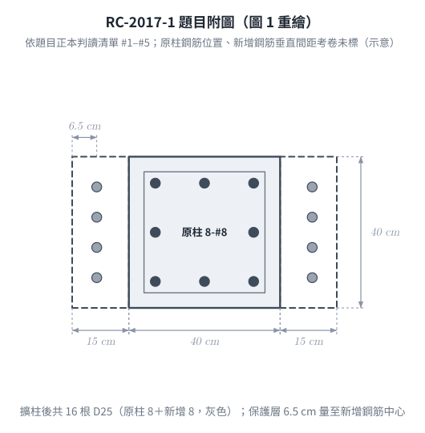
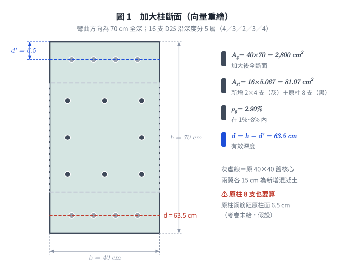
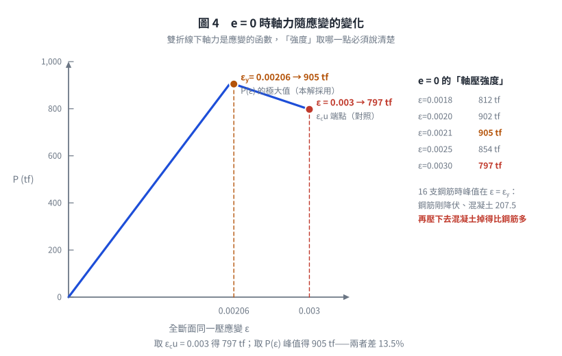
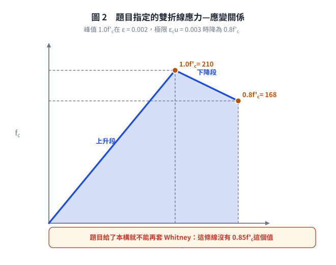
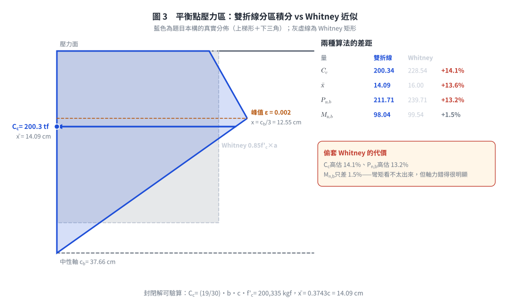

### 考題編號：RC-2017-1

**主分類：** `RC-U1-2` RC 柱強度分析與設計
**副分類：** 無
**設計法：** USD強度設計法
**標籤：** `加大柱` `組合截面` `軸壓強度` `雙折線應力應變` `最大可用軸力` `締箍柱` `最小偏心` `新舊混凝土`

---

## 1. 題目（考卷原文見題目正本）

> 考卷原文、公式／附表、附圖與判讀清單（已確認）見 [`RC-2017-1-problem.md`](RC-2017-1-problem.md)。本節只列解題時最容易讀錯的地方與本解使用的記號；題意以題目正本為準。

*重繪自考卷附圖，依題目正本判讀清單；攔下漏掉原柱 8 根鋼筋、把保護層基準弄錯的錯誤。*

### 常見誤讀

| 項目 | 正確判讀 | 常見誤讀 |
|---|---|---|
| 擴柱後鋼筋 | 原柱 8 根＋新增 8 根，共 16 根 D25（判讀 #1，使用者確認） | 只計新增 8 根 |
| 保護層 6.5 cm | 量至新增鋼筋中心（判讀 #2，使用者確認） | 當淨保護層（中心距外緣 7.77 cm） |
| 原柱鋼筋位置 | 考卷沒有給（判讀 #3），須自行假設 | 當作已知 |
| 混凝土應力應變 | 用圖 2 自訂雙折線，$\varepsilon_{cu}=0.003$ 時 $0.8f'_c$（判讀 #8） | 仍套 Whitney 矩形應力塊 |
| $e=0$ 軸力強度 | 取 $P(\varepsilon)$ 的峰值（16 根時在 $\varepsilon=\varepsilon_y$，904.8 tf；2026-11-14 使用者定案） | 直接取 $\varepsilon=0.003$、$0.8f'_c$ 當唯一答案 |

**本解記號：** 擴柱後 $b=40$ cm、$h=70$ cm（彎曲方向）；$f'_c=210$ kgf/cm²（新舊相同）、$f_y=4200$ kgf/cm²、$A_b=5.067$ cm²；新增鋼筋距外緣 6.5 cm（中心）；原柱鋼筋假設距原柱面 6.5 cm（考卷未給，使用者定案）→ 沿彎曲深度 5 層 6.5／21.5／35／48.5／63.5 cm（4／3／2／3／4 根）。

### 判讀圖解（解析自繪）

圖 1（擴柱後 16 支 D25 的斷面重繪）見 §4 Step 1。

---

## 2. 考題核心精神與出題者意圖 (Core Concepts & Examiner's Intent)

**核心觀念：** 本題是「加大柱（Column Jacketing）」的強度計算，考驗三項能力：

1. **讀懂擴柱後的配筋**：原柱 8 根仍在，新增 8 根集中在長向兩端——擴柱後共 16 根 D25，沿彎曲深度分 5 層（4／3／2／3／4）
2. **以題給本構求 $e=0$ 強度**：全斷面同一應變 $\varepsilon$，$P(\varepsilon)=f_c(\varepsilon)(A_g-A_{st})+f_s(\varepsilon)A_{st}$；圖 2 混凝土在 0.002 達峰值後下降、鋼筋在 $\varepsilon_y$ 才降伏，「強度」是 $P(\varepsilon)$ 的最大值
3. **對雙折線分區積分**：偏心受壓時壓力區應力**不是常數**，在 $\varepsilon=0.002$ 有轉折，須切成梯形段＋三角形段分別求合力與形心，**不能套 $C_c=0.85f'_c\,a\,b$**

**出題者意圖：**
- 測試「題目另給應力-應變模型時，不應自動套用 Whitney $0.85f'_c$」
- 測試擴柱後新舊鋼筋共同作用的斷面分析（多層鋼筋的應變相容）
- 測試「適當軸力下最大彎矩」＝交互曲線的鼻端，發生在平衡點附近

---

## 3. 解題戰略地圖與陷阱分析 (Strategic Roadmap & Trap Analysis)

**作戰計畫：**
1. 斷面幾何：$A_g$、$A_{st}=16A_b$、$\rho_g$
2. 原柱鋼筋位置考卷未給 → 假設距原柱面 6.5 cm（與新增鋼筋同保護層）
3. 【e＝0】寫出 $P(\varepsilon)$，在 $0.002\le\varepsilon\le0.003$ 找最大值（混凝土下降、鋼筋上升的交換點）
4. 【最大彎矩】平衡條件求 $c_b$（最外拉力筋 $\varepsilon_t=\varepsilon_y$）
5. 壓力區分區積分：梯形段（$0.8f'_c\to f'_c$）＋三角形段（$f'_c\to0$）
6. 5 層鋼筋各自由應變求應力；受壓者扣該位置的雙折線混凝土應力
7. 對斷面形心取矩 → $M_{n,b}$；以 c 掃描確認平衡點即彎矩最大值

**關鍵陷阱：**

| # | 陷阱 | 正確做法 |
|---|------|---------|
| 1 | **只算新增 8 根**：以為題文「鋼筋為 8 根 D25」就是全部 | 圖 1 原柱 8 根（黑）仍在，擴柱後共 16 根（關卡一確認） |
| 2 | **$e=0$ 直接取 $\varepsilon=0.003$**：把 $0.8f'_c$ 當成唯一答案 | $P(\varepsilon)$ 的峰值在 $\varepsilon=\varepsilon_y=0.00206$：905 tf；0.003 時只有 797 tf |
| 3 | **套用 Whitney $0.85f'_c$** | 題目給了本構就照本構積分 |
| 4 | **壓力筋扣 $0.85f'_c$** | 扣的是該位置的雙折線應力（例：$\varepsilon=0.00248$ 處為 189.7） |
| 5 | **中間各層鋼筋當成降伏** | 原柱三層應變只有 0.0013、0.0002、−0.0009，都未降伏 |

---

## 3.5 變數層次分析 (Variable Hierarchy Analysis)

> 複習提示：第一次解題後，在每個卡住的知識點旁標記 `⚠`；第二次複習時只看有 `⚠` 的項目。

### 最終目標

(a) 偏心 $e=0$ 時的軸力強度 $P_n(e=0)$；(c) 適當軸力下長邊最大可能彎矩 $M_{n,\max}$（另附 (b) 規範設計軸力上限）

### 本題關鍵公式（依計算順序）

$$\text{Step 1: } f_c(\varepsilon) = \begin{cases} f'_c\,\varepsilon/0.002 & \varepsilon\le0.002\\ f'_c\left[1-0.2(\varepsilon-0.002)/0.001\right] & 0.002<\varepsilon\le0.003\end{cases}$$

$$\text{Step 2: } P(\varepsilon) = f_c(\varepsilon)\,(A_g-A_{st}) + \min(E_s\varepsilon,f_y)\,A_{st} \;\Rightarrow\; P_n(e=0)=\max_\varepsilon P(\varepsilon)$$

$$\text{Step 3: } c_b = \frac{\varepsilon_{cu}}{\varepsilon_{cu}+\varepsilon_y}\,d,\qquad x_{pk}=\frac{\boxed{c_b}}{3}$$

$$\text{Step 4: } C_c = \underbrace{b\,x_{pk}\tfrac{0.8f'_c+f'_c}{2}}_{C_1} + \underbrace{b(\boxed{c_b}-x_{pk})\tfrac{f'_c}{2}}_{C_2}=\tfrac{19}{30}\,b\,c_b\,f'_c,\quad \bar x_c = 0.3743\,c_b$$

$$\text{Step 5: } F_i = A_i\left[f_s(\varepsilon_i) - f_c(\varepsilon_i)\right],\quad \varepsilon_i = \varepsilon_{cu}\frac{\boxed{c_b}-d_i}{\boxed{c_b}}$$

$$\text{Step 6: } M_{n,b} = \boxed{C_c}\left(\frac h2-\boxed{\bar x_c}\right) + \sum F_i\left(\frac h2 - d_i\right)$$

### L1：題目直接給定

| 符號 | 數值 | 說明 |
|------|------|------|
| $b\times h$ | 40×70 cm | 擴柱後（$h$ 為彎曲方向） |
| $f'_c$ | 210 kgf/cm² | 新舊混凝土相同 |
| $f_y$ | 4200 kgf/cm² | |
| $A_b$ | 5.067 cm² | D25 |
| 鋼筋 | 原柱 8＋新增 8 | 共 16 根（判讀 #1） |
| 保護層 | 6.5 cm | 量至新增鋼筋中心（判讀 #2） |
| 本構 | 圖 2 雙折線 | 峰值 $f'_c$@0.002、$0.8f'_c$@0.003 |
| $E_s$ | 2.04×10⁶ kgf/cm² | 卷首公式 |

### L2：需知識點推導

| 符號 | 公式／來源 | 卡關? |
|------|-----------|-------|
| 原柱鋼筋 | 假設距原柱面 6.5 cm → 距壓力面 21.5／35／48.5 cm（3／2／3 根） | ⚠ |
| 各層 $d_i$ | 6.5（4）、21.5（3）、35（2）、48.5（3）、63.5（4） | |
| $A_{st}$ | $16\times5.067=81.07$ cm² | |
| $\varepsilon_y$ | 0.002059 | |
| $P_n(e=0)$ | 峰值在 $\varepsilon_y$：904.8 tf | ⚠ |
| $c_b$ | $0.5930\times63.5=37.66$ cm | |
| $C_c$、$\bar x_c$ | 200.3 tf、14.09 cm | |
| $P_{n,b}$、$M_{n,b}$ | 211.7 tf、98.04 tf·m | |

### L3：深層知識（不懂就卡住）

| 知識點 | 說明 | 卡關? |
|--------|------|-------|
| 軸壓強度＝$P(\varepsilon)$ 的最大值 | 混凝土過峰後下降、鋼筋到 $\varepsilon_y$ 才平台；兩者疊加的峰值落在 $\varepsilon_y$（鋼筋多時）或 0.002（鋼筋少時） | ⚠ |
| 雙折線閉合解 | $c\le h$ 時 $C_c=\tfrac{19}{30}bcf'_c$、$\bar x_c=0.3743c$ | |
| 最大彎矩在平衡點 | $c<c_b$ 時最外拉力筋已降伏，彎矩隨 c 減小而下降；$c>c_b$ 時拉力筋應力下降，彎矩也下降 | |
| 新舊混凝土一體 | 強度同為 210，介面剪力在第二題才處理 | |

---

## 4. 步驟化詳細計算過程 (Step-by-Step Detailed Calculation)

### 【前置】材料參數確認

| 參數 | 數值 | 來源 |
|------|------|------|
| $f'_c$ | 210 kgf/cm² | 題目（新舊相同） |
| $f_y$ | 4,200 kgf/cm² | 題目 |
| $E_s$ | $2.04\times10^6$ kgf/cm² | 卷首公式 |
| $\varepsilon_y$ | $4200/2.04\times10^6=0.002059$ | 計算 |
| 本構 | 圖 2 雙折線 | 題目 |

---

### 【Step 1】斷面幾何與鋼筋分層

$$A_g = 40\times70 = 2{,}800\text{ cm}^2,\qquad A_{st} = 16\times5.067 = 81.07\text{ cm}^2,\qquad \rho_g = 2.90\%$$

原柱 40×40 位於中央（距兩端各 15 cm），原柱鋼筋假設距原柱面 6.5 cm（考卷未給，2026-11-14 使用者定案）。沿彎曲深度（自壓力面）：

| 層 | $d_i$ (cm) | 根數 | $A_i$ (cm²) | 來源 |
|---|---:|---:|---:|---|
| 1 | 6.5 | 4 | 20.27 | 新增 |
| 2 | 21.5 | 3 | 15.20 | 原柱 |
| 3 | 35.0 | 2 | 10.13 | 原柱 |
| 4 | 48.5 | 3 | 15.20 | 原柱 |
| 5 | 63.5 | 4 | 20.27 | 新增 |

*圖 1　加大柱斷面（向量重繪）。原柱 8 支（黑）仍在，新增 8 支（灰）在長向兩端——擴柱後共 16 支，沿深度 4／3／2／3／4 五層；原柱鋼筋距原柱面 6.5 cm 為假設。*

---

### 【Part (a)：偏心 $e=0$ 時的軸力強度】

全斷面同一壓應變 $\varepsilon$：

$$P(\varepsilon) = f_c(\varepsilon)\,(2{,}800-81.07) + \min(E_s\varepsilon,\,4200)\times81.07$$

| $\varepsilon$ | 0.0018 | 0.0020 | **$\varepsilon_y$＝0.002059** | 0.0025 | 0.0030 |
|---|---:|---:|---:|---:|---:|
| $f_c$ | 189.0 | 210.0 | **207.5** | 189.0 | 168.0 |
| $f_s$ | 3,672 | 4,080 | **4,200** | 4,200 | 4,200 |
| $P$ (tf) | 811.6 | 901.7 | **904.8** | 854.4 | 797.3 |

- $\varepsilon<\varepsilon_y$：混凝土與鋼筋都在上升（或混凝土剛過峰），$P$ 仍增加
- $\varepsilon>\varepsilon_y$：鋼筋進入平台，混凝土每 0.001 應變掉 $0.2f'_c$，$P$ 開始下降

$$\boxed{P_n(e=0) = 207.5\times2{,}718.9 + 4{,}200\times81.07 = 564{,}258 + 340{,}502 \approx 904.8\text{ tf}}$$

（取 $\varepsilon_{cu}=0.003$ 時為 797.3 tf，見 §5。）

*圖 4　$e=0$ 時軸力隨應變的變化。16 支鋼筋時峰值在 $\varepsilon_y$（鋼筋剛降伏、混凝土 207.5）；再壓下去混凝土掉得比鋼筋增加得多。*

---

### 【Part (b)（附）：規範設計軸力上限】

現行規範箍筋柱 $\phi P_{n,\max}=0.80\,\phi P_o$，$P_o$ 依規範用 $0.85f'_c$：

$$P_o = 0.85\times210\times2{,}718.9 + 4{,}200\times81.07 = 825.8\text{ tf},\qquad \phi P_{n,\max} = 0.80\times0.65\times825.8 = 429.4\text{ tf}$$

（考卷未問此值；若改以圖 2 的 904.8 tf 代入為 470.5 tf。）

---

### 【Part (c)：適當軸力下長邊最大可能彎矩】

#### Step 1　平衡點中性軸

$$c_b = \frac{0.003}{0.003+0.002059}\times63.5 = 37.66\text{ cm},\qquad x_{pk} = c_b/3 = 12.55\text{ cm}\ (\varepsilon=0.002)$$

#### Step 2　壓力區分區積分

$$C_1 = \frac{168+210}{2}\times12.55\times40 = 94{,}896\text{ kgf},\quad \bar x_1 = 12.55\times\frac{168+2\times210}{3(168+210)} = 6.51\text{ cm}$$

$$C_2 = \frac{210}{2}\times25.10\times40 = 105{,}440\text{ kgf},\quad \bar x_2 = 12.55 + 25.10/3 = 20.92\text{ cm}$$

$$C_c = 200{,}335\text{ kgf} = \tfrac{19}{30}\times40\times37.66\times210\ ✓,\qquad \bar x_c = \frac{94{,}896\times6.51+105{,}440\times20.92}{200{,}335} = 14.09\text{ cm}$$

#### Step 3　各層鋼筋（受壓者扣該處雙折線應力）

| $d_i$ | $\varepsilon_i$ | $f_s$ | 扣 $f_c(\varepsilon_i)$ | $F_i$ (kgf) | 臂 $35-d_i$ | 矩 (kgf·cm) |
|---:|---:|---:|---:|---:|---:|---:|
| 6.5 | +0.002482 | 4,200 | 189.7 | +81,280 | 28.5 | 2,316,500 |
| 21.5 | +0.001287 | 2,626 | 135.2 | +37,861 | 13.5 | 511,100 |
| 35.0 | +0.000212 | 432 | 22.2 | +4,151 | 0 | 0 |
| 48.5 | −0.000864 | −1,762 | — | −26,787 | −13.5 | 361,600 |
| 63.5 | −0.002059 | −4,200 | — | −85,126 | −28.5 | 2,426,100 |

#### Step 4　軸力與彎矩

$$P_{n,b} = 200{,}335 + 81{,}280 + 37{,}861 + 4{,}151 - 26{,}787 - 85{,}126 = 211{,}713\text{ kgf} \approx 211.7\text{ tf}$$

$$M_{n,b} = 200{,}335\times(35-14.09) + 2{,}316{,}500 + 511{,}100 + 361{,}600 + 2{,}426{,}100 = 9{,}803{,}500\text{ kgf·cm}$$

$$\boxed{M_{n,\max} = M_{n,b} \approx 98.04\text{ tf·m}\quad(\text{對應 } P_n \approx 211.7\text{ tf})}$$

#### Step 5　確認平衡點即最大值

以 $c$ 由 20 到 60 cm 掃描（纖維數值積分為第二路徑），$M_n$ 的最大值發生在 $c=37.66$ cm（＝$c_b$），兩種積分結果一致（98.04 tf·m）。$c<c_b$ 時最外拉力筋已降伏，壓力區縮小使彎矩下降；$c>c_b$ 時拉力筋應力下降，彎矩也下降。

#### Step 6　設計值（參考）

平衡點 $\varepsilon_t=\varepsilon_y$ 屬壓力控制，$\phi=0.65$：$\phi M_n = 63.7$ tf·m、$\phi P_n = 137.6$ tf（題文只問「最大可能彎矩」，主答為標稱值）。

*圖 2　題目指定的雙折線本構：峰值 $f'_c$ 在 0.002，極限 0.003 時降為 $0.8f'_c$。這條線上沒有 $0.85f'_c$ 這個值。*

*圖 3　平衡點壓力區：雙折線分區積分 vs Whitney。套 Whitney 會高估 $C_c$ 14.1%、$P_{n,b}$ 13.2%，彎矩只差 1.5%——彎矩看不太出來，軸力錯得很明顯。*

---

### 【結論】

| 項目 | 方法 | 答案 |
|------|------|------|
| **(a)** 偏心 $e=0$ 的軸力強度 | 圖 2 本構，$P(\varepsilon)$ 峰值（$\varepsilon=\varepsilon_y$） | $\boxed{904.8\text{ tf}}$ |
| **(c)** 長邊最大可能彎矩 | 平衡點，雙折線分區積分＋5 層鋼筋 | $\boxed{98.04\text{ tf·m}}$（$P_n=211.7$ tf） |
| (b) 附：規範設計軸力上限 | $0.80\times0.65\times P_o$（$0.85f'_c$） | 429.4 tf |

---

## 5. 關鍵爭議點與進階探討 (Critical Issues & Advanced Discussion)

### ① 舊版解析的讀題錯誤（2026-11-14 勘誤）

舊版只計新增 8 根 D25，並以 $\varepsilon=0.003$ 定義 $e=0$ 強度，得 $P_n(e=0)=634$ tf、$\phi P_{n,\max}=330$ tf、$M_{n,b}=89.3$ tf·m（$P_{n,b}=197$ tf）、$\phi M_{n,b}=58.5$ tf·m。題目正本（關卡一確認）為擴柱後共 16 根：$P_n(e=0)=904.8$ tf、$M_{n,\max}=98.04$ tf·m。舊版在「只算 8 根」的前提下計算正確（本次重算 89.25 tf·m 相同）。

### ② $e=0$ 強度取哪一點（2026-11-14 使用者定案）

| 定義 | $P_n(e=0)$ | 說明 |
|---|---:|---|
| **$P(\varepsilon)$ 峰值（主解）** | **904.8 tf** | 「強度」＝斷面能承受的最大軸力 |
| $\varepsilon_{cu}=0.003$ | 797.3 tf | 與交互曲線 $c\to\infty$ 端點一致，但不是最大值 |
| 規範 $0.85f'_c$（對照） | 825.8 tf | 不用圖 2 本構 |
| 只計新增 8 根（舊版讀法，峰值） | 744.9 tf | 判讀錯誤，僅供對照 |

### ③ 原柱鋼筋位置的影響

考卷沒有給原柱保護層。主解假設距原柱面 6.5 cm；若照圖面量測約 8.6 cm（圖不依比例），$M_{n,\max}=95.53$ tf·m（−2.6%），$P_n(e=0)$ 不受影響（同心受壓與位置無關）。

### ④ Whitney 對照

若不用圖 2、改用規範 Whitney（$\beta_1=0.85$，扣 $0.85f'_c$）：$c=36.15$ cm 時最大 $M_n=99.59$ tf·m（+1.6%），$P_{n,b}$ 則高估 13%。題目明示用圖 2，主解照本構。

### ⑤ 規範版本

卷首指定土木 401-100，並印出 $\phi=0.65+(\varepsilon_t-0.002)(0.25/0.003)$。依現行建築物混凝土結構設計規範（2023），過渡區自 $\varepsilon_{ty}$ 起算；本題平衡點 $\varepsilon_t=\varepsilon_{ty}$，兩式都得 $\phi=0.65$（考卷式得 0.655），只影響附註的設計值。卷首 $E_s$ 為數值參數照用；題目的雙折線本構屬題意條件，照用。

### ⑥ 新舊混凝土介面

本題視新舊混凝土完全一體（強度相同）；能否一體作用，取決於介面剪力傳遞與植筋——這是同卷第二題的內容。

*圖解補繪：2026-08-21（向量圖 4 張，腳本 `figs/gen_RC-2017-1.py`，可重跑；腳本檔尾對 §4 公佈值做 assert）*

*修正日期：2026-11-14（§1 改為指向題目正本，插入重繪附圖 figs/RC-2017-1-fig-1-problem.svg、改寫常見誤讀與本解記號；刪除「8 支 D25 為題目講明」的加字（擴柱後 16 根，使用者確認）；本行非答案勘誤）*

*修正日期：2026-11-14（解析勘誤：鋼筋由只計新增 8 根改為擴柱後 16 根〔題目正本判讀 #1〕、原柱鋼筋假設距原柱面 6.5 cm、$e=0$ 強度改取 $P(\varepsilon)$ 峰值（使用者定案）；$P_n(e=0)$ 634 → 904.8 tf、$M_{n,\max}$ 89.3 → 98.04 tf·m；改寫 §2–§5、多層鋼筋斷面，重畫圖 1、3、4（gen 腳本對帳 25 項通過）。驗證：Python 重算 MISMATCHES: 0，壓力區以閉合式與纖維積分交叉、最大彎矩以求極值與 c 掃描交叉；依 RC-U1-2 批 1 盲解比對）*
