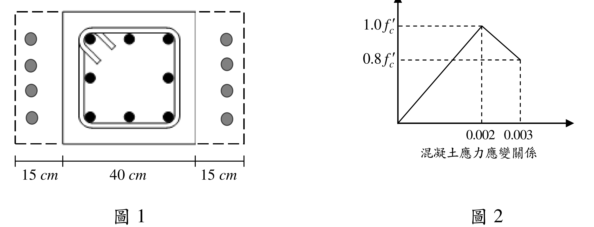

# RC-2017-2 題目正本

> 本檔只記錄**考卷上寫了什麼、圖上畫了什麼**，不含任何解法。解析見同資料夾 `RC-2017-2.md`。
> 判讀清單已經使用者確認（凍結）；本檔原則上不再修改（改動須回考卷原圖並記 log）。

| 項目 | 內容 |
|------|------|
| 考卷 | `raw/exams/RC-2017_鋼筋混凝土設計與預力.pdf` 第 1 頁（全一頁），第二題（承第一題） |
| 考年 | 民國 106 年（2017） |
| 配分 | 25 分 |
| 附圖 | `RC-2017-2-fig-1.png`（第一題的圖 1 擴柱斷面與圖 2 混凝土應力應變關係；本題「承上題」沿用；2026-11-15 由考卷擷取 500 dpi，原本本題資料夾沒有附圖） |
| 判讀狀態 | **已確認**（2026-11-15 使用者確認；影響答案項目使用者選擇：#1 #2 沿用 RC-2017-1 已確認判讀；轉錄 2026-11-15；PyMuPDF 110 dpi 全頁目視，附圖 450 dpi 局部放大（圖 1 為內嵌點陣影像）；盲讀後才比對既有解析） |

## 1. 考卷原文（逐字）

本題「承上題」，第一題原文一併照錄：

> 一、柱斷面為 40cm×40cm，配置 8 根 D25（#8）鋼筋（$f_y$= 4,200 kgf/cm²，$A_b$= 5.067cm²），如圖 1 所示。混凝土強度 $f_c'$= 210 kgf/cm²，經耐震評估後，發現必須擴柱為 40cm×70cm，使用常重混凝土，$f_c'$= 210 kgf/cm²，鋼筋為 8 根 D25（#8），分布於長向之兩邊，保護層 6.5cm，試求偏心 $e$ = 0 時的軸力強度與適當軸力下長邊所能承受最大可能彎矩。混凝土之應力應變關係可簡化如圖 2。（25 分）
>
> 二、承上題，為確保該柱新舊混凝土可充分結合，以發揮複合作用，請問新舊混凝土介面在彎矩最大時需承受多少剪力，如何設計植筋以確保介面不致分離，新舊混凝土間已經過表面粗糙處理。（植筋使用 D19，$f_y$= 4,200 kgf/cm²，$A_b$=3.871cm²）（25 分）

## 2. 考卷給的公式、附表與參數

- 卷首「使用規範：土木水利 401-100，否則不計分。」
- 卷首「可能使用之公式，但不限於」（照錄）：
  - $\phi = 0.65+(\varepsilon_t-0.002)(0.25/0.003)$、$E_s = 2.04\times10^6$ kgf/cm²、$E_c = 15000\sqrt{f'_c}$ kgf/cm²
  - $V_c = 0.53\sqrt{f'_c}\,b_w d$
  - $\beta_1 = 0.85-0.05\dfrac{f'_c-280}{70}$ 且 $0.65\le\beta_1\le0.85$
- 圖 2 混凝土應力應變關係（照錄）：應變 0 至 0.002 直線上升至 $1.0f'_c$；0.002 至 0.003 直線下降至 $0.8f'_c$；0.003 處截止。
- 本題數值：植筋 D19，$f_y$＝4200 kgf/cm²，$A_b$＝3.871 cm²；新舊混凝土介面已粗糙處理。
- 考卷數值矛盾：植筋寫 D19，但 $A_b$＝3.871 cm² 為 D22 的面積（D19 為 2.87 cm²），照錄。
- **沒有給**：柱高（或彎矩沿柱高的變化、柱剪力）、介面摩擦係數、植筋埋入深度條件、保護層 6.5 cm 的量測基準。
- 卷首注意事項：㈠可以使用電子計算器。㈡不必抄題，作答時請將試題題號及答案依照順序寫在試卷上，於本試題上作答者，不予計分。㈢本科目除專門名詞或數理公式外，應使用本國文字作答。

## 3. 附圖

圖面文字照錄：`15 cm`、`40 cm`、`15 cm`、`圖 1`；`1.0f'c`、`0.8f'c`、`0.002`、`0.003`、`混凝土應力應變關係`、`圖 2`。

## 4. 判讀清單

「把握」標**不確定**者請優先確認；解讀類項目（題目用字的意思）另標「解讀」。

| # | 項目 | 判讀 | 圖上／題文依據 | 把握 |
|---|------|------|---------------|------|
| 1 | 擴柱後縱筋 | 舊柱 8 根 D25 保留；擴柱**另加** 8 根 D25，左右新混凝土各 4 根排成一列；擴柱後共 16 根（同 RC-2017-1 題目正本判讀 #1，2026-11-14 使用者已確認） | 圖 1：舊柱內 8 根黑色＋兩側虛線區各 4 根灰色；題文「鋼筋為 8 根 D25，分布於長向之兩邊」 | 確定（解讀）（影響答案）；沿用 RC-2017-1 已確認判讀 |
| 2 | 保護層 6.5 cm | 新增縱筋**中心**到新混凝土外緣 6.5 cm（同 RC-2017-1 題目正本判讀 #2，已確認）；題文未說明量到筋心或筋外緣 | 題文只寫「保護層 6.5cm」；圖 1 未標尺寸、未依比例 | 確定（解讀）（影響答案）；沿用 RC-2017-1 已確認判讀 |
| 3 | 擴柱幾何 | 舊柱 40×40 cm 置中；長向（70 cm）兩端各加 15 cm 新混凝土，斷面 40×70 cm | 圖 1 尺寸 15、40、15 cm；題文 | 確定 |
| 4 | 新舊介面 | 兩個介面：舊柱左右兩側面（各寬 40 cm、沿柱高），已粗糙處理 | 圖 1 實線舊柱邊界；題文 | 確定 |
| 5 | 材料 | 新舊混凝土 $f'_c$ 皆 210 kgf/cm²，常重混凝土；縱筋與植筋 $f_y$＝4200 kgf/cm² | 題文 | 確定 |
| 6 | 「彎矩最大時」 | 指第一題求得的「長邊所能承受最大可能彎矩」那個狀態 | 題文「承上題」「彎矩最大時」 | 確定（解讀） |
| 7 | 介面剪力的方向 | 介面剪力為沿柱軸向（新混凝土條帶與舊柱之間）的縱向剪力；考卷沒有給柱高或柱剪力，無法由彎矩梯度求剪力流 | 題文未給柱高、剪力 | 確定（解讀） |
| 8 | 植筋面積 | 考卷印「D19，$A_b$=3.871cm²」；3.871 cm² 是 D22 的面積，D19 標準面積為 2.87 cm²（本卷無鋼筋表；98 年考卷給 D19＝2.87 cm²、107 年考卷鋼筋表 D22＝3.87 cm²）。照錄考卷數值，答題時宜註明 | 題文 | 確定（考卷數值矛盾，照錄） |
| 9 | 所求 | 介面在彎矩最大時需承受的剪力；植筋（D19）的設計方式 | 題文 | 確定 |
| 10 | 考卷沒有給 | 柱高、柱剪力、摩擦係數、植筋埋入深度、保護層量測基準 | 全題 | 確定 |

---

*轉錄：2026-11-15（RC-U2-1／U2-2 題目正本推廣・批 1）*

*確認：2026-11-15 使用者確認（RC-U2-1／U2-2 題目正本推廣・批 1，關卡一）*
