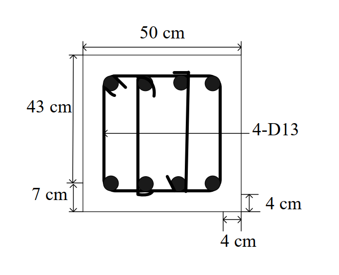

# RC-2018-1 題目正本

> 本檔只記錄**考卷上寫了什麼、圖上畫了什麼**，不含任何解法。解析見同資料夾 `RC-2018-1.md`。
> 判讀清單已經使用者確認（凍結）；本檔原則上不再修改（改動須回考卷原圖並記 log）。

| 項目 | 內容 |
|------|------|
| 考卷 | `raw/exams/RC-2018_鋼筋混凝土設計與預力.pdf` 第 1 頁（頁次 2－1），第一題 |
| 考年 | 民國 107 年（2018） |
| 配分 | 25 分 |
| 附圖 | `RC-2018-1-fig-1.png`（梁斷面） |
| 判讀狀態 | **已確認**（2026-11-15 使用者確認；影響答案項目使用者選擇：#1 抗剪計 4 肢、抗扭只計外圍閉合箍；#2 #3 h＝50、d＝43；轉錄 2026-11-15；PyMuPDF 110 dpi 全頁目視，附圖 450 dpi 局部放大；尺寸文字以 PDF 文字座標核對；盲讀後才比對既有解析） |

## 1. 考卷原文（逐字）

> 一、一鋼筋混凝土矩形梁斷面（如圖示）承受扭矩 $T_u$=4 tf-m 及剪力載重 $V_u$=20 tf。梁斷面配置 4 支 D13 閉合箍筋，淨保護層為 4 cm。試以塑性理念設計箍筋之間距。（25 分）

## 2. 考卷給的公式、附表與參數

- 卷首依據與作答規範：內政部營建署「混凝土結構設計規範」（內政部 100.6.9 台內營字第 1000801914 號令）；中國土木水利學會「混凝土工程設計規範」（土木 401-100）。未依上述規範作答，不予計分。
- 卷首鋼筋表與材料（照錄）：D13，$d_b$＝1.27 cm，$A_b$＝1.27 cm²；D22，$d_b$＝2.22 cm，$A_b$＝3.87 cm²；D25，$d_b$＝2.54 cm，$A_b$＝5.07 cm²；D29，$d_b$＝2.87 cm，$A_b$＝6.47 cm²；混凝土強度 $f'_c$＝280 kgf/cm²，D10 與 D13 $f_y$＝2800 kgf/cm²；D25 以上 $f_y$＝4200 kgf/cm²。
- 題文數值：$T_u$＝4 tf-m、$V_u$＝20 tf；4 支 D13 閉合箍筋；淨保護層 4 cm。
- **沒有給**：公式、縱筋號數（圖上 8 根未標號數）、扭矩屬平衡或諧和扭矩、強度折減因數、混凝土種類（常重／輕質）。
- 卷首注意事項：可以使用電子計算器；不必抄題，作答時請將試題題號及答案依照順序寫在試卷上，於本試題上作答者，不予計分；本科目得以本國文字或英文作答。

## 3. 附圖

圖面文字照錄：`50 cm`、`43 cm`、`7 cm`、`4-D13`、`4 cm`（垂直）、`4 cm`（水平）。

## 4. 判讀清單

「把握」標**不確定**者請優先確認；解讀類項目（題目用字的意思）另標「解讀」。

| # | 項目 | 判讀 | 圖上／題文依據 | 把握 |
|---|------|------|---------------|------|
| 1 | 4 支 D13 的組成 | 斷面上有 **4 支垂直肢**：外圍一圈閉合箍筋（2 肢）＋內部 2 支繫筋（左內肢兩端彎鉤、右內肢上 90°／下 135° 彎鉤，皆非閉合）。使用者定案：抗剪計 4 肢；抗扭只計外圍閉合箍（$A_t$＝1 支） | 450 dpi：`4-D13` 指示線水平穿過 4 支垂直肢；內部兩肢端部為單支彎鉤，未與水平段圍成閉合；題文寫「4 支 D13 閉合箍筋」 | 不確定（解讀）（影響答案）；使用者確認 |
| 2 | 斷面尺寸 | 寬 $b$＝50 cm；高 $h$＝43＋7＝50 cm | 50cm 延伸線對齊左右外緣；43cm 上端對齊頂面、與 7cm 交點在下排筋心、7cm 下端對齊底面 | 確定 |
| 3 | 有效深度 | $d$＝43 cm（頂面到下排筋心） | 同 #2 | 確定 |
| 4 | 淨保護層 | 4 cm，量到箍筋外緣（底面與側面皆是） | 右下兩個 4cm：一端對齊外緣，另一端對齊箍筋外緣附近；題文「淨保護層為 4 cm」 | 確定 |
| 5 | 縱筋 | 上下各 4 根，共 8 根；號數未標 | 圖上 8 個黑點，無號數標註 | 確定 |
| 6 | 材料 | $f'_c$＝280 kgf/cm²；D13（箍筋）$f_{yt}$＝2800 kgf/cm²；縱筋 $f_y$ 依號數（D25 以上 4200） | 卷首材料說明 | 確定（解讀） |
| 7 | 「塑性理念」 | 指以空間桁架（薄壁管）塑性模型的扭剪設計（規範現行扭力設計法） | 題文 | 確定（解讀） |
| 8 | 載重 | $T_u$＝4 tf-m、$V_u$＝20 tf 同時作用，皆為設計值 | 題文 | 確定 |
| 9 | 所求 | 箍筋（D13）間距 | 題文 | 確定 |
| 10 | 考卷沒有給 | 縱筋號數、平衡／諧和扭矩、$\phi$、混凝土種類 | 全題 | 確定 |

---

*轉錄：2026-11-15（RC-U2-1／U2-2 題目正本推廣・批 1）*

*確認：2026-11-15 使用者確認（RC-U2-1／U2-2 題目正本推廣・批 1，關卡一）*
