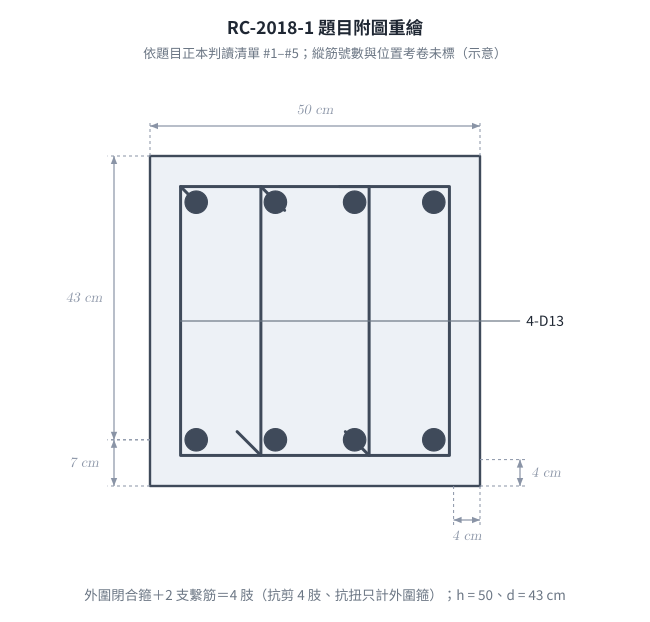
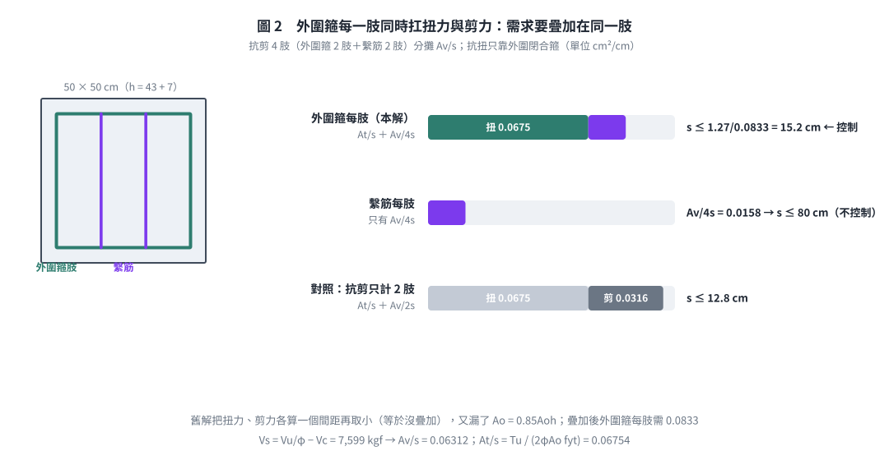

# 考題編號：RC-2018-1

**主分類：** `RC-U2-2` RC 扭力強度設計  
**副分類：** `RC-U2-1` RC 剪力強度分析與設計  
**設計法：** USD強度設計法  
**標籤：** `矩形梁` `扭矩剪力組合` `空間桁架類比` `塑性理念` `閉合箍筋` `poh/8最大間距` `Aoh計算` `縱向扭力筋`

---

## 1. 題目（考卷原文見題目正本）

> 考卷原文、公式／附表、附圖與判讀清單（已確認）見 [`RC-2018-1-problem.md`](RC-2018-1-problem.md)。本節只列解題時最容易讀錯的地方與本解使用的記號；題意以題目正本為準。


*重繪自考卷附圖，依題目正本判讀清單 #1–#5。本圖攔下的讀錯：$h$＝50、$d$＝43（不是 $h$＝43）；4-D13 是 4 支肢，不是 4 根角隅縱筋。*

### 常見誤讀

| 項目 | 正確判讀 | 常見誤讀 |
|------|---------|---------|
| 43／7 cm | 頂面至下排筋心 43、筋心至底面 7 → $h$＝50、$d$＝43 cm | $h$＝43、$d$＝36（本庫 2026-11-15 前舊解，答 18 cm） |
| 4-D13 | 4 支垂直肢＝外圍閉合箍 2 肢＋2 支繫筋；抗剪計 4 肢、抗扭只計外圍箍（使用者確認） | 4 根角隅縱筋（本庫舊解）；4 支都當閉合箍 |
| 縱筋 | 上下各 4 根共 8 根，號數未給 | 4 根 D13 |
| 扭剪組合 | 外圍箍同時承擔 $A_t/s$ 與分到的 $A_v/s$，兩者疊加後求間距 | 扭、剪各算間距再取小（本庫舊解） |
| $A_o$ | $0.85A_{oh}$ | 直接用 $A_{oh}$ |

**本解記號：** $f_{yt}$＝2800 kgf/cm²（D13，$A_b$＝1.27 cm²）；$A_{oh}$、$p_h$＝外圍箍中心線圍成面積與周長；$A_t$＝外圍箍單肢；$A_v$＝4 肢合計。規範：建築物混凝土結構設計規範（內政部 2023 年版），kgf-cm 制，$\phi$＝0.75，$\theta$＝45°。

---

## 2. 考題核心精神與出題者意圖（Core Concepts & Examiner's Intent）

**核心觀念：** 「塑性理念」＝空間桁架（薄壁管）塑性模型：扭矩由外圍閉合箍的剪力流抵抗，剪力由全部垂直肢抵抗；**外圍箍的每一肢同時承擔扭力 $A_t/s$ 與分到的剪力**，兩者疊加後才能求間距。

**出題者的考點：**
1. 斷面幾何：$h$＝50、$d$＝43；$A_{oh}$ 以外圍箍中心線計，$A_o=0.85A_{oh}$
2. 扭力門檻 $T_u>\phi T_{th}$
3. 斷面尺寸上限（實心斷面扭剪合成）
4. 扭剪箍筋疊加（不是各算間距取小）
5. 最大間距 $p_h/8$、$d/2$ 與最少箍筋量

---

## 3. 解題戰略地圖與陷阱分析（Strategic Roadmap & Trap Analysis）

```
Step 1 → 斷面幾何（Acp, pcp, Aoh, ph, Ao）
Step 2 → 扭力門檻
Step 3 → 斷面尺寸上限
Step 4 → 扭力：外圍箍每肢 At/s
Step 5 → 剪力：Vs → Av/s（4 肢合計）→ 每肢 Av/4s
Step 6 → 外圍箍每肢需求 At/s + Av/4s → s
Step 7 → 最大間距、最少量
```

| # | 陷阱 | 後果 | 正確做法 |
|---|------|------|---------|
| ① | 把 43 cm 當全高 | $A_{oh}$、$d$ 全部偏小 | $h$＝43＋7＝50、$d$＝43 |
| ② | 扭、剪各算一個間距再取小 | 外圍箍肢實際承受兩者之和，不保守 | 同一肢疊加 $A_t/s+A_v/(n\,s)$ |
| ③ | $A_t/s$ 用 $2A_{oh}$ | 箍筋低估 15% | $T_n=2A_oA_tf_{yt}\cot\theta/s$，$A_o=0.85A_{oh}$ |
| ④ | 繫筋也計入抗扭 | 非閉合，不能形成剪力流 | 抗扭只計外圍閉合箍 |
| ⑤ | SI／kgf 係數混用 | 上限、門檻差 3.19 倍 | 統一 kgf-cm 制 |

---

## 3.5 變數層次分析（Variable Hierarchy Analysis）

> 複習提示：第一次解題後，在每個卡住的知識點旁標記 `⚠`；第二次複習時只看有 `⚠` 的項目。

### 最終目標
`在 Tu=4 tf·m、Vu=20 tf 下，設計 4 肢 D13 箍筋（外圍閉合箍＋2 繫筋）的間距 s`

### 本題關鍵公式（依計算順序）

> $\boxed{\cdot}$ = 需由前步驟推導，非題目直接給定的變數

$$\text{Step 1: } x_1=y_1=50-2(4+0.635),\quad A_{oh}=x_1y_1,\quad p_h=2(x_1+y_1),\quad A_o=0.85A_{oh}$$

$$\text{Step 3（斷面）: } \sqrt{\left(\frac{V_u}{b_wd}\right)^2+\left(\frac{T_u\boxed{p_h}}{1.7\boxed{A_{oh}}^2}\right)^2}\le\phi\!\left(\frac{V_c}{b_wd}+2.12\sqrt{f'_c}\right)$$

$$\text{Step 4（扭力）: } \frac{A_t}{s}=\frac{T_u}{2\phi\boxed{A_o}f_{yt}\cot\theta}$$

$$\text{Step 5（剪力）: } V_s=\frac{V_u}{\phi}-V_c,\quad \frac{A_v}{s}=\frac{V_s}{f_{yt}d}$$

$$\text{Step 6（外圍箍每肢）: } \frac{A_b}{s}\ge\frac{A_t}{s}+\frac{1}{4}\frac{A_v}{s}\ \Rightarrow\ s=\frac{A_b}{A_t/s+A_v/4s}$$

### L1：題目直接給定

| 符號 | 數值 | 說明 |
|------|------|------|
| $b$、$h$ | 50、50 cm | $h$＝43＋7 |
| $d$ | 43 cm | 頂面至下排筋心 |
| 淨保護層 | 4 cm | 至箍筋外緣 |
| D13 | $d_b$＝1.27、$A_b$＝1.27 cm² | 4 肢 |
| $f'_c$ | 280 kgf/cm² | |
| $f_{yt}$ | 2800 kgf/cm² | D13 |
| $T_u$、$V_u$ | 4 tf·m、20 tf | 設計值 |

### L2：需知識點推導

| 符號 | 公式/來源 | 卡關? |
|------|----------|:-----:|
| $A_{cp}$、$p_{cp}$ | 2500 cm²、200 cm | |
| $x_1=y_1$ | $50-9.27=40.73$ cm | |
| $A_{oh}$、$p_h$、$A_o$ | 1658.9 cm²、162.92 cm、1410.1 cm² | |
| $\phi T_{th}$ | $0.75\times0.27\times16.733\times31{,}250=105{,}890$ kgf·cm | |
| $V_c$ | $0.53\times16.733\times50\times43=19{,}069$ kgf | |
| $A_t/s$ | $400{,}000/(2\times0.75\times1410.1\times2800)=0.06754$ | |
| $V_s$ | $20{,}000/0.75-19{,}069=7{,}598$ kgf | |
| $A_v/s$ | $7{,}598/(2800\times43)=0.06311$（每肢 0.01578） | |
| 外圍箍每肢需求 | $0.06754+0.01578=0.08332$ | ⚠ |
| $s$ | $1.27/0.08332=15.2$ cm | |

### L3：深層知識（不懂就卡住）

| 知識點 | 說明 | 卡關? |
|--------|------|:-----:|
| 扭剪疊加 | 扭力剪力流在斷面兩側面方向相反、剪力同向：一側面兩者相加，所以每肢都要能承受 $A_t/s+A_v/(ns)$ | ⚠ |
| 繫筋只抗剪 | 端部單支彎鉤，不閉合，不能傳遞環向剪力流 | |
| $A_o=0.85A_{oh}$ | 剪力流中心線在箍筋中心線內側，規範以 0.85 簡化 | |
| 塑性理念 | 混凝土開裂後扭矩全由鋼筋（桁架拉桿）承擔，$T_c$＝0 | |

---

## 4. 步驟化詳細計算過程（Step-by-Step Detailed Calculation）

### Step 1：斷面幾何

$$A_{cp}=50\times50=2500\ \text{cm}^2,\qquad p_{cp}=200\ \text{cm}$$

$$x_1=y_1=50-2\times(4+0.635)=40.73\ \text{cm}$$

$$A_{oh}=40.73^2=\boxed{1658.9\ \text{cm}^2},\qquad p_h=4\times40.73=\boxed{162.92\ \text{cm}},\qquad A_o=0.85\times1658.9=\boxed{1410.1\ \text{cm}^2}$$

### Step 2：扭力門檻判斷

$$\phi T_{th}=0.75\times0.27\sqrt{280}\times\frac{2500^2}{200}=0.75\times4.518\times31{,}250=105{,}890\ \text{kgf·cm}=1.06\ \text{tf·m}<T_u=4\ \text{tf·m}$$

→ 須設計扭力鋼筋。

### Step 3：截面尺寸上限檢核

$$V_c=0.53\sqrt{f'_c}b_wd=0.53\times16.733\times50\times43=19{,}069\ \text{kgf}$$

$$\frac{V_u}{b_wd}=\frac{20{,}000}{2150}=9.30,\qquad \frac{T_up_h}{1.7A_{oh}^2}=\frac{400{,}000\times162.92}{1.7\times1658.9^2}=13.93\ \text{kgf/cm}^2$$

$$\sqrt{9.30^2+13.93^2}=16.75\ \le\ \phi\left(\frac{V_c}{b_wd}+2.12\sqrt{f'_c}\right)=0.75\times(8.87+35.47)=33.26\ \text{kgf/cm}^2\ ✓$$

### Step 4：扭力箍筋（外圍閉合箍，每肢）

$$\frac{A_t}{s}=\frac{T_u}{2\phi A_of_{yt}\cot\theta}=\frac{400{,}000}{2\times0.75\times1410.1\times2800}=\frac{400{,}000}{5{,}922{,}420}=\boxed{0.06754\ \text{cm}^2/\text{cm}}$$

### Step 5：剪力箍筋（4 肢合計）

$$V_s=\frac{V_u}{\phi}-V_c=\frac{20{,}000}{0.75}-19{,}069=7{,}598\ \text{kgf}\quad(<1.06\sqrt{f'_c}b_wd=38{,}140\ \Rightarrow s\le d/2)$$

$$\frac{A_v}{s}=\frac{V_s}{f_{yt}d}=\frac{7{,}598}{2800\times43}=\boxed{0.06311\ \text{cm}^2/\text{cm}}\quad（\text{每肢 } 0.01578）$$

### Step 6：外圍箍每肢疊加需求

$$\frac{A_b}{s}\ge\frac{A_t}{s}+\frac{A_v}{4s}=0.06754+0.01578=0.08332\ \text{cm}^2/\text{cm}$$

$$s\le\frac{1.27}{0.08332}=15.24\ \text{cm}$$

內部繫筋只需 $A_v/4s$＝0.01578 → $s\le80$ cm，不控制。



*圖 2　扭剪需求疊加在外圍箍的同一肢。本圖攔下的錯：扭力、剪力各算一個間距再取小（沒有疊加），以及抗剪肢數與抗扭肢數混用。*

### Step 7：最大間距、最少量與設計間距

| 條件 | 限值 |
|------|------|
| 扭剪疊加強度 | 15.2 cm ← **控制** |
| 扭力 $p_h/8$ | 20.4 cm |
| 剪力 $d/2$ | 21.5 cm |
| 絕對上限 | 30 cm |

最少箍筋：$(A_v+2A_t)/s=0.06311+2\times0.06754=0.198\ \ge\ \max(0.2\sqrt{f'_c},3.5)\,b_w/f_{yt}=3.5\times50/2800=0.0625$ ✓

$$\boxed{s=15\ \text{cm}\quad（4\text{ 肢 D13@15 cm；計算值 15.2 cm）}}$$

### 補充：縱向扭力鋼筋 $A_\ell$

$$A_\ell=\frac{A_t}{s}p_h\frac{f_{yt}}{f_y}\cot^2\theta=0.06754\times162.92\times\frac{2800}{f_y}=11.00\times\frac{2800}{f_y}\ \text{cm}^2$$

縱筋號數未給：若用 D13（$f_y$＝2800）需 11.0 cm²；若用 D25 以上（$f_y$＝4200）需 7.34 cm²。$A_{\ell,\min}=1.33\sqrt{f'_c}A_{cp}/f_y-A_\ell$（以 $f_y$＝4200：13.25−7.34＝5.91 cm²），不控制。扭力縱筋須沿周長分布、間距 ≤ 30 cm、每角一根，可與撓曲筋合併配置。

---

## 5. 關鍵爭議點與進階探討（Critical Issues & Advanced Discussion）

### 爭議 1：抗剪計幾肢？

| 假設 | 外圍箍每肢需求 | $s$ |
|------|------|------|
| 抗剪 4 肢、抗扭只計外圍箍（本解，使用者定案） | $0.06754+0.06311/4$ | **15.2 cm** |
| 抗剪只計外圍箍 2 肢 | $0.06754+0.06311/2$ | 12.8 cm |

### 爭議 2：舊解（2026-11-15 前）的三個問題

1. 把 43 cm 當全高：$h$＝43、$d$＝36，$A_{oh}$＝1374 cm²
2. 扭力 $A_t/s$ 與剪力 $A_v/s$ 各算一個間距再取小，未在同一肢疊加
3. $A_t/s$ 用 $2A_{oh}$（漏 0.85），並以 SI 近似「÷10」換算

答案由 $d/2$＝18 cm 控制；即使舊幾何、正確組合也只有 9.4 cm，18 cm 不成立。

### 爭議 3：$\theta = 45°$ 還是可以取其他角度？

規範允許 $30°\le\theta\le60°$；較小 $\theta$ 減少箍筋、增加縱筋。考場取 45° 即可。

### 爭議 4：扭矩屬平衡或諧和扭矩？

題目未說明，以 $T_u$＝4 tf·m 全額設計。若屬諧和扭矩，可折減至 $\phi T_{cr}=4\phi T_{th}=4.24$ tf·m > 4，本題不適用折減。

*修正日期：2026-11-15（§1 改為指向題目正本，插入重繪附圖 figs/RC-2018-1-fig-1-problem.svg；舊 §1 重述改寫為常見誤讀與本解記號；本行非答案勘誤）*

*修正日期：2026-11-15（解析勘誤：斷面改讀 h＝50、d＝43（原讀 h＝43、d＝36）；4-D13 為外圍閉合箍＋2 繫筋，抗剪 4 肢、抗扭只計外圍箍（使用者定案）；扭剪改為同一肢疊加（原各算間距取小）、補 Ao＝0.85Aoh；全文改 kgf-cm 制並依現行台灣規範（建築物混凝土結構設計規範 2023 年版）；s 18 cm → 15.2 cm（取 15 cm）；驗證：盲解比對 + 勘誤腳本重算 MISMATCHES: 0）*

*修正日期：2026-11-15（圖解補繪（非勘誤）：新增 figs/RC-2018-1-fig-2-legs.svg，腳本 figs/gen_RC-2018-1.py，可重跑；答案不變）*
