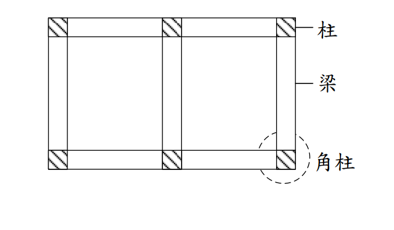

# RC-2018-2 題目正本

> 本檔只記錄**考卷上寫了什麼、圖上畫了什麼**，不含任何解法。解析見同資料夾 `RC-2018-2.md`。
> 判讀清單已經確認（凍結）；本檔原則上不再修改（改動須回考卷原圖並記 log）。

| 項目 | 內容 |
|------|------|
| 考卷 | `raw/exams/RC-2018_鋼筋混凝土設計與預力.pdf` 第 1 頁（頁次 2－1），第二題 |
| 考年 | 民國 107 年（2018） |
| 配分 | 25 分 |
| 附圖 | `RC-2018-2-fig-1.png`（構架平面示意，右下角柱以虛線圓圈標示） |
| 判讀狀態 | **已確認**（2026-11-15 使用者授權依 Claude 建議確認；轉錄 2026-11-15；PyMuPDF 110 dpi 全頁目視，附圖 400–450 dpi 局部放大；文字以 PDF 文字層核對（公式以影像為準）；盲讀後才比對既有解析） |

## 1. 考卷原文（逐字）

> 二、鋼筋混凝土構架樓層高 3.8 m。各梁尺寸與配筋均相同，配置 8 支 D29 拉力筋，有效深度為 43 cm。柱與梁同寬，柱斷面為 50 cm×50 cm，請檢核此構架角柱接頭之剪力強度。（25 分）

## 2. 考卷給的公式、附表與參數

- 題文數值：樓層高 3.8 m；各梁 8-D29 拉力筋、$d$＝43 cm；柱 50×50 cm；柱與梁同寬（梁寬 50 cm）。
- 卷首（全卷）：D13 $d_b$＝1.27 cm、$A_b$＝1.27 cm²；D22 2.22 cm、3.87 cm²；D25 2.54 cm、5.07 cm²；D29 2.87 cm、6.47 cm²；混凝土強度 $f'_c$＝280 kgf/cm²，D10 與 D13 $f_y$＝2800 kgf/cm²；D25 以上 $f_y$＝4200 kgf/cm²。
- 作答規範（卷首）：內政部營建署「混凝土結構設計規範」（內政部 100.6.9 台內營字第 1000801914 號令）；中國土木水利學會「混凝土工程設計規範」（土木 401-100）。未依上述規範作答，不予計分。
- **沒有給**：梁全深（只給 $d$＝43 cm）、梁跨度、底筋（壓力筋）量、接頭所在樓層（中間層或屋頂層）、柱軸力、梁端彎矩或剪力。
- 第一題（同卷）的梁斷面為寬 50、$d$＝43、筋心距底 7 cm（全深 50 cm），但第二題題文**沒有寫**「承第一題」。
- 卷首注意事項：㈠可以使用電子計算器。㈡不必抄題，作答時請將試題題號及答案依照順序寫在試卷上，於本試題上作答者，不予計分。㈢本科目得以本國文字或英文作答。

## 3. 附圖

圖面文字照錄：`柱`、`梁`、`角柱`。

## 4. 判讀清單

「把握」標**不確定**者優先列；解讀類項目（題目用字的意思）另標「解讀」。標「依 Claude 建議確認」者，為使用者 2026-11-15 授權「要我確認的請依你建議」後定案。

| # | 項目 | 判讀 | 圖上／題文依據 | 把握 |
|---|------|------|---------------|------|
| 1 | 接頭所在樓層 | **中間樓層**接頭：角柱上下皆有柱（柱剪力由上下柱反曲點在層高中央推求） | 題文只給「樓層高 3.8 m」，未說屋頂；附圖為一般樓層平面 | 不確定（影響答案）；依 Claude 建議確認 |
| 2 | 梁全深 | 考卷沒有給；須自行假設並明列（同卷第一題斷面全深 50 cm 可作參考，但本題未說承第一題） | 題文只給 $d$＝43 | 不確定（影響答案）；依 Claude 建議確認 |
| 3 | 附圖性質 | **平面圖**：斜線方塊是柱的水平斷面，雙線是梁（俯視）；不是立面圖 | 六個斜線方塊在梁的交點、四周雙線框；若為立面，柱應是長條而非方塊 | 確定 |
| 4 | 角柱接頭幾何 | 角柱只有兩支互相垂直的梁框入（每方向各一支），另兩面無梁；梁寬＝柱寬＝50 cm | 附圖右下角：上方一支、左方一支雙線梁；題文「柱與梁同寬」 | 確定 |
| 5 | 梁拉力筋 | 每支梁 8-D29（$A_s$＝51.76 cm²）、$f_y$＝4200（D25 以上）；底筋未給 | 題文「配置 8 支 D29 拉力筋」 | 確定 |
| 6 | $d$ | 43 cm | 題文 | 確定 |
| 7 | 柱 | 50×50 cm | 題文 | 確定 |
| 8 | 兩方向 | 兩方向梁尺寸、配筋相同，各方向分別檢核結果相同 | 題文「各梁尺寸與配筋均相同」 | 確定 |
| 9 | 所求 | 檢核角柱梁柱接頭的剪力強度（需求 vs. 設計強度） | 題文 | 確定 |
| 10 | 考卷沒有給 | 梁全深、跨度、底筋、柱軸力、接頭樓層 | 全題 | 確定 |

---

*轉錄：2026-11-15（RC-U3-3 批 2＋U1-3＋U2-3 題目正本推廣）*

*確認：2026-11-15 使用者授權依 Claude 建議確認（RC-U3-3 批 2＋U1-3＋U2-3 題目正本推廣，關卡一）*
