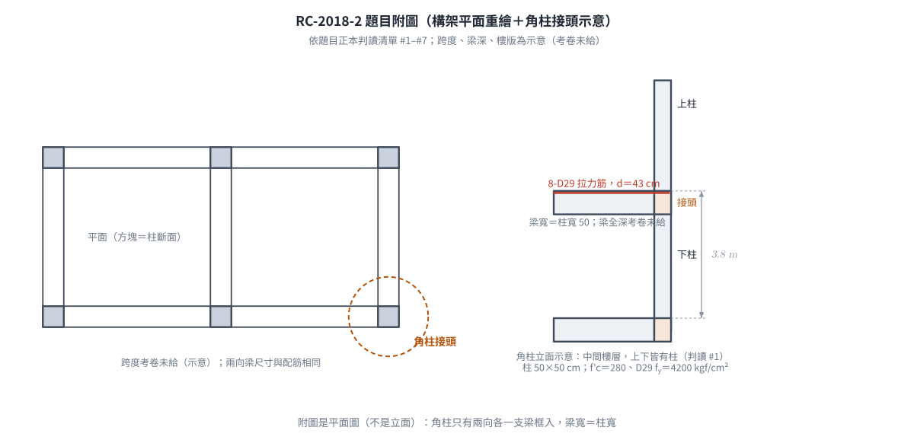

# 考題編號：RC-2018-2

**主分類：** `RC-U3-3` 韌性要求與耐震設計  
**副分類：** `RC-U1-1` RC 梁彎矩強度分析與設計  
**設計法：** USD 強度設計法  
**標籤：** `角柱接頭` `接頭剪力` `梁柱接頭` `耐震設計` `拉力控制` `剪力強度檢核` `鋼筋混凝土構架`

---

## 1. 題目（考卷原文見題目正本）

> 考卷原文、公式／附表、附圖與判讀清單（已確認）見 [`RC-2018-2-problem.md`](RC-2018-2-problem.md)。本節只列解題時最容易讀錯的地方與本解使用的記號；題意以題目正本為準。


*重繪自考卷附圖，依題目正本判讀清單 #1–#7。本圖攔下的讀錯：把平面圖當立面、把角柱接頭當屋頂層。*

### 常見誤讀

| 項目 | 正確判讀 | 常見誤讀 |
|------|---------|---------|
| 附圖 | **平面圖**：方塊為柱斷面、雙線為梁 | 立面圖、上方為屋頂梁 |
| 接頭樓層 | 中間樓層，上下皆有柱（判讀 #1） | 屋頂層角柱 |
| 梁全深 | 考卷沒有給（只給 $d$＝43 cm），須明列假設 | 直接取 50 cm 當題目已知 |
| 框入梁 | 兩向各一支（角柱），梁寬＝柱寬＝50 cm | 四面皆有梁 |
| 梁筋拉力 | 耐震接頭依規範 18.8.2.1 取 $T=1.25f_yA_s$ | $T=A_sf_y$（本庫舊解，漏 1.25） |
| 柱剪力 | 角柱每方向只有**一支**梁：$V_{col}=M_{pr}/H$ | $2M_n/H$（內柱兩側皆有梁的式子，本庫舊解） |
| 底筋 | 考卷沒有給 | 自行補值當題意 |

**本解記號：** 柱 50×50 cm；梁寬 50 cm；每支梁 8-D29（$A_s$＝51.76 cm²）、$d$＝43 cm；樓層高 $H$＝3.8 m；$f'_c$＝280、D29 $f_y$＝4200 kgf/cm²。規範：建築物混凝土結構設計規範（2023 年版，ACI 318-19 世代）18.8.2.1、18.8.4、21.2.4。

---

## 2. 考題核心精神與出題者意圖 (Core Concepts & Examiner's Intent)

### 核心觀念

**梁柱接頭剪力強度（Beam-Column Joint Shear Strength）** 是耐震設計的關鍵薄弱環節。角柱接頭（Corner Joint）缺少對向梁的圍束、沿剪力方向的梁也不連續，剪力強度係數最低，最容易成為設計瓶頸。

本題靈魂：**接頭剪力需求 $V_j$ 是梁筋以 $1.25f_y$ 降伏時的拉力 $T$ 減去柱剪力 $V_{col}$；角柱只有一支梁把力送進接頭，$V_{col}$ 只由這支梁的 $M_{pr}$ 平衡。**

### 出題者意圖

1. 考生必須能計算**梁端拉力 $T = 1.25f_yA_s$**（耐震接頭用可能強度，不用 $\phi$）
2. 考生必須記得**柱剪力 $V_{col}$ 由梁 $M_{pr}$ 與柱反曲點逆推**，且角柱只有一支梁
3. 考生必須熟記**角柱的接頭強度係數**（kgf 制 $3.2\sqrt{f'_c}A_j$，與內柱 $5.3$ 差異甚大）
4. 陷阱：用 $A_sf_y$、或套內柱的 $2M/H$，都會低估 $V_j$

---

## 3. 解題戰略地圖與陷阱分析 (Strategic Roadmap & Trap Analysis)

### 作戰計畫

```
Step 1: 計算梁端拉力 T = 1.25 fy As
Step 2: 由 T 求應力塊 a 與梁可能彎矩 Mpr（φ = 1.0）
Step 3: 計算柱剪力 Vcol = Mpr / H（角柱每向一支梁，上下柱反曲點在層高中央）
Step 4: 計算接頭剪力需求 Vj = T - Vcol
Step 5: 確認接頭有效面積 Aj = bj × hc
Step 6: 計算接頭剪力強度 φVn = 0.85 × 3.2√f'c × Aj
Step 7: 比較 Vj vs φVn → OK 或 NG
```

### 關鍵陷阱

| # | 陷阱 | 應對策略 |
|---|------|---------|
| ① | 用 $T=A_sf_y$ | 規範 18.8.2.1：接頭面梁筋應力取 $1.25f_y$ |
| ② | 套內柱 $V_{col}=2M/H$ | 角柱每方向只有一支梁，$V_{col}=M_{pr}/H$ |
| ③ | 忘記減柱剪力 $V_{col}$ | 接頭剪力＝梁端拉力－柱剪力 |
| ④ | 混淆角柱/外柱/內柱的強度係數 | 柱連續、沿 $V_u$ 方向梁不連續、未受橫向梁圍束 → 1.0（SI）＝3.2（kgf） |
| ⑤ | 梁比柱窄時 $b_j$ 另算 | 本題梁柱同寬，$b_j$＝50 cm |

---

## 3.5 變數層次分析 (Variable Hierarchy Analysis)

> 複習提示：第一次解題後，在每個卡住的知識點旁標記 `⚠`；第二次複習時只看有 `⚠` 的項目。

### 最終目標

求角柱梁柱接頭的設計剪力強度 $\phi V_n$，並與接頭剪力需求 $V_j$ 比較，判斷是否滿足 $V_j \leq \phi V_n$。

### 本題關鍵公式（依計算順序）

$$
\text{Step 1:}\quad T = 1.25 f_y A_s
$$

$$
\text{Step 2:}\quad a = \frac{\boxed{T}}{0.85 f'_c b},\qquad M_{pr} = T\left(d - \frac{\boxed{a}}{2}\right)
$$

$$
\text{Step 3:}\quad V_{col} = \frac{\boxed{M_{pr}}}{H}
$$

$$
\text{Step 4:}\quad V_j = \boxed{T} - \boxed{V_{col}}
$$

$$
\text{Step 5:}\quad \phi V_n = 0.85 \times 3.2\sqrt{f'_c}\, b_j h_c
$$

$$
\text{Step 6:}\quad \text{Check:}\quad V_j \leq \phi V_n\ ?
$$

### L1：題目直接給定

| 符號 | 數值 | 說明 |
|------|------|------|
| $H$ | 380 cm | 樓層高度 |
| $n_s$ | 8 | 梁拉力鋼筋支數 |
| $A_b$ | 6.47 cm² | 單支 D29 面積 |
| $d$ | 43 cm | 梁有效深度 |
| $b_w = b_c$ | 50 cm | 梁寬 = 柱寬（同寬） |
| $h_c$ | 50 cm | 柱斷面邊長（剪力方向） |
| $f'_c$ | 280 kgf/cm² | 混凝土抗壓強度 |
| $f_y$ | 4200 kgf/cm² | 鋼筋降伏強度（D25以上） |

### L2：需知識點推導

| 符號 | 公式／來源 | 卡關? |
|------|-----------|------|
| $A_s$ | $8 \times 6.47 = 51.76$ cm² | |
| $T$ | $1.25\times4200\times51.76 = 271.74$ tf | |
| $a$ | $271{,}740/(0.85\times280\times50) = 22.84$ cm | |
| $M_{pr}$ | $T(d-a/2) = 85.82$ tf·m | |
| $V_{col}$ | $M_{pr}/H = 22.58$ tf（上下柱反曲點在層高中央） | |
| $V_j$ | $T - V_{col} = 249.2$ tf | |
| $b_j$、$A_j$ | 50 cm、2500 cm² | |
| 係數 | 角柱 → $3.2\sqrt{f'_c}$（kgf 制）；$\phi$＝0.85 | |
| $\phi V_n$ | $0.85\times3.2\times16.733\times2500 = 113.8$ tf | |

### L3：深層知識（不懂就卡住）

| 知識點 | 說明 | 卡關? |
|--------|------|------|
| 為何 $1.25f_y$ | 梁端塑鉸實際降伏強度與應變硬化使鋼筋應力超過 $f_y$，接頭必須以梁的可能強度設計（容量設計） | |
| 接頭剪力 = 拉力 − 柱剪力 | 取接頭上半部自由體：水平力為梁筋拉力 $T$（向外）與上柱剪力 $V_{col}$（反向） | |
| 角柱 $V_{col}$ | 柱上下反曲點在層高中央，柱彎矩和＝梁端彎矩 → $V_{col}\cdot H = M_{pr}$（只有一支梁）；內柱兩側梁才是 $M_{pr}^++M_{pr}^-$ | |
| 強度係數分類 | 現行規範依「柱是否連續、沿 $V_u$ 方向梁是否連續、是否受橫向梁圍束」分級；SI 1.7／1.25／1.0 → kgf 約 5.3／4.0／3.2 | |

---

## 4. 步驟化詳細計算過程 (Step-by-Step Detailed Calculation)

### Step 1：梁拉力鋼筋面積

$$
A_s = 8 \times 6.47 = 51.76\ \text{cm}^2
$$

### Step 2：梁端拉力 T（$1.25f_y$）

$$
\boxed{T = 1.25 f_y A_s = 1.25 \times 4200 \times 51.76 = 271{,}740\ \text{kgf} = 271.74\ \text{tf}}
$$

> **策略註解：** 規範 18.8.2.1：特殊抗彎矩構架梁柱接頭，梁縱筋在接頭面的拉力以應力 $1.25f_y$ 計算，且不乘 $\phi$。考卷指定的 100 年版規範同樣有此規定，舊解只用 $A_sf_y$ 是漏用條文。

### Step 3：梁可能彎矩 $M_{pr}$（為推算 $V_{col}$ 用）

$$
a = \frac{T}{0.85 f'_c b_w} = \frac{271{,}740}{0.85 \times 280 \times 50} = \frac{271{,}740}{11{,}900} = 22.84\ \text{cm}
$$

$$
M_{pr} = T\left(d - \frac{a}{2}\right) = 271{,}740 \times \left(43 - 11.42\right) = 8{,}582{,}000\ \text{kgf·cm} = \boxed{85.82\ \text{tf·m}}
$$

### Step 4：柱剪力 $V_{col}$

角柱在此方向只有一支梁；上下柱反曲點假設在層高中央，接頭處上下柱彎矩和等於梁端彎矩：

$$
V_{col}\cdot\frac{H}{2}\times2 = M_{pr}\quad\Rightarrow\quad V_{col} = \frac{M_{pr}}{H} = \frac{8{,}582{,}000}{380} = 22{,}585\ \text{kgf} \approx \boxed{22.58\ \text{tf}}
$$

> **策略註解：** $H = 380$ cm 為樓層高（反曲點間距）；梁全深考卷未給，以層高計算 $V_{col}$ 較小、$V_j$ 較大（偏保守）。另忽略梁剪力對柱心的附加彎矩（梁跨度未給）。

### Step 5：接頭剪力需求 $V_j$

$$
V_j = T - V_{col} = 271{,}740 - 22{,}585 = 249{,}155\ \text{kgf} \approx \boxed{249.2\ \text{tf}}
$$


*圖 2　接頭剪力的來源是一條水平力平衡：上半部自由體只受梁筋拉力 $T$ 與上柱剪力 $V_{col}$，差值由接頭水平剪力面承受。攔的是 $T$ 用 $A_sf_y$（漏乘 1.25）、角柱照內柱套 $(M_{pr}^++M_{pr}^-)/H$ 或 $2M/H$（角柱每方向只有一支梁），以及忘記扣 $V_{col}$；舊解兩處都使 $V_j$ 偏小，但結論 NG 不變。*

### Step 6：接頭有效面積 Aj 與圍束條件

$$
b_j = b_c = 50\ \text{cm},\qquad A_j = b_j \times h_c = 50 \times 50 = 2{,}500\ \text{cm}^2
$$

- 接頭類型：**角柱**——柱連續（中間樓層）、沿 $V_u$ 方向的梁只有一側（不連續）、橫向只有一支梁（未受對向梁圍束）
- 現行規範表 18.8.4.3：SI 制 $1.0\lambda\sqrt{f'_c}A_j$ → kgf 制 $3.2\lambda\sqrt{f'_c}A_j$（常重混凝土 $\lambda$＝1）

### Step 7：接頭剪力設計強度 $\phi V_n$

$$
\phi V_n = 0.85 \times 3.2 \times \sqrt{280} \times 2{,}500 = 0.85 \times 133{,}866 = 113{,}786\ \text{kgf} \approx \boxed{113.8\ \text{tf}}
$$

（$\phi$＝0.85：規範 21.2.4.4 特殊抗彎矩構架梁柱接頭剪力）

### Step 8：強度檢核

$$
V_j = 249.2\ \text{tf} \quad > \quad \phi V_n = 113.8\ \text{tf}
$$

$$
\boxed{\therefore\ \text{角柱接頭剪力強度}\textbf{不足（NG）}，\ \frac{V_j}{\phi V_n} = \frac{249.2}{113.8} = 2.19 > 1.0}
$$

> **解釋：** 需求為設計強度的 2.19 倍。改善方式：①增大柱斷面（見 §5.3）；②減少梁端鋼筋量或加大梁深以降低梁筋量；③提高 $f'_c$。

---

## 5. 關鍵爭議點與進階探討 (Critical Issues & Advanced Discussion)

### 5.1 柱剪力的估算爭議

本題**未給出梁深**，$V_{col}$ 有兩種合理作法：

| 作法 | $V_{col}$ | $V_j$ | $V_j/\phi V_n$ |
|------|:---:|:---:|:---:|
| **用樓層高 $H$＝380 cm（主線）** | 22.58 tf | 249.2 tf | 2.19 |
| 假設梁深 50 cm，以淨高 330 cm 計 | 26.01 tf | 245.7 tf | 2.16 |

兩種作法都 NG，考場上取任一均可接受，須說明假設。

### 5.2 舊解（$T=A_sf_y$、$V_{col}=2M_n/H$）對照

| 作法 | $T$ | $V_{col}$ | $V_j$ | $V_j/\phi V_n$ |
|------|:---:|:---:|:---:|:---:|
| **現行（$1.25f_y$、$M_{pr}/H$；主線）** | 271.74 | 22.58 | **249.2** | **2.19** |
| $A_sf_y$、$M_n/H$ | 217.39 | 19.37 | 198.0 | 1.74 |
| 舊解 $A_sf_y$、$2M_n/H$ | 217.39 | 38.75 | 178.6 | 1.57 |

舊解兩處錯誤都使 $V_j$ 偏小（不保守）：漏 $1.25f_y$（規範條文漏用）、角柱套內柱的 $2M/H$（觀念模型）。結論 NG 不變。

### 5.3 強度係數的換算根源

現行規範表 18.8.4.3（同 ACI 318-19，SI 制係數 × $\sqrt{10.2}\approx3.19$ 為 kgf 制）：

| 柱連續（中間樓層） | 受橫向梁圍束 | 未受圍束 |
|---|:---:|:---:|
| 沿 $V_u$ 方向梁連續 | 1.7（≈5.3） | 1.25（≈4.0） |
| 沿 $V_u$ 方向梁不連續 | 1.25（≈4.0） | **1.0（≈3.2）← 本題角柱** |

（柱不連續（屋頂層）時分別降為 1.25／1.0／1.0／0.7。）

### 5.4 進階：若要通過，柱需多大？

令 $\phi V_n \geq V_j$（其他條件不變）：

$$
A_j \geq \frac{249{,}155}{0.85 \times 3.2 \times 16.733} = \frac{249{,}155}{45.51} = 5{,}474\ \text{cm}^2
\quad\Rightarrow\quad b_c \geq \sqrt{5{,}474} = 74.0\ \text{cm}
$$

即**柱邊長需增大至約 75 cm × 75 cm**（梁寬維持 50 cm 時 $b_j$ 另依 18.8.4.2 檢核），或減少梁筋量。

### 5.5 實務補充

- 角柱接頭另須檢核：梁筋以標準彎鉤錨定於接頭內，$\ell_{dh}=f_yd_b/(17.2\sqrt{f'_c})$＝41.9 cm（≥ $8d_b$＝23.0、15 cm）須小於柱深可用長度；接頭內須配置圍束橫向鋼筋（18.8.3）
- 若接頭位於屋頂層（柱不連續），係數降為 0.7（≈2.2），更不利

---

**驗算狀態：** `unverified`  
**手寫補充：** 無

*修正日期：2026-11-15（§1 改為指向題目正本，插入重繪附圖 figs/RC-2018-2-fig-1-problem.svg；舊 §1 重述改寫為常見誤讀與本解記號；本行非答案勘誤）*

*修正日期：2026-11-15（改依現行台灣規範（建築物混凝土結構設計規範 2023／耐震規範 111）：梁筋拉力 $A_sf_y$ → $1.25f_yA_s$（18.8.2.1）＝271.74 tf；角柱柱剪力 $2M_n/H$ → $M_{pr}/H$＝22.58 tf；$V_j$ 178.7 → **249.2 tf**、$V_j/\phi V_n$ 1.57 → **2.19**（NG 不變，$\phi V_n$＝113.8 tf 不變）；§5 淨高對照、柱需尺寸 63 → 74 cm、強度係數表改 18.8.4.3 分類；驗證：`.work/u33b2c/check_errata_U3_3_B2.py` 重算 MISMATCHES: 0）*

*圖解補繪：2026-11-15（向量圖 `figs/RC-2018-2-fig-2-joint.svg`，腳本 `figs/gen_RC-2018-2.py`，可重跑；數值由常數現算並於檔尾 assert 對 §4；DIAG-RC-U3-3-B2）*
