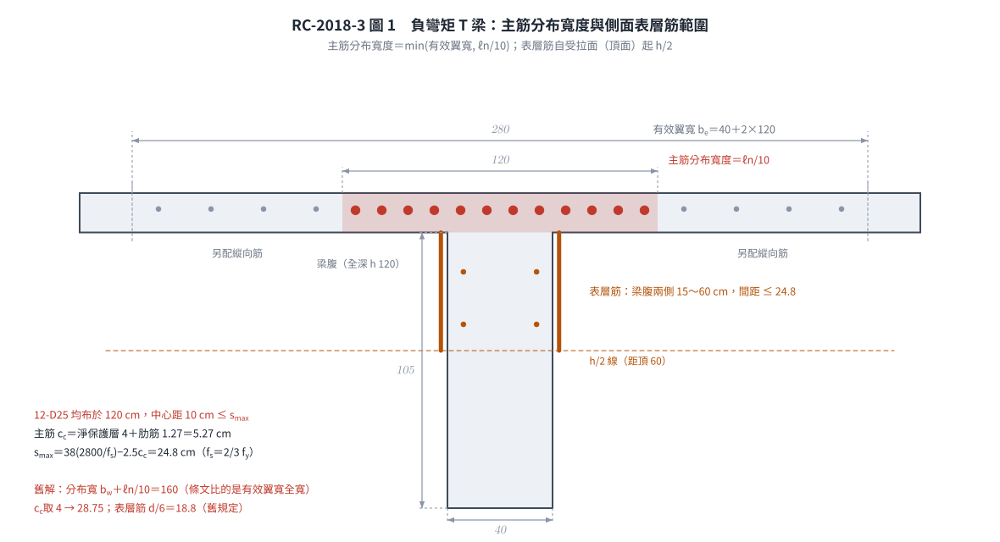

# 考題編號：RC-2018-3

**主分類：** `RC-U3-1` 梁工作性要求（含撓度、裂縫）  
**副分類：** 無  
**設計法：** USD 強度設計法  
**標籤：** `T形梁` `負彎矩` `裂縫控制` `主筋分布寬度` `側面縱向表層鋼筋` `拉力翼板` `間距限制` `skin reinforcement` `ln/10限制` `現行規範2023`

---

## 1. 題目（考卷原文見題目正本）

> 考卷原文、公式／附表、附圖與判讀清單（已確認）見 [`RC-2018-3-problem.md`](RC-2018-3-problem.md)。本節只列解題時最容易讀錯的地方與本解使用的記號；題意以題目正本為準。

### 常見誤讀

| 項目 | 正確判讀 | 常見誤讀 |
|------|---------|---------|
| 梁跨度 12 m | 考卷未說明是中心距或淨跨、未給柱寬，取 12 m 代 $\ell_n$ 並註明 | 當成確定的淨跨 |
| 負彎矩拉力側 | 拉力在翼版側，主筋須分布在受拉翼版內 | 只排在梁腹寬內 |
| 120 tf-m | 考卷未標使用或設計彎矩 | 當作因數化彎矩直接求 $f_s$ |
| 淨保護層 4 cm | 量到最外層鋼筋（D13 肋筋）外緣 → 主筋 $c_c$＝4＋1.27＝5.27 cm（與題給 $d$＝113≈120－4－1.27－1.27 吻合） | 主筋 $c_c$ 直接取 4 cm（本庫舊解） |
| 主筋分布寬度 | 有效翼寬全寬（280）與 $\ell_n/10$（120）取小 → **120 cm**（含梁腹） | 梁腹寬＋$\ell_n/10$＝160 cm（本庫舊解） |
| 表層筋間距 | 現行規範同裂縫控制式（$c_c$ 量到表層筋）→ 24.8 cm | $\min(d/6,30)$＝18.8 cm（ACI 318-02 以前舊規定） |
| 規範 | 考卷指定 100 年版／土木 401-100；主線依現行規範 | 沿用舊版條文 |

**本解記號：** $b_w$＝40、$h$＝120、$d$＝113、$h_f$＝15 cm；梁中心距 3 m；12-D25（$f_y$＝4200）；D13 肋筋（$f_y$＝2800）；$f'_c$＝280 kgf/cm²。

---

## 2. 考題核心精神與出題者意圖 (Core Concepts & Examiner's Intent)

### 核心觀念

本題考察**負彎矩 T 型梁**的裂縫控制設計：
- 負彎矩下，T 形梁的**拉力區在頂部（翼版／版面）**
- 拉力鋼筋（12-D25）須分布於受拉翼版，分布寬度取**有效翼寬與 $\ell_n/10$ 的較小者**；有效翼寬較大時，外側翼版另配縱向筋
- 主筋間距受裂縫控制式限制：$s\le38\left(\dfrac{2800}{f_s}\right)-2.5c_c$ 且 $\le30\left(\dfrac{2800}{f_s}\right)$（cm，$f_s$ kgf/cm²）
- 梁深 $h > 90$ cm，**側面表層鋼筋**須自受拉面起 $h/2$ 範圍內配置，間距同裂縫控制式

本題靈魂：**裂縫控制＝控制鋼筋間距與分布**，而不是控制鋼筋面積。

### 出題者意圖

1. 是否熟悉負彎矩 T 形梁的拉力翼版特性
2. 是否能正確計算**主筋分布寬度**（有效翼寬 vs $\ell_n/10$）
3. 是否記得**側面表層鋼筋**的觸發條件（$h > 90$ cm）、範圍與間距
4. $c_c$ 的定義：受拉鋼筋**表面**到受拉面的淨距

### 規範依據（現行建築物混凝土結構設計規範 2023）

| 項目 | 條文（同 ACI 318-19） |
|------|------|
| 有效翼寬 | 6.3.2：每側懸伸 $\min(8h_f,\ s_w/2,\ \ell_n/8)$ |
| 裂縫控制間距 | 24.3.2：表 24.3.2；$f_s$ 可取 $\frac23f_y$ |
| 受拉翼版鋼筋分布 | 24.3.4：分布於有效翼寬，但不大於 $\ell_n/10$；有效翼寬超過 $\ell_n/10$ 時外側翼版另配縱向筋 |
| 表層鋼筋 | 9.7.2.3：$h>90$ cm，自受拉面起 $h/2$ 範圍兩側面配置，間距依 24.3.2（$c_c$ 為表層筋至側面淨距） |

---

## 3. 解題戰略地圖與陷阱分析 (Strategic Roadmap & Trap Analysis)

### 作戰計畫

```
【主筋裂縫控制】
Step 1: 服務載重鋼筋應力 fs（取 2/3 fy）
Step 2: 主筋 cc（淨保護層 4 + 肋筋 1.27）→ 最大間距 s_max
Step 3: 有效翼寬（每側懸伸取小值）
Step 4: 主筋分布寬度 = min(有效翼寬, ln/10)
Step 5: 12-D25 在分布寬度內的間距 ≤ s_max

【側面表層鋼筋】
Step 6: h > 90 cm → 需配
Step 7: 範圍：自拉力面（頂面）起 h/2
Step 8: 間距：同裂縫控制式（cc 量到表層筋）
```

### 關鍵陷阱

| # | 陷阱 | 應對策略 |
|---|------|---------|
| ① | 誤以為正彎矩：拉力區在底部 | 負彎矩下拉力在**頂部翼版** |
| ② | 分布寬度＝梁腹＋$\ell_n/10$ | 條文比較的是**有效翼寬全寬**與 $\ell_n/10$：$\min(280,120)$＝120 cm |
| ③ | $c_c$ 取淨保護層 4 cm | $c_c$ 量到**主筋表面**：4＋1.27（肋筋）＝5.27 cm |
| ④ | 表層筋間距用 $d/6$ | 舊規定；現行與主筋同一裂縫控制式 |
| ⑤ | 表層筋範圍由梁底量起 | 負彎矩：從**頂面往下 $h/2$＝60 cm** |

---

## 3.5 變數層次分析 (Variable Hierarchy Analysis)

> 複習提示：第一次解題後，在每個卡住的知識點旁標記 `⚠`；第二次複習時只看有 `⚠` 的項目。

### 最終目標

求 12-D25 主筋應分布的**寬度**及**間距**（滿足裂縫控制），並求側面縱向表層鋼筋的**配置範圍**及**間距**。

### 本題關鍵公式（依計算順序）

$$
\text{Step 1:}\quad f_s = \tfrac{2}{3}\,f_y
$$

$$
\text{Step 2:}\quad s_{max} = 38\left(\frac{2800}{\boxed{f_s}}\right) - 2.5\,c_c \leq 30\left(\frac{2800}{\boxed{f_s}}\right) \quad \text{(cm, kgf/cm}^2\text{)}
$$

$$
\text{Step 3:}\quad b_{e} = b_w + 2\min\!\left(8h_f,\;\frac{s_w}{2},\;\frac{\ell_n}{8}\right)
$$

$$
\text{Step 4:}\quad \text{分布寬度} = \min\!\left(\boxed{b_e},\;\frac{\ell_n}{10}\right)
$$

$$
\text{Step 5（skin）:}\quad \text{範圍 } h/2\text{（自受拉面）},\quad s_{skin} \le s_{max}\ (c_c\text{ 量到表層筋})
$$

### L1：題目直接給定

| 符號 | 數值 | 說明 |
|------|------|------|
| $b_w$ | 40 cm | 梁腹寬 |
| $h$ | 120 cm | 梁全深 |
| $d$ | 113 cm | 梁有效深度 |
| $h_f$ | 15 cm | 翼緣（版）厚 |
| $\ell_n$ | 1200 cm | 梁跨度（代淨跨，題目正本 #1） |
| 中距 | 300 cm | 鄰梁中心距 |
| $n$ | 12 | 主筋支數（D25） |
| $d_b$ | 2.54 cm | D25 鋼筋直徑 |
| $d_{stirrup}$ | 1.27 cm | D13 肋筋直徑 |
| 淨保護層 | 4 cm | 量到肋筋外緣 |
| $f_y$ | 4200 kgf/cm² | 主筋降伏強度 |

### L2：需知識點推導

**【服務載重鋼筋應力】**

| 符號 | 公式／來源 | 卡關? |
|------|-----------|------|
| $f_s$ | $\tfrac{2}{3} \times 4200 = 2800$ kgf/cm² | |

**【最大裂縫控制間距】**

| 符號 | 公式／來源 | 卡關? |
|------|-----------|------|
| $c_c$ | $4 + 1.27 = 5.27$ cm（主筋表面至頂面） | ⚠ |
| $s_{max,1}$ | $38\times1 - 2.5 \times 5.27 = 24.8$ cm | |
| $s_{max,2}$ | $30\times1 = 30$ cm | |
| $s_{max}$ | $\min(24.8, 30) = 24.8$ cm | |

**【有效翼寬與分布寬度】**

| 符號 | 公式／來源 | 卡關? |
|------|-----------|------|
| $s_w$ | 鄰梁間淨距 $= 300 - 40 = 260$ cm | |
| 每側懸伸 | $\min(8h_f=120,\ s_w/2=130,\ \ell_n/8=150) = 120$ cm | |
| $b_e$ | $40+2\times120 = 280$ cm | |
| $\ell_n/10$ | $1200/10 = 120$ cm | |
| **分布寬度** | $\min(280, 120) = 120$ cm | ⚠ |

**【主筋實際間距】**

| 符號 | 公式／來源 | 卡關? |
|------|-----------|------|
| $s$ | $120/12 = 10$ cm（每支分擔寬度） | |
| 淨距 | $10-2.54=7.46$ cm ≥ 最小淨距 | |

**【側面表層鋼筋】**

| 符號 | 公式／來源 | 卡關? |
|------|-----------|------|
| 觸發條件 | $h = 120\ \text{cm} > 90\ \text{cm}$ → 需配 | |
| 配置範圍 | 自拉力面（頂面）往下 $h/2 = 60$ cm；扣除版厚，梁腹側面深度 15～60 cm 段 | |
| $s_{skin}$ | $c_c=4+1.27=5.27$（表層筋在肋筋內側）→ $\le 24.8$ cm | ⚠ |

### L3：深層知識（不懂就卡住）

| 知識點 | 說明 | 卡關? |
|--------|------|------|
| T 形梁負彎矩的翼版為拉力區 | 負彎矩時頂部受拉，翼版鋼筋都在拉力區 | |
| $\ell_n/10$ 限制 | 翼版很寬時，若把主筋撒到整個有效翼寬，靠近梁腹處鋼筋太少，梁腹附近會出現寬裂縫；所以限制在 $\ell_n/10$ 內，外側另配筋控制翼版裂縫 | ⚠ |
| $c_c$ 的定義 | 受拉鋼筋**表面**至受拉面的淨距；有肋筋時＝淨保護層＋肋筋直徑 | ⚠ |
| 表層鋼筋 | 深梁腹板在主筋以外的受拉區會出現比主筋處更寬的裂縫，表層筋控制這段裂縫 | |
| 表層筋範圍從**拉力面**算 | 負彎矩→從頂算；正彎矩→從底算 | |

---

## 4. 步驟化詳細計算過程 (Step-by-Step Detailed Calculation)

### ━━━━ 第一部分：主筋裂縫控制 ━━━━

### Step 1：服務載重下主筋應力 $f_s$

120 tf-m 未標明是使用或設計彎矩（題目正本 #2），依規範 24.3.2 允許取：

$$
f_s = \frac{2}{3}\,f_y = \frac{2}{3} \times 4200 = 2800\ \text{kgf/cm}^2
$$

### Step 2：最大允許鋼筋間距 $s_{max}$（規範 24.3.2）

主筋 $c_c$（主筋表面到受拉面）：淨保護層量到 D13 肋筋外緣，故

$$
c_c = 4 + 1.27 = 5.27\ \text{cm}
$$

（核對：$d = 120 - 4 - 1.27 - 2.54/2 = 113.46 \approx 113$ cm，與題給 $d$ 吻合。）

$$
s_{max} = 38\left(\frac{2800}{2800}\right) - 2.5 \times 5.27 = 38 - 13.18 = 24.8\ \text{cm} \ \le\ 30\left(\frac{2800}{2800}\right) = 30\ \text{cm}
$$

$$
\boxed{s_{max} = 24.8\ \text{cm}}
$$

### Step 3：有效翼寬（規範 6.3.2）

T 形梁（內梁）每側有效懸伸取下列三項之最小值：

| 限制條件 | 數值 |
|---------|------|
| $8h_f = 8 \times 15$ | **120 cm**（控制）|
| 梁間淨距之半 $(s_w/2) = (300-40)/2$ | 130 cm |
| $\ell_n/8 = 1200/8$ | 150 cm |

$$
b_e = 40 + 2\times120 = \boxed{280\ \text{cm}}
$$

### Step 4：主筋分布寬度（規範 24.3.4）

> 翼版受拉時，部分撓曲拉力鋼筋須分布於有效翼寬內，但不得寬於 $\ell_n/10$；有效翼寬超過 $\ell_n/10$ 時，翼版外側部分須另配縱向鋼筋。

$$
\frac{\ell_n}{10} = \frac{1200}{10} = 120\ \text{cm} < b_e = 280\ \text{cm}
$$

$$
\boxed{\text{主筋分布寬度} = \min(280,\ 120) = \mathbf{120\ cm}}\quad(\text{以梁腹為中心，含梁腹 40 cm 及兩側各 40 cm 翼版})
$$

分布區域示意（單位 cm）：

```
←──────────────────── 280 cm（有效翼寬）────────────────────→
          ←──────── 120 cm（12-D25 分布寬度）────────→
│← 80 →│← 40 →│←── 40（梁腹）──→│← 40 →│← 80 →│
│外側翼版│ 翼版  │      梁腹       │ 翼版  │外側翼版│
│另配縱筋│ 主筋  │      主筋       │ 主筋  │另配縱筋│
```

### Step 5：12-D25 主筋間距與檢核

12 支 D25 均布於 120 cm 寬（翼版連續，不受側面保護層限制）：

$$
s = \frac{120}{12} = \boxed{10\ \text{cm}} \le s_{max} = 24.8\ \text{cm} \quad \checkmark
$$

淨距 $10 - 2.54 = 7.46$ cm ≥ $\max(d_b,\ 2.5\text{ cm},\ \tfrac43d_{agg})$ ✓

$$
\boxed{\therefore\ \text{主筋分布寬度} = 120\ \text{cm}，\text{主筋間距約 } 10\ \text{cm}\ (\leq s_{max} = 24.8\ \text{cm})}
$$

翼版外側（每側 80 cm）須另配縱向鋼筋（題目未要求數量）。

---

### ━━━━ 第二部分：側面縱向表層鋼筋 ━━━━

### Step 6：確認配置必要性

$$
h = 120\ \text{cm} > 90\ \text{cm} \quad \Rightarrow \quad \textbf{必須配置側面縱向表層鋼筋}\ (\text{規範 9.7.2.3})
$$

### Step 7：配置範圍

自受拉面（負彎矩→頂面）起 $h/2$ 範圍內的兩側面：

$$
\frac{h}{2} = \frac{120}{2} = 60\ \text{cm\ （自梁頂量起）}
$$

頂部 15 cm 為版，實際配置於**梁腹兩側面、深度 15～60 cm 段**（45 cm）。

示意（從梁頂往下量，cm）：

```
 0 ──── 翼版頂面（拉力面）← 主筋 12-D25
15 ──── 翼版底面 = 梁腹頂面
        ↑
        │  梁腹兩側面：表層鋼筋配置段（45 cm）
        ↓
60 ──── h/2 線
        │  （不需表層筋）
120 ─── 梁底面（壓力面）
```

### Step 8：表層鋼筋間距

表層筋置於肋筋內側，$c_c$（表層筋表面至側面）＝4＋1.27＝5.27 cm，間距同裂縫控制式：

$$
\boxed{s_{skin} \le 38\left(\frac{2800}{2800}\right) - 2.5\times5.27 = 24.8\ \text{cm}\ (\le 30)}
$$

配置例：每側 2 支（深度約 30、50 cm），間距 20 cm ≤ 24.8 cm ✓（與頂部主筋層、$h/2$ 線之間距亦 ≤ 24.8 cm）。

---



*圖 1　主筋分布寬度與表層筋範圍。攔：分布寬度取 $b_w+\ell_n/10$（條文比較的是有效翼寬全寬與 $\ell_n/10$）；表層筋範圍由梁底量起；$c_c$ 漏加肋筋直徑。*

## 5. 關鍵爭議點與進階探討 (Critical Issues & Advanced Discussion)

### 5.1 舊解的錯誤（本次勘誤）

| 項目 | 舊解 | 正確 | 說明 |
|------|------|------|------|
| 主筋 $c_c$ | 4 cm | 5.27 cm | $c_c$ 是主筋表面到受拉面；保護層量到肋筋外緣（題目正本 #4） |
| $s_{max}$ | 28.75 cm | 24.8 cm | |
| 分布寬度 | $b_w+\ell_n/10$＝160 cm（並稱 120 cm 為錯誤） | 120 cm | 條文原文 "effective flange width … but not wider than ℓn/10"：比較的是有效翼寬全寬，不是懸伸寬 |
| 主筋間距 | 13.6 cm | 約 10 cm | |
| 表層筋間距 | $\min(d/6, 30)$＝18.8 cm | 24.8 cm | $d/6$ 是 ACI 318-02 以前的規定；401-100（ACI 318-08 世代）起已改同裂縫控制式 |

舊解的 15 cm 表層筋配置仍滿足 24.8 cm 上限，但答案所求的「間距上限」與「分布寬度」都改變。舊解 §5.3 的 $A_{sk}$ 面積式也是舊規定，現行規範表層筋不規定最小面積（只規定間距）。

### 5.2 保護層解讀對照

| 解讀 | 主筋 $c_c$ | $s_{max}$（kgf 式，主線式） | $s_{max}$（MPa 式換算） |
|------|------|------|------|
| 4 cm 量到肋筋外緣（主線，題目正本 #4） | 5.27 cm | **24.8 cm** | 25.6 cm |
| 4 cm 為主筋淨保護層（對照） | 4.0 cm | 28.0 cm | 28.75 cm（舊解值） |

- 「MPa 式換算」：$380(280/f_s)-2.5c_c$（mm、MPa，$f_s$＝274.6 MPa），因 280 MPa ≠ 2800 kgf/cm² 而與 kgf 式差約 3%；本庫 kgf 制採 $38(2800/f_s)$。
- 分布寬度 120 cm 與表層筋範圍 60 cm 兩項與 $c_c$ 解讀無關。

### 5.3 120 tf-m 若為使用彎矩

若 120 tf-m 是使用載重彎矩，$f_s \approx M/(A_s\,jd) = 12{,}000{,}000/(60.84\times0.9\times113) \approx 1940$ kgf/cm²，$s_{max}$ 放寬為 $38(2800/1940)-13.2 = 41.7$，小於 $30(2800/1940)=43.3$，故 $s_{max}$＝41.7 cm。題目未標明，主線依規範取 $f_s=\frac23f_y$。

### 5.4 規範版本提醒

考卷指定土木 401-100（ACI 318-08 世代）；其裂縫控制式、受拉翼版分布與表層筋規定與現行規範（ACI 318-19 世代）內容相同，答案不因版本改變，差異只在條號（舊 10.6.4／10.6.6／10.6.7 → 現行 24.3.2／24.3.4／9.7.2.3）。

---

**驗算狀態：** `unverified`  
**手寫補充：** 無

*修正日期：2026-11-15（§1 改為指向題目正本；舊 §1 重述改寫為常見誤讀與本解記號；本行非答案勘誤）*

*修正日期：2026-11-15（FIX-RC-U3-B1 解析勘誤，改依現行台灣規範（建築物混凝土結構設計規範 2023）：主筋 $c_c$ 4 → 5.27 cm（淨保護層量到肋筋外緣，題目正本 #4），$s_{max}$ 28.75 → **24.8 cm**；分布寬度 160 → **120 cm**（有效翼寬 280 與 $\ell_n/10$ 取小），主筋間距 13.6 → 約 10 cm；表層筋間距 $d/6$＝18.8 → **24.8 cm**（同裂縫控制式）；條號改現行 24.3.2／24.3.4／9.7.2.3；「4 cm 為主筋淨保護層」對照 28.0 cm 列 §5.2；撤除 §1 待勘誤提示。驗證：check_errata_U3_B1.py 重算，MISMATCHES: 0）*

*圖解補繪：2026-11-15（DIAG-RC-U3-B1，向量圖，腳本 `figs/gen_RC-2018-3.py`，可重跑；非勘誤、答案不變）*
