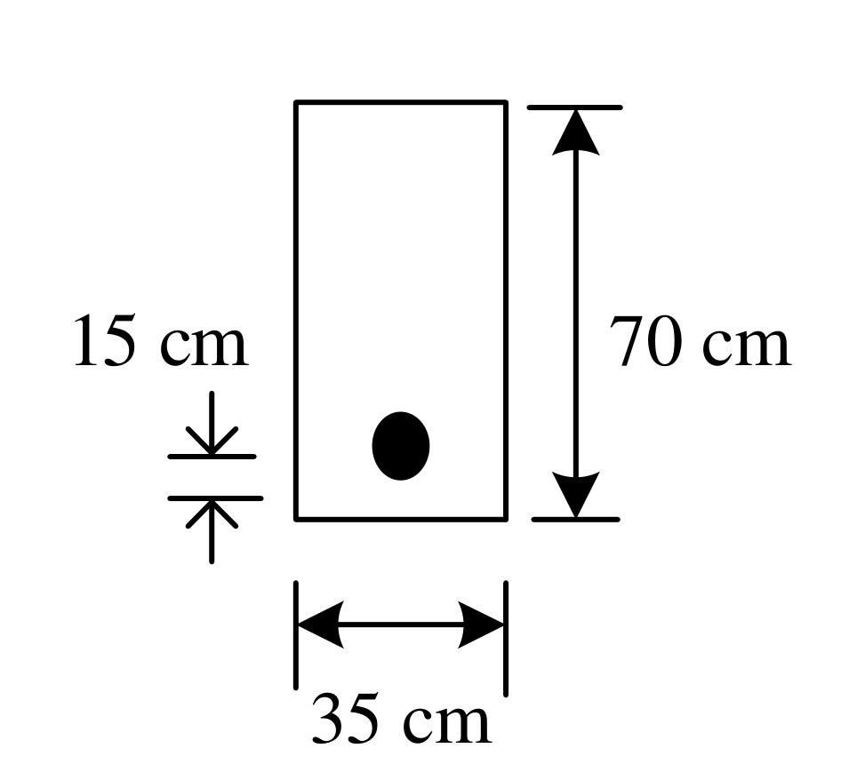

# RC-2018-4 題目正本

> 本檔只記錄**考卷上寫了什麼、圖上畫了什麼**，不含任何解法。解析見同資料夾 `RC-2018-4.md`。
> 判讀清單已經使用者確認（凍結）；本檔原則上不再修改（改動須回考卷原圖並記 log）。

| 項目 | 內容 |
|------|------|
| 考卷 | `raw/exams/RC-2018_鋼筋混凝土設計與預力.pdf` 第 2 頁，第四題；作答規範見第 1 頁 |
| 考年 | 民國 107 年（2018） |
| 配分 | 25 分 |
| 附圖 | `RC-2018-4-fig-2.png`（矩形斷面，無圖號；2026-11-14 由考卷向量圖 500 dpi 重新擷取）；既有 `RC-2018-4-fig-1.png` 為同一圖、解析度較低，保留不刪 |
| 判讀狀態 | **已確認**（2026-11-14 使用者確認；轉錄 2026-11-14；PyMuPDF 110 dpi 全頁目視＋抽出文字核對，附圖 500 dpi 並讀 PDF 繪圖座標；盲讀後才比對既有解析） |

## 1. 考卷原文（逐字）

> 四、如圖所示之後拉法預力梁斷面，預力鋼鍵套管直徑 7.5 cm$\phi$，施預力後以水泥砂漿填滿。預力鋼鍵 $f_{pu}$= 19000 kgf/cm²，混凝土 $f'_c$= 420 kgf/cm²，$E_s$=2×10⁶ kgf/cm²，$E_c$=3.07×10⁵ kgf/cm²，有效預力 $F_e$=100 tf，$A_{ps}$=14 cm²。試求開裂彎矩、極限彎矩並檢核鋼鍵是否被拉斷。（25 分）
> 參考公式：$f_{pu}\left(1-0.5\rho_p\dfrac{f_{pu}}{f'_c}\right)$，$f_{se}+700+\dfrac{f'_c}{100\rho_p}$

（「鋼鍵」照考卷原文。）

## 2. 考卷給的公式、附表與參數

- 題文數值：套管直徑 7.5 cm（施預力後灌漿）；$f_{pu}=19{,}000$；$f'_c=420$；$E_s=2\times10^6$；$E_c=3.07\times10^5$ kgf/cm²；$F_e=100$ tf；$A_{ps}=14$ cm²。
- 參考公式兩式（有握裹近似式、無握裹近似式），照錄如上（考卷未寫左邊「$f_{ps}=$」）。
- 第 1 頁作答規範：內政部營建署「混凝土結構設計規範」（內政部 100.6.9 台內營字第 1000801914 號令）；中國土木水利學會「混凝土工程設計規範」（土木 401-100）。未依上述規範作答，不予計分。第 1 頁另列鋼筋資料（D13、D22、D25、D29 的 $d_b$、$A_b$；混凝土 $f'_c$ 280、D10 與 D13 $f_y$ 2800、D25 以上 $f_y$ 4200）屬第一～三題，與本題無關。
- **沒有給**：$f_r$、$f_{py}$、鋼鍵斷裂應變或應力-應變曲線、$\varepsilon_{cu}$、$\beta_1$、跨度與載重。
- 卷首注意事項：可以使用電子計算器。不必抄題，作答時請將試題題號及答案依照順序寫在試卷上，於本試題上作答者，不予計分。本科目得以本國文字或英文作答。

## 3. 附圖

圖面文字照錄：`15 cm`、`70 cm`、`35 cm`。

## 4. 判讀清單

「把握」標**不確定**者請優先確認；解讀類項目（題目用字的意思）另標「解讀」。

| # | 項目 | 判讀 | 圖上／題文依據 | 把握 |
|---|------|------|---------------|------|
| 1 | 鋼鍵深度 | 15 cm 解讀為**鋼鍵（套管）中心至梁底** → $d_p = 55$ cm | 圖未依比例：斷面 67.6 pt 代表 70 cm，實心圓心 y＝412.3 距底 11.9 pt（約 12 cm）；15 cm 尺寸的兩條引線在 y＝414.0 與 420.8，兩端都不精確對齊圓心或梁底。依慣例取中心至梁底 | 確定（解讀） |
| 2 | 斷面 | 矩形 $b=35$、$h=70$ cm | 尺寸線兩端對齊斷面外框（x 252.8–286.9、y 356.6–424.2） | 確定 |
| 3 | 鋼鍵水平位置 | 置中（單一鋼鍵） | 實心圓 x 265.6–274.1，圓心 269.85＝斷面中線（PDF 座標） | 確定 |
| 4 | 握裹 | 後拉、施預力後以水泥砂漿灌滿 → 有握裹；開裂彎矩計算時套管已灌漿 | 題文 | 確定（解讀） |
| 5 | 參考公式兩式 | 考卷同時給有握裹式（$1-0.5\rho_p f_{pu}/f'_c$）與無握裹式（$f_{se}+700+f'_c/100\rho_p$），未說明用哪一式 | 題文 | 確定（解讀）（本題灌漿 → 有握裹） |
| 6 | 「檢核鋼鍵是否被拉斷」 | 考卷未給斷裂應變或應力-應變曲線，判斷依據需自行假設 | 題文 | 確定（解讀） |
| 7 | 套管面積 | 直徑 7.5 cm 套管；計算開裂彎矩時是否扣除套管或以變換斷面計算，考卷未說明（給了 $E_s$、$E_c$） | 題文 | 確定（解讀） |
| 8 | 考卷沒有給 | $f_r$、$f_{py}$、斷裂應變、$\varepsilon_{cu}$、$\beta_1$ | 全題 | 確定（作答須自行假設） |

---

*轉錄：2026-11-14（RC-U4-1 題目正本推廣・批 1）*

*確認：2026-11-14 使用者確認（RC-U4-1 題目正本推廣・批 1，關卡一）*
