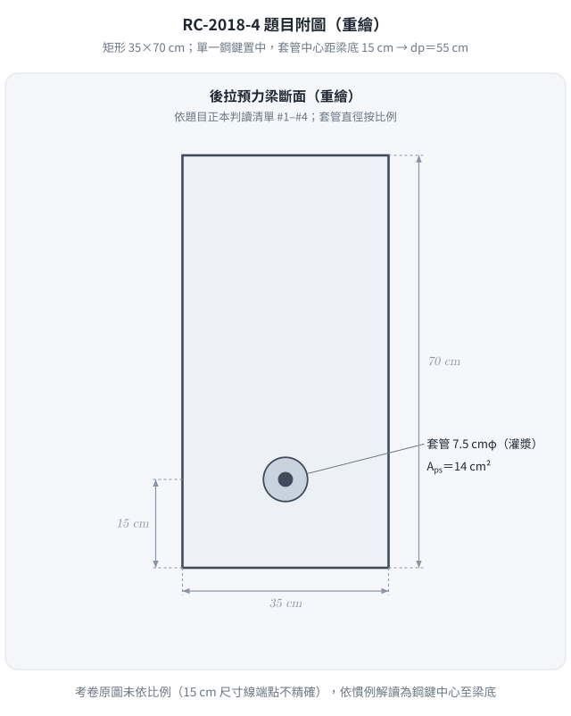
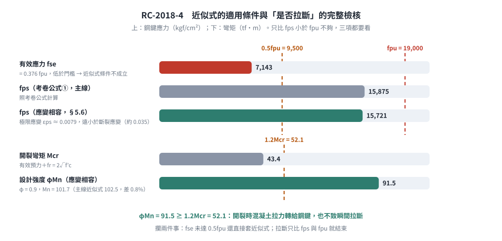

# 考題編號：RC-2018-4

**主分類：** `RC-U4-1` 預力梁斷面應力分析  
**副分類：** 無  
**設計法：** WSD / USD 混合  
**標籤：** `後拉法` `有黏結` `開裂彎矩` `極限彎矩` `fps公式` `Whitney應力塊` `鋼鍵拉斷檢核` `β1折減`

---

## 1. 題目（考卷原文見題目正本）

> 考卷原文、公式／附表、附圖與判讀清單（已確認）見 [`RC-2018-4-problem.md`](RC-2018-4-problem.md)。本節只列解題時最容易讀錯的地方與本解使用的記號；題意以題目正本為準。


*重繪自考卷附圖，依題目正本判讀清單 #1–#4。考卷原圖未依比例，15 cm 依慣例解讀為鋼鍵中心至梁底 → $d_p=55$ cm。*

### 常見誤讀

| 項目 | 正確判讀 | 常見誤讀 |
|------|---------|---------|
| 鋼鍵深度（#1） | 15 cm 為鋼鍵（套管）中心至梁底，$d_p=55$ cm、$e=20$ cm | 量到套管邊緣 |
| 握裹（#4） | 施預力後灌漿 → 有握裹，用有握裹的 $f_{ps}$ 式 | 用無握裹式 |
| 參考公式（#5） | 考卷兩式並列；本題用第一式，第二式只作對照 | 兩式取大 |
| 拉斷檢核（#6） | 考卷未給斷裂應變，判斷依據須自行假設：極限應變對斷裂應變、$\phi M_n\ge1.2M_{cr}$（見 §5.6） | 只比 $f_{ps}<f_{pu}$ 就結束 |
| 近似式適用條件 | $f_{ps}$ 有握裹近似式須 $f_{se}\ge0.5f_{pu}$；本題 $f_{se}=0.376f_{pu}$ 不符，規範要求改用應變相容（§5.6，$M_n=101.7$，差 0.8%） | 不檢核就直接套式 |

**本解記號：** $F_e=100$ tf → $f_{se}=F_e/A_{ps}=7{,}143$ kgf/cm²；$E_s=E_p=2\times10^6$、$E_c=3.07\times10^5$ kgf/cm²（考卷給定）。

**自行假設（考卷未給）：** $f_r$、$\beta_1$、$\varepsilon_{cu}=0.003$ 依規範。

---

## 2. 考題核心精神與出題者意圖 (Core Concepts & Examiner's Intent)

### 核心觀念

本題考察預力梁從**開裂**到**極限**的兩個關鍵強度計算：

1. **開裂彎矩（$M_{cr}$）**：彈性分析，預力在底纖維建立壓應力，外加彎矩需大到足以克服此壓力並引起拉力裂縫。
2. **極限彎矩（$M_n$）**：非線性分析，鋼鍵應力在極限狀態下超過有效預力（$f_{ps} > f_{se}$），使用 Whitney 應力塊。
3. **拉斷檢核**：$f_{ps}$ 是否達到 $f_{pu}$——若使用 fps 公式計算後 $f_{ps} < f_{pu}$，表示斷面先達到混凝土壓碎而非鋼鍵拉斷。

本題靈魂：**有黏結 vs 無黏結的 $f_{ps}$ 公式選擇**——題目提供兩條公式，有黏結用公式①（附著力讓鋼鍵充分發展應力），無黏結用公式②（滑動摩擦限制應力增量）。

### 出題者意圖

1. 考生能區分有黏結/無黏結腱的 $f_{ps}$ 公式適用場景
2. 考生能正確計算 Mcr 的預壓應力貢獻（$F_e/A + F_e \cdot e/S_b$）
3. 考生記得 $\beta_1$ 隨 $f'_c$ 遞減（f'c = 420 > 280，$\beta_1 < 0.85$）
4. 陷阱：偏心距 e 方向、dp vs h 的關係、fr 用 kgf/cm² 或 MPa 公式

---

## 3. 解題戰略地圖與陷阱分析 (Strategic Roadmap & Trap Analysis)

### 作戰計畫

```
【開裂彎矩 Mcr】
Step 1: 計算斷面性質（A、Ig、Sb）
Step 2: 計算底纖維有效預壓應力 fpe_b
Step 3: 計算混凝土破裂模數 fr = 2√f'c
Step 4: Mcr = Sb × (fpe_b + fr)

【極限彎矩 Mn + 鋼鍵檢核】
Step 5: 計算 fse = Fe / Aps
Step 6: 計算 ρp = Aps / (b × dp)
Step 7: 選擇有黏結公式①求 fps（含拉斷檢核）
Step 8: 計算 β1（f'c = 420 需折減）
Step 9: Whitney 應力塊求 a
Step 10: Mn = Aps × fps × (dp - a/2)
```

### 關鍵陷阱

| # | 陷阱 | 應對策略 |
|---|------|---------|
| ① | 誤用無黏結公式②（fse + 700 + f'c/100ρp），導致 fps 嚴重低估 | 後拉法 + 水泥砂漿填滿 = 有黏結，**必須用公式①** |
| ② | 忘記 $\beta_1$ 折減（f'c=420 > 280，β1 = 0.75，非 0.85） | $\beta_1 = 0.85 - 0.05 \times (420-280)/70 = 0.75$ |
| ③ | Mcr 計算時，偏心距 e 符號或方向錯誤 | 鋼鍵在形心以下 → 底纖維為額外壓縮（正向有利） |
| ④ | dp 混淆（從頂算 dp，非 h - e） | $d_p = h - 15 = 55$ cm（從頂面到鋼鍵中心） |
| ⑤ | 直接套 $f_{ps}$ 近似式，不檢核適用條件 | 有握裹近似式須 $f_{se}\ge0.5f_{pu}$；本題 $f_{se}=0.376f_{pu}$ 不符，主線沿用並以應變相容核對（§5.6，$M_n$ 差 0.8%） |

---

## 3.5 變數層次分析 (Variable Hierarchy Analysis)

> 複習提示：第一次解題後，在每個卡住的知識點旁標記 `⚠`；第二次複習時只看有 `⚠` 的項目。

### 最終目標

求 $M_{cr}$、$M_n$，並確認 $f_{ps} < f_{pu}$（鋼鍵不被拉斷）。

### 本題關鍵公式（依計算順序）

$$
\text{Step 1:}\quad A = b \cdot h,\quad I_g = \frac{b\,h^3}{12},\quad S_b = \frac{I_g}{y_b}
$$

$$
\text{Step 2:}\quad f_{pe,b} = \frac{F_e}{A} + \frac{F_e \cdot e \cdot y_b}{I_g}
$$

$$
\text{Step 3:}\quad f_r = 2\sqrt{f'_c}\ \text{(kgf/cm}^2\text{)}
$$

$$
\text{Step 4:}\quad M_{cr} = \boxed{S_b} \cdot \!\left(\boxed{f_{pe,b}} + \boxed{f_r}\right)
$$

$$
\text{Step 5:}\quad f_{se} = F_e / A_{ps}
$$

$$
\text{Step 6:}\quad \rho_p = A_{ps} / (b \cdot d_p)
$$

$$
\text{Step 7:}\quad f_{ps} = f_{pu}\!\left(1 - 0.5\,\boxed{\rho_p}\,\frac{f_{pu}}{f'_c}\right) \leq f_{pu}
$$

$$
\text{Step 8:}\quad \beta_1 = 0.85 - \frac{0.05(f'_c - 280)}{70}
$$

$$
\text{Step 9:}\quad a = \frac{A_{ps} \cdot \boxed{f_{ps}}}{0.85\,f'_c\,b}
$$

$$
\text{Step 10:}\quad M_n = A_{ps} \cdot \boxed{f_{ps}} \cdot \!\left(d_p - \frac{\boxed{a}}{2}\right)
$$

### L1：題目直接給定

| 符號 | 數值 | 說明 |
|------|------|------|
| $b$ | 35 cm | 梁寬 |
| $h$ | 70 cm | 梁深 |
| 鋼鍵距底 | 15 cm | 從圖讀取 |
| $d_p$ | 55 cm | $h - 15$ |
| $A_{ps}$ | 14 cm² | 鋼鍵面積 |
| $F_e$ | 100,000 kgf | 有效預力 |
| $f_{pu}$ | 19,000 kgf/cm² | 鋼鍵極限強度 |
| $f'_c$ | 420 kgf/cm² | 混凝土強度 |
| $E_p$ | 2×10⁶ kgf/cm² | 鋼材彈性模數 |
| $E_c$ | 3.07×10⁵ kgf/cm² | 混凝土彈性模數 |

### L2：需知識點推導

**【斷面性質（毛斷面）】**

| 符號 | 公式 | 卡關? |
|------|------|------|
| $A$ | $35 \times 70 = 2450$ cm² | |
| $y_b = y_t$ | $70/2 = 35$ cm（矩形對稱） | |
| $e$ | $35 - 15 = 20$ cm | |
| $I_g$ | $35 \times 70^3/12 = 1{,}000{,}417$ cm⁴ | |
| $S_b = S_t$ | $I_g/y_b = 28{,}583$ cm³ | |

**【開裂彎矩計算】**

| 符號 | 公式 | 卡關? |
|------|------|------|
| $f_{pe,b}$ | $F_e/A + F_e \cdot e/S_b = 40.82 + 69.97 = 110.79$ kgf/cm² | |
| $f_r$ | $2\sqrt{420} = 40.99$ kgf/cm² | |
| $M_{cr}$ | $S_b \times (f_{pe,b} + f_r) = 28{,}583 \times 151.78$ | |

**【極限彎矩計算】**

| 符號 | 公式 | 卡關? |
|------|------|------|
| $f_{se}$ | $F_e/A_{ps} = 100{,}000/14 = 7{,}143$ kgf/cm² | |
| $\rho_p$ | $A_{ps}/(b \cdot d_p) = 14/(35 \times 55) = 0.007273$ | |
| $f_{ps}$ | 公式①（有黏結）→ 代入計算 | |
| $\beta_1$ | $0.85 - 0.05 \times (420-280)/70 = 0.75$ | |
| $a$ | $A_{ps} \cdot f_{ps}/(0.85 f'_c b)$ | |
| $M_n$ | $A_{ps} \cdot f_{ps} \cdot (d_p - a/2)$ | |

### L3：深層知識（不懂就卡住）

| 知識點 | 說明 | 卡關? |
|--------|------|------|
| 有黏結 vs 無黏結 fps 公式 | 有黏結腱：fps = fpu(1-0.5ρp·fpu/f'c)；無黏結腱：fps = fse + 700 + f'c/(100ρp)（kgf/cm²）。前者 fps 值通常更高 | |
| β1 折減規則 | f'c ≤ 280 kgf/cm²：β1 = 0.85；每增加 70 kgf/cm²，β1 減 0.05；最小值 0.65 | |
| Mcr 底纖維預壓應力兩項 | Fe/A 為均勻預壓，Fe·e·yb/Ig 為彎曲預壓（因偏心）——兩項均為底纖維壓縮，計算時相加 | |
| fps < fpu 的意義 | 表示極限狀態下鋼鍵仍有應力儲備、破壞由混凝土壓碎控制；但它只是必要條件，判斷是否拉斷還要看極限應變對斷裂應變，以及 $\phi M_n\ge1.2M_{cr}$（開裂時不致突然拉斷，見 §5.6） | |

---

## 4. 步驟化詳細計算過程 (Step-by-Step Detailed Calculation)

### ━━━━ 第一部分：開裂彎矩 Mcr ━━━━

### Step 1：斷面性質（毛斷面）

$$
A = b \times h = 35 \times 70 = 2{,}450\ \text{cm}^2
$$

$$
I_g = \frac{b\,h^3}{12} = \frac{35 \times 70^3}{12} = \frac{35 \times 343{,}000}{12} = \frac{12{,}005{,}000}{12} = 1{,}000{,}417\ \text{cm}^4
$$

$$
y_b = y_t = \frac{h}{2} = 35\ \text{cm}
$$

$$
S_b = \frac{I_g}{y_b} = \frac{1{,}000{,}417}{35} = 28{,}583\ \text{cm}^3
$$

幾何關係：
$$
d_p = h - 15 = 70 - 15 = 55\ \text{cm}\qquad e = y_b - 15 = 35 - 15 = 20\ \text{cm}
$$

> **策略註解：** 使用毛斷面（套管 7.5 cm φ，面積 44.2 cm²，僅佔 1.8%，省略影響合理）。

### Step 2：底纖維有效預壓應力 $f_{pe,b}$

鋼鍵在形心以下（e = 20 cm），對底纖維產生**兩種壓力**：

$$
\frac{F_e}{A} = \frac{100{,}000}{2{,}450} = 40.82\ \text{kgf/cm}^2 \quad \text{（均勻軸壓）}
$$

$$
\frac{F_e \cdot e}{S_b} = \frac{100{,}000 \times 20}{28{,}583} = \frac{2{,}000{,}000}{28{,}583} = 69.97\ \text{kgf/cm}^2 \quad \text{（偏心彎曲壓力）}
$$

$$
\boxed{f_{pe,b} = 40.82 + 69.97 = 110.79\ \text{kgf/cm}^2\ \text{（壓力，正值）}}
$$

### Step 3：混凝土破裂模數 $f_r$

$$
f_r = 2\sqrt{f'_c} = 2\sqrt{420} = 2 \times 20.494 = \boxed{40.99\ \text{kgf/cm}^2}
$$

> **策略註解：** 台灣考試使用 $f_r = 2\sqrt{f'_c}$（kgf/cm²），等效於 ACI 的 $0.623\sqrt{f'_c}$（MPa）。

### Step 4：開裂彎矩 $M_{cr}$

開裂條件：底纖維總應力 = 0（考慮 fr 即拉力剛出現）：

$$
f_{pe,b} - \frac{M_{cr}}{S_b} = -f_r \quad\Rightarrow\quad M_{cr} = S_b \cdot \left(f_{pe,b} + f_r\right)
$$

$$
M_{cr} = 28{,}583 \times (110.79 + 40.99) = 28{,}583 \times 151.78
$$

$$
\boxed{M_{cr} = 4{,}339{,}300\ \text{kgf·cm} \approx 43.4\ \text{tf·m}}
$$

---

### ━━━━ 第二部分：極限彎矩 Mn 與鋼鍵檢核 ━━━━

### Step 5：有效鋼鍵應力 $f_{se}$

$$
f_{se} = \frac{F_e}{A_{ps}} = \frac{100{,}000}{14} = 7{,}143\ \text{kgf/cm}^2
$$

### Step 6：預力鋼筋比 $\rho_p$

$$
\rho_p = \frac{A_{ps}}{b \cdot d_p} = \frac{14}{35 \times 55} = \frac{14}{1{,}925} = 0.007273
$$

### Step 7：極限狀態鋼鍵應力 $f_{ps}$（有黏結腱公式）

本梁為後拉法 + 水泥砂漿灌滿 → **有黏結（bonded）後拉腱** → 考卷參考公式①。

> **適用條件：** 規範的有握裹近似式須 $f_{se}\ge0.5f_{pu}$。本題 $f_{se}=7{,}143=0.376f_{pu}<0.5f_{pu}=9{,}500$，**條件不成立**；以下主線仍照考卷公式計算，並在 §5.6 以應變相容核對（$f_{ps}=15{,}721$、$M_n=101.7$ tf·m，差 0.8%）。

使用公式①：

$$
f_{ps} = f_{pu}\!\left(1 - 0.5\,\rho_p\,\frac{f_{pu}}{f'_c}\right)
$$

$$
= 19{,}000 \times \left(1 - 0.5 \times 0.007273 \times \frac{19{,}000}{420}\right)
$$

$$
= 19{,}000 \times \left(1 - 0.5 \times 0.007273 \times 45.24\right)
$$

$$
= 19{,}000 \times \left(1 - 0.5 \times 0.3290\right)
$$

$$
= 19{,}000 \times (1 - 0.1645) = 19{,}000 \times 0.8355
$$

$$
\boxed{f_{ps} = 15{,}875\ \text{kgf/cm}^2}
$$

**鋼鍵拉斷檢核：**

$$
f_{ps} = 15{,}875\ \text{kgf/cm}^2 \quad < \quad f_{pu} = 19{,}000\ \text{kgf/cm}^2
$$

$$
\boxed{\therefore\ \text{鋼鍵}\textbf{不被拉斷} \checkmark}
$$

> 只比 $f_{ps}<f_{pu}$ 還不夠：完整的拉斷檢核另需極限應變對斷裂應變（$\varepsilon_{ps}\approx0.008$ ≪ 約 0.035）與 $\phi M_n=91.5\ge1.2M_{cr}=52.1$ tf·m，見 §5.6。

> **策略註解：** 若誤用公式②（無黏結腱）：$f_{ps} = 7143 + 700 + 420/(100 \times 0.007273) = 8{,}421$ kgf/cm²（比正確值低 47%），極限彎矩將嚴重低估。兩公式差異巨大，選錯公式會造成根本性錯誤。

**與 fse 比較（合理性驗證）：**
$$
f_{se} = 7{,}143 < f_{ps} = 15{,}875 < f_{pu} = 19{,}000 \quad \checkmark
$$

### Step 8：應力塊折減係數 $\beta_1$

$$
\beta_1 = 0.85 - \frac{0.05 \times (f'_c - 280)}{70} = 0.85 - \frac{0.05 \times (420 - 280)}{70} = 0.85 - \frac{0.05 \times 140}{70}
$$

$$
= 0.85 - 0.05 \times 2 = 0.85 - 0.10 = \boxed{0.75}
$$

### Step 9：Whitney 等值矩形應力塊深度 $a$

$$
a = \frac{A_{ps} \cdot f_{ps}}{0.85\,f'_c\,b} = \frac{14 \times 15{,}875}{0.85 \times 420 \times 35} = \frac{222{,}250}{12{,}495} = \boxed{17.79\ \text{cm}}
$$

中性軸深度：
$$
c = \frac{a}{\beta_1} = \frac{17.79}{0.75} = 23.72\ \text{cm}
$$

驗核（中性軸在斷面內）：
$$
c = 23.72\ \text{cm} < h = 70\ \text{cm} \quad \checkmark
$$

$$
\frac{c}{d_p} = \frac{23.72}{55} = 0.431 < 1.0 \quad \checkmark
$$

### Step 10：極限彎矩 $M_n$

$$
M_n = A_{ps} \cdot f_{ps} \cdot \left(d_p - \frac{a}{2}\right)
$$

$$
= 14 \times 15{,}875 \times \left(55 - \frac{17.79}{2}\right)
$$

$$
= 222{,}250 \times (55 - 8.895)
$$

$$
= 222{,}250 \times 46.105
$$

$$
\boxed{M_n = 10{,}246{,}000\ \text{kgf·cm} \approx 102.5\ \text{tf·m}}
$$

---

### 最終結果彙整

| 求解項目 | 結果 |
|---------|------|
| 開裂彎矩 $M_{cr}$ | **43.4 tf·m** |
| 鋼鍵應力 $f_{ps}$ | 15,875 kgf/cm² |
| 極限彎矩 $M_n$ | **102.5 tf·m** |
| 鋼鍵是否拉斷？ | **否**：$f_{ps}<f_{pu}$，極限應變 $\varepsilon_{ps}\approx0.008$ 遠小於斷裂應變，且 $\phi M_n=91.5\ge1.2M_{cr}=52.1$ tf·m（見 §5.6）|

強度裕度比（極限/開裂）：
$$
\frac{M_n}{M_{cr}} = \frac{102.5}{43.4} = 2.36 \quad \text{（極限強度為開裂強度的 2.36 倍）}
$$

---

## 5. 關鍵爭議點與進階探討 (Critical Issues & Advanced Discussion)

### 5.1 有黏結 vs 無黏結：fps 公式選擇

| 特性 | 有黏結（本題）| 無黏結 |
|------|-------------|--------|
| 灌漿 | ✅ 水泥砂漿填滿 | ❌ 套管不填漿 |
| $f_{ps}$ 公式 | $f_{pu}(1-0.5\rho_p f_{pu}/f'_c)$ | $f_{se} + 700 + f'c/(100\rho_p)$ |
| 本題計算結果 | 15,875 kgf/cm² | 8,421 kgf/cm² |
| 物理意義 | 附著力傳遞→局部應變大→fps高 | 整體平均應變增量→fps低 |

結論：選錯公式，極限彎矩誤差高達 **47%**。

### 5.2 Mcr 的精確計算（是否扣除套管面積）

本題使用毛斷面簡算。若用淨斷面：
- 套管面積 $A_{duct} = \pi(7.5/2)^2 = 44.2$ cm²（佔總面積 1.8%）
- 形心偏移：往上移 $\approx 0.4$ cm（影響甚微）
- $M_{cr}$ 修正量 < 2%

→ 考場使用毛斷面即可，誤差在合理範圍。

### 5.3 鋼鍵拉斷的物理意義

若極限彎矩計算時 $f_{ps} = f_{pu}$，則鋼鍵在達到 $M_n$ 前即拉斷，屬**脆性破壞**（不安全設計）。

本題 $f_{ps}/f_{pu} = 15875/19000 = 0.836$，表示斷面在極限狀態下：
- 混凝土先達到極限壓應變（0.003）→ 延性破壞 ✓
- 鋼鍵尚有 16.4% 的強度裕量（仍在彈性範圍延伸）

### 5.4 為何 $f_{ps} > f_{se}$ 合理？

有效預力時：$f_{se} = 7143$ kgf/cm²（鋼鍵受拉）
極限狀態時：$f_{ps} = 15875$ kgf/cm²（鋼鍵繼續被拉伸）

在外加彎矩作用下，截面變形使鋼鍵進一步伸長，因為黏結傳力使得局部應變增量很大，故 fps >> fse。這是有黏結腱的核心特性。

### 5.5 彈性模數比（模數比）

$$
n = \frac{E_p}{E_c} = \frac{2 \times 10^6}{3.07 \times 10^5} = 6.51
$$

題目給的 Es、Ec 主要用於彈性分析（如計算開裂前的應力分布或使用換算斷面法），本題 Mcr 計算中未直接用到，但需注意這組數值是確認材料特性用。

---

### 5.6 近似式的適用條件與拉斷檢核（2026-11-14 補）

**① $f_{se}\ge0.5f_{pu}$ 不成立 → 近似式不適用**

規範的有握裹 $f_{ps}$ 近似式（考卷參考公式第一式）只在 $f_{se}\ge0.5f_{pu}$ 時可用。本題

$$f_{se} = \frac{100{,}000}{14} = 7{,}143 = 0.376\,f_{pu} < 0.5f_{pu} = 9{,}500\ \text{kgf/cm}^2$$

依現行建築物混凝土結構設計規範（2023），應改以應變相容求 $f_{ps}$：

- $\varepsilon_1 = f_{se}/E_s = 7143/(2\times10^6) = 0.00357$
- $\varepsilon_2 = \dfrac{F_e}{AE_c}\left(1+\dfrac{e^2}{r^2}\right) = \dfrac{100{,}000}{2450\times3.07\times10^5}\left(1+\dfrac{400}{408.3}\right) = 0.00026$
- $\varepsilon_3 = 0.003(d_p-c)/c$；以 $0.85f'_c\beta_1 bc = A_{ps}f_{ps}$（$\beta_1=0.75$）疊代

得 $c = 23.5$ cm、$a = 17.6$ cm、$\varepsilon_{ps} = 0.00786$。此應變仍在鋼鍵彈性段（低鬆弛鋼絞線約至 0.0086），所以 $f_{ps} = E_s\varepsilon_{ps} = 15{,}721$ kgf/cm²，與應力-應變曲線的非線性段形狀無關：

$$M_n = 14\times15{,}721\times(55 - 17.6/2) = 101.7\ \text{tf·m}$$

與主線近似式結果 102.5 tf·m 只差 0.8%，主線答案可用；但作答時應寫出「$f_{se}<0.5f_{pu}$，近似式條件不成立，以應變相容核對」。（若改用現行 $\gamma_p$：$\gamma_p/\beta_1 = 0.28/0.75$ 得 106.5、$0.40/0.75$ 得 101.4 tf·m，均在 ±5% 內。）

**② 鋼鍵是否被拉斷：兩項檢核**

- **極限應變**：$\varepsilon_{ps}\approx0.008$，遠小於鋼絞線最小斷裂伸長率（約 0.035），$f_{ps}<f_{pu}$ → 不會拉斷。
- **開裂即斷的風險**：若 $M_n$ 比 $M_{cr}$ 小，梁一開裂、混凝土拉力轉給鋼鍵，鋼鍵會瞬間拉斷。規範因此要求有握裹預力構材 $\phi M_n \ge 1.2M_{cr}$：$\phi M_n = 0.9\times101.7 = 91.5 \ge 1.2\times43.4 = 52.1$ tf·m ✓（$M_n/M_{cr}=2.34$）。




*圖 1　近似式適用條件與拉斷的三項檢核。$f_{se}$ 沒過 $0.5f_{pu}$ 的門檻線、$\phi M_n$ 過了 $1.2M_{cr}$——這張圖攔兩個錯：$f_{se}$ 未達 $0.5f_{pu}$ 還直接套近似式，以及拉斷只比 $f_{ps}<f_{pu}$ 就結束。*

**驗算狀態：** `unverified`  
**手寫補充：** 無

*修正日期：2026-11-14（§1 改為指向題目正本，重繪題目附圖 figs/RC-2018-4-fig-1-problem.svg）*

*修正日期：2026-11-14（解析勘誤（數值不變）：補 §5.6——$f_{se}=0.376f_{pu}<0.5f_{pu}$，有握裹 $f_{ps}$ 近似式不適用，依現行台灣規範（建築物混凝土結構設計規範 2023）以應變相容核對 $M_n=101.7$ tf·m（主線 102.5，差 0.8%）；拉斷檢核補極限應變與 $\phi M_n\ge1.2M_{cr}$；§1 常見誤讀同步；verify 腳本重算 MISMATCHES: 0）*

*修正日期：2026-11-14（解析勘誤（數值不變）：落實檢查殘留——§4 Step 7 補 $f_{se}\ge0.5f_{pu}$ 適用條件說明與完整拉斷檢核指引、最終彙整表拉斷判據改為三項並指向 §5.6；§3 陷阱表補 ⑤；§3.5 L3「fps < fpu 的意義」改寫）*

*圖解補繪：2026-11-14（向量圖 1 張 `figs/RC-2018-4-fig-2-checks.svg`，腳本 `gen_RC-2018-4.py`，可重跑；腳本檔尾對 §4／§5 公佈值做 assert）*
