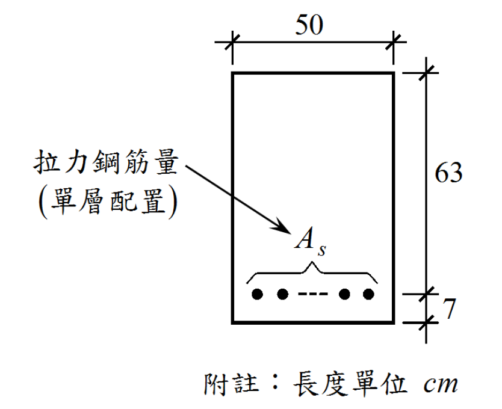

# RC-2019-1 題目正本

> 本檔只記錄**考卷上寫了什麼、圖上畫了什麼**，不含任何解法。解析見同資料夾 `RC-2019-1.md`。
> 判讀清單已經使用者確認（凍結）；本檔原則上不再修改（改動須回考卷原圖並記 log）。

| 項目 | 內容 |
|------|------|
| 考卷 | `raw/exams/RC-2019_鋼筋混凝土設計與預力.pdf` 第 1 頁（頁次 4－1），第一題 |
| 考年 | 民國 108 年（2019） |
| 配分 | 25 分 |
| 附圖 | `RC-2019-1-fig-1.png`（單筋梁斷面） |
| 判讀狀態 | **已確認**（2026-11-13 使用者確認；轉錄 2026-11-13，PyMuPDF 110 dpi 全頁目視＋抽出文字核對；盲讀後才比對既有解析） |

## 1. 考卷原文（逐字）

> 一、附圖所示，為一鋼筋混凝土單筋梁斷面構造。該梁之混凝土抗壓強度為 f'c = 210 kgf/cm²，鋼筋之降伏應力為 fy = 4,200 kgf/cm²。如果該斷面承受一設計彎矩 Mu = 85.72 tf − m，試求所需之拉力鋼筋量 AS。（25 分）
>
> 附註：長度單位 cm
>
> 提示：本命題之強度折減因數 φ 界於 0.65 與 0.9 之間。

## 2. 考卷給的公式、附表與參數

- 卷首：應考人必須依據中國土木水利工程學會所出版的「混凝土工程設計規範與解說」（土木 401-100）來作答。未依上列規範作答，不予計分。
- 題文數值：$f'_c=210$、$f_y=4200$ kgf/cm²；$M_u=85.72$ tf-m。
- 提示：$\phi$ 界於 0.65 與 0.9 之間。
- **沒有給**：$E_s$、$\varepsilon_{cu}$、$\beta_1$、鋼筋號數。
- 卷首注意事項：㈠可以使用電子計算器；㈡不必抄題；㈢除專門名詞或數理公式外，應使用本國文字作答。

## 3. 附圖

圖面文字照錄：`50`、`63`、`7`、`拉力鋼筋量`、`(單層配置)`、`As`、`附註：長度單位 cm`。

## 4. 判讀清單

「把握」標**不確定**者請優先確認；解讀類項目（題目用字的意思）另標「解讀」。

| # | 項目 | 判讀 | 圖上／題文依據 | 把握 |
|---|------|------|---------------|------|
| 1 | 梁寬 | $b=50$ cm | 上方尺寸線兩端對齊斷面左右側 | 確定 |
| 2 | 63 段 | 斷面頂面到拉力筋列中心 → $d=63$ cm | 110 dpi：63 尺寸線上端對齊頂面、下端分界記號對齊鋼筋列中心高度 | 確定 |
| 3 | 7 段 | 拉力筋列中心到斷面底面；$h=63+7=70$ cm | 7 尺寸線上端接 63 段、下端對齊底面 | 確定 |
| 4 | 鋼筋 | 單層拉力筋 $A_s$（根數未定，以「--- 」表示），無壓力筋 | 題文「單筋梁」；圖上只有底部一排 | 確定 |
| 5 | 提示 | 本題的 $\phi$ 落在過渡區（0.65～0.9），不能直接取 0.9 | 題下提示 | 確定（解讀） |
| 6 | 考卷沒有給 | $E_s$、$\varepsilon_{cu}$、$\beta_1$、鋼筋號數 | 全題 | 確定 |

---

*轉錄：2026-11-13（RC-U1-1 題目正本推廣・批 2）*

*確認：2026-11-13 使用者確認（RC-U1-1 題目正本推廣・批 2，關卡一）*
