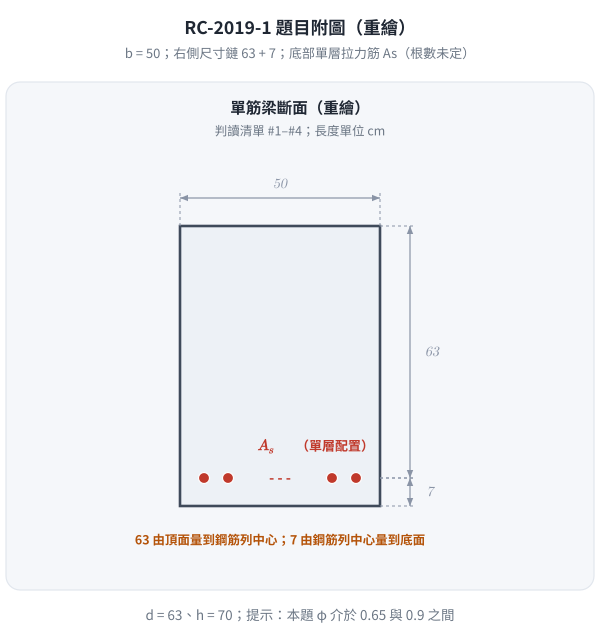
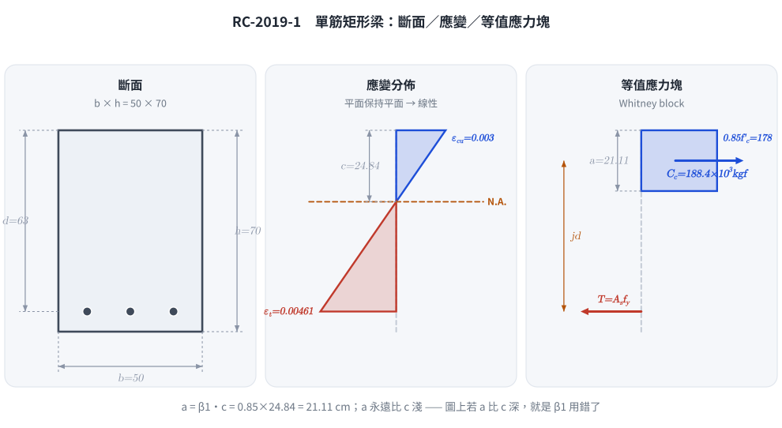
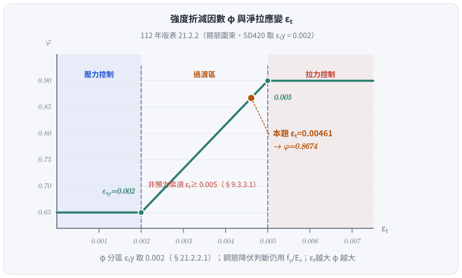
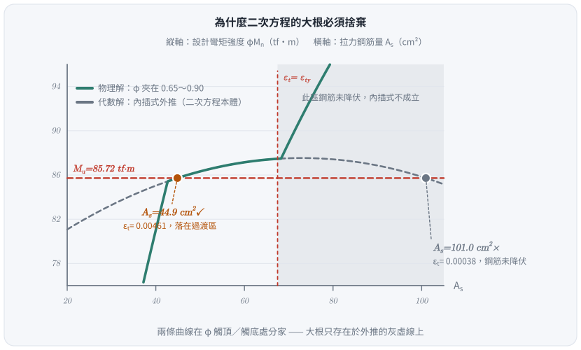

# 考題編號：RC-2019-1

**主分類：** `RC-U1-1` RC 梁彎矩強度分析與設計
**副分類：** 無
**設計法：** USD 強度設計法
**標籤：** `單筋梁` `過渡區φ值` `Whitney應力塊` `矩形斷面` `二次方程求As` `應變相容` `φ=0.65~0.9`

---

## 1. 題目（考卷原文見題目正本）

> 考卷原文、公式／附表、附圖與判讀清單（已確認）見 [`RC-2019-1-problem.md`](RC-2019-1-problem.md)。本節只列解題時最容易讀錯的地方與本解使用的記號；題意以題目正本為準。

*重繪自考卷附圖，依題目正本判讀清單。尺寸鏈的分界畫在鋼筋列中心——這張圖攔下「63 當全深、7 當淨保護層」：d = 63、h = 70。*

### 常見誤讀

| 項目 | 正確判讀 | 常見誤讀 |
|---|---|---|
| 63／7 尺寸 | 63 由頂面量到鋼筋列中心，7 由鋼筋列中心量到底面（判讀 #2、#3） | 63 當全深 $h$，再扣保護層求 $d$ |
| 強度折減因數 | 題下提示 $\phi$ 介於 0.65 與 0.9（判讀 #5），須與 $A_s$ 聯立 | 直接取 $\phi = 0.9$ |
| 鋼筋配置 | 單層、單筋（判讀 #4） | 自行加壓力筋或排兩層 |

**本解記號：** $b = 50$、$d = 63$、$h = 70$ cm；$f'_c = 210$、$f_y = 4200$ kgf/cm²；$M_u = 85.72$ tf-m。

---

## 2. 考題核心精神與出題者意圖 (Core Concepts & Examiner's Intent)

**核心觀念：** 本題測驗考生能否在 $\phi$ 值未知（過渡區）的情況下，正確建立 $\phi$–$A_s$–$\varepsilon_t$ 的聯立方程，透過**代入消元**化為二次方程求解 $A_s$，而非直接假設 $\phi = 0.9$。

**出題者意圖：**
1. 強迫考生理解 $\phi$ 值不是固定的，需由應變條件決定
2. 測試是否知道過渡區 $\phi$ 的線性內插公式
3. 透過「$\phi$ 界於 0.65 與 0.9」的提示，告知考生：假設 $\phi = 0.9$ 算出的答案不對，直接假設 $\phi = 0.65$ 也不對
4. 考察將多個方程式聯立整理後求解的代數能力

**陷阱所在：** 若直接假設 $\phi = 0.9$，求出 $A_s$ 後驗算 $\varepsilon_t < 0.005$，發現矛盾——表示需要用過渡區公式重解，否則白費工夫。

---

## 3. 解題戰略地圖與陷阱分析 (Strategic Roadmap & Trap Analysis)

**作戰計畫（五步驟）：**
1. 確認 $\beta_1$（依 $f'_c$ 決定）
2. 以 $A_s$ 為未知數，將 $a$、$c$、$\varepsilon_t$ 全部表示為 $A_s$ 的函數
3. 將過渡區 $\phi$ 公式也表示為 $A_s$ 的函數
4. 代入 $\phi M_n = M_u$ 展開，化為二次方程求 $A_s$
5. 驗算 $\varepsilon_t$ 落在過渡區（$\varepsilon_{ty} < \varepsilon_t < 0.005$），並依 §9.3.3.1 檢查梁是否拉力控制

**關鍵陷阱與應對：**

| # | 陷阱 | 應對策略 |
|---|------|---------|
| 1 | **直接假設 $\phi = 0.9$** 然後求 $A_s$，略過驗算 | 題目已明示 $\phi$ 不等於 0.9；必須以聯立方程求解 |
| 2 | **把兩個應變混用**：降伏判斷與 φ 分區 | 降伏用 $\varepsilon_y = f_y/E_s = 0.002059$；φ 分區用 $\varepsilon_{ty}=0.002$（112 年版 §21.2.2.1，SD420 可採），內插分母 0.003 |
| 3 | **過渡區 $\phi$ 線性內插**方向反了（以為 $\varepsilon_t$ 越大 $\phi$ 越小） | $\varepsilon_t$ 越大越偏向拉力控制，$\phi$ 越接近 0.9（越大） |
| 4 | **有效深度 $d$ 的判讀** 錯誤（把 63 當成全斷面高、把 7 忽略或誤用） | 題目圖中 63 cm 為有效深度 $d$，7 cm 為鋼筋形心至底纖維距離，$h = 70$ cm |

---

## 3.5 變數層次分析 (Variable Hierarchy Analysis)

> 複習提示：第一次解題後，在每個卡住的知識點旁標記 `⚠`；第二次複習時只看有 `⚠` 的項目。

### 最終目標

求所需拉力鋼筋量 $A_s$（$\text{cm}^2$），使 $\phi M_n \geq M_u = 85.72\ \text{tf·m}$，其中 $\phi$ 屬於過渡區。

---

### 本題關鍵公式（依計算順序）

$$
\text{Step 1: } a = \frac{A_s \cdot f_y}{0.85 f'_c \cdot b}
$$

$$
\text{Step 2: } c = \frac{\boxed{a}}{\beta_1}
$$

$$
\text{Step 3: } \varepsilon_t = 0.003 \cdot \frac{d - \boxed{c}}{\boxed{c}} = \frac{0.3414}{A_s} - 0.003
$$

$$
\text{Step 4: } \phi = 0.65 + 0.25\,\frac{\boxed{\varepsilon_t} - \varepsilon_{ty}}{0.003} = 0.2333 + \frac{28.45}{A_s}\quad(\varepsilon_{ty}=0.002)
$$

$$
\text{Step 5: } \phi M_n = \boxed{\phi} \cdot A_s \cdot f_y \cdot \left(d - \frac{\boxed{a}}{2}\right) = M_u \quad \Rightarrow \quad \text{二次方程求 } A_s
$$

---

### L1：題目直接給定

| 符號 | 數值 | 說明 |
|------|------|------|
| $b$ | 50 cm | 梁寬 |
| $d$ | 63 cm | 有效深度（由圖讀取） |
| $h$ | 70 cm | 全斷面深（63 + 7） |
| $f'_c$ | 210 kgf/cm² | 混凝土抗壓強度 |
| $f_y$ | 4,200 kgf/cm² | 鋼筋降伏應力 |
| $M_u$ | 85.72 tf·m = 8,572,000 kgf·cm | 設計彎矩 |

---

### L2：需知識點推導

**（A）材料常數**

| 符號 | 公式／來源 | 卡關? |
|------|-----------|-------|
| $\beta_1$ | $f'_c \leq 280 \Rightarrow \beta_1 = 0.85$（土木 401-100 第 10.2.7 條） | |
| $E_s$ | $= 2.04 \times 10^6\ \text{kgf/cm}^2$（土木 401-100） | |
| $\varepsilon_y$ | $= f_y/E_s = 4200/2{,}040{,}000 = 0.002059$（判斷鋼筋是否降伏用） | |
| $\varepsilon_{ty}$（φ 分區用） | $=0.002$（112 年版 §21.2.2.1：$f_y=4200$ 竹節鋼筋可採 0.002） | |

**（B）幾何量（以 $A_s$ 表示）**

| 符號 | 公式／來源 | 卡關? |
|------|-----------|-------|
| $a$ | $= A_s \cdot f_y/(0.85 f'_c \cdot b) = 0.4706\,A_s$ | |
| $c$ | $= a/\beta_1 = 0.5536\,A_s$ | |
| $\varepsilon_t$ | $= 0.003(d-c)/c = 0.3414/A_s - 0.003$ | |

**（C）強度折減因數**

| 符號 | 公式／來源 | 卡關? |
|------|-----------|-------|
| $\phi$ | 過渡區（表 21.2.2）：$0.65 + 0.25(\varepsilon_t-\varepsilon_{ty})/0.003$ | |
| $\phi$（整理後） | $= 0.2333 + 28.45/A_s$ | |

**（D）二次方程求解**

| 符號 | 公式／來源 | 卡關? |
|------|-----------|-------|
| 方程式 | $0.05490\,A_s^2 - 8.006\,A_s + 248.70 = 0$ | |
| $A_s$ | 較小根（較大根鋼筋未降伏，不合） | |

---

### L3：深層知識（不懂就卡住）

| 知識點 | 說明 | 卡關? |
|--------|------|-------|
| **過渡區定義** | $\varepsilon_{ty} < \varepsilon_t < \varepsilon_{ty}+0.003$（SD420：0.002～0.005）時，$\phi$ 在 0.65~0.9 之間線性內插；$\varepsilon_t \geq 0.005$ 才用 $\phi=0.9$（拉力控制） | |
| **梁須拉力控制** | 112 年版 §9.3.3.1：非預力梁應符合表 21.2.2 拉力控制，即 $\varepsilon_t \ge 0.005$（舊規範的 $\varepsilon_t \ge 0.004$ 已取消） | |
| **為什麼二次方程有兩根** | 較大根對應鋼筋未降伏（$\varepsilon_t < \varepsilon_y$）的情況，物理上無效，必須捨棄 | |
| **$\beta_1$ 的分界值** | $f'_c = 280\ \text{kgf/cm}^2$ 時 $\beta_1 = 0.85$；$> 280$ 每增加 70 減 0.05，最小 0.65 | |
| **$\phi = 0.9$ 的前提** | 拉力控制斷面（$\varepsilon_t \geq 0.005$）才能直接用 $\phi = 0.9$；本題 $\varepsilon_t \approx 0.00461 < 0.005$，故不能直接用 | |

---

## 4. 步驟化詳細計算過程 (Step-by-Step Detailed Calculation)

### 4.1 斷面參數確認

由附圖：

$$b = 50\ \text{cm}, \quad d = 63\ \text{cm}, \quad h = 70\ \text{cm}$$

$$f'_c = 210\ \text{kgf/cm}^2 \leq 280\ \text{kgf/cm}^2 \quad \Rightarrow \quad \beta_1 = 0.85$$

$$E_s = 2.04 \times 10^6\ \text{kgf/cm}^2, \quad \varepsilon_y = \frac{4200}{2{,}040{,}000} = 0.002059,\quad \varepsilon_{ty}=0.002\ (\text{φ 分區，§21.2.2.1})$$

$$M_u = 85.72\ \text{tf·m} = 8{,}572{,}000\ \text{kgf·cm}$$

---

### 4.2 建立 $a$、$c$、$\varepsilon_t$ 與 $A_s$ 的關係

由等效矩形應力塊（Whitney）平衡：

$$a = \frac{A_s \cdot f_y}{0.85 f'_c \cdot b} = \frac{4200\,A_s}{0.85 \times 210 \times 50} = \frac{4200\,A_s}{8925} = 0.4706\,A_s \ \text{(cm)}$$

$$c = \frac{a}{\beta_1} = \frac{0.4706\,A_s}{0.85} = 0.5536\,A_s \ \text{(cm)}$$

底部鋼筋淨拉應變：

$$\varepsilon_t = 0.003 \cdot \frac{d - c}{c} = 0.003 \cdot \frac{63 - 0.5536\,A_s}{0.5536\,A_s} = \frac{0.003 \times 63}{0.5536\,A_s} - 0.003 = \frac{0.3414}{A_s} - 0.003$$

---

*圖 1　斷面／應變／等值應力塊。垂直尺度三格共用，$a = \beta_1 c$ 永遠比 $c$ 淺——圖上若 $a$ 比 $c$ 深就是 $\beta_1$ 用錯，這是檢查 $a$、$c$ 有沒有代反最快的方式。*

### 4.3 建立過渡區 $\phi$ 與 $A_s$ 的關係

由題目提示確認為過渡區，套入 112 年版表 21.2.2 的線性內插公式（$f_y=4200$ 依 §21.2.2.1 取 $\varepsilon_{ty}=0.002$，拉力控制界限 $\varepsilon_{ty}+0.003=0.005$）：

$$\phi = 0.65 + 0.25\,\frac{\varepsilon_t - \varepsilon_{ty}}{0.003}$$

代入 $\varepsilon_t = 0.3414/A_s - 0.003$：

$$\phi = 0.65 + \frac{0.25}{0.003} \cdot \left(\frac{0.3414}{A_s} - 0.003 - 0.002\right) = 0.65 + 83.33 \times \frac{0.3414}{A_s} - 83.33 \times 0.005$$

$$= 0.65 + \frac{28.45}{A_s} - 0.4167$$

$$\boxed{\phi = 0.2333 + \frac{28.45}{A_s}}$$

---

*圖 2　過渡區內插（112 年版表 21.2.2，SD420 取 $\varepsilon_{ty}=0.002$）。$\varepsilon_t$ 越大 $\phi$ 越大——這張圖攔下內插方向記反；也提醒：非預力梁須 $\varepsilon_t \ge 0.005$（§9.3.3.1），本題的點落在梁的禁區。*

### 4.4 代入彎矩方程，化簡為二次方程

設計強度條件：$\phi M_n = M_u$

$$\phi \cdot A_s \cdot f_y \cdot \left(d - \frac{a}{2}\right) = M_u$$

$$\left(0.2333\,A_s + 28.45\right) \times 4200 \times \left(63 - 0.2353\,A_s\right) = 8{,}572{,}000$$

兩側除以 4200：

$$\left(0.2333\,A_s + 28.45\right)\left(63 - 0.2353\,A_s\right) = \frac{8{,}572{,}000}{4200} = 2040.95$$

展開左側：

$$\underbrace{0.2333 \times 63}_{14.70}\,A_s - \underbrace{0.2333 \times 0.2353}_{0.05490}\,A_s^2 + \underbrace{28.45 \times 63}_{1792.3} - \underbrace{28.45 \times 0.2353}_{6.694}\,A_s = 2040.95$$

整理：

$$-0.05490\,A_s^2 + (14.70 - 6.694)\,A_s + 1792.3 = 2040.95$$

$$\boxed{0.05490\,A_s^2 - 8.006\,A_s + 248.70 = 0}$$

---

### 4.5 求解二次方程

$$A_s = \frac{8.006 \pm \sqrt{8.006^2 - 4 \times 0.05490 \times 248.70}}{2 \times 0.05490} = \frac{8.006 \pm \sqrt{64.10 - 54.61}}{0.10980} = \frac{8.006 \pm 3.080}{0.10980}$$

| 根 | $A_s$ (cm²) | 說明 |
|----|-----------|------|
| 取 $+$ | $(8.006 + 3.080)/0.10980 = 101.0\ \text{cm}^2$ | **無效**：代入後 $\varepsilon_t < \varepsilon_{ty}$，已落在壓力控制區，內插式不適用 |
| 取 $-$ | $(8.006 - 3.080)/0.10980 = \mathbf{44.9}\ \text{cm}^2$ | **有效解** |

$$\boxed{A_s \approx 44.9\ \text{cm}^2}$$

> **精度說明：** 上式係數為四捨五入值；直接以 $\phi M_n(A_s) = M_u$ 數值求根得 $A_s = 44.87$ cm²。
> 常數項務必用 $8{,}572{,}000/4200 = 2040.95$。

---

*圖 3　為什麼大根必須捨棄。實線是 $\phi$ 被夾在 0.65～0.90 的物理解，灰虛線才是二次方程本體（把內插式外推）——大根 101.0 cm² 只存在於虛線上，該處 $\varepsilon_t < \varepsilon_{ty}$。*

### 4.6 驗算

以精解 $A_s = 44.87$ cm² 代回：

$$a = 0.4706 \times 44.87 = 21.11\ \text{cm},\qquad c = 21.11/0.85 = 24.84\ \text{cm}$$

$$\varepsilon_t = 0.003 \times \frac{63 - 24.84}{24.84} = 0.00461$$

$$\varepsilon_{ty} = 0.002 < \varepsilon_t = 0.00461 < 0.005 \quad \checkmark \text{（過渡區確認，與題目提示相符）}$$

$$\phi = 0.65 + 0.25 \times \frac{0.00461 - 0.002}{0.003} = 0.8674$$

$$\phi M_n = 0.8674 \times 44.87 \times 4200 \times (63 - 10.56) = 0.8674 \times 9{,}882{,}700 = 8{,}572{,}000\ \text{kgf·cm} = 85.72\ \text{tf·m} = M_u \quad \checkmark$$

**延性檢核（現行規範 §9.3.3.1：非預力梁須拉力控制，$\varepsilon_t \geq 0.005$）：**

$$\varepsilon_t = 0.00461 < 0.005 \quad \text{✗}$$

本題照題意（單筋、$\phi$ 介於 0.65 與 0.9）求得 $A_s = 44.87$ cm²，但依現行規範這根單筋梁**不符拉力控制的規定**：
單筋斷面在 $\varepsilon_t = 0.005$（$c = 3d/8 = 23.63$ cm）時的最大設計彎矩只有

$$A_{s} = \frac{0.85(210)(0.85\times23.63)(50)}{4200} = 42.67\ \text{cm}^2,\qquad \phi M_n = 0.9 \times 94.92 = 85.42\ \text{tf·m} < M_u = 85.72\ \text{tf·m}$$

只差 0.35%。實務上應加少量壓力筋（$d'=6$ cm 時理論需 $A'_s \approx 0.14$ cm²，配 2-D13 即可，拉力筋約 42.8 cm²）或略加深斷面。
考卷依土木 401-100（$\varepsilon_t \ge 0.004$）命題，在舊規範下本解合格；見 §5.4。

**最小鋼筋量驗核：**

$$A_{s,\min} = \max\!\left(\frac{0.80\sqrt{f'_c}}{f_y},\, \frac{14}{f_y}\right) b_w d = \max(0.00276,\, 0.00333) \times 50 \times 63 = 10.50\ \text{cm}^2$$

$$A_s = 44.9\ \text{cm}^2 \gg A_{s,\min} = 10.50\ \text{cm}^2 \quad \checkmark$$

---

## 5. 關鍵爭議點與進階探討 (Critical Issues & Advanced Discussion)

### 5.1 本題解法的唯一性

本題的「正解路徑」是**將 $\phi$ 表示為 $A_s$ 的函數後聯立求解**。市面上部分解析使用「迭代法」（假設 $\phi$→求 $A_s$→回代驗算→修正 $\phi$）同樣可以得到正確答案，但收斂需要 3~5 次疊代，在考場上較不效率。

二次方程法是最直接的路徑，且**不需要事先猜測 $\phi$**，推薦考場使用。

### 5.2 $\varepsilon_y$ 與 $\varepsilon_{ty}$

判斷鋼筋是否降伏用 $\varepsilon_y = f_y/E_s = 4200/2{,}040{,}000 = 0.002059$；
$\phi$ 分區用的 $\varepsilon_{ty}$ 依 112 年版 §21.2.2.1，$f_y = 4200$ 竹節鋼筋可採 0.002，此時拉力控制界限恰為 0.005。
（本解舊版用 $\varepsilon_{ty}=0.002059$ 起點、0.005 終點的混合式，得 $A_s = 45.52$ cm²、$\phi = 0.8575$；改為規範原式後 $A_s = 44.87$ cm²，差 1.4%。）

### 5.3 高鋼筋比的實務意義

本題 $\rho = 44.87/(50 \times 63) = 0.01424$，平衡鋼筋比 $\rho_b = 0.85 \times 0.85 \times \frac{210}{4200} \times \frac{6120}{6120+4200} = 0.02142$，$\rho/\rho_b = 0.665$。
現行規範要求非預力梁拉力控制，單筋斷面的上限是 $\varepsilon_t = 0.005$（$A_s = 42.67$ cm²）；本題需求略超過，應增大斷面或採用壓力筋。

### 5.4 考卷規範（土木 401-100）與現行規範的差異

| 項目 | 土木 401-100（考卷指定） | 現行 112 年版（本解主線） | 影響 |
|------|------|------|------|
| φ 過渡式 | 坊間以 $\varepsilon_{ty}=0.002059$ 起點、0.005 終點內插 | 表 21.2.2：$0.65+0.25(\varepsilon_t-\varepsilon_{ty})/0.003$，SD420 取 $\varepsilon_{ty}=0.002$ | $A_s$ 45.52 → 44.87 cm² |
| 梁的最小淨拉應變 | $\varepsilon_t \ge 0.004$ | 拉力控制 $\varepsilon_t \ge 0.005$（§9.3.3.1） | 本題單筋解在舊規範合格、現行規範不合格 |

---

*圖解補繪：2026-08-31（向量圖 3 張，腳本 `figs/gen_RC-2019-1.py`，可重跑；腳本檔尾對 §4／§5 公佈值做 assert）*

*修正日期：2026-11-13（§1 改為指向題目正本＋常見誤讀＋本解記號，嵌入重繪附圖 figs/RC-2019-1-fig-1-problem.svg；舊 §1 證據圖已收入題目正本）*

*修正日期：2026-11-21（解析勘誤，改依現行台灣規範（建築物混凝土結構設計規範 2023）：φ 過渡式改為表 21.2.2 原式、SD420 依 §21.2.2.1 取 εty = 0.002；As 45.52 → 44.87 cm²、φ 0.8575 → 0.8674；梁延性改依 §9.3.3.1 拉力控制（εt ≥ 0.005），本題單筋解 εt = 0.00461 不合格、補壓力筋說明；gen 腳本與圖 1–3 重產）*
