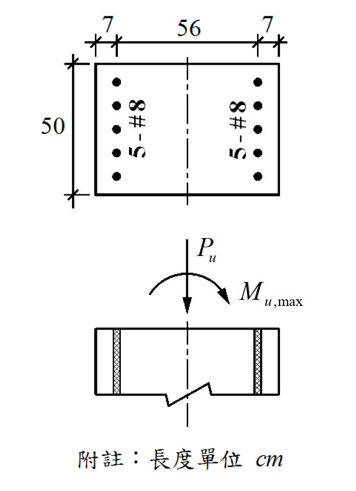

# RC-2019-2 題目正本

> 本檔只記錄**考卷上寫了什麼、圖上畫了什麼**，不含任何解法。解析見同資料夾 `RC-2019-2.md`。
> 判讀清單已經使用者確認（凍結）；本檔原則上不再修改（改動須回考卷原圖並記 log）。

| 項目 | 內容 |
|------|------|
| 考卷 | `raw/exams/RC-2019_鋼筋混凝土設計與預力.pdf` 第 2 頁（頁次 4－2），第二題 |
| 考年 | 民國 108 年（2019） |
| 配分 | 25 分 |
| 附圖 | `RC-2019-2-fig-1.png`（斷面與受力示意） |
| 判讀狀態 | **已確認**（2026-11-14 使用者確認；無不確定項；轉錄 2026-11-14；PyMuPDF 110 dpi 全頁目視＋抽出文字核對，附圖 400 dpi 放大；盲讀後才比對既有解析） |

## 1. 考卷原文（逐字）

> 二、附圖所示，為一鋼筋混凝土柱斷面構造。該柱之混凝土抗壓強度為 $f'_c=280\ kgf/cm^2$，鋼筋之降伏應力為 $f_y=4{,}200\ kgf/cm^2$。柱內縱向鋼筋量為每側 5－#8。如果該柱斷面承受一個設計軸力 $P_u=291\ tf$，試求該柱斷面所能承受之最大設計彎矩 $M_{u,\max}$。（25 分）
> 提示：
> 1. 本命題之斷面屬於「壓力控制斷面」。
> 2. 一根 #8 筋之斷面積為 $A_b^{\#8}=5.07\ cm^2$。

## 2. 考卷給的公式、附表與參數

- 題文數值：$f'_c=280$、$f_y=4200$ kgf/cm²；每側 5-#8；$P_u=291$ tf；$A_b^{\#8}=5.07$ cm²。
- 提示：壓力控制斷面。
- 卷首（第 1 頁）：「應考人必須依據中國土木水利工程學會所出版的『混凝土工程設計規範與解說』（土木401-100）來作答。未依上列規範作答，不予計分。」
- **沒有給**：$E_s$、$\varepsilon_{cu}$、$\beta_1$、$\phi$ 數值、箍筋或螺筋型式、每側 5 根的間距。
- 卷首注意事項：㈠可以使用電子計算器。㈡不必抄題，作答時請將試題題號及答案依照順序寫在試卷上，於本試題上作答者，不予計分。㈢本科目除專門名詞或數理公式外，應使用本國文字作答。

## 3. 附圖

圖面文字照錄：「7」「56」「7」「50」「5-#8」「5-#8」「$P_u$」「$M_{u,\max}$」「附註：長度單位 cm」。

## 4. 判讀清單

| # | 項目 | 判讀 | 圖上／題文依據 | 把握 |
|---|------|------|---------------|------|
| 1 | 斷面尺寸 | 寬 $7+56+7=70$ cm（彎曲方向）、高 50 cm | 400 dpi：上方三段尺寸線、左側 50 尺寸線 | 確定 |
| 2 | 彎曲方向 | 沿 70 cm 方向彎曲（立面圖的彎矩與兩側鋼筋同一平面） | 下方立面示意 | 確定 |
| 3 | 鋼筋配置 | 左右兩側各 5-#8，距左右緣 7 cm（量至鋼筋中心），$d=63$ cm | 7 尺寸線內側端點對齊鋼筋縱列圓心 | 確定 |
| 4 | 每側 5 根的垂直位置 | 未標尺寸；同列在同一彎曲深度，不影響本題 | 圖上無尺寸 | 確定 |
| 5 | 「最大設計彎矩」 | 在 $P_u=291$ tf 下斷面設計強度能承受的彎矩，即設計交互曲線上 $\phi P_n=291$ tf 對應的 $\phi M_n$ | 題文 | 確定（解讀） |
| 6 | $\phi$ | 提示壓力控制 → 取壓力控制斷面的 $\phi$；柱型式未給，圖上未畫箍筋 → 以箍筋柱看待 | 提示 1；附圖 | 確定（解讀）（螺筋柱 $\phi$ 不同） |
| 7 | 考卷沒有給 | $E_s$、$\varepsilon_{cu}$、$\beta_1$ 需依規範自行採用 | 題文 | 確定 |

---

*轉錄：2026-11-14（RC-U1-2 題目正本推廣・批 1）*

*確認：2026-11-14 使用者確認（RC-U1-2 題目正本推廣・批 1，關卡一）*
