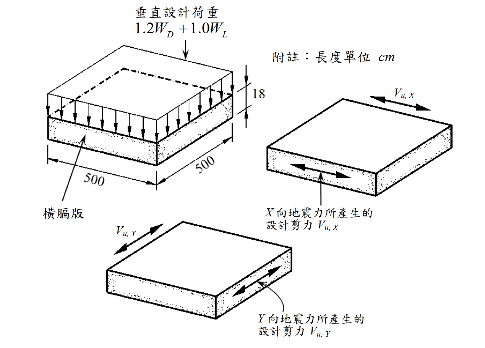

# RC-2019-3 題目正本

> 本檔只記錄**考卷上寫了什麼、圖上畫了什麼**，不含任何解法。解析見同資料夾 `RC-2019-3.md`。
> 判讀清單已經確認（凍結）；本檔原則上不再修改（改動須回考卷原圖並記 log）。

| 項目 | 內容 |
|------|------|
| 考卷 | `raw/exams/RC-2019_鋼筋混凝土設計與預力.pdf` 第 3 頁（頁次 4－3），第三題 |
| 考年 | 民國 108 年（2019） |
| 配分 | 25 分 |
| 附圖 | `RC-2019-3-fig-1.png`（橫膈版立體示意：重力荷重、尺寸、X／Y 向設計剪力） |
| 判讀狀態 | **已確認**（2026-11-15 使用者授權依 Claude 建議確認；轉錄 2026-11-15；PyMuPDF 110 dpi 全頁目視，附圖 400–450 dpi 局部放大；文字以 PDF 文字層核對（公式以影像為準）；盲讀後才比對既有解析） |

## 1. 考卷原文（逐字）

> 三、附圖所示，為一片自建築結構所擷取出來的橫膈版。橫膈版之混凝土抗壓強度為 $f'_c$＝280 kgf/cm²，鋼筋之降伏應力為 $f_y$＝2,800 kgf/cm²。在 $U=1.2D+1.0L\pm1.0E$ 的載重組合下，版內所需之「撓曲鋼筋」量，先行依據設計載重 $1.2W_D+1.0W_L$ 完成設計，並採用 #4@25「雙層、雙向及等間距」的方式來配置。
>
> 若 X 向與 Y 向地震力對於該橫膈版所產生的設計剪力分別為 $V_{u,X}$＝100 tf 與 $V_{u,Y}$＝100 tf，試計算該橫膈版內所需之「抗剪鋼筋」量。如果該橫膈版內鋼筋仍然採用 #4 鋼筋，且其配置方式仍然採用「雙層、雙向及等間距」的型態，試求該橫膈版於最終設計所需之鋼筋間距 $s$。（25 分）
>
> 提示：
> 1. 橫膈版的計算剪力強度為 $V_n=\left(0.53\sqrt{f'_c}+\rho_t f_y\right)A_{cv}$，其剪力設計之強度折減因數可以保守採用 $\phi$＝0.6。
> 2. 一根 #4 筋之斷面積為 $A_b^{\#4}$＝1.27 cm²。

## 2. 考卷給的公式、附表與參數

- 題文數值：$f'_c$＝280、$f_y$＝2800 kgf/cm²；撓曲鋼筋已設計為 #4@25（雙層、雙向、等間距）；$V_{u,X}$＝$V_{u,Y}$＝100 tf；#4 $A_b$＝1.27 cm²。
- 提示公式（照錄）：$V_n=(0.53\sqrt{f'_c}+\rho_tf_y)A_{cv}$，$\phi$＝0.6（題目寫「可以保守採用」）。
- 附圖：版平面 500×500、厚 18（長度單位 cm）。
- 作答規範（卷首）：應考人必須依據中國土木水利工程學會所出版的「混凝土工程設計規範與解說」（土木 401-100）來作答。未依上列規範作答，不予計分。
- **沒有給**：$\rho_t$ 的方向定義、$A_{cv}$ 的取法、撓曲鋼筋是否全部為撓曲所需（或有餘裕）、保護層與有效深度、版的支承條件。
- 卷首注意事項：㈠可以使用電子計算器。㈡不必抄題，作答時請將試題題號及答案依照順序寫在試卷上，於本試題上作答者，不予計分。㈢本科目除專門名詞或數理公式外，應使用本國文字作答。

## 3. 附圖

圖面文字照錄：`垂直設計荷重`、`1.2W_D +1.0W_L`、`附註：長度單位 cm`、`18`、`500`、`500`、`橫膈版`、`V_u,X`、`X 向地震力所產生的設計剪力 V_u,X`、`V_u,Y`、`Y 向地震力所產生的設計剪力 V_u,Y`。

## 4. 判讀清單

「把握」標**不確定**者優先列；解讀類項目（題目用字的意思）另標「解讀」。標「依 Claude 建議確認」者，為使用者 2026-11-15 授權「要我確認的請依你建議」後定案。

| # | 項目 | 判讀 | 圖上／題文依據 | 把握 |
|---|------|------|---------------|------|
| 1 | 「最終設計所需之鋼筋間距」 | **撓曲鋼筋與抗剪鋼筋兩者相加**：最終每方向的鋼筋量＝撓曲所需（#4@25 雙層）＋抗剪所需，再換成同一 #4 雙層等間距的 $s$ | 題文先說撓曲鋼筋「先行…完成設計」，再求「抗剪鋼筋」量，最後問「最終設計」所需間距；同一載重組合 $U=1.2D+1.0L\pm1.0E$ 下撓曲與剪力同時作用 | 不確定（影響答案）；依 Claude 建議確認 |
| 2 | $\rho_t$ 方向 | 平行於該剪力方向的分布鋼筋（雙層合計）除以受剪斷面 $A_{cv}$ | 提示公式；規範橫膈版剪力條文 | 確定（解讀） |
| 3 | $A_{cv}$ | 受剪斷面＝版長 500 × 版厚 18 cm（每一方向） | 附圖尺寸 500、500、18 | 確定（解讀） |
| 4 | 版尺寸 | 平面 500×500 cm、厚 18 cm | 附圖尺寸線與「附註：長度單位 cm」 | 確定 |
| 5 | 撓曲配筋 | #4@25，上下雙層、X／Y 雙向、等間距 | 題文 | 確定 |
| 6 | 設計剪力 | $V_{u,X}$＝$V_{u,Y}$＝100 tf（已為設計值）；方形版兩向對稱 | 題文 | 確定 |
| 7 | $\phi$ | 題目給 0.6（「可以保守採用」） | 提示 1 | 確定 |
| 8 | $f_y$ | 2800 kgf/cm²（非 4200） | 題文 | 確定 |
| 9 | 考卷沒有給 | 撓曲鋼筋實際需求量（是否有餘裕）、有效深度、支承條件 | 全題 | 確定 |

---

*轉錄：2026-11-15（RC-U3-3 批 2＋U1-3＋U2-3 題目正本推廣）*

*確認：2026-11-15 使用者授權依 Claude 建議確認（RC-U3-3 批 2＋U1-3＋U2-3 題目正本推廣，關卡一）*
