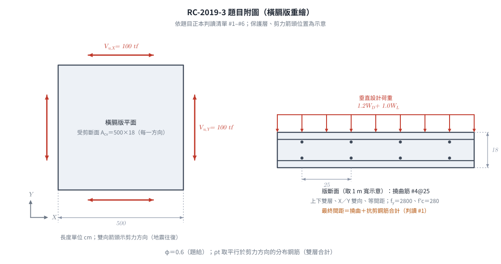
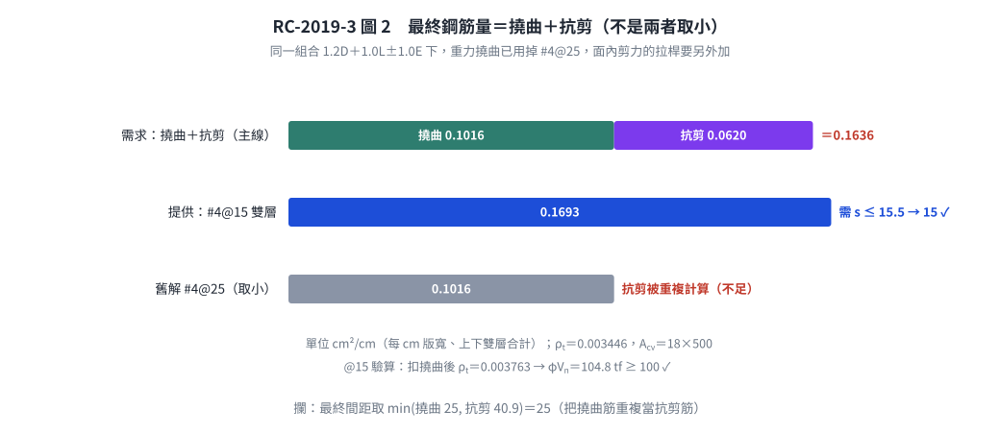

# 考題編號：RC-2019-3

**主分類：** `RC-U3-3` 韌性要求與耐震設計
**副分類：** `RC-U3-2` 樓版與基腳設計
**設計法：** USD 強度設計法
**標籤：** `橫膈版` `地震剪力` `抗剪鋼筋` `雙向版` `ρt計算` `撓曲加抗剪合計` `最終設計間距`

---

## 1. 題目（考卷原文見題目正本）

> 考卷原文、公式／附表、附圖與判讀清單（已確認）見 [`RC-2019-3-problem.md`](RC-2019-3-problem.md)。本節只列解題時最容易讀錯的地方與本解使用的記號；題意以題目正本為準。

*重繪自考卷附圖，依題目正本判讀清單 #1–#6。本圖攔下的讀錯：最終間距只取撓曲與剪力兩者較小者（題意為兩者合計）；$A_{cv}$ 取版面積。*

### 常見誤讀

| 項目 | 正確判讀 | 常見誤讀 |
|------|---------|---------|
| 最終設計間距 | 撓曲鋼筋（#4@25 雙層）＋抗剪鋼筋**合計**後換成 #4 雙層等間距的 $s$（判讀 #1） | 撓曲間距與剪力間距取小（本庫舊解 → 25 cm） |
| $A_{cv}$ | 500×18＝9,000 cm²（每一方向） | 500×500 版面積 |
| $\rho_t$ | 平行於剪力方向的分布鋼筋，雙層合計 | 只算一層 |
| 附圖 | 考卷附圖未畫鋼筋 | 圖中有雙向配筋示意 |
| $f_y$ | 2800 kgf/cm² | 4200 |

**本解記號：** 版 500×500 cm、$t$＝18 cm；$A_{cv}$＝9,000 cm²；#4 $A_b$＝1.27 cm²；撓曲筋 #4@25 雙層雙向；$V_u$＝100 tf（兩向）；$\phi$＝0.6（題給）；$f'_c$＝280、$f_y$＝2800 kgf/cm²。規範：建築物混凝土結構設計規範（2023 年版）12.5.3（橫膈版剪力）、24.4.3（版最少鋼筋）。

---

## 2. 考題核心精神與出題者意圖 (Core Concepts & Examiner's Intent)

**核心觀念：** 橫膈版在同一載重組合 $U=1.2D+1.0L\pm1.0E$ 下，同時承受重力載重產生的**撓曲需求**與地震力產生的**面內剪力需求**；撓曲鋼筋已被重力撓曲用掉，抗剪鋼筋必須**另外加上去**，最終鋼筋量為兩者合計。本題測驗考生能否：

1. 正確辨識橫膈版剪力設計公式中的 $A_{cv}$（截面積 = 厚度 × 剪力方向的版長）
2. 從 $\phi V_n \geq V_u$ 反推所需 $\rho_t$ 與抗剪鋼筋量
3. 把抗剪鋼筋與撓曲鋼筋相加，換成題目要求的 #4 雙層雙向等間距

**出題者意圖：** 題目先說撓曲鋼筋「先行完成設計」、再求「抗剪鋼筋量」、最後問「最終設計所需之鋼筋間距」——三段式敘述就是要考生把兩種需求疊加，而不是拿既有撓曲筋去兼任抗剪。

---

## 3. 解題戰略地圖與陷阱分析 (Strategic Roadmap & Trap Analysis)

**作戰計畫（四步驟）：**
1. 確認 $A_{cv}$（厚度 × 版的邊長）
2. 由 $\phi V_n = V_u$ 求所需 $\rho_t$ 與抗剪鋼筋量（每 cm 版寬）
3. 撓曲鋼筋量（#4@25 雙層）＋抗剪鋼筋量 = 最終所需
4. 換成 #4 雙層等間距的 $s$，取整並驗算

**關鍵陷阱與應對：**

| # | 陷阱 | 應對策略 |
|---|------|---------|
| 1 | **最終間距取 min(撓曲, 剪力)** | 兩者在同一組合同時作用，鋼筋量要**相加** |
| 2 | **$f_y$ 用成 4200** | 本題 $f_y = 2800\ \text{kgf/cm}^2$ |
| 3 | **$A_{cv}$ 誤算為版的全面積（500×500）** | $A_{cv} = t \times L = 18 \times 500 = 9{,}000\ \text{cm}^2$ |
| 4 | **$\rho_t$ 忘乘以雙層** | 雙層配置時 $\rho_t = 2A_b/(s \cdot t)$ |

---

## 3.5 變數層次分析 (Variable Hierarchy Analysis)

> 複習提示：第一次解題後，在每個卡住的知識點旁標記 `⚠`；第二次複習時只看有 `⚠` 的項目。

### 最終目標

求橫膈版最終設計所需之鋼筋間距 $s$（#4，雙層、雙向、等間距），同時提供撓曲所需與抗剪所需的鋼筋量。

---

### 本題關鍵公式（依計算順序）

$$
\text{Step 1: } A_{cv} = t \times L = 18 \times 500 = 9{,}000\ \text{cm}^2
$$

$$
\text{Step 2: } \phi\left(0.53\sqrt{f'_c} + \rho_t f_y\right) A_{cv} \geq V_u \ \Rightarrow\ \rho_{t,\text{req}}
$$

$$
\text{Step 3: } \left(\frac{A_s}{s}\right)_{\text{shear}} = \frac{\boxed{\rho_{t,\text{req}}}\,A_{cv}}{L},\qquad \left(\frac{A_s}{s}\right)_{\text{flex}} = \frac{2A_b}{25}
$$

$$
\text{Step 4: } s = \frac{2A_b}{\boxed{(A_s/s)_{\text{flex}}} + \boxed{(A_s/s)_{\text{shear}}}}
$$

---

### L1：題目直接給定

| 符號 | 數值 | 說明 |
|------|------|------|
| $L_X = L_Y$ | 500 cm | 橫膈版平面邊長（正方形） |
| $t$ | 18 cm | 版厚 |
| $f'_c$ | 280 kgf/cm² | 混凝土抗壓強度 |
| $f_y$ | 2,800 kgf/cm² | 鋼筋降伏應力 |
| $A_b^{\#4}$ | 1.27 cm² | 單根 #4 鋼筋面積 |
| $V_{u,X} = V_{u,Y}$ | 100 tf | X 向與 Y 向地震設計剪力 |
| $\phi$ | 0.6 | 題給（保守） |
| 撓曲筋 | #4@25 雙層雙向 | 已依 $1.2W_D+1.0W_L$ 設計 |

---

### L2：需知識點推導

| 符號 | 公式／來源 | 卡關? |
|------|-----------|-------|
| $A_{cv}$ | $18 \times 500 = 9{,}000\ \text{cm}^2$ | |
| $0.53\sqrt{f'_c}$ | $0.53\times16.733 = 8.868$ kgf/cm² | |
| $\rho_{t,\text{req}}$ | $(100{,}000/0.6/9{,}000 - 8.868)/2800 = 0.003446$ | |
| 抗剪筋 | $0.003446\times9{,}000 = 31.02$ cm² → $31.02/500 = 0.0620$ cm²/cm（雙層合計） | |
| 撓曲筋 | $2\times1.27/25 = 0.1016$ cm²/cm（雙層合計） | |
| 合計 | $0.1636$ cm²/cm | |
| $s$ | $2\times1.27/0.1636 = 15.5$ cm → **15 cm** | |

---

### L3：深層知識（不懂就卡住）

| 知識點 | 說明 | 卡關? |
|--------|------|-------|
| **橫膈版的 $A_{cv}$** | 橫膈版類比水平剪力牆；受剪截面 = 厚度 × 版長（非版全面積）| |
| **$\rho_t$ 含義** | 平行於剪力方向的分布鋼筋（雙層計）佔受剪截面積之比 | |
| **為何要相加** | 撓曲筋已被重力彎矩所需拉力用滿；面內剪力需要的拉桿是額外的需求，同一組合下不能重複使用同一根鋼筋 | |
| **剪力上限** | $V_n \le 2.12\sqrt{f'_c}A_{cv}$（規範 12.5.3.4） | |

---

## 4. 步驟化詳細計算過程 (Step-by-Step Detailed Calculation)

### 4.1 受剪截面積 $A_{cv}$

對稱方形橫膈版，X、Y 兩向受剪截面相同：

$$A_{cv} = t \times L = 18\ \text{cm} \times 500\ \text{cm} = 9{,}000\ \text{cm}^2$$

---

### 4.2 所需配筋率 $\rho_t$（抗剪）

$$\phi\left(0.53\sqrt{f'_c} + \rho_t f_y\right)A_{cv} \geq V_u$$

$$0.53\sqrt{280} = 0.53 \times 16.733 = 8.868\ \text{kgf/cm}^2$$

$$8.868 + 2800\,\rho_t = \frac{100{,}000}{0.6 \times 9{,}000} = 18.519\ \text{kgf/cm}^2$$

$$\boxed{\rho_{t,\text{req}} = \frac{18.519 - 8.868}{2800} = 0.003446}$$

**剪力上限檢核：** $V_n = 166.7$ tf $\le 2.12\sqrt{280}\times9{,}000 = 319.3$ tf ✓

---

### 4.3 抗剪鋼筋量

$$A_{s,\text{shear}} = \rho_t A_{cv} = 0.003446 \times 9{,}000 = 31.02\ \text{cm}^2\ \text{（沿 500 cm 版長、雙層合計）}$$

$$\left(\frac{A_s}{s}\right)_{\text{shear}} = \frac{31.02}{500} = 0.0620\ \text{cm}^2/\text{cm}$$

> 若只看抗剪：#4 雙層 $s = 2.54/0.0620 = 40.9$ cm——但這是**另外**要加的量，不能由既有撓曲筋兼任。

---

### 4.4 撓曲＋抗剪合計，求最終間距

$$\left(\frac{A_s}{s}\right)_{\text{flex}} = \frac{2 \times 1.27}{25} = 0.1016\ \text{cm}^2/\text{cm}$$

$$\left(\frac{A_s}{s}\right)_{\text{total}} = 0.1016 + 0.0620 = 0.1636\ \text{cm}^2/\text{cm}$$

$$s = \frac{2 \times 1.27}{0.1636} = 15.5\ \text{cm} \ \Rightarrow\ \boxed{s = 15\ \text{cm}}$$

**最終設計：#4@15 cm，雙層、雙向、等間距。**

*圖 2　同一載重組合下，重力撓曲已經用掉既有的 #4@25，面內剪力需要的分佈筋是**另外**再加的量，兩段長條必須串接而不是擇小。攔的是把撓曲間距與抗剪間距各算一個再取 $\min(25, 40.9)$＝25，等於讓同一批鋼筋同時抵撓曲又抵剪力。*

---

### 4.5 驗算（$s$＝15 cm）

$$\left(\frac{A_s}{s}\right)_{\text{prov}} = \frac{2.54}{15} = 0.1693\ \text{cm}^2/\text{cm}$$

扣除撓曲所需 0.1016，剩餘抗剪 $0.0677$ cm²/cm → $\rho_t = 0.0677/18 = 0.003763 \ge 0.003446$ ✓

$$\phi V_n = 0.6 \times (8.868 + 0.003763 \times 2800) \times 9{,}000 = 104.8\ \text{tf} \ge 100\ \text{tf} \quad \checkmark$$

最少鋼筋：$0.0020\times18 = 0.036$ cm²/cm（$f_y<4200$，規範 24.4.3.2）≪ 0.1693 ✓；間距 15 cm ≤ min(3h, 45) ✓

---

## 5. 關鍵爭議點與進階探討 (Critical Issues & Advanced Discussion)

### 5.1 「最終設計」：相加（主線）vs 取小（舊解）

| 讀法 | 做法 | 最終 $s$ |
|------|------|:---:|
| **相加（主線，題目正本判讀 #1）** | 撓曲 0.1016＋抗剪 0.0620＝0.1636 cm²/cm | **15 cm** |
| 取小（本庫舊解） | $\min(s_{\text{flex}}{=}25,\ s_{\text{shear}}{=}40.9)$ | 25 cm |

取小的作法隱含「既有撓曲筋可同時兼任面內抗剪」；但撓曲筋是依同一組合的重力彎矩設計（題目說已完成設計），沒有餘裕可挪用，故應相加。以 #4@25 單獨檢核剪力（$\phi V_n$＝133.2 tf）雖大於 100 tf，但那是把撓曲筋重複計算。

### 5.2 $\phi$ 取值

題目給 $\phi$＝0.6（保守）。現行規範 21.2.4：橫膈版剪力的 $\phi$ 不得大於耐震系統垂直構材剪力所用之最小 $\phi$，一般為 0.75，若垂直構材剪力由 $V_n$ 對應撓曲強度控制時取 0.6；題給值在規範範圍內，照用。若取 0.75：$\rho_t$＝0.002124、合計 0.1398 cm²/cm → $s$＝18.2 → 取 18 cm。

### 5.3 $A_{cv}$ 與 X、Y 兩向

若誤取 $A_{cv} = 500 \times 500$（全版水平面積），所求 $\rho_t$ 會小很多，為錯誤解法。本題版為正方形且 $V_{u,X}=V_{u,Y}$，兩向對稱只算一次；若不對稱需分別計算、各方向配筋可不同。

### 5.4 $f_y$＝2800

本題 $f_y = 2{,}800\ \text{kgf/cm}^2$。若誤讀為 4200，所求 $\rho_t$ 偏低、間距偏大，屬常見讀題錯誤。

### 5.5 規範版本

考卷指定土木 401-100；現行建築物混凝土結構設計規範（2023 年版）12.5.3.3 橫膈版剪力強度式 $V_n=A_{cv}(0.53\lambda\sqrt{f'_c}+\rho_tf_y)$ 與提示式相同（常重混凝土 $\lambda$＝1），答案不受規範版本影響。

*修正日期：2026-11-15（§1 改為指向題目正本，插入重繪附圖 figs/RC-2019-3-fig-1-problem.svg；舊 §1 重述改寫為常見誤讀與本解記號；本行非答案勘誤）*

*修正日期：2026-11-15（依題目正本判讀 #1 勘誤：最終鋼筋量改為撓曲＋抗剪合計（0.1016＋0.0620＝0.1636 cm²/cm），最終間距 $\min(25,40.9)$＝25 → **#4@15 cm**（雙層雙向）；補剪力上限、最少鋼筋與 $\phi$＝0.75 對照；改依現行台灣規範（建築物混凝土結構設計規範 2023／耐震規範 111），提示式與現行 12.5.3.3 相同；驗證：`.work/u33b2c/check_errata_U3_3_B2.py` 重算 MISMATCHES: 0）*

*圖解補繪：2026-11-15（向量圖 `figs/RC-2019-3-fig-2-steel.svg`，腳本 `figs/gen_RC-2019-3.py`，可重跑；數值由常數現算並於檔尾 assert 對 §4；DIAG-RC-U3-3-B2）*
