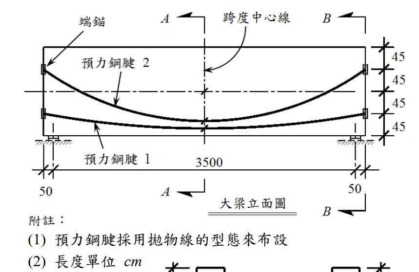
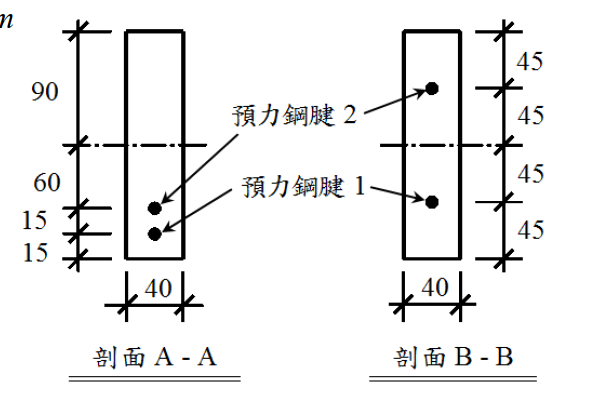

# RC-2019-4 題目正本

> 本檔只記錄**考卷上寫了什麼、圖上畫了什麼**，不含任何解法。解析見同資料夾 `RC-2019-4.md`。
> 判讀清單已經確認（凍結）；本檔原則上不再修改（改動須回考卷原圖並記 log）。

| 項目 | 內容 |
|------|------|
| 考卷 | `raw/exams/RC-2019_鋼筋混凝土設計與預力.pdf` 第 4 頁（頁次 4－4），第四題 |
| 考年 | 民國 108 年（2019） |
| 配分 | 25 分 |
| 附圖 | `RC-2019-4-fig-1.png`（大梁立面圖＋附註）、`RC-2019-4-fig-2.png`（剖面 A-A、剖面 B-B） |
| 判讀狀態 | **已確認**（2026-11-15 使用者授權依 Claude 建議確認；轉錄 2026-11-15；PyMuPDF 110 dpi 全頁＋400 dpi 局部目視、文字層逐字核對（提示公式以影像為準）；盲讀後才比對既有解析） |

## 1. 考卷原文（逐字）

> 四、附圖所示，為一簡支預力混凝土大梁細部構造。
> 預力大梁混凝土抗壓強度為 $f'_c=350\ kgf/cm^2$。預力鋼腱之彈性模數為 $E_{ps}=1{,}970{,}000\ kgf/cm^2$。預力鋼腱 1 與 2 以拋物線型態布設，其截面積分別為 $A^{(1)}_{ps}$ 與 $A^{(2)}_{ps}$，且 $A^{(1)}_{ps}=A^{(2)}_{ps}=30.0\ cm^2$。預力大梁採用「後拉式工法」來施作。預力鋼腱單位長度之皺摺摩擦係數為 $K=0.0049/m$、曲率摩擦係數為 $\mu_p=0.25/rad$。
> 預力大梁於混凝土第 28 天齡期時，首先將預力鋼腱 1 由其兩端同步施拉至預應力 $f_{pj}=12{,}300\ kgf/cm^2$ 然後錨碇之。隨後，再將預力鋼腱 2 由其兩端同步施拉至預應力 $f_{pj}=12{,}300\ kgf/cm^2$ 並錨碇之。
> 本題不考慮「端錨滑動」對於預力鋼腱所造成的預應力損失。試求：（25 分）
> 1. 預力鋼腱 1 與 2 在中央跨度處之起始預力 $P^{(1)}_{i,Cen}$ 與 $P^{(2)}_{i,Cen}$；
> 2. 預力鋼腱 1 與 2 在梁兩端端錨處之起始預力 $P^{(1)}_{i,End}$ 與 $P^{(2)}_{i,End}$。
>
> 提示：
> $P_{px}=P_{pj}\cdot e^{-\omega}$，式中 $\omega=Kl_{px}+\mu_p\alpha_{px}$。
> 混凝土之彈性模數 $E_c=15{,}000\sqrt{f'_c}$。

## 2. 考卷給的公式、附表與參數

- 提示式照錄：$P_{px}=P_{pj}e^{-\omega}$，$\omega=Kl_{px}+\mu_p\alpha_{px}$；$E_c=15000\sqrt{f'_c}$。
- $f'_c=350$ kgf/cm²；$E_{ps}=1{,}970{,}000$ kgf/cm²；$A^{(1)}_{ps}=A^{(2)}_{ps}=30.0$ cm²；$K=0.0049$/m；$\mu_p=0.25$/rad；$f_{pj}=12{,}300$ kgf/cm²（兩腱相同）。
- 施拉順序：28 天齡期，先鋼腱 1（兩端同步）錨碇，再鋼腱 2（兩端同步）錨碇；不考慮端錨滑動。
- 附圖附註：(1) 預力鋼腱採用拋物線的型態來布設；(2) 長度單位 cm。
- **沒有給**：混凝土單位重、套管尺寸（是否扣除）、長期損失（題目只問「起始預力」）。
- 卷首：應考人必須依據中國土木水利工程學會所出版的「混凝土工程設計規範與解說」（土木401-100）來作答。未依上列規範作答，不予計分。注意事項：可以使用電子計算器。不必抄題，作答時請將試題題號及答案依照順序寫在試卷上，於本試題上作答者，不予計分。本科目除專門名詞或數理公式外，應使用本國文字作答。

## 3. 附圖

圖面文字照錄：端錨、A、B、跨度中心線、預力鋼腱 2、預力鋼腱 1、45、45、45、45、50、3500、50、大梁立面圖、附註：(1) 預力鋼腱採用拋物線的型態來布設 (2) 長度單位 cm、90、60、15、15、40、剖面 A-A、剖面 B-B。

## 4. 判讀清單

| # | 項目 | 判讀 | 圖上／題文依據 | 把握 |
|---|------|------|---------------|------|
| 1 | 跨度與梁長 | 支承中心距 3500 cm；支承距梁端各 50 cm；梁全長 3600 cm；端錨在梁端面 | 400 dpi：3500 尺寸線端點對齊兩支承中心虛線，兩側 50 由梁端量到支承虛線；端錨畫在梁端 | 確定 |
| 2 | 斷面 | 矩形，寬 40、深 180（＝45×4＝90＋60＋15＋15）；形心距底 90 | 兩剖面尺寸 | 確定 |
| 3 | 剖面位置 | **A-A 在跨度中心線（跨中），B-B 在梁端** | 立面圖 A-A 剖切線與跨度中心線重合；B-B 剖切線在右端 | 確定 |
| 4 | 跨中鋼腱高程 | 鋼腱 2 距底 30（形心下 60）；鋼腱 1 距底 15 | 剖面 A-A 尺寸 60 下端延伸線對齊鋼腱 2 | 確定 |
| 5 | 梁端鋼腱高程 | 鋼腱 2 距底 135（距頂 45）；鋼腱 1 距底 45 | 剖面 B-B；立面右側 45×4 與端錨位置 | 確定 |
| 6 | 拋物線矢高與方向 | 兩腱皆向下垂、跨中最低、對稱；矢高：鋼腱 1 為 45－15＝30 cm，鋼腱 2 為 135－30＝105 cm | #4、#5；立面圖 | 確定 |
| 7 | 拋物線水平長 | 錨碇至錨碇 3600 cm（端錨在梁端，不在支承） | #1 | 確定（解讀；2026-11-15 使用者授權依 Claude 建議確認） |
| 8 | 張拉端 | **兩腱皆由兩端同步施拉**（梁端即張拉端） | 題文兩處皆寫「由其兩端同步施拉」 | 確定 |
| 9 | 施拉順序的效應 | 鋼腱 1 先錨碇，鋼腱 2 施拉時混凝土再壓縮，鋼腱 1 產生彈性縮短損失；鋼腱 2 最後施拉無此損失。提示給 $E_c$、題給 $E_{ps}$ 與斷面，即供此計算；「起始預力」含摩擦與此彈性縮短 | 題文施拉順序；提示 $E_c$ | 確定（解讀） |
| 10 | 不計項目 | 端錨滑動（題文）；長期損失不在「起始預力」範圍 | 題文 | 確定 |
| 11 | 支承 | 簡支（題文）；圖上兩端為支承墊符號 | 題文「簡支」；立面圖 | 確定 |
| 12 | 考卷沒有給 | 單位重、套管尺寸 | 全題 | 確定（作答須明列假設；鋼腱 1 彈性縮短只需鋼腱 2 施拉引起的應力增量） |

---

*轉錄：2026-11-15（RC-U4-2+U4-3+U4-4 題目正本推廣・批 1）*

*確認：2026-11-15 使用者授權依 Claude 建議確認（RC-U4-2+U4-3+U4-4 題目正本推廣・批 1，關卡一）*
