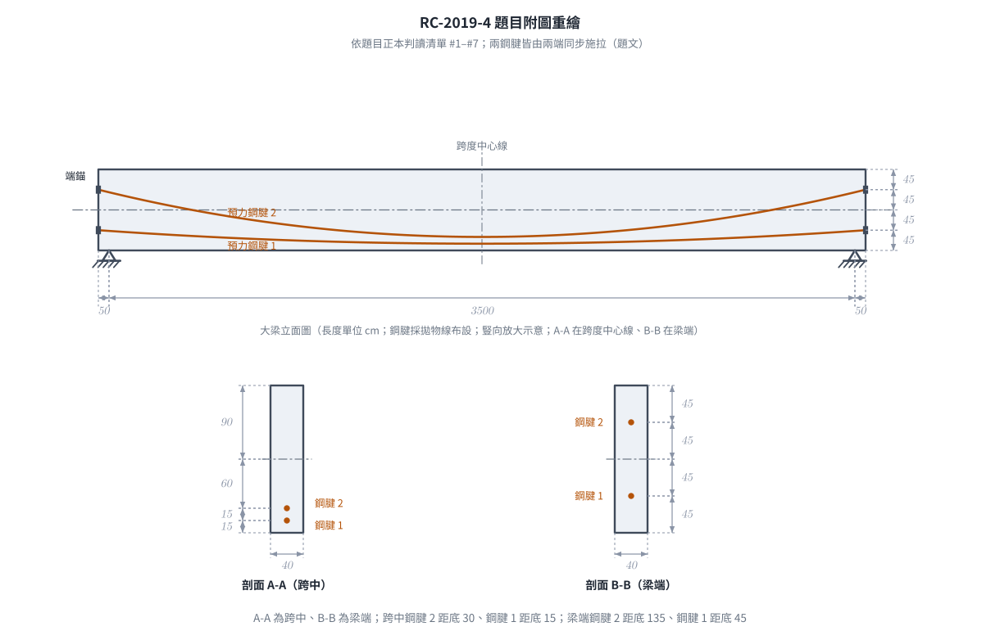
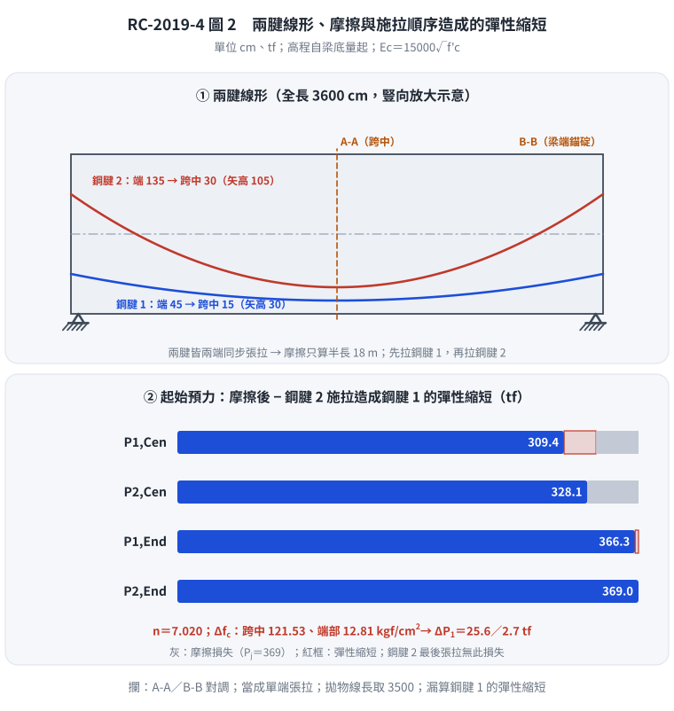

# 考題編號：RC-2019-4

**主分類：** `RC-U4-3` 預力損失
**副分類：** `RC-U4-1` 預力梁斷面應力分析
**設計法：** WSD 工作應力法
**標籤：** `後拉法` `摩擦損失` `拋物線腱` `雙腱施拉` `角度改變量` `矢高計算` `起始預力` `彈性縮短` `施拉順序`

---

## 1. 題目（考卷原文見題目正本）

> 考卷原文、公式／附表、附圖與判讀清單（已確認）見 [`RC-2019-4-problem.md`](RC-2019-4-problem.md)。本節只列解題時最容易讀錯的地方與本解使用的記號；題意以題目正本為準。

*重繪自考卷附圖，依題目正本判讀清單 #1–#7。本圖攔下的讀錯：A-A／B-B 對調；鋼腱 2 端部高度讀成 90；拋物線長取支承中心距 3500。*

### 常見誤讀

| 項目 | 正確判讀 | 常見誤讀 |
|------|---------|---------|
| 剖面位置 | A-A 在跨中（跨度中心線）、B-B 在梁端 | A-A 為端部、B-B 為跨中（本庫舊 §1） |
| 鋼腱 2 端部 | 距底 135（距頂 45），矢高 135－30＝105 cm | 距底 90、矢高 60（本庫舊解） |
| 鋼腱線形 | 兩腱皆向下垂、跨中最低 | 跨中向上凸起（本庫舊 §1 圖說） |
| 張拉端 | **兩腱皆由兩端同步施拉** | 鋼腱 1 一端施拉（本庫舊解） |
| 拋物線長 | 錨碇至錨碇 3600 cm | 支承中心距 3500 cm |
| 施拉順序 | 鋼腱 2 施拉使已錨碇的鋼腱 1 產生彈性縮短損失（提示給 $E_c$） | 忽略；或另加題目沒有的「其餘長期損失不計」條件 |

**本解記號：** $L_{anchor}$＝3600 cm（半長 1800）；$b$＝40、$h$＝180 cm；$A_{ps}^{(1)}=A_{ps}^{(2)}$＝30 cm²；$f_{pj}$＝12300 kgf/cm²；$K$＝0.0049/m、$\mu_p$＝0.25/rad；矢高 $\delta_1$＝30、$\delta_2$＝105 cm；$E_{ps}$＝1,970,000、$E_c=15000\sqrt{f'_c}$ kgf/cm²。偏心 $e$ 以形心為準、下為正。

---

## 2. 考題核心精神與出題者意圖 (Core Concepts & Examiner's Intent)

### 核心概念
本題測驗**後拉法多腱依序施拉的起始預力**：
1. **拋物線腱幾何 → 角度改變量**：由兩個剖面讀出端部與跨中高程，求矢高，再得 $\alpha=4\delta/L$
2. **兩端同步張拉的摩擦分布**：兩端都是張拉端，預力在端部最大（$=P_{pj}$）、跨中最小，對稱分布
3. **依序施拉的彈性縮短**：鋼腱 1 先錨碇；鋼腱 2 施拉時混凝土再被壓縮，已錨碇的鋼腱 1 跟著縮短而掉預力。最後施拉的鋼腱 2 沒有這項損失
4. **起始預力** = 張拉端預力扣除摩擦（題目不計錨碇滑動）及施拉當下的彈性縮短，不含長期損失

### 出題者意圖
- 讀圖：剖面 A-A 在跨度中心線、B-B 在梁端，兩腱高程與矢高（鋼腱 2 矢高 105 cm 最容易讀錯）
- 摩擦公式 $P_{px}=P_{pj}e^{-\omega}$、$\omega=Kl_{px}+\mu_p\alpha_{px}$ 的取值（$l$、$\alpha$ 都量到錨碇，不是支承）
- 提示給 $E_c=15000\sqrt{f'_c}$、題目給 $E_{ps}$ ——就是要算 $n=E_{ps}/E_c$ 與鋼腱 1 的彈性縮短

---

## 3. 解題戰略地圖與陷阱分析 (Strategic Roadmap & Trap Analysis)

### 解題步驟
1. **讀圖**：形心距底 90；跨中（A-A）鋼腱 1 距底 15、鋼腱 2 距底 30；梁端（B-B）鋼腱 1 距底 45、鋼腱 2 距底 135
2. **矢高與角變**：$\delta=$ 端部高程 − 跨中高程；$\alpha_{\text{端→中}}=4\delta/L$，$L$＝36 m
3. **摩擦**：兩腱都兩端張拉，端部 $=P_{pj}$；跨中 $P=P_{pj}e^{-(K\cdot18+\mu_p\alpha)}$
4. **彈性縮短（只有鋼腱 1）**：鋼腱 2 的預力在鋼腱 1 位置造成的混凝土壓應力 $\Delta f_c$，$\Delta P_1=n\,\Delta f_c\,A_{ps}$，跨中、端部分別算
5. 組合四個起始預力

### 關鍵陷阱分析

| # | 陷阱 | 錯誤做法 | 正確做法 |
|---|------|---------|---------|
| ① | **剖面對調** | A-A 當端部、B-B 當跨中 → 鋼腱 2 矢高 60 | A-A 剖切線與跨度中心線重合 → 跨中；矢高 $\delta_2$＝135−30＝105 cm |
| ② | **張拉端** | 鋼腱 1 當一端施拉，端部取全長摩擦 | 題文兩處皆「由其兩端同步施拉」→ 兩腱端部摩擦都是 0 |
| ③ | **拋物線長** | 用支承中心距 3500 | 錨碇在梁端，拋物線水平長 3600、半長 18 m |
| ④ | **漏彈性縮短** | 只算摩擦 | 鋼腱 1 已錨碇，鋼腱 2 施拉使它縮短：跨中掉 25.6 tf（約 7%） |
| ⑤ | **彈性縮短用錯應力** | 只用 $P_2/A$（漏彎曲項），或把自重彎矩算進去 | $\Delta f_c=\frac{P_2}{A}+\frac{P_2e_2e_1}{I}$；自重在鋼腱 1 施拉時已作用，不屬增量 |
| ⑥ | **端部彎曲項符號** | 端部 $e_2$ 也取正 | 梁端鋼腱 2 在形心**上方** 45（$e_2=-45$）、鋼腱 1 在下方 45 → 彎曲項為負 |

---

## 3.5 變數層次分析 (Variable Hierarchy Analysis)

> 複習提示：第一次解題後，在每個卡住的知識點旁標記 `⚠`；第二次複習時只看有 `⚠` 的項目。

### 最終目標
`兩腱在跨中與梁端的起始預力 P(1)i,Cen、P(2)i,Cen、P(1)i,End、P(2)i,End（含摩擦與依序施拉的彈性縮短）`

### 本題關鍵公式（依計算順序）

$$\text{Step 1（矢高）: } \delta = y_{端} - y_{跨中}$$

$$\text{Step 2（端到跨中角變）: } \alpha = \frac{4\boxed{\delta}}{L}$$

$$\text{Step 3（摩擦）: } P_{x} = P_{pj}\,e^{-(Kl+\mu_p\boxed{\alpha})}$$

$$\text{Step 4（鋼腱 1 位置混凝土應力增量）: } \Delta f_c=\frac{\boxed{P_2}}{A}+\frac{\boxed{P_2}e_2e_1}{I}$$

$$\text{Step 5（彈性縮短）: } \Delta P_1=\boxed{n}\,\boxed{\Delta f_c}\,A_{ps},\quad n=\frac{E_{ps}}{E_c}$$

### L1：題目直接給定

| 符號 | 數值 | 說明 |
|------|------|------|
| $L$ | 3600 cm | 錨碇至錨碇（支承中心距 3500、兩端各 50） |
| $b$ | 40 cm | 梁寬 |
| $h$ | 180 cm | 梁高 |
| $f'_c$ | 350 kgf/cm² | 混凝土抗壓強度 |
| $E_{ps}$ | 1,970,000 kgf/cm² | 鋼腱彈性模數 |
| $A_{ps}^{(1)} = A_{ps}^{(2)}$ | 30.0 cm² | 各腱截面積 |
| $f_{pj}$ | 12,300 kgf/cm² | 張拉端鋼腱應力 |
| $K$ | 0.0049/m | 擺動摩擦係數 |
| $\mu_p$ | 0.25/rad | 曲率摩擦係數 |
| 鋼腱 1 距底（跨中 A-A／梁端 B-B） | 15／45 cm | 剖面圖 |
| 鋼腱 2 距底（跨中 A-A／梁端 B-B） | 30／135 cm | 剖面圖（B-B 距頂 45） |

### L2：需知識點推導

| 符號 | 公式／來源 | 卡關? |
|------|-----------|:-----:|
| 偏心 | 鋼腱 1：跨中 $+75$、端部 $+45$；鋼腱 2：跨中 $+60$、端部 $-45$ cm | |
| $\delta_1$、$\delta_2$ | 45−15＝30 cm；135−30＝105 cm | |
| $\alpha_1$、$\alpha_2$ | $4(0.30)/36=0.03333$；$4(1.05)/36=0.11667$ rad | |
| $P_{pj}$ | $12300\times30=369{,}000$ kgf | |
| $E_c$、$n$ | $15000\sqrt{350}=280{,}624$；$n=7.020$ | |
| $A$、$I$ | 7,200 cm²；$40(180)^3/12=19{,}440{,}000$ cm⁴ | |

### L3：深層知識（不懂就卡住）

| 知識點 | 說明 | 卡關? |
|--------|------|:-----:|
| **拋物線角變** | $y=4\delta x(L-x)/L^2$，端部斜率 $4\delta/L$、跨中 0 → 端到跨中角變 $4\delta/L$ | |
| **兩端張拉** | 兩端皆為張拉端，端部預力 $=P_{pj}$，跨中最低；摩擦量到最近的張拉端（半長 18 m） | |
| **依序施拉的彈性縮短** | 後拉的鋼腱施拉時，先錨碇的鋼腱與混凝土一起縮短 $\Delta\varepsilon=\Delta f_c/E_c$，鋼腱應力掉 $E_{ps}\Delta\varepsilon=n\Delta f_c$；最後一根沒有損失 | |
| **未灌漿鋼腱的應變** | 鋼腱 1 尚未灌漿，嚴格說它的縮短是沿全長摩擦受束下的平均；本解依題目分斷面求預力的問法逐斷面計算，§5 附平均應變法對照 | |

---

## 4. 步驟化詳細計算過程 (Step-by-Step Detailed Calculation)

### 前置：形心、偏心與斷面性質

矩形斷面 40×180 cm，形心距底 90 cm；$A=7{,}200$ cm²，$I=19{,}440{,}000$ cm⁴。

| 鋼腱 | 跨中（A-A）距底 | 跨中偏心 | 梁端（B-B）距底 | 梁端偏心 |
|------|---------------|---------|---------------|---------|
| 1 | 15 | $+75$ | 45 | $+45$ |
| 2 | 30 | $+60$ | 135 | $-45$（形心上方） |

### Step 1：矢高

$$\boxed{\delta_1=45-15=30\ \text{cm}},\qquad \boxed{\delta_2=135-30=105\ \text{cm}}$$

兩腱都由端部向下垂到跨中最低（等值載重向上）。

### Step 2：端到跨中角變（$L$＝36 m）

$$\alpha_1=\frac{4\times0.30}{36}=0.03333\ \text{rad},\qquad \alpha_2=\frac{4\times1.05}{36}=0.11667\ \text{rad}$$

### Step 3：張拉力

$$P_{pj}=12{,}300\times30.0=369{,}000\ \text{kgf}=369\ \text{tf}$$

### Step 4：摩擦後預力（兩腱皆兩端同步張拉）

跨中距最近張拉端 $l$＝18 m：

$$\omega_1=0.0049(18)+0.25(0.03333)=0.0882+0.00833=0.09653,\quad e^{-\omega_1}=0.90798$$

$$P_{Cen}^{(1),fr}=369{,}000\times0.90798=335{,}040\ \text{kgf}=335.04\ \text{tf}$$

$$\omega_2=0.0049(18)+0.25(0.11667)=0.0882+0.02917=0.11737,\quad e^{-\omega_2}=0.88926$$

$$P_{Cen}^{(2)}=369{,}000\times0.88926=328{,}140\ \text{kgf}=328.14\ \text{tf}$$

梁端即張拉端，摩擦為 0：$P_{End}^{(1),fr}=P_{End}^{(2)}=369$ tf。

> 交叉驗算：沿實際拋物線弧長（18.003／18.041 m）與真實切線角 $\tan^{-1}$ 數值積分，跨中預力 335.04／328.11 tf，與小角度公式差 < 0.01%。

### Step 5：鋼腱 2 施拉 → 鋼腱 1 彈性縮短

$$E_c=15{,}000\sqrt{350}=280{,}624\ \text{kgf/cm}^2,\qquad n=\frac{1{,}970{,}000}{280{,}624}=7.020$$

**跨中**（$P_2=328{,}140$、$e_2=+60$、$e_1=+75$）：

$$\Delta f_c=\frac{328{,}140}{7{,}200}+\frac{328{,}140\times60\times75}{19{,}440{,}000}=45.58+75.96=121.53\ \text{kgf/cm}^2$$

$$\Delta f_{pES}=7.020\times121.53=853.2\ \text{kgf/cm}^2,\qquad \Delta P_1=853.2\times30=25{,}600\ \text{kgf}=25.60\ \text{tf}$$

**梁端**（$P_2=369{,}000$、$e_2=-45$、$e_1=+45$）：

$$\Delta f_c=\frac{369{,}000}{7{,}200}+\frac{369{,}000\times(-45)\times45}{19{,}440{,}000}=51.25-38.44=12.81\ \text{kgf/cm}^2$$

$$\Delta f_{pES}=7.020\times12.81=89.9\ \text{kgf/cm}^2,\qquad \Delta P_1=89.9\times30=2{,}700\ \text{kgf}=2.70\ \text{tf}$$

> 📌 自重彎矩在鋼腱 1 施拉時（梁已起拱、自重作用）就已存在，不屬於鋼腱 2 造成的增量，不計入。鋼腱 2 最後施拉，沒有彈性縮短損失。

### Step 6：起始預力

$$\boxed{P_{i,Cen}^{(1)}=335.04-25.60=309.4\ \text{tf}}\qquad\boxed{P_{i,Cen}^{(2)}=328.1\ \text{tf}}$$

$$\boxed{P_{i,End}^{(1)}=369.0-2.70=366.3\ \text{tf}}\qquad\boxed{P_{i,End}^{(2)}=369.0\ \text{tf}}$$

### 計算結果彙整

| 項目 | 鋼腱 1 | 鋼腱 2 |
|------|:------:|:------:|
| 矢高 $\delta$ | 30 cm | 105 cm |
| $\alpha$（端→跨中） | 0.03333 rad | 0.11667 rad |
| $\omega$（跨中） | 0.09653 | 0.11737 |
| 摩擦後跨中 | 335.04 tf | 328.14 tf |
| 彈性縮短 跨中／梁端 | 25.60／2.70 tf | 0（最後施拉） |
| **跨中起始預力** | **309.4 tf**（損失 16.1%） | **328.1 tf**（損失 11.1%） |
| **梁端起始預力** | **366.3 tf**（損失 0.7%） | **369.0 tf** |

*圖 2　兩腱線形、摩擦與施拉順序造成的彈性縮短。兩腱都由兩端同步張拉，摩擦只累積到跨中；鋼腱 1 先錨碇，鋼腱 2 施拉時混凝土再壓縮，鋼腱 1 在跨中損失遠大於梁端（鋼腱 2 在端部位於形心上方，壓應力增量小）。本圖攔：A-A／B-B 對調、當成單端張拉、拋物線長取支承中心距 3500、漏算彈性縮短。*

---

## 5. 關鍵爭議點與進階探討 (Critical Issues & Advanced Discussion)

### 5.1 彈性縮短：逐斷面 vs 沿全長平均應變（對照）

鋼腱 1 錨碇後尚未灌漿，若認為它能沿全長滑動調整，則它的縮短取決於鋼腱 1 位置混凝土應變**沿全長的平均**。以鋼腱 2 的摩擦分布、兩腱拋物線偏心沿全長積分：

$$\overline{\Delta f_c}=\frac{1}{L}\int_0^L\left(\frac{P_2(x)}{A}+\frac{P_2(x)e_2(x)e_1(x)}{I}\right)dx=81.22\ \text{kgf/cm}^2$$

$$\Delta P_1=7.020\times81.22\times30=17{,}110\ \text{kgf}=17.11\ \text{tf（全長均一）}$$

→ $P_{i,Cen}^{(1)}$＝335.04−17.11＝**317.9 tf**、$P_{i,End}^{(1)}$＝369−17.11＝**351.9 tf**（與主線差 2.7%～4%）。實際上鋼腱 1 與套管間有摩擦，無法完全滑動，真值介於兩者之間。題目要求分別求跨中與端錨處的預力，本解主線採逐斷面計算；兩種算法作答時都應寫明假設。

### 5.2 舊解（2026-11-15 勘誤前）與差異

| 項目 | 舊解 | 本解 |
|------|------|------|
| 剖面 | A-A 端部、B-B 跨中 | A-A 跨中、B-B 梁端 |
| 鋼腱 2 矢高 | 60 cm | 105 cm |
| 鋼腱 1 張拉 | 一端（端部取全長 35 m 摩擦） | 兩端同步 |
| 拋物線長 | 3500 cm | 3600 cm |
| 彈性縮短 | 未計（舊 §5 只以 $P_2/A$ 試算） | 逐斷面含彎曲項 |
| 答案（tf） | 336／333／306／369 | **309.4／328.1／366.3／369.0** |

### 5.3 拋物線角變公式驗證

$y(x)=4\delta\,x(L-x)/L^2$：$y'(0)=4\delta/L$、$y'(L/2)=0$、$y'(L)=-4\delta/L$ → 端到跨中 $4\delta/L$、端到端 $8\delta/L$。本題兩端同步張拉，摩擦只需量到跨中（半長、$4\delta/L$）。

### 5.4 為何兩端張拉、為何依序施拉要注意

- 兩端張拉讓鋼腱 2（矢高大）的跨中損失只有 11.1%；若改一端張拉，另一端 $\omega=0.0049(36)+0.25(0.2333)=0.2347$，只剩 79.1%。
- 依序施拉使先拉的鋼腱損失彈性縮短；實務上可對先拉的鋼腱補拉，或依序估算後提高先拉鋼腱的 $f_{pj}$（仍須在規範的鋼腱應力限值內）。

### 5.5 規範

摩擦公式為考卷提示式（與現行建築物混凝土結構設計規範 2023 解說一致），$E_c=15000\sqrt{f'_c}$ 為考卷提示（與現行規範常重混凝土的 kgf 制公式一致）；本題無容許應力檢核，規範版本不影響答案。

*修正日期：2026-11-15（§1 改為指向題目正本，插入重繪附圖 figs/RC-2019-4-fig-1-problem.svg；舊 §1 重述改寫為常見誤讀與本解記號；本行非答案勘誤）*

*修正日期：2026-11-15（解析勘誤 FIX-RC-U4-2-B1，改依現行台灣規範（建築物混凝土結構設計規範 2023）：依題目正本 #3–#9 改 A-A 跨中／B-B 梁端、鋼腱 2 矢高 60 → 105 cm、兩腱皆兩端同步施拉、拋物線長 3500 → 3600 cm，並補鋼腱 2 施拉對鋼腱 1 的彈性縮短（逐斷面）：$P^{(1)}_{i,Cen}$ 336 → **309.4 tf**、$P^{(2)}_{i,Cen}$ 333 → **328.1 tf**、$P^{(1)}_{i,End}$ 306 → **366.3 tf**、$P^{(2)}_{i,End}$ 369（不變）；§5 附平均應變法對照 317.9／351.9 tf；撤除 §1 待勘誤提示；驗證：`.work/u4b1c/check_errata_U4_2_B1.py` 閉合式與弧長數值積分兩路徑，MISMATCHES: 0）*

*圖解補繪：2026-11-15（DIAG-RC-U4-2-B1，向量圖 `figs/RC-2019-4-fig-2-tendons.svg`，腳本 `figs/gen_RC-2019-4.py`，數值取自本解 §4 並於腳本檔尾 assert，可重跑）*
