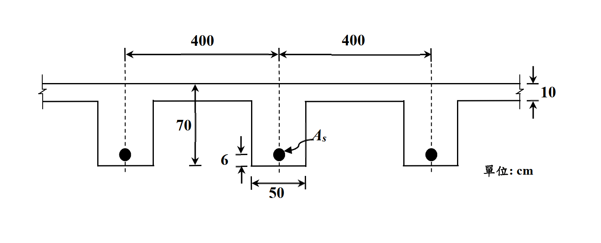

# RC-2020-1 題目正本

> 本檔只記錄**考卷上寫了什麼、圖上畫了什麼**，不含任何解法。解析見同資料夾 `RC-2020-1.md`。
> 判讀清單已經使用者確認（凍結）；本檔原則上不再修改（改動須回考卷原圖並記 log）。

| 項目 | 內容 |
|------|------|
| 考卷 | `raw/exams/RC-2020_鋼筋混凝土設計與預力.pdf` 第 1 頁（頁次 4－1），第一題 |
| 考年 | 民國 109 年（2020） |
| 配分 | 30 分 |
| 附圖 | `RC-2020-1-fig-1.png`（梁版系統斷面） |
| 判讀狀態 | **已確認**（2026-11-13 使用者確認；#1 使用者確認 h = 70、d = 64（推翻解析 h = 80、d = 74）；轉錄 2026-11-13，PyMuPDF 110 dpi 全頁目視＋抽出文字核對，附圖 400 dpi＋PDF 向量座標；盲讀後才比對既有解析） |

## 1. 考卷原文（逐字）

> 一、一梁版系統斷面如下所示，每一梁腹與部分相連的版可視為一 T 型梁抵抗外載，每一 T 型梁所受之設計（因數化）正彎矩 Mu = 130 tf-m（含自重之效應），求每一 T 型梁所需之最少拉力筋面積 As。混凝土抗壓強度 f'c = 210 kgf/cm²，鋼筋降伏強度 fy = 4200 kgf/cm²，梁跨度為 500 cm。根據規範，T 型梁翼版之有效版寬不得超過該梁跨度之 1/4；梁腹每側懸出之有效翼版寬度不得超過翼版厚之 8 倍或該梁與鄰梁間淨距之 1/2。（30 分）

## 2. 考卷給的公式、附表與參數

- 作答規範：依據內政部於民國 108 年 2 月 25 日公布之「混凝土結構設計規範」或中國土木水利工程學會「混凝土工程設計規範與解說（土木 401-100）」作答，未依上述規範作答，不予計分。
- 題文數值：$M_u=130$ tf-m（含自重）；$f'_c=210$、$f_y=4200$ kgf/cm²；梁跨度 500 cm。
- 題文給的有效翼寬規定：全寬 $\le L/4$；每側懸出 $\le 8h_f$ 或 $\le$ 與鄰梁淨距之 1/2。
- **沒有給**：$\phi$、$E_s$、$\varepsilon_{cu}$、$\beta_1$、鋼筋號數。
- 卷首注意事項：㈠可以使用電子計算器；㈡不必抄題；㈢除專門名詞或數理公式外，應使用本國文字作答。

## 3. 附圖

圖面文字照錄：`400`、`400`、`10`、`70`、`6`、`As`、`50`、`單位: cm`。

## 4. 判讀清單

「把握」標**不確定**者請優先確認；解讀類項目（題目用字的意思）另標「解讀」。

| # | 項目 | 判讀 | 圖上／題文依據 | 把握 |
|---|------|------|---------------|------|
| 1 | 70 段 | 由**版頂面**量到**梁腹底面**＝全深 $h=70$ cm（不是翼板底到梁底） | 400 dpi 目視：70 尺寸線上箭頭頂在版頂線、下端短橫線對齊梁腹底。PDF 向量：尺寸線 y = 519.0→581.2，版頂線 y = 518.0–519.0，梁腹底 y = 581.2–582.2，翼板底面 y = 531.4 | 確定（使用者選擇：70 為版頂到梁腹底，h = 70、d = 64） |
| 2 | 版厚 | $h_f=10$ cm | 右端 10 尺寸線夾版頂、版底兩線 | 確定 |
| 3 | 6 段 | 拉力筋中心到梁腹底面 → $d=70-6=64$ cm | 6 尺寸線上端橫線 y = 572.5–573.6 對齊鋼筋中心（y = 573.2）、下端對齊梁腹底 | 確定 |
| 4 | 梁腹寬 | $b_w=50$ cm（三根梁腹畫法相同） | 50 尺寸線兩端對齊中間梁腹左右側 | 確定 |
| 5 | 400 段 | **梁中心到梁中心**的間距 400 cm；與鄰梁的**淨距**＝$400-50=350$ cm | 400 尺寸線端點落在梁腹中心虛線上，不是梁腹側面 | 確定 |
| 6 | 跨度 | 500 cm（供 $L/4$ 用） | 題文 | 確定 |
| 7 | 有效翼寬規則 | 題目明列三條：$\le L/4$、每側 $\le 8h_f$、每側 $\le$ 淨距/2 | 題文 | 確定 |
| 8 | 所求 | 「最少拉力筋面積」＝滿足 $\phi M_n\ge M_u$ 的所需 $A_s$（並不小於最小鋼筋量） | 題文 | 確定（解讀） |
| 9 | 圖未依比例 | 圖上 70 只有約 62 pt、版厚 10 約 13 pt、400 約 117 pt，比例不一致，只能依尺寸線端點判讀 | PDF 向量量測 | 確定 |
| 10 | 考卷沒有給 | $\phi$、$E_s$、$\varepsilon_{cu}$、$\beta_1$、鋼筋號數 | 全題 | 確定 |

---

*轉錄：2026-11-13（RC-U1-1 題目正本推廣・批 2）*

*確認：2026-11-13 使用者確認（RC-U1-1 題目正本推廣・批 2，關卡一）*
