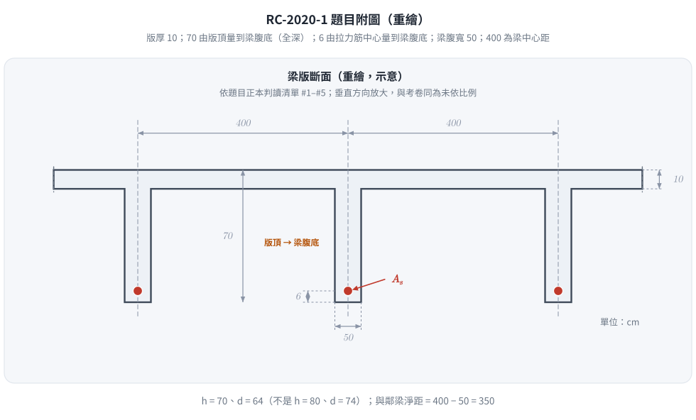
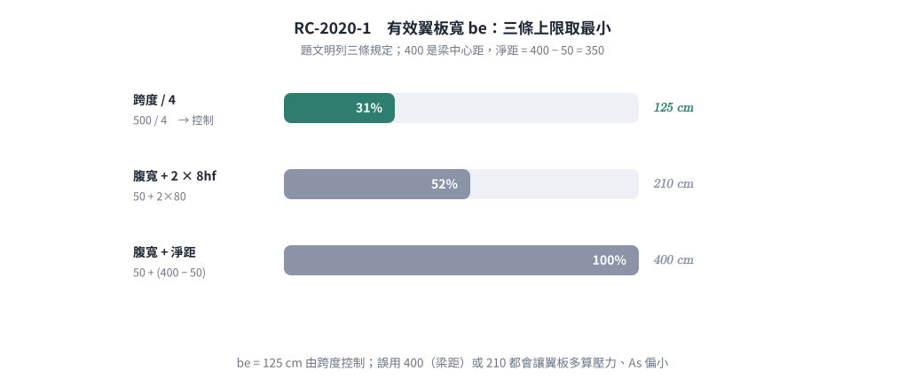
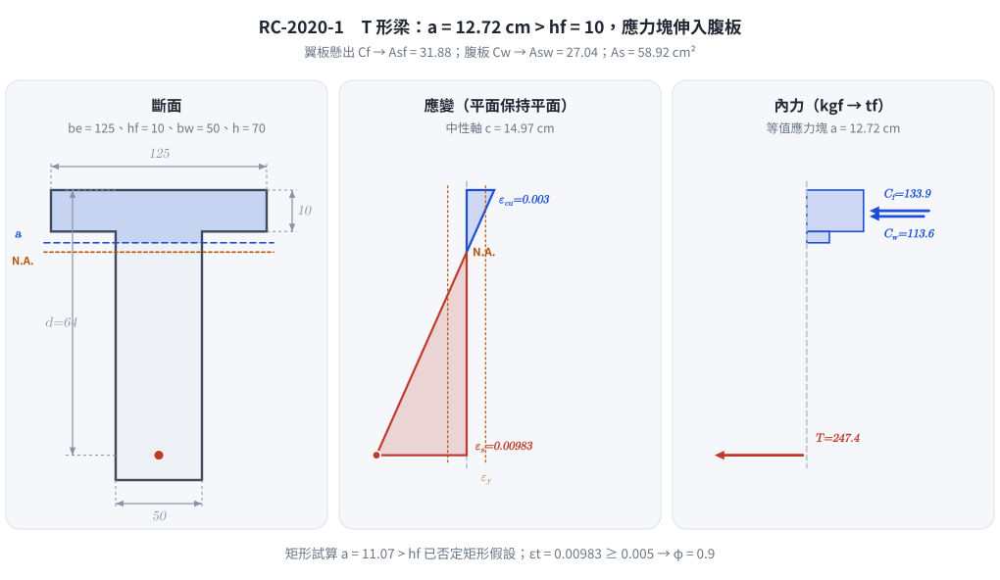

# 考題編號：RC-2020-1

**主分類：** `RC-U1-1` RC 梁彎矩強度分析與設計
**副分類：** 無
**設計法：** USD 強度設計法
**標籤：** `T形梁` `有效翼板寬` `中性軸在翼板` `最少鋼筋量` `Whitney應力塊` `正彎矩設計` `中性軸在腹板` `翼板懸出分解` `尺寸鏈判讀` `d=64`

---

## 1. 題目（考卷原文見題目正本）

> 考卷原文、公式／附表、附圖與判讀清單（已確認）見 [`RC-2020-1-problem.md`](RC-2020-1-problem.md)。本節只列解題時最容易讀錯的地方與本解使用的記號；題意以題目正本為準。

*重繪自考卷附圖（考卷未依比例），依題目正本判讀清單。70 cm 的上端畫在版頂面——這張圖攔下「70 是腹板高、全深 80」：全深 $h = 70$ cm、$d = 64$ cm；400 量到梁腹中心線，是中心距不是淨距。*

### 常見誤讀

| 項目 | 正確判讀 | 常見誤讀 |
|---|---|---|
| 70 cm 尺寸 | 版頂面到梁腹底面＝全深 $h = 70$ cm（判讀 #1） | 翼板底到梁底，$h = 10 + 70 = 80$（本解 2026-11-13 前即採 $h = 80$、$d = 74$） |
| 有效深度 | $d = 70 - 6 = 64$ cm（6 cm 量到鋼筋中心，判讀 #3） | $d = 74$；或把 6 當淨保護層再扣鋼筋半徑 |
| 400 cm 尺寸 | 梁中心到梁中心；與鄰梁淨距 $= 400 - 50 = 350$ cm（判讀 #5） | 當成梁間淨距 400 |
| 中性軸位置 | $d = 64$ 時矩形假設得 $a = 11.07 > h_f = 10$，必須按 T 形梁分解 | 照「內梁中性軸多在翼板」直接用矩形公式 |

**本解記號：** $b_e$ = 有效翼板寬；$h_f = 10$、$b_w = 50$、$d = 64$ cm；$s_{clear}$ = 與鄰梁淨距 350 cm；$A_{sf}$、$A_{sw}$ = 平衡翼板懸出部分與腹板部分壓力的拉力筋。

---

## 2. 考題核心精神與出題者意圖（Core Concepts & Examiner's Intent）

**核心觀念：** T 形梁有效翼板寬三個控制條件的判斷 → 中性軸位置假設與驗證 → 中性軸落入腹板時以「翼板懸出＋腹板」分解求 $A_s$。

**出題者意圖：**
1. 測驗考生能否正確套用三個有效翼板寬規定，取最小值（並分清中心距與淨距）
2. 判斷中性軸是否在翼板內——本題 $a$ 略大於 $h_f$，不能憑經驗直接當矩形梁
3. 中性軸在腹板時的 T 形梁分解（$A_{sf}$ + $A_{sw}$），再確認拉力控制與最小鋼筋量

**陷阱：** 題目明示三個規定條件，考生需**全部計算**後取最小值；$M_u = 130 \text{ tf-m}$ 需正確換算為 kgf-cm（$\times 10^5$，不是 $\times 10^4$）；附圖的 70 cm 是全深。

---

## 3. 解題戰略地圖與陷阱分析（Strategic Roadmap & Trap Analysis）

**作戰計畫：**
1. 由附圖尺寸鏈定 $h = 70$、$d = 64$ cm
2. 計算有效翼板寬 $b_e$（三條件取最小）
3. 先假設中性軸在翼板內 → 以寬 $b_e$ 矩形梁試算 $a$
4. $a > h_f$ → 改用 T 形梁分解：翼板懸出壓力 $C_f$ → $A_{sf}$；剩餘彎矩由腹板承擔 → 解二次方程求 $A_{sw}$
5. 確認 $\varepsilon_t \geq 0.005$（拉力控制，$\phi = 0.9$）
6. 檢核最小鋼筋量 $A_{s,\min}$

**五大陷阱：**

| 陷阱 | 說明 | 對策 |
|------|------|------|
| 全深讀錯 | 70 cm 從版頂量起，不是從翼板底 | 先看尺寸線端點，再定 $h$、$d$ |
| 單位換算 | $M_u = 130 \text{ tf-m}$，1 tf = 1000 kgf，1 m = 100 cm | $M_u = 130 \times 10^5 = 1.3 \times 10^7 \text{ kgf-cm}$ |
| 有效翼板寬取最小 | 三個條件需**全部算**；第三條用淨距 350，不是中心距 400 | 逐一計算後比較 |
| 矩形假設不驗算 | 試算 $a = 11.07 > h_f = 10$，矩形解 58.83 cm² 不成立 | 改用 T 形分解（58.92 cm²） |
| 最小鋼筋量用 $b_w$ | $A_{s,\min}$ 公式中用腹板寬 $b_w$，**不用** $b_e$ | $A_{s,\min} = \frac{14}{f_y} b_w d$ |

---

## 3.5 變數層次分析（Variable Hierarchy Analysis）

> 複習提示：第一次解題後，在每個卡住的知識點旁標記 `⚠`；第二次複習時只看有 `⚠` 的項目。

### 最終目標

`求滿足 φMn ≥ Mu 的最少拉力筋面積 As（同時不得低於 As,min）`

### 本題關鍵公式（依計算順序）

> $\boxed{\cdot}$ = 需由前步驟推導，非題目直接給定的變數

$$\text{Step 1: } b_e = \min\!\left(\frac{L}{4},\ b_w + 2 \times 8h_f,\ b_w + s_{clear}\right)$$

$$\text{Step 2（試算）: } \phi A_s f_y\!\left(d - \frac{a}{2}\right) = M_u,\quad a = \frac{A_s f_y}{0.85 f'_c \boxed{b_e}} \;\Rightarrow\; a \overset{?}{\leq} h_f$$

$$\text{Step 3（翼板懸出）: } C_f = 0.85 f'_c (\boxed{b_e} - b_w) h_f,\quad A_{sf} = \frac{C_f}{f_y},\quad M_{nf} = C_f\!\left(d - \frac{h_f}{2}\right)$$

$$\text{Step 4（腹板）: } A_{sw} f_y\!\left(d - \frac{a}{2}\right) = \frac{M_u}{\phi} - \boxed{M_{nf}},\quad a = \frac{A_{sw} f_y}{0.85 f'_c b_w} \;\Rightarrow\; A_s = \boxed{A_{sf}} + \boxed{A_{sw}}$$

$$\text{Step 5（延性驗算）: } \varepsilon_t = 0.003 \times \frac{d - \boxed{c}}{\boxed{c}} \geq 0.005 \quad \Rightarrow \phi = 0.9$$

$$\text{Step 6: } A_{s,\min} = \max\!\left(\frac{0.8\sqrt{f'_c}}{f_y},\ \frac{14}{f_y}\right) b_w d$$

### L1：題目直接給定

| 符號 | 數值 | 說明 |
|------|------|------|
| $f'_c$ | 210 kgf/cm² | 混凝土抗壓強度 |
| $f_y$ | 4200 kgf/cm² | 鋼筋降伏強度 |
| $M_u$ | 130 tf-m | 設計正彎矩（含自重） |
| $L$ | 500 cm | 梁跨度 |
| $h_f$ | 10 cm | 翼板（版）厚 |
| $b_w$ | 50 cm | 梁腹寬 |
| $h$ | 70 cm | 全深（版頂到梁腹底，判讀 #1） |
| $d$ | 64 cm | 有效深度（$h - 6$，判讀 #3） |
| 梁中心距 | 400 cm | 淨距 $s_{clear} = 400 - 50 = 350$ cm（判讀 #5） |

### L2：需知識點推導

**Step 1：有效翼板寬**

| 符號 | 公式/來源 | 卡關? |
|------|----------|:-----:|
| $b_e$ 條件1 | $L/4 = 500/4 = 125 \text{ cm}$（總寬限制） | |
| $b_e$ 條件2 | $b_w + 2 \times 8h_f = 50 + 160 = 210 \text{ cm}$ | |
| $b_e$ 條件3 | $b_w + s_{clear} = 50 + 350 = 400 \text{ cm}$ | |
| $b_e$ | $\min(125, 210, 400) = 125 \text{ cm}$ | |

**Step 2：矩形試算**

| 符號 | 公式/來源 | 卡關? |
|------|----------|:-----:|
| $\beta_1$ | $f'_c = 210 \leq 280 \Rightarrow \beta_1 = 0.85$ | |
| $A_s$（矩形） | $3780A_s(64 - 0.09413A_s) = 13{,}000{,}000$ → 58.83 cm² | |
| $a$（矩形） | $0.18826 \times 58.83 = 11.07 \text{ cm} > h_f = 10$ ✗ → T 形梁 | |

**Step 3–4：T 形分解**

| 符號 | 公式/來源 | 卡關? |
|------|----------|:-----:|
| $C_f$ | $0.85 \times 210 \times (125-50) \times 10 = 133{,}875$ kgf | |
| $A_{sf}$ | $133{,}875/4200 = 31.88$ cm² | |
| $M_{nf}$ | $133{,}875 \times (64 - 5) = 7{,}898{,}625$ kgf-cm | |
| $M_{nw}$ | $13{,}000{,}000/0.9 - 7{,}898{,}625 = 6{,}545{,}819$ kgf-cm | |
| $A_{sw}$ | $988.24A_{sw}^2 - 268{,}800A_{sw} + 6{,}545{,}819 = 0$ → 27.04 cm² | |
| $A_s$ | $31.88 + 27.04 = 58.92$ cm² | |

**Step 5：驗算**

| 符號 | 公式/來源 | 卡關? |
|------|----------|:-----:|
| $a$ | $0.4706 \times 27.04 = 12.72 \text{ cm} > h_f$ ✓（與 T 形假設一致） | |
| $c$ | $a/\beta_1 = 12.72/0.85 = 14.97 \text{ cm}$ | |
| $\varepsilon_t$ | $0.003 \times (64-14.97)/14.97 = 0.00983 \geq 0.005$ ✓ → $\phi=0.9$ | |

**Step 6：最小鋼筋量**

| 符號 | 公式/來源 | 卡關? |
|------|----------|:-----:|
| $A_{s,\min}$ | $(14/4200) \times 50 \times 64 = 10.67 \text{ cm}^2$ | |

### L3：深層知識（不懂就卡住）

| 知識點 | 說明 | 卡關? |
|--------|------|:-----:|
| 三個有效翼板寬條件的物理意義 | 條件1限制翼板參與受力的長度；條件2限制剪力滯效應；條件3避免相鄰梁翼板重疊（用淨距） | |
| 中性軸假設的驗算邏輯 | 矩形試算 $a > h_f$ 時，寬 $b_e$ 的矩形壓力塊不存在，必須改用 T 梁分解（$A_{sf} + A_{sw}$） | |
| 翼板懸出的力臂 | 懸出部分壓力作用在翼板中心，力臂 $d - h_f/2$，不是 $d - a/2$ | |
| 最小鋼筋量用 $b_w$ 而非 $b_e$ | T 梁腹板是受拉側主體；若用 $b_e$ 會高估最小鋼筋量 | |
| 二次方程取小根 | 較小根對應延性破壞（拉力控制）；較大根表示壓力控制，不符延性設計 | |

---

## 4. 步驟化詳細計算過程（Step-by-Step Detailed Calculation）

### Step 0：斷面尺寸（由附圖尺寸鏈）

$$h = 70 \text{ cm（版頂到梁腹底）},\quad d = 70 - 6 = 64 \text{ cm},\quad h_f = 10 \text{ cm},\quad b_w = 50 \text{ cm}$$

### Step 1：有效翼板寬 $b_e$

條件一：總有效翼板寬 $\leq L/4$

$$b_e \leq \frac{L}{4} = \frac{500}{4} = 125 \text{ cm}$$

條件二：每側懸出 $\leq 8h_f$

$$b_e \leq b_w + 2 \times 8h_f = 50 + 2 \times 8 \times 10 = 50 + 160 = 210 \text{ cm}$$

條件三：每側懸出 $\leq$ 與鄰梁淨距$/2$（淨距 $= 400 - 50 = 350$ cm）

$$b_e \leq b_w + 2 \times \frac{350}{2} = 50 + 350 = 400 \text{ cm}$$

$$\boxed{b_e = \min(125,\ 210,\ 400) = 125 \text{ cm}}$$

*圖 1　有效翼板寬的三條上限。400 是梁中心距、不是淨距；只要拿錯其中一條，翼板就多算壓力、$A_s$ 偏小——這張圖攔下「看到 400 就直接當翼寬」。*

### Step 2：材料參數

$$\beta_1 = 0.85 \quad (f'_c = 210 \text{ kgf/cm}^2 \leq 280)$$

單位換算：

$$M_u = 130 \text{ tf-m} = 130 \times 1000 \times 100 = 13{,}000{,}000 \text{ kgf-cm}$$

### Step 3：先假設中性軸在翼板內（矩形試算）

以 $b_e = 125 \text{ cm}$ 矩形梁、$\phi = 0.9$ 試算：

$$a = \frac{A_s f_y}{0.85 f'_c b_e} = \frac{4200 A_s}{0.85 \times 210 \times 125} = 0.18826 A_s$$

$$0.9 \times 4200 \times A_s \left(64 - 0.09413 A_s\right) = 13{,}000{,}000$$

$$355.8 A_s^2 - 241{,}920 A_s + 13{,}000{,}000 = 0 \;\Rightarrow\; A_s = 58.83 \text{ cm}^2$$

$$a = 0.18826 \times 58.83 = 11.07 \text{ cm} > h_f = 10 \text{ cm} \quad \times$$

中性軸落入腹板，矩形假設**不成立**，改用 T 形梁分解。

### Step 4：T 形梁分解

**翼板懸出部分：**

$$C_f = 0.85 f'_c (b_e - b_w) h_f = 0.85 \times 210 \times (125 - 50) \times 10 = 133{,}875 \text{ kgf}$$

$$A_{sf} = \frac{C_f}{f_y} = \frac{133{,}875}{4200} = 31.88 \text{ cm}^2$$

$$M_{nf} = C_f\left(d - \frac{h_f}{2}\right) = 133{,}875 \times (64 - 5) = 7{,}898{,}625 \text{ kgf-cm}$$

**腹板部分：**

$$M_{nw} = \frac{M_u}{\phi} - M_{nf} = \frac{13{,}000{,}000}{0.9} - 7{,}898{,}625 = 14{,}444{,}444 - 7{,}898{,}625 = 6{,}545{,}819 \text{ kgf-cm}$$

$$a = \frac{A_{sw} f_y}{0.85 f'_c b_w} = \frac{4200 A_{sw}}{0.85 \times 210 \times 50} = 0.4706 A_{sw}$$

$$4200 A_{sw}\left(64 - 0.2353 A_{sw}\right) = 6{,}545{,}819$$

$$988.24 A_{sw}^2 - 268{,}800 A_{sw} + 6{,}545{,}819 = 0$$

$$A_{sw} = \frac{268{,}800 - \sqrt{268{,}800^2 - 4 \times 988.24 \times 6{,}545{,}819}}{2 \times 988.24} = \frac{268{,}800 - 215{,}356}{1976.5} = 27.04 \text{ cm}^2$$

$$\boxed{A_s = A_{sf} + A_{sw} = 31.88 + 27.04 = 58.92 \text{ cm}^2}$$

### Step 5：驗算中性軸與 $\phi$ 值

$$a = 0.4706 \times 27.04 = 12.72 \text{ cm} > h_f = 10 \text{ cm} \quad \checkmark \text{（T 形假設成立）}$$

$$c = \frac{a}{\beta_1} = \frac{12.72}{0.85} = 14.97 \text{ cm}$$

$$\varepsilon_t = 0.003 \times \frac{d - c}{c} = 0.003 \times \frac{64 - 14.97}{14.97} = 0.00983 > 0.005 \quad \checkmark$$

$\phi = 0.9$（拉力控制），假設正確。

**反算驗證：** $T = 58.92 \times 4200 = 247{,}464$ kgf；腹板壓力 $C_w = 247{,}464 - 133{,}875 = 113{,}589$ kgf，$a = 113{,}589/8925 = 12.73$ cm；
$\phi M_n = 0.9\,[133{,}875 \times 59 + 113{,}589 \times (64 - 6.36)] = 0.9 \times 14{,}446{,}000 \approx 13.0 \times 10^6$ kgf-cm $= M_u$ ✓

*圖 2　T 形梁分解。應力塊深 $a = 12.72$ cm 超過 $h_f = 10$ cm，壓力分成翼板懸出 $C_f$ 與腹板 $C_w$ 兩塊——這張圖攔下「內梁中性軸多在翼板」直接套矩形公式。*

### Step 6：最小鋼筋量檢核

$$A_{s,\min} = \max\!\left(\frac{0.8\sqrt{210}}{4200},\ \frac{14}{4200}\right) \times 50 \times 64 = \frac{14}{4200} \times 3200 = 10.67 \text{ cm}^2$$

$$A_s = 58.92 \text{ cm}^2 \gg A_{s,\min} = 10.67 \text{ cm}^2 \quad \checkmark \text{（強度需求控制）}$$

### 最終結果

$$\boxed{A_s = 58.9 \text{ cm}^2 \quad (A_{sf} = 31.88 + A_{sw} = 27.04)}$$

---

## 5. 關鍵爭議點與進階探討（Critical Issues & Advanced Discussion）

**1. 有效深度 d 的取法**
附圖的 70 cm 尺寸線上端在版頂、下端在梁腹底，是全深；6 cm 尺寸線上端對齊鋼筋中心，所以 $d = 70 - 6 = 64$ cm，不必再扣鋼筋半徑。若把 70 當腹板高（$h = 80$、$d = 74$），會得 $a = 9.34 < h_f$、$A_s = 49.6$ cm²——不但少配約 16%，還錯過了本題「中性軸落入腹板」的考點。

**2. 中性軸剛好越過翼板底**
矩形試算 $a = 11.07$ cm 只比 $h_f = 10$ cm 多 1.07 cm，T 形分解後 $A_s = 58.92$，與矩形錯解 58.83 只差 0.15%。數值差很小，但矩形解的前提（寬 125 cm 的壓力塊）並不存在，考場上要寫出驗算與分解，才是完整答案。

**3. 中心距與淨距**
400 cm 量到梁腹中心線，條件三應用淨距 350 cm（$b_e \leq 400$）；誤用 400 得 $b_e \leq 450$。本題由 $L/4 = 125$ 控制，兩者結果相同，但跨度較長時第三條件可能控制。

**4. 最小鋼筋量用 $b_w$ 不用 $b_e$**
T 梁最小鋼筋量規定使用 $b_w$（腹板寬），因腹板是受拉部分的主要承力寬度。本題 $A_{s,\min} = 10.67$ cm² 遠小於計算值 58.92 cm²，無影響。

**5. 延性驗算**
土木 401-100 以淨拉應變判定：$\varepsilon_t = 0.00983 \geq 0.005$ 為拉力控制，$\phi = 0.9$；梁的下限 $\varepsilon_t \geq 0.004$ 亦滿足。T 形斷面不宜直接套矩形斷面的 $0.75\rho_b$ 公式（$\rho_b$ 須含翼板懸出項），以 $\varepsilon_t$ 判定較直接。

---

*修正日期：2026-11-13（§1 改為指向題目正本＋常見誤讀＋本解記號，嵌入重繪附圖 figs/RC-2020-1-fig-1-problem.svg；舊 §1 證據圖 fig-1 已收入題目正本）*
*修正日期：2026-11-13（題意（判讀）勘誤：附圖 70 cm 為版頂到梁腹底，h = 70、d = 64（原解 h = 80、d = 74）；400 為梁中心距，淨距 350。矩形試算 a = 11.07 > hf，中性軸落入腹板，改按 T 形分解：As 49.6 → 58.92 cm²（Asf 31.88 + Asw 27.04），εt 0.0172 → 0.00983，As,min 12.33 → 10.67 cm²。§1–§5 全部改寫。驗證：程式重算 17 值 MISMATCHES: 0；由 As 正向反算 φMn = Mu、中性軸二分搜尋兩條路徑一致）*

*圖解補繪：2026-11-13（向量圖 2 張，腳本 `gen_RC-2020-1.py`，可重跑；腳本檔尾對 §4 公佈值做 assert）*
