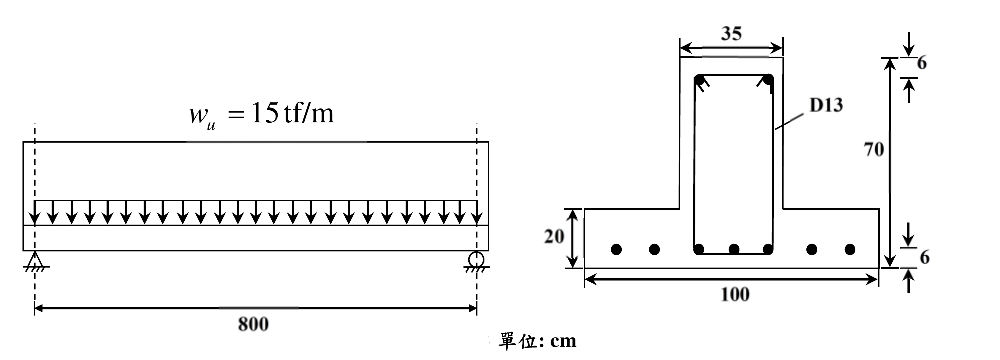

# RC-2020-2 題目正本

> 本檔只記錄**考卷上寫了什麼、圖上畫了什麼**，不含任何解法。解析見同資料夾 `RC-2020-2.md`。
> 判讀清單已經使用者確認（凍結）；本檔原則上不再修改（改動須回考卷原圖並記 log）。

| 項目 | 內容 |
|------|------|
| 考卷 | `raw/exams/RC-2020_鋼筋混凝土設計與預力.pdf` 第 2 頁（頁次 4－2），第二題 |
| 考年 | 民國 109 年（2020） |
| 配分 | 25 分（㈠5 分、㈡15 分、㈢5 分） |
| 附圖 | `RC-2020-2-fig-2.png`（立面與斷面；2026-11-15 由考卷重新擷取 500 dpi）；既有 `RC-2020-2-fig-1.png` 為同一圖，解析度較低（尺寸 6 看不清），保留不刪 |
| 判讀狀態 | **已確認**（2026-11-15 使用者確認；影響答案項目使用者選擇：#3 h＝70（全高）、d＝64；#1 載重作用於翼版頂面；轉錄 2026-11-15；PyMuPDF 110 dpi 全頁目視，附圖 400 dpi 局部放大；盲讀後才比對既有解析） |

## 1. 考卷原文（逐字）

> 二、一簡支獨立倒 T 型梁如下所示，受均佈設計（因數化）載重 $w_u = 15\ \text{tf/m}$（含自重）。混凝土抗壓強度 $f'_c = 280\ \text{kgf/cm}^2$，鋼筋降伏強度 $f_y = 4200\ \text{kgf/cm}^2$。一支 D13 鋼筋斷面積為 1.267 cm²。混凝土抗剪強度 $V_c = 0.53\sqrt{f'_c}\,b_w d$。
> ㈠請判斷支承處斷面可否按距離支承面 $d$ 處斷面之 $V_u$ 設計之，請說明原因。（5 分）
> ㈡計算支承位置剪力鋼筋之最大間距。（15 分）
> ㈢計算此梁斷面所能抵抗之最大設計剪力 $V_u$。（5 分）

## 2. 考卷給的公式、附表與參數

- 卷首作答規範：依據內政部於民國 108 年 2 月 25 日公布之「混凝土結構設計規範」或中國土木水利工程學會「混凝土工程設計規範與解說（土木 401-100）」作答，未依上述規範作答，不予計分。
- 題文公式：$V_c = 0.53\sqrt{f'_c}\,b_w d$。
- 題文數值：$w_u$＝15 tf/m（含自重）；$f'_c$＝280、$f_y$＝4200 kgf/cm²；D13 面積 1.267 cm²。
- **沒有給**：主筋號數、支承寬度、強度折減因數、混凝土種類（常重／輕質）。
- 卷首注意事項：可以使用電子計算器；不必抄題，作答時請將試題題號及答案依照順序寫在試卷上，於本試題上作答者，不予計分。

## 3. 附圖

圖面文字照錄：`wu = 15 tf/m`、`800`、`35`、`D13`、`6`、`70`、`20`、`6`、`100`、`單位: cm`。

## 4. 判讀清單

「把握」標**不確定**者請優先確認；解讀類項目（題目用字的意思）另標「解讀」。

| # | 項目 | 判讀 | 圖上／題文依據 | 把握 |
|---|------|------|---------------|------|
| 1 | 載重作用位置 | 均佈載重作用在**下翼版頂面**（倒 T 的托架面），不是梁頂；即載重由梁腹下部引入 | 400 dpi 立面：載重箭頭尖端停在梁身內一條水平線（距底面約 19–20 cm，與翼版厚 20 對應；梁身 70 cm＝292 px，線距底 70 px），箭頭上端的連線也在梁身內 | 確定（解讀）（影響答案）；使用者確認 |
| 2 | 70 的量測基準 | 70 為梁**全高**（頂面到底面） | 70 尺寸線上端對齊頂面延伸線（y≈155）、下端對齊底面延伸線（y≈720） | 確定 |
| 3 | 有效深度 | 下方 6＝底面到下排筋心 → $d$＝70－6＝**64 cm**；上方 6＝頂面到上排筋心 | 下 6 的兩箭頭夾在筋心（y≈672）與底面（y≈720）；上 6 夾在頂面（y≈155）與上排筋心（y≈213） | 確定（解讀）（影響答案）；使用者確認 |
| 4 | 斷面 | 倒 T：下翼版寬 100、厚 20；梁腹寬 $b_w$＝35；全高 70 | 斷面尺寸 100、20、35、70 | 確定 |
| 5 | 鋼筋 | 底部 7 根（翼版兩側各 2、梁腹內 3）；梁腹頂部 2 根；號數未標 | 斷面圖 | 確定 |
| 6 | 箍筋 | D13 閉合箍筋，只在梁腹內，2 肢；上方兩角 135° 彎鉤 | 斷面圖 `D13` 指示線、箍筋輪廓 | 確定 |
| 7 | 支承與跨度 | 左鉸右滾的簡支梁，跨度 800 cm 為支承中心距；梁端略伸出支承中心線；支承寬度未給 | 立面虛線、支承符號、800 尺寸線兩端對齊虛線 | 確定 |
| 8 | 載重 | $w_u$＝15 tf/m 為設計（因數化）載重，已含自重，全跨均佈 | 題文 | 確定 |
| 9 | 所求 | ㈠支承處可否以距支承面 $d$ 處的 $V_u$ 設計並說明原因；㈡支承位置剪力鋼筋最大間距；㈢斷面所能抵抗的最大設計剪力 $V_u$ | 題文 | 確定 |
| 10 | 考卷沒有給 | 主筋號數、支承寬度、$\phi$、混凝土種類 | 全題 | 確定 |

---

*轉錄：2026-11-15（RC-U2-1／U2-2 題目正本推廣・批 1）*

*確認：2026-11-15 使用者確認（RC-U2-1／U2-2 題目正本推廣・批 1，關卡一）*
