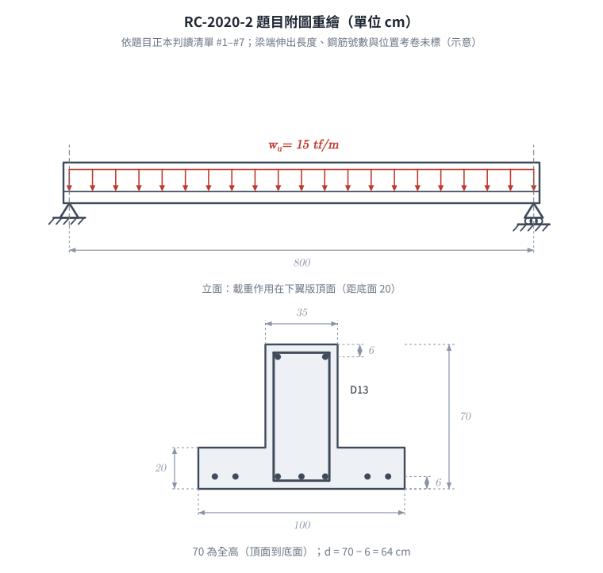
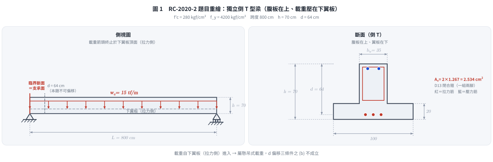
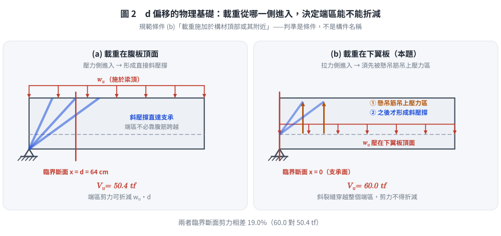
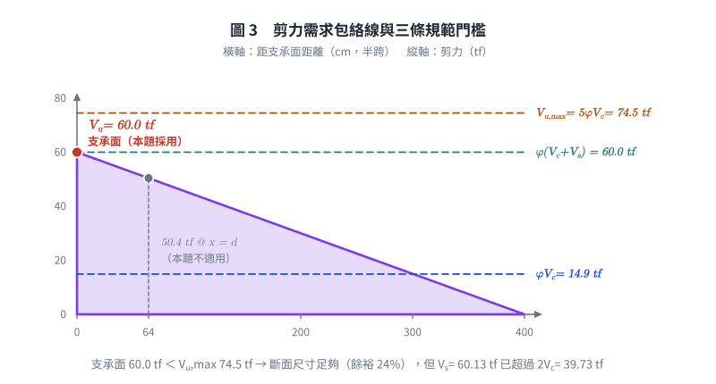
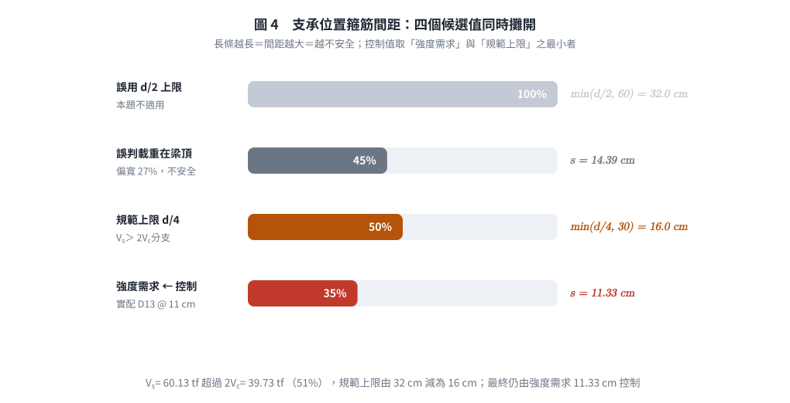

# 考題編號：RC-2020-2

**主分類：** `RC-U2-1` RC 剪力強度分析與設計
**副分類：** 無
**設計法：** USD 強度設計法
**標籤：** `倒T型梁` `臨界斷面` `d偏移規則` `懸吊式載重` `下翼板載重` `不可d偏移` `最大肋筋間距` `最大設計剪力` `Vc簡化公式` `懸吊鋼筋`

---

## 1. 題目（考卷原文見題目正本）

> 考卷原文、公式／附表、附圖與判讀清單（已確認）見 [`RC-2020-2-problem.md`](RC-2020-2-problem.md)。本節只列解題時最容易讀錯的地方與本解使用的記號；題意以題目正本為準。

*重繪自考卷附圖，依題目正本判讀清單 #1–#7。本圖攔下的讀錯：70 是全高（$d$＝64），不是梁腹高；載重作用在下翼版頂面而非梁頂。*

### 常見誤讀

| 項目 | 正確判讀 | 常見誤讀 |
|------|---------|---------|
| 70 | 全高（頂面到底面），$d=70-6=64$ cm | 梁腹高，全高 90、$d$＝84（本庫 2026-11-15 前舊解，答 16.6 cm／97.8 tf） |
| 載重位置 | 下翼版頂面（載重由梁腹下部引入） | 梁頂均佈載重 |
| 梁腹寬 | $b_w$＝35 cm；D13 箍筋兩肢只在梁腹內 | 用翼版寬 100 |
| 跨度 | 800 cm 為支承中心距；支承寬度未給，取支承中心處剪力 | — |

**本解記號：** $V_u$＝支承面設計剪力；$A_v=2\times1.267=2.534$ cm²；$V_c=0.53\sqrt{f'_c}\,b_wd$（題給，與現行規範 $A_v\ge A_{v,\min}$、$N_u$＝0 時的簡化式相同）。規範：建築物混凝土結構設計規範（內政部 2023 年版）。

#### 判讀圖解（解析自繪）

*圖 1　倒 T 型梁題目重繪（$h$＝70、$d$＝64）。側視圖的載重箭頭**止於下翼板頂面**而非梁頂——讀成梁頂載重，小題(一)答成「可以」，小題(二)的間距會從 11.3 cm 放寬到 14.4 cm。*

---

## 2. 考題核心精神與出題者意圖（Core Concepts & Examiner's Intent）

**核心觀念：**
1. $d$ 偏移規則的**三項適用條件**，尤其是「載重須施加於構材頂部附近」這一條
2. 倒 T 型梁（承托梁／ledger beam）的載重自**下翼板（拉力側）**進入，屬懸吊式載重
3. 依支承面 $V_u$ 計算所需箍筋間距，並對照規範上限的雙門檻（$d/2$ vs $d/4$）
4. 斷面最大可承受剪力受 $V_{s,\max} = 2.12\sqrt{f'_c}b_wd = 4V_c$ 控制

**出題者意圖：**
- 小題(一) 是本題靈魂：**故意畫一個載重從下翼板進入的倒 T 型梁**，測驗考生會不會反射性地套 $d$ 偏移。
- 小題(二) 測驗完整剪力設計流程（$\phi$ → $V_s$ → 間距 → 規範上限）；本題 $V_s$＝60.1 tf 遠超 $2V_c$＝39.7 tf，上限取 $d/4$。
- 小題(三) 測驗 $V_{s,\max}$ 對截面剪力容量的控制概念。
- 附圖判讀：70 是全高，不是梁腹高。

---

## 3. 解題戰略地圖與陷阱分析（Strategic Roadmap & Trap Analysis）

**作戰計畫：**
1. (一) 逐條檢核 $d$ 偏移三條件 → 條件(b)不成立（載重在拉力側）→ **不可偏移**，臨界斷面取支承面
2. 計算 $V_c$、支承面 $V_u = w_u L/2$
3. (二) 計算 $V_s$，與 $2V_c$、$4V_c$ 比較定間距上限，再與強度需求取小
4. (三) 以 $V_{s,\max} = 4V_c$ 代入求 $\phi V_{n,\max}$

**五大陷阱：**

| 陷阱 | 說明 | 對策 |
|------|------|------|
| **載重位置誤判（致命）** | 倒 T 型梁的載重箭頭畫在下翼板頂面，非梁頂 | 放大附圖確認箭頭尖端的高度 |
| **全高誤判** | 70 的尺寸線由頂面量到底面 | $h$＝70、$d$＝64；不要再加翼版 20 |
| $\phi$ 值選擇 | 剪力 $\phi = 0.75$ | 非 0.85（舊制） |
| $A_v$ 計算 | 閉合箍筋一組 = 2 支 D13 | $A_v = 2 \times 1.267 = 2.534 \text{ cm}^2$ |
| 間距上限選擇 | 先判斷 $V_s$ 是否超過 $2V_c$（＝$1.06\sqrt{f'_c}b_wd$） | 本題 $V_s = 60.1 > 2V_c = 39.7$ → 取 $d/4$ |

---

## 3.5 變數層次分析（Variable Hierarchy Analysis）

> 複習提示：第一次解題後，在每個卡住的知識點旁標記 `⚠`；第二次複習時只看有 `⚠` 的項目。

### 最終目標

`(一) 判斷臨界斷面位置；(二) 求支承位置最大箍筋間距；(三) 求斷面最大可承受設計剪力`

### 本題關鍵公式（依計算順序）

$$\text{Step 1: } V_c = 0.53\sqrt{f'_c}\, b_w d$$

$$\text{Step 2: } V_u\big|_{\text{critical}} = V_{u,\text{support}} = \frac{w_u L}{2} \quad \text{（不可 d 偏移）}$$

$$\text{Step 3: } V_s = \frac{V_u}{\phi} - \boxed{V_c}$$

$$\text{Step 4: } s = \frac{A_v f_{yt} d}{\boxed{V_s}} \leq s_{\max,\text{code}} = \begin{cases} \min(d/2,\,60) & \boxed{V_s} \le 2\boxed{V_c} \\ \min(d/4,\,30) & \boxed{V_s} > 2\boxed{V_c}\end{cases}$$

$$\text{Step 5（最大Vu）: } V_{u,\max} = \phi\!\left(\boxed{V_c} + 4\boxed{V_c}\right) = 5\phi \boxed{V_c}$$

### L1：題目直接給定

| 符號 | 數值 | 說明 |
|------|------|------|
| $f'_c$ | 280 kgf/cm² | 混凝土抗壓強度 |
| $f_y$ | 4200 kgf/cm² | 剪力筋降伏強度 |
| $w_u$ | 15 tf/m | 均佈設計載重（施加於**下翼板頂面**） |
| $L$ | 800 cm | 梁跨度 |
| $b_w$ | 35 cm | 腹板寬（剪力計算用） |
| $h$ | 70 cm | 斷面全深（頂面到底面） |
| $d$ | 64 cm | 有效深度（70−6） |
| $A_v$ | 2.534 cm² | 一組 D13 閉合箍面積（2×1.267） |

### L2：需知識點推導

| 符號 | 公式/來源 | 卡關? |
|------|----------|:-----:|
| $V_c$ | $0.53 \times \sqrt{280} \times 35 \times 64 = 19{,}866 \text{ kgf}$ | |
| $\phi V_c$ | $0.75 \times 19{,}866 = 14{,}899 \text{ kgf} = 14.9 \text{ tf}$ | |
| $V_{u,\text{critical}}$ | $= V_{u,\text{support}} = 15 \times 8/2 = 60 \text{ tf}$（**不可** 扣 $w_u d$） | |
| $V_s$ | $60/0.75 - 19.87 = 60.13 \text{ tf}$ | |
| 門檻 $2V_c$ | $39.73$ tf → $V_s$ 超過 → $s_{\max,\text{code}} = \min(16,\,30) = 16 \text{ cm}$ | |
| $s$（強度） | $2.534 \times 4200 \times 64 / 60{,}134 = 11.33 \text{ cm}$ | |
| 控制間距 | $\min(11.33,\ 16) = 11.3 \text{ cm}$（實配 11 cm） | |
| $V_{s,\max}$ | $4V_c = 79{,}463 \text{ kgf}$ | |
| $V_{u,\max}$ | $0.75 \times 5 \times 19{,}866 = 74{,}496 \text{ kgf} = 74.5 \text{ tf}$ | |

### L3：深層知識（不懂就卡住）

| 知識點 | 說明 | 卡關? |
|--------|------|:-----:|
| $d$ 偏移三條件 | (a) 支承反力在端區產生壓力；(b) **載重施加於構材頂部或其附近**；(c) 支承面至臨界斷面間無集中載重。**三條缺一即不可偏移**，本題(b)不成立 | |
| 為何載重在拉力側就不能偏移 | 偏移的物理基礎是支承附近形成直接斜壓撐；載重若自下翼板進入，必須先被垂直懸吊鋼筋「吊」到腹板頂部才能形成壓撐，端區承受全剪力 | |
| $V_s$ 間距上限雙門檻 | $V_s \leq 1.06\sqrt{f'_c}b_wd$ → $s \leq \min(d/2, 60)$；超過 → $s \leq \min(d/4, 30)$；$V_s > 2.12\sqrt{f'_c}b_wd$ → 需放大斷面 | |
| $A_v = 2$ 支 D13 | 閉合箍筋每組兩腳 | |
| 懸吊鋼筋（hanger reinforcement） | 下翼板載重須以垂直鋼筋吊入腹板壓力區，需求量 $A_h/s \ge w_u/(\phi f_y)$ | |

---

## 4. 步驟化詳細計算過程（Step-by-Step Detailed Calculation）

### 前置：斷面與材料參數整理

$$b_w = 35 \text{ cm}, \quad h = 70 \text{ cm}, \quad d = 70 - 6 = 64 \text{ cm}, \quad A_v = 2 \times 1.267 = 2.534 \text{ cm}^2,\quad \phi = 0.75$$

### 小題(一)：支承處是否可採 $d$ 偏移

**判斷結論：不可以（NO）。臨界斷面必須取在支承面。**

依規範，可將臨界斷面移至距支承面 $d$ 處，須**同時**滿足三條件：

| 條件 | 內容 | 本題 |
|------|------|:----:|
| (a) | 支承反力在構材端區產生**壓力** | ✓ 簡支支承向上頂住翼板 |
| (b) | 載重施加於構材**頂部或其附近**（不得自拉力側進入） | ✗ **載重壓在下翼板頂面（拉力側）** |
| (c) | 支承面與臨界斷面之間無集中載重 | ✓ 純均佈載重 |

**理由：** 本梁為**倒 T 型（腹板在上、翼板在下）獨立梁**，附圖中 $w_u$ 的載重箭頭終止於距底面 20 cm 處，即**下翼板的頂面**。簡支梁的拉力側在下方，故此載重是自**拉力側**進入斷面，屬**懸吊式載重**——實務上就是倒 T 承托梁以下翼板承托預鑄版或小梁的情形。

支承附近無法形成「載重點直接斜壓撐至支承」的傳力機制：載重必須先由腹板中的**垂直懸吊鋼筋**吊升至腹板壓力區，再向支承傳遞。斜裂縫會穿越整個端區，端區承受**未折減的全部剪力**。

$$\boxed{\text{臨界斷面：支承面（}x = 0\text{），}V_u = 60 \text{ tf；不得取 } d = 64 \text{ cm 處}}$$

> **對照（若誤判為梁頂載重）：** $V_{u,d} = 60 - 15 \times 0.64 = 50.4$ tf，
> $V_s = 50.4/0.75 - 19.87 = 47.33$ tf，$s = 14.4$ cm——比正解 11.3 cm 寬 27%，不安全。

---

### 小題(二)：支承位置剪力筋最大間距

**Step 1：混凝土剪力強度 $V_c$**

$$V_c = 0.53\sqrt{f'_c}\,b_w d = 0.53 \times 16.7332 \times 35 \times 64 = 0.53 \times 16.7332 \times 2{,}240 = 19{,}866 \text{ kgf} = 19.87 \text{ tf}$$

**Step 2：支承面（臨界斷面）剪力 $V_u$**

$$V_u = w_u \times \frac{L}{2} = 15 \times \frac{8}{2} = \mathbf{60 \text{ tf}} = 60{,}000 \text{ kgf}$$

（依小題(一)，**不作** $d$ 偏移；支承寬度未給，以支承中心剪力計，偏保守。）

**Step 3：所需箍筋剪力強度 $V_s$**

$$V_s = \frac{V_u}{\phi} - V_c = \frac{60{,}000}{0.75} - 19{,}866 = 80{,}000 - 19{,}866 = \mathbf{60{,}134 \text{ kgf}} = 60.13 \text{ tf}$$

**Step 4：判斷規範間距上限門檻**

$$2V_c = 1.06\sqrt{f'_c}b_wd = 39{,}731 \text{ kgf},\qquad 4V_c = 2.12\sqrt{f'_c}b_wd = 79{,}463 \text{ kgf}$$

$$2V_c = 39.73 \ \mathbf{<}\ V_s = 60.13 \ \mathbf{<}\ 4V_c = 79.46 \quad\Rightarrow\quad \text{斷面尺寸足夠，但適用加嚴間距}$$

$$s_{\max,\text{code}} = \min\!\left(\frac{d}{4},\ 30 \text{ cm}\right) = \min(16,\ 30) = 16 \text{ cm}$$

**Step 5：由強度需求計算間距**

$$s = \frac{A_v f_{yt} d}{V_s} = \frac{2.534 \times 4200 \times 64}{60{,}134} = \frac{681{,}139}{60{,}134} = \mathbf{11.33 \text{ cm}}$$

**Step 6：取最小值（控制間距）**

$$s_{\max} = \min(s_{\text{strength}},\ s_{\max,\text{code}}) = \min(11.33,\ 16) = \boxed{11.3 \text{ cm}}$$

支承位置剪力筋最大間距 $= \mathbf{11.3 \text{ cm}}$（實際採用 D13 @ 11 cm）。

**最小剪力筋量驗核：**

$$A_{v,\min} = \max\!\left(0.2\sqrt{f'_c}\,\frac{b_w s}{f_{yt}},\ 3.5\,\frac{b_w s}{f_{yt}}\right)
= \max\!\left(\frac{0.2(16.733)(35)(11)}{4200},\ \frac{3.5(35)(11)}{4200}\right) = \max(0.307,\ 0.321) = 0.321 \text{ cm}^2 \ \ll\ 2.534 \quad \checkmark$$

---

### 小題(三)：斷面最大可承受設計剪力 $V_{u,\max}$

$$V_{s,\max} = 2.12\sqrt{f'_c}\,b_w d = 4V_c = 79{,}463 \text{ kgf}$$

$$V_{n,\max} = V_c + V_{s,\max} = 5V_c = 99{,}328 \text{ kgf}$$

$$V_{u,\max} = \phi V_{n,\max} = 0.75 \times 99{,}328 = \boxed{74{,}496 \text{ kgf} \approx 74.5 \text{ tf}}$$

**驗算：** 支承面 $V_u = 60 \text{ tf} < V_{u,\max} = 74.5 \text{ tf}$ ✓，斷面尺寸足夠（餘裕 24%）。

---

### 計算結果彙整

| 項目 | 結果 |
|------|:----:|
| $V_c$ | 19.87 tf（$\phi V_c = 14.9$ tf） |
| **(一) 臨界斷面** | **支承面；不可 $d$ 偏移**（載重自下翼板／拉力側進入） |
| 臨界斷面 $V_u$ | 60.0 tf |
| 所需 $V_s$ | 60.13 tf（$> 2V_c = 39.73$，$< 4V_c = 79.46$） |
| 規範間距上限 | $\min(d/4,\,30) = 16$ cm |
| 強度需求間距 | 11.33 cm |
| **(二) 最大間距** | **11.3 cm（實配 D13 @ 11 cm）** |
| **(三) $V_{u,\max}$** | **74.5 tf**（$= 5\phi V_c$） |

---

*圖 2　$d$ 偏移的物理基礎。左圖載重在壓力側，斜壓撐直接把力送到支承；右圖載重自拉力側進入，得先被懸吊筋吊上壓力區才形成壓撐，斜裂縫穿越整個端區。可攔下「簡支梁一律可偏移」這個把構件名稱當判準的反射動作。*

*圖 3　剪力需求與門檻。$\phi V_c$ 只是「不必配箍筋」的界線，斷面容量天花板是 $V_{u,\max} = 5\phi V_c = 74.5$ tf；把 $\phi V_c$ 當成 $V_u$ 上限、或忘記 $V_{s,\max} = 4V_c$，小題(三)就答不出來。*

*圖 4　四個候選間距同時攤開，長條越長＝越不安全。$V_s$＝60.13 tf 超過 $2V_c$＝39.73 tf，規範上限由 32 cm 減為 16 cm；最終由強度需求 11.33 cm 控制。可攔下上限選錯分支、以及忘記與強度需求取小。*

## 5. 關鍵爭議點與進階探討（Critical Issues & Advanced Discussion）

**1. $d$ 偏移的本質，以及「倒 T 型梁」為何是反例**

$d$ 偏移成立的物理基礎是：支承附近的斜壓撐把外力**直接**傳至支承，不必靠腹筋跨越斜裂縫。這要求載重進入斷面的位置在壓力側（梁頂）。倒 T 型梁的下翼板承托載重時，力流是「翼板 → 垂直懸吊筋 → 腹板頂部壓力區 → 斜壓撐 → 支承」，因此**端區剪力不得折減**——**判準是條件，不是構件名稱**。

**2. 懸吊鋼筋（hanger reinforcement）需求量**

本題未問，但這是倒 T 承托梁的必要配筋：

$$\frac{A_h}{s} \ \ge\ \frac{w_u}{\phi f_y} = \frac{150 \text{ kgf/cm}}{0.75 \times 4200} = 0.0476 \text{ cm}^2/\text{cm}$$

若把懸吊需求與剪力需求疊加在同一組箍筋（保守做法）：$A_v/s = V_s/(f_yd) + A_h/s = 0.2237 + 0.0476 = 0.2713$ → $s = 2.534/0.2713 = 9.3$ cm。若懸吊筋另行配置，剪力箍筋仍為 11.3 cm。懸吊筋須錨定至腹板壓力區，宜與翼板頂面的橫向筋一併配置。

**3. $\phi = 0.75$ vs $\phi = 0.85$**

現行規範與考卷指定規範剪力均採 $\phi = 0.75$。若誤用 0.85：$V_s = 60/0.85 - 19.87 = 50.72$ tf（仍 $> 2V_c$），$s = 13.4$ cm。

**4. 舊讀法（$h$＝90、$d$＝84）對照**

本庫 2026-11-15 前舊解把 70 讀成梁腹高、全高 90：$V_c$＝26.07 tf、$V_s$＝53.93 tf、$s$＝16.6 cm、$V_{u,\max}$＝97.8 tf。考卷 70 的尺寸線上端對齊頂面、下端對齊底面（題目正本判讀清單 #2），此讀法不成立。

**5. 規範版本**

$d$ 偏移三條件、$V_c$ 簡化式（$N_u$＝0、$A_v \ge A_{v,\min}$）、間距門檻 $1.06\sqrt{f'_c}b_wd$、$V_{s,\max}=2.12\sqrt{f'_c}b_wd$、$A_{v,\min}$ 在考卷指定版本與現行規範（2023）相同，答案不受規範版本影響。若為無腹筋斷面，現行規範須改用 $V_c = 2.1\lambda_s\lambda\rho_w^{1/3}\sqrt{f'_c}b_wd$，$\lambda_s=\sqrt{2/(1+0.04d)}\le1$（$d$ 以 cm 計；本題 $d$＝64 → 0.75）。

**6. 若題目改成「腹板頂面承載」的對照表**

| | 載重在下翼板（**本題**） | 載重在腹板頂面 |
|---|:---:|:---:|
| $d$ 偏移 | 不可 | 可 |
| 臨界斷面 $V_u$ | 60.0 tf | 50.4 tf |
| $V_s$ | 60.13 tf | 47.33 tf |
| $V_s$ vs $2V_c$（39.73） | $>$ | $>$ |
| 規範上限 | $\min(d/4,30) = 16$ cm | 16 cm |
| 強度需求 | 11.33 cm | 14.39 cm |
| **最大間距** | **11.3 cm** | 14.4 cm |
| 額外配筋 | 需懸吊鋼筋 | 不需 |

*圖解補繪：2026-09-02（向量圖 4 張，腳本 `figs/gen_RC-2020-2.py`，可重跑；腳本檔尾對 §4 公佈值做 assert）*

*修正日期：2026-11-15（§1 改為指向題目正本，插入重繪附圖 figs/RC-2020-2-fig-1-problem.svg；舊 §1 重述改寫為常見誤讀與本解記號；本行非答案勘誤）*

*修正日期：2026-11-15（解析勘誤：70 改讀為全高 h＝70、d＝64（原讀 h＝90、d＝84）；㈡ s 16.6 → 11.3 cm、㈢ Vu,max 97.8 → 74.5 tf，㈠ 結論不變；figs/gen_RC-2020-2.py 常數改 h＝70、d＝64 並更新對帳值，圖 1、3、4 重產；規範版本對答案無影響（現行台灣規範 2023 版相同）；驗證：盲解比對 + 勘誤腳本重算 MISMATCHES: 0 + gen 腳本 assert 全過）*
