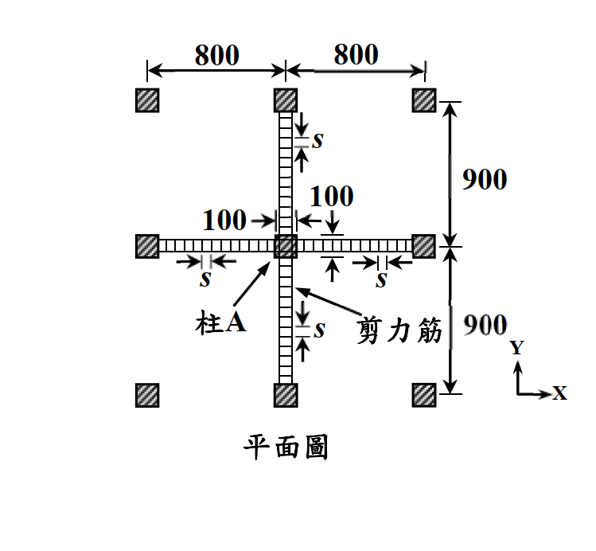
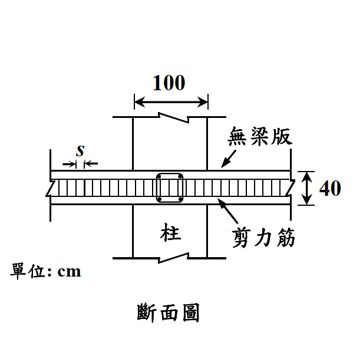

# RC-2020-3 題目正本

> 本檔只記錄**考卷上寫了什麼、圖上畫了什麼**，不含任何解法。解析見同資料夾 `RC-2020-3.md`。
> 判讀清單已經確認（凍結）；本檔原則上不再修改（改動須回考卷原圖並記 log）。

| 項目 | 內容 |
|------|------|
| 考卷 | `raw/exams/RC-2020_鋼筋混凝土設計與預力.pdf` 第 3 頁（頁次 4－3），第三題 |
| 考年 | 民國 109 年（2020） |
| 配分 | 20 分（㈠10 分、㈡10 分） |
| 附圖 | `RC-2020-3-fig-1.png`（平面圖）、`RC-2020-3-fig-2.png`（斷面圖） |
| 判讀狀態 | **已確認**（2026-11-15 使用者授權依 Claude 建議確認；轉錄 2026-11-15；PyMuPDF 110 dpi 全頁目視，附圖 250–450 dpi 局部放大；文字以 PDF 文字層核對；盲讀後才比對既有解析） |

## 1. 考卷原文（逐字）

> 三、一地下室無梁版柱系統如下所示，版上承擔均佈設計（因數化）載重 4.6 tf/m²（含自重），版之全深 $h$＝40 cm，平均有效深度 $d$＝35 cm。設版與柱之間無彎矩之傳遞。混凝土抗壓強度 $f'_c$＝280 kgf/cm²，鋼筋降伏強度 $f_y$＝4200 kgf/cm²。
> ㈠若版中無剪力鋼筋，檢核版於柱 A 之混凝土穿孔剪力強度是否足夠？（10 分）
> ㈡若穿孔剪力強度不足，則由柱面往外，沿平面 X 與 Y 方向配置雙肢剪力鋼筋，計算所需剪力鋼筋間距 $s$。剪力鋼筋採 D13 鋼筋，一支斷面積為 1.267 cm²。（10 分）
> 根據規範，無剪力筋時，版混凝土穿孔剪力強度由下列三式決定：
> ⑴ $V_c=0.265\left(2+\dfrac{4}{\beta}\right)\sqrt{f'_c}\,b_od$
> ⑵ $V_c=0.265\left(2+\dfrac{\alpha_sd}{b_o}\right)\sqrt{f'_c}\,b_od$，式中 $\alpha_s$ 於內柱時為 40，於邊柱時為 30，於角柱時為 20。
> ⑶ $V_c=1.06\sqrt{f'_c}\,b_od$
> 有剪力筋時，版混凝土穿孔剪力強度 $V_c=0.53\sqrt{f'_c}\,b_od$

## 2. 考卷給的公式、附表與參數

- 卷首（第 1 頁）照錄：「作答規範：依據內政部於民國 108 年 2 月 25 日公布之「混凝土結構設計規範」或中國土木水利工程學會「混凝土工程設計規範與解說（土木 401-100）」作答，未依上述規範作答，不予計分。」
- 題文數值：$w_u$＝4.6 tf/m²（設計、含自重）；$h$＝40、$d$＝35 cm（平均）；$f'_c$＝280、$f_y$＝4200 kgf/cm²；D13 一支 1.267 cm²；版柱間無彎矩傳遞。
- 題目印出的公式：無剪力筋時三式 ⑴⑵⑶（如上，照錄；⑴ 式中符號印為 $\beta$）；有剪力筋時 $V_c=0.53\sqrt{f'_c}\,b_od$。屬題目印出的規範公式，依現行規範換用（差異於解析 §5 註明）。
- **沒有給**：強度折減因數 $\phi$、剪力筋 $f_{yt}$（題文只給 $f_y$＝4200）、有剪力筋時 $V_n$ 上限、剪力筋配置範圍。
- 卷首注意事項：㈠可以使用電子計算器。㈡不必抄題，作答時請將試題題號及答案依照順序寫在試卷上，於本試題上作答者，不予計分。㈢本科目除專門名詞或數理公式外，應使用本國文字作答。

## 3. 附圖

圖面文字照錄：平面圖 `800`、`800`、`900`、`900`、`100→`（柱寬）、`100`（剪力筋帶寬）、`s`（四處）、`柱A`、`剪力筋`、`Y`、`X`；斷面圖 `100`、`s`、`無梁版`、`40`、`柱`、`剪力筋`；`單位: cm`、`平面圖`、`斷面圖`。

## 4. 判讀清單

「把握」標**不確定**者優先列；解讀類項目（題目用字的意思）另標「解讀」。標「依 Claude 建議確認」者，為使用者 2026-11-15 授權「要我確認的請依你建議」後定案。

| # | 項目 | 判讀 | 圖上／題文依據 | 把握 |
|---|------|------|---------------|------|
| 1 | 柱距 | **X 向 800 cm、Y 向 900 cm**（柱中心距；兩向不同） | 平面圖上方兩段 `800` 尺寸線水平（X 向）、右側兩段 `900` 尺寸線垂直（Y 向），端點皆對齊柱中心 | 確定（影響答案）；依 Claude 建議確認 |
| 2 | 柱 A 位置 | 格網中央柱 → 內柱（$\alpha_s$＝40） | 平面圖柱 A 四周皆有柱、版連續 | 確定 |
| 3 | 柱尺寸 | 100×100 cm 方柱（$\beta$＝1） | 平面圖 `100→ ←` 尺寸夾柱 A 左右兩面；斷面圖柱寬 `100`；圖上柱為正方形 | 確定（解讀） |
| 4 | 剪力筋帶 | 由柱面沿 ＋X、－X、＋Y、－Y 各一條，帶寬 100 cm（等於柱寬）；每條為雙肢；間距 $s$ | 平面圖右側 `100` 垂直尺寸夾 X 向剪力筋帶上下緣；題文「沿平面 X 與 Y 方向配置雙肢剪力鋼筋」 | 確定（解讀） |
| 5 | 版厚與有效深度 | $h$＝40 cm（斷面圖 `40`）、平均 $d$＝35 cm（題文） | 斷面圖、題文 | 確定 |
| 6 | 載重 | $w_u$＝4.6 tf/m² 為因數化載重且含自重，不再乘因數 | 題文 | 確定 |
| 7 | 彎矩傳遞 | 版柱間無不平衡彎矩傳遞（只檢核直接穿孔剪力） | 題文 | 確定 |
| 8 | 題目印出的公式 | ⑴⑵⑶及有剪力筋時 $0.53\sqrt{f'_c}\,b_od$ 照錄；屬規範公式，依現行規範換用 | 題文 | 確定 |
| 9 | 考卷沒有給 | $\phi$、$f_{yt}$、$V_n$ 上限、剪力筋延伸範圍 | 全題 | 確定 |

---

*轉錄：2026-11-15（RC-U3-1／U3-2 題目正本推廣・批 1）*

*確認：2026-11-15 使用者授權依 Claude 建議確認（RC-U3-1／U3-2 題目正本推廣・批 1，關卡一）*
