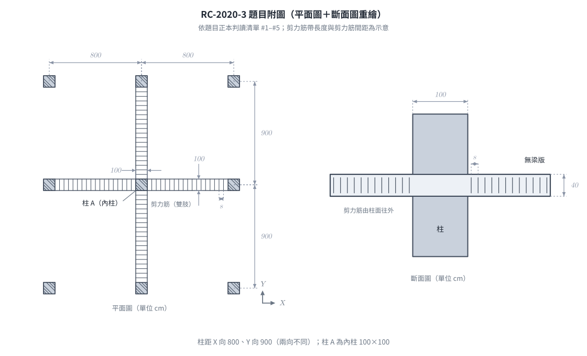
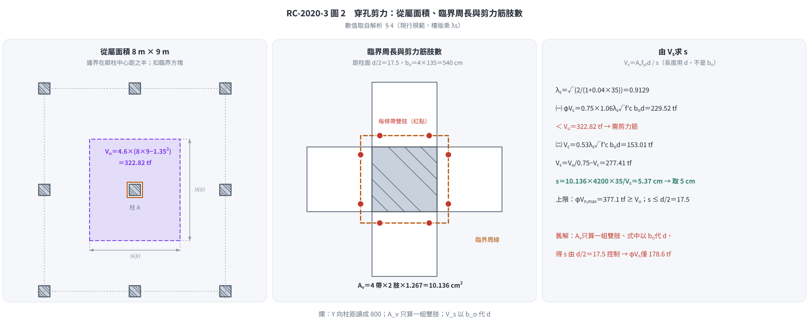

# 考題編號：RC-2020-3

**主分類：** `RC-U3-2` 樓版與基腳設計
**副分類：** 無
**設計法：** USD 強度設計法
**標籤：** `無梁版` `穿孔剪力` `雙向剪力` `內柱` `剪力鋼筋設計` `三公式控制`

---

## 1. 題目（考卷原文見題目正本）

> 考卷原文、公式／附表、附圖與判讀清單（已確認）見 [`RC-2020-3-problem.md`](RC-2020-3-problem.md)。本節只列解題時最容易讀錯的地方與本解使用的記號；題意以題目正本為準。

*重繪自考卷平面圖與斷面圖，依題目正本判讀清單 #1–#5。本圖攔下的讀錯：Y 向柱距是 900，不是 800（從屬面積 8×9 m）。*

### 常見誤讀

| 項目 | 正確判讀 | 常見誤讀 |
|------|---------|---------|
| 柱距 | X 向 800、Y 向 900 cm（柱中心距） | 兩向都取 800（本庫舊解） |
| 柱 A | 內柱（$\alpha_s$＝40）、100×100（$\beta$＝1） | 邊柱 |
| 剪力筋配置 | 沿 ±X、±Y 四條、每條雙肢，帶寬 100（等於柱寬） | 每條只算 1 肢；只算兩條 |
| 載重 | 4.6 tf/m² 已因數化且含自重 | 再乘載重因數或另加自重 |
| 題給公式 | 考卷印出的三式與有剪力筋時 $0.53\sqrt{f'_c}\,b_od$ 屬規範式，主線依現行規範換用 | 照抄、未檢查 $V_n$ 上限 |
| 剪力筋 $V_s$ | $V_s=A_vf_{yt}d/s$，$A_v$＝同一周線上所有肢（4 條×2 肢＝8 肢） | 用 $A_vf_yb_o/s$（式中以 $b_o$ 代 $d$，量綱錯誤）；$A_v$ 只算一組雙肢（本庫舊解，得 $s$＝$d/2$ 控制） |
| 尺寸效應 | 樓版穿孔剪力乘 $\lambda_s=\sqrt{2/(1+0.04d)}$（現行規範；不適用基腳的 13.2.6.2 放寬） | 忽略 $\lambda_s$ |

**本解記號：** $\ell_x$＝800、$\ell_y$＝900 cm（從屬面積 72 m²）；$\lambda_s$＝尺寸效應因數；柱 $c$＝100 cm；$h$＝40、$d$＝35 cm；$w_u$＝4.6 tf/m²；$b_o$＝臨界周長（距柱面 $d/2$）；D13 $A_b$＝1.267 cm²。

---

## 2. 考題核心精神與出題者意圖（Core Concepts & Examiner's Intent）

**核心觀念：**
1. 穿孔剪力臨界周長 $b_o$ 與從屬面積（兩向柱距不同：8 m × 9 m）
2. 三個 $v_c$ 式取最小值，判斷控制式
3. 有剪力筋時 $v_c$ 降為 $0.53\lambda_s\sqrt{f'_c}$，其餘由剪力筋 $V_s=A_vf_{yt}d/s$ 補足；並檢查 $V_n$ 上限與 $s\le d/2$

**現行規範（建築物混凝土結構設計規範 2023）：**
- 無剪力筋：$v_c=\lambda_s\lambda\sqrt{f'_c}\min\{1.06,\ 0.53(1+2/\beta),\ 0.265(2+\alpha_sd/b_o)\}$，$\lambda_s=\sqrt{2/(1+0.04d)}\le1$
- 閉合箍筋（單肢或多肢）：$v_c=0.53\lambda_s\lambda\sqrt{f'_c}$；$V_n\le1.59\sqrt{f'_c}b_od$；$V_s=A_vf_{yt}d/s$，$A_v$＝距柱面等距之一周線上所有剪力筋肢面積；$s\le d/2$；$d\ge15$ cm 且 $\ge16d_b$
- 樓版不適用 13.2.6.2（基腳可忽略 $\lambda_s$ 的放寬），所以本題乘 $\lambda_s$

**出題者意圖：**
- 測驗考生能否從平面圖讀出兩向柱距（800／900）、判斷內柱 $\alpha_s=40$
- 三式哪個控制（方柱時 1.06 幾乎總是最小）
- 加剪力筋後 $v_c$ 減半，必須由剪力筋補足差額

---

## 3. 解題戰略地圖與陷阱分析（Strategic Roadmap & Trap Analysis）

**作戰計畫：**
1. 臨界周長 $b_o = 4(c + d) = 4 \times 135 = 540 \text{ cm}$
2. 穿孔剪力需求 $V_u=w_u[\ell_x\ell_y-(c+d)^2]$
3. 三式取最小、乘 $\lambda_s$ 與 $\phi = 0.75$，判斷是否足夠
4. 不足 → $v_c=0.53\lambda_s\sqrt{f'_c}$，求 $V_s$，以 $V_s=A_vf_{yt}d/s$ 求 $s$；檢查 $V_n$ 上限、$s\le d/2$

**四大陷阱：**

| 陷阱 | 說明 | 對策 |
|------|------|------|
| 從屬面積 | Y 向柱距 900，不是 800 | $\ell_x\ell_y=8\times9=72$ m² |
| $V_u$ 面積 | 需扣除臨界周長內面積 $(c+d)^2$ | $V_u = w_u[\ell_x\ell_y - (c+d)^2]$ |
| $V_s$ 公式 | 每一周線上的剪力筋只計一次，長度因次用 $d$（斜裂縫水平投影） | $V_s=A_vf_{yt}d/s$，不是 $A_vf_yb_o/s$ |
| $A_v$ 肢數 | 四條剪力筋帶（±X、±Y）各雙肢，同一周線共 8 肢 | $A_v=8\times1.267=10.136$ cm² |

---

## 3.5 變數層次分析（Variable Hierarchy Analysis）

> 複習提示：第一次解題後，在每個卡住的知識點旁標記 `⚠`；第二次複習時只看有 `⚠` 的項目。

### 最終目標

`(一) 驗算 φVc ≥ Vu（無剪力筋）；(二) 求剪力筋間距 s`

### 本題關鍵公式

$$\text{Step 1: } b_o = 4(c + d),\quad \lambda_s=\sqrt{\frac{2}{1+0.04d}}$$

$$\text{Step 2: } V_u = w_u \cdot \bigl[\ell_x \ell_y - (c+d)^2\bigr]$$

$$\text{Step 3: } \phi V_c = \phi\,\lambda_s\sqrt{f'_c}\,b_od\cdot\min\{1.06,\ 0.53(1+2/\beta),\ 0.265(2+\alpha_sd/b_o)\}\ \stackrel{?}{\geq}\ V_u$$

$$\text{Step 4: } V_s = \frac{V_u}{\phi} - \boxed{V_c^{(w)}} \quad (V_c^{(w)} = 0.53\lambda_s\sqrt{f'_c}\,\boxed{b_o}\,d)$$

$$\text{Step 5: } s = \frac{A_v f_{yt}\, d}{\boxed{V_s}} \leq \frac{d}{2},\qquad V_c^{(w)}+V_s\le1.59\sqrt{f'_c}\,b_od$$

### L1：題目直接給定

| 符號 | 數值 | 說明 |
|------|------|------|
| $f'_c$ | 280 kgf/cm² | 混凝土強度 |
| $f_y$ | 4200 kgf/cm² | 剪力筋 $f_{yt}$ 取同值 |
| $d$ | 35 cm | 版平均有效深度 |
| $c$ | 100 cm | 正方形柱邊長 |
| $\ell_x,\ \ell_y$ | 800、900 cm | 柱中心距（平面圖） |
| $w_u$ | 4.6 tf/m² | 設計均佈載重（含自重） |
| $\alpha_s$ | 40 | 內柱 |
| $\beta$ | 1.0 | 方形柱長短邊比 |
| D13 | 1.267 cm²／支 | 剪力筋 |

### L2：需知識點推導

**Step 1：周長與需求**

| 符號 | 公式/來源 | 卡關? |
|------|----------|:-----:|
| $b_o$ | $4(100+35) = 540 \text{ cm}$ | |
| $V_u$ | $4.6\times(72 - 1.35^2) = 322.82 \text{ tf}$ | ⚠ |
| $\lambda_s$ | $\sqrt{2/(1+0.04\times35)}=0.9129$ | ⚠ |

**Step 2：三個 $v_c$ 式**

| 式 | 係數 | 卡關? |
|------|---------|:-----:|
| $0.53(1+2/\beta)$（考卷印為 $0.265(2+4/\beta)$） | 1.59 | |
| $0.265(2+\alpha_s d/b_o)$ | $0.265\times4.593=1.217$ | |
| $1.06$ | **1.06（控制）** | |
| $\phi V_c$ | $0.75\times1.06\times0.9129\times\sqrt{280}\times540\times35=229.52$ tf ＜ 322.82 ✗ | |

**Step 3：有剪力筋設計**

| 符號 | 公式/來源 | 卡關? |
|------|----------|:-----:|
| $V_c^{(w)}$ | $0.53\times0.9129\times16.733\times18{,}900 = 153.01 \text{ tf}$ | |
| $V_s$ | $322.82/0.75 - 153.01 = 277.41 \text{ tf}$ | |
| $A_v$ | $4\times2\times1.267=10.136$ cm² | ⚠ |
| $s$（強度） | $10.136\times4200\times35/277{,}410 = 5.37 \text{ cm}$ → 取 5 cm | ⚠ |
| 上限 | $s\le d/2=17.5$ ✓；$\phi V_{n,\max}=0.75\times1.59\sqrt{f'_c}b_od=377.1\ge322.82$ ✓ | |

### L3：深層知識（不懂就卡住）

| 知識點 | 說明 | 卡關? |
|--------|------|:-----:|
| 為何加剪力筋後 $v_c$ 降低 | 剪力筋要等斜裂縫開展後才發揮，此時混凝土貢獻已下降，規範取 $0.53\lambda_s\sqrt{f'_c}$（約為無筋時一半） | |
| $V_s=A_vf_{yt}d/s$ | 一條 45° 穿孔斜裂縫的水平投影約 $d$，穿過它的剪力筋周線數為 $d/s$；每條周線上的肢數全部計入 $A_v$ | ⚠ |
| 規範最大間距 $d/2$ | 確保每條斜裂縫至少穿過兩排剪力筋 | |
| $V_u$ 為何扣除 $(c+d)^2$ | 臨界周長內的載重直接傳至柱，不在穿孔破壞面上產生剪力 | |
| $\lambda_s$ | 厚版斜裂縫較寬、骨材嵌合較差，剪應力強度隨 $d$ 降低；樓版照計，淺基礎可依 13.2.6.2 忽略 | ⚠ |

---

## 4. 步驟化詳細計算過程（Step-by-Step Detailed Calculation）

### 前置：斷面與材料參數

$$c = 100 \text{ cm},\quad d = 35 \text{ cm},\quad b_o = 4(c+d) = 4 \times 135 = 540 \text{ cm}$$

$$\sqrt{f'_c} = \sqrt{280} = 16.733,\qquad \sqrt{f'_c}\,b_od = 16.733\times540\times35 = 316{,}254 \text{ kgf}$$

$$\lambda_s = \sqrt{\frac{2}{1+0.04\times35}} = \sqrt{\frac{2}{2.4}} = 0.9129$$

### 小題(一)：驗核混凝土穿孔剪力強度

**Step 1：穿孔剪力需求 $V_u$**（從屬面積 $8\times9$ m）

$$V_u = w_u \times \bigl[\ell_x \ell_y - (c+d)^2\bigr] = 4.6 \times \bigl[8\times9 - 1.35^2\bigr] = 4.6\times(72 - 1.8225) = \mathbf{322.82 \text{ tf}}$$

**Step 2：三個 $v_c$ 式**（內柱 $\alpha_s = 40$、方柱 $\beta = 1$）

$$0.53\left(1+\frac{2}{\beta}\right)=1.59;\qquad 0.265\left(2+\frac{40\times35}{540}\right)=0.265\times4.593=1.217;\qquad 1.06$$

取最小 1.06（第三式控制）：

$$V_c = 1.06\,\lambda_s\sqrt{f'_c}\,b_od = 1.06\times0.9129\times316{,}254 = 306{,}020 \text{ kgf}$$

**Step 3：比較**

$$\phi V_c = 0.75 \times 306.02 = 229.52 \text{ tf}$$

$$V_u = 322.82 \text{ tf} > \phi V_c = 229.52 \text{ tf} \quad \Longrightarrow \boxed{\text{穿孔剪力強度不足，需配剪力鋼筋}}$$

（照考卷印出的式子、不乘 $\lambda_s$：$\phi V_c$＝251.4 tf，仍不足，結論相同。）

---

### 小題(二)：設計剪力鋼筋間距 s

配剪力筋（閉合箍筋）後，混凝土貢獻：

$$V_c^{(w)} = 0.53\lambda_s\sqrt{f'_c}\,b_o\,d = 0.53 \times 0.9129\times316{,}254 = 153{,}010 \text{ kgf} = 153.01 \text{ tf}$$

**Step 1：所需剪力筋強度 $V_s$**

$$\phi(V_c^{(w)} + V_s) \geq V_u \implies V_s \geq \frac{V_u}{\phi} - V_c^{(w)} = \frac{322.82}{0.75} - 153.01 = 430.42 - 153.01 = \mathbf{277.41 \text{ tf}}$$

**Step 2：$V_n$ 上限檢核**

$$\phi V_{n,\max} = 0.75\times1.59\sqrt{f'_c}\,b_od = 0.75\times1.59\times316{,}254 = 377.1 \text{ tf} \ \ge\ V_u = 322.82 \text{ tf}\quad\checkmark$$

**Step 3：由強度需求求間距 $s$**

四條剪力筋帶（±X、±Y）各為雙肢 D13，距柱面同一距離的一周線上共 8 肢：

$$A_v = 4\times2\times1.267 = 10.136 \text{ cm}^2$$

$$V_s = \frac{A_v f_{yt} d}{s} \implies s = \frac{A_v f_{yt} d}{V_s} = \frac{10.136 \times 4200 \times 35}{277{,}410} = \frac{1{,}489{,}990}{277{,}410} = 5.37 \text{ cm}$$

**Step 4：構造限制**

$$s \le \frac{d}{2} = 17.5 \text{ cm}\ \checkmark;\qquad d=35\ge\max(15,\ 16d_b=20.3)\text{ cm}\ \checkmark$$

$$\boxed{s = 5.37 \text{ cm} \Rightarrow \text{取 } s = 5 \text{ cm}}$$

驗算（$s$＝5 cm）：$\phi V_n = 0.75\times\left(153.01 + \dfrac{10.136\times4200\times35}{5}/1000\right) = 0.75\times(153.01+298.00)=338.3 \text{ tf} \ge 322.82 \text{ tf}$ ✓

（照考卷印出的 $0.53\sqrt{f'_c}b_od$、不乘 $\lambda_s$：$V_c^{(w)}$＝167.6 tf、$s$＝5.67 cm，仍取 5 cm。）

---

*圖 2　從屬面積、臨界周長與剪力筋肢數。攔：Y 向柱距讀成 800；$A_v$ 只算一組雙肢；$V_s$ 以 $b_o$ 代 $d$（舊解因此得 $s$ 由 $d/2$ 控制）。*

## 5. 關鍵爭議點與進階探討（Critical Issues & Advanced Discussion）

**1. 舊解的錯誤（本次勘誤）**

| 項目 | 舊解 | 正確 |
|------|------|------|
| 從屬面積 | $8\times8=64$ m² → $V_u$＝286.0 tf | $8\times9=72$ m² → 322.82 tf |
| $V_s$ 式 | $A_vf_yb_o/s$（以周長代 $d$，量綱錯誤） | $A_vf_{yt}d/s$ |
| $A_v$ | 一組雙肢 2.534 cm² | 一周線 8 肢 10.136 cm² |
| 結論 | 強度要求 $s$＝26.9 cm，由 $d/2$＝17.5 cm 控制 | $s$＝5.37 cm（強度控制） |

若照舊解採 $s$＝17.5 cm，實際 $V_s=10.136\times4200\times35/17.5=85.1$ tf，$\phi V_n=0.75(153.01+85.1)=178.6$ tf，遠小於 $V_u$＝322.82 tf。

**2. 規範版本對照**

| 項目 | 考卷印出式（不乘 $\lambda_s$） | 現行規範（主線） |
|------|------|------|
| ㈠ $\phi V_c$ | 251.4 tf（不足） | 229.52 tf（不足） |
| ㈡ $V_c^{(w)}$ | 167.6 tf | 153.01 tf |
| ㈡ $s$ | 5.67 cm | 5.37 cm |

考卷依 108 年規範（401-100 世代），式中無 $\lambda_s$；現行規範雙向剪力（含有剪力筋時的 $v_c$）乘 $\lambda_s$。樓版不適用基腳可忽略 $\lambda_s$ 的 13.2.6.2。

**3. 本題剪力筋需求很高**
$s$＝5 cm 已接近施工極限，而且 $\phi V_{n,\max}$＝377.1 tf 只比 $V_u$ 多 17%。實務上會改用柱頭版（drop panel）、柱帽加大 $b_o$ 與 $d$，或剪力釘（headed shear stud，$V_n$ 上限較高）。

**4. 剪力筋延伸範圍（題目未問）**
剪力筋須由柱面往外延伸，直到最外一排剪力筋外 $d/2$ 的臨界周線上 $v_u\le\phi\,0.53\lambda_s\sqrt{f'_c}$；第一排距柱面不大於 $d/2$。

**5. $V_u$ 的受力面積**
扣除 $(c+d)^2 = 1.8225\text{ m}^2$ 是因為臨界周長內的版面載重由柱直接承受；若誤用全面積 72 m²，$V_u$ 偏大約 2.5%。

*修正日期：2026-11-15（§1 改為指向題目正本，插入重繪附圖 figs/RC-2020-3-fig-1-problem.svg；舊 §1 重述改寫為常見誤讀與本解記號；本行非答案勘誤）*

*修正日期：2026-11-15（FIX-RC-U3-B1 解析勘誤，改依現行台灣規範（建築物混凝土結構設計規範 2023）：Y 向柱距改讀 900（題目正本 #1，考卷第 3 頁平面圖右側兩段 900 尺寸線）→ $V_u$ 286.0 → 322.82 tf；㈠ 乘 $\lambda_s$＝0.9129，$\phi V_c$ 251.4 → 229.52 tf（不足，結論不變）；㈡ $V_s$ 式改 $A_vf_{yt}d/s$、$A_v$ 改一周線 8 肢 10.136 cm²、$v_c=0.53\lambda_s\sqrt{f'_c}$：$s$ 17.5 → **5.37 cm（取 5 cm）**；補 $V_n$ 上限檢核；撤除 §1 待勘誤提示。驗證：check_errata_U3_B1.py 重算，MISMATCHES: 0）*

*圖解補繪：2026-11-15（DIAG-RC-U3-B1，向量圖，腳本 `figs/gen_RC-2020-3.py`，可重跑；非勘誤、答案不變）*
