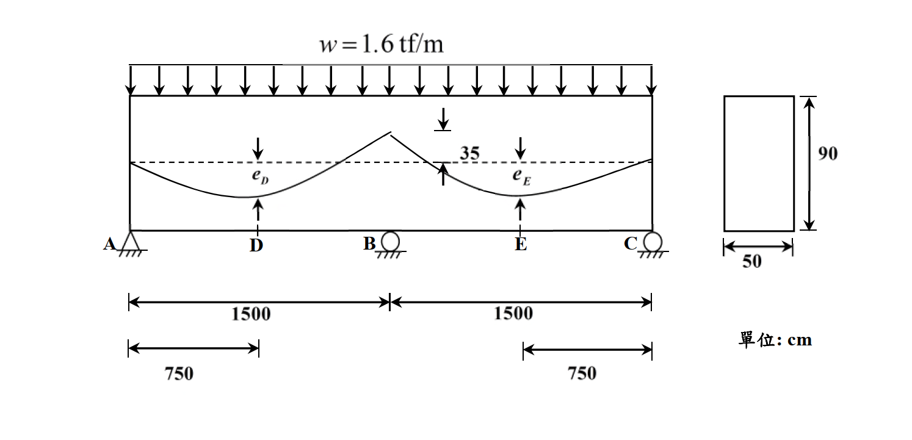

# RC-2020-4 題目正本

> 本檔只記錄**考卷上寫了什麼、圖上畫了什麼**，不含任何解法。解析見同資料夾 `RC-2020-4.md`。
> 判讀清單已經確認（凍結）；本檔原則上不再修改（改動須回考卷原圖並記 log）。

| 項目 | 內容 |
|------|------|
| 考卷 | `raw/exams/RC-2020_鋼筋混凝土設計與預力.pdf` 第 4 頁（頁次 4－4），第四題 |
| 考年 | 民國 109 年（2020） |
| 配分 | 25 分（㈠ 15 分、㈡ 10 分） |
| 附圖 | `RC-2020-4-fig-1.png`（兩跨連續梁立面＋斷面） |
| 判讀狀態 | **已確認**（2026-11-15 使用者授權依 Claude 建議確認；轉錄 2026-11-15；PyMuPDF 110 dpi 全頁＋400–450 dpi 局部目視、文字層逐字核對；盲讀後才比對既有解析） |

## 1. 考卷原文（逐字）

> 四、一預力連續梁如下所示，受一均佈靜載（含自重）$w$ = 1.6 tf/m，預力鋼腱採拋物線型配置，鋼腱於支承 B 處之偏心為 35 cm。
> ㈠計算預力鋼腱於梁各跨度中點（D 與 E 點）之偏心值（$e_D$ 與 $e_E$）以及有效預力值 $P_e$，使預力不產生二次彎矩效應，且在 $P_e$ 與題目給定的載重作用下，梁斷面受均勻軸壓應力。（15 分）
> ㈡設有效預力 $P_e$ 與初始預力 $P_i$ 之比值為 0.8，求在初始預力 $P_i$ 以及題目給定的載重作用下，斷面 B 上緣與下緣混凝土之應力。（10 分）

## 2. 考卷給的公式、附表與參數

- 兩跨連續梁 A–B–C，跨度各 1500 cm；D、E 為兩跨中點（距 A、距 C 各 750 cm）。
- 斷面：矩形 50（寬）×90（深）cm。
- 均佈靜載（含自重）$w=1.6$ tf/m，全長。
- 鋼腱拋物線型配置；支承 B 處偏心 35 cm。
- ㈡ $P_e/P_i=0.8$。
- **沒有給**：$f'_c$、容許應力、鋼腱面積（題目也不要求）。
- 卷首：作答規範：依據內政部於民國 108 年 2 月 25 日公布之「混凝土結構設計規範」或中國土木水利工程學會「混凝土工程設計規範與解說（土木401-100）」作答，未依上述規範作答，不予計分。注意事項：可以使用電子計算器。不必抄題，作答時請將試題題號及答案依照順序寫在試卷上，於本試題上作答者，不予計分。本科目除專門名詞或數理公式外，應使用本國文字作答。

## 3. 附圖

圖面文字照錄：w＝1.6 tf/m、35、e_D、e_E、A、B、C、D、E、1500、1500、750、750、90、50、單位: cm。

## 4. 判讀清單

| # | 項目 | 判讀 | 圖上／題文依據 | 把握 |
|---|------|------|---------------|------|
| 1 | 支承 | A 鉸支承（三角形）、B 與 C 滾支承（圓圈）；兩跨各 1500 cm | 附圖 450 dpi | 確定 |
| 2 | 斷面 | 矩形 50×90 cm | 附圖尺寸 | 確定 |
| 3 | A、C 端偏心 | 0（鋼腱端點落在形心虛線上） | 附圖 450 dpi，鋼腱兩端與虛線相交於梁端 | 確定 |
| 4 | B 點偏心方向 | 形心**以上** 35 cm：尺寸 35 的上箭頭指向鋼腱頂點高度的水平短線，下箭頭指向形心虛線 | 附圖 450 dpi | 確定 |
| 5 | D、E 位置 | 各跨中點（750 cm），$e_D$、$e_E$ 在形心以下、為待求 | 題文；附圖尺寸 750 | 確定 |
| 6 | 鋼腱線形 | 每跨一條拋物線，兩段於 B 點相交（圖畫成尖角）；題文要求求出使無二次彎矩且均勻軸壓的 $e_D$、$e_E$ | 附圖；題文 | 確定（解讀；2026-11-15 使用者授權依 Claude 建議確認） |
| 7 | 載重 | $w=1.6$ tf/m（含自重）兩跨全長均佈 | 附圖箭頭布滿全長；題文 | 確定 |
| 8 | ㈡ 載重 | $P_i=P_e/0.8$ 與 $w$ 同時作用，求斷面 B 上、下緣應力 | 題文 | 確定 |
| 9 | 考卷沒有給 | $f'_c$、容許應力 | 全題 | 確定（題目只求應力，不要求檢核） |

---

*轉錄：2026-11-15（RC-U4-2+U4-3+U4-4 題目正本推廣・批 1）*

*確認：2026-11-15 使用者授權依 Claude 建議確認（RC-U4-2+U4-3+U4-4 題目正本推廣・批 1，關卡一）*
