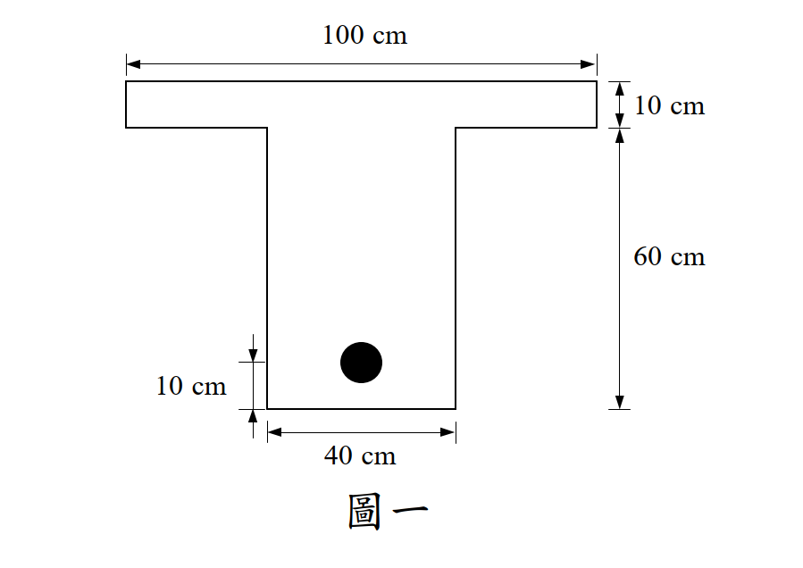

# RC-2021-1 題目正本

> 本檔只記錄**考卷上寫了什麼、圖上畫了什麼**，不含任何解法。解析見同資料夾 `RC-2021-1.md`。
> 判讀清單已經使用者確認（凍結）；本檔原則上不再修改（改動須回考卷原圖並記 log）。

| 項目 | 內容 |
|------|------|
| 考卷 | `raw/exams/RC-2021_鋼筋混凝土設計與預力.pdf` 第 1 頁（頁次 4－1），第一題 |
| 考年 | 民國 110 年（2021） |
| 配分 | 30 分 |
| 附圖 | `RC-2021-1-fig-1.png`（圖一：T 型梁斷面） |
| 判讀狀態 | **已確認**（2026-11-13 使用者確認；轉錄 2026-11-13，PyMuPDF 110 dpi 全頁目視＋抽出文字核對，附圖以 PDF 向量座標核對；盲讀後才比對既有解析） |

## 1. 考卷原文（逐字）

> 一、某一跨度 8 m 之混凝土 T 型簡支梁，斷面如圖一，其鋼筋斷面重心距梁底 10 cm，混凝土 f'c = 240 kgf/cm²，撓曲鋼筋 fy = 4200 kgf/cm²，剪力鋼筋 fyt = 2800 kgf/cm²，承受靜載重（含自重）D = 1.8 tf/m，活載重 L = 4.5 tf/m。試求本梁跨度中點所需之最小撓曲鋼筋量 (As)req，並設計兩端近支承處之剪力鋼筋，採用 2 股（2 legs）D10（#3，Ab = 0.7133 cm²）之肋筋配置，試求肋筋最大間距 smax。（30 分）

## 2. 考卷給的公式、附表與參數

- 作答規範：依據內政部於民國 110 年 3 月 2 日公布之「混凝土結構設計規範」或中國土木水利工程學會「混凝土工程設計規範與解說（土木 401-100）」作答，未依上述規範作答，不予計分。
- 題文數值：跨度 8 m 簡支；鋼筋重心距梁底 10 cm；$f'_c=240$、$f_y=4200$、$f_{yt}=2800$ kgf/cm²；$D=1.8$ tf/m（含自重）、$L=4.5$ tf/m；肋筋 2 股 D10，$A_b=0.7133$ cm²。
- **沒有給**：載重組合、$\phi$、$\beta_1$、支承寬度（剪力臨界斷面位置）、$\lambda$（視為常重混凝土）。
- 卷首注意事項：㈠可以使用電子計算器；㈡不必抄題；㈢除專門名詞或數理公式外，應使用本國文字作答。

## 3. 附圖

圖面文字照錄：`100 cm`、`10 cm`（翼板厚）、`60 cm`、`10 cm`（鋼筋）、`40 cm`、`圖一`。

## 4. 判讀清單

「把握」標**不確定**者請優先確認；解讀類項目（題目用字的意思）另標「解讀」。

| # | 項目 | 判讀 | 圖上／題文依據 | 把握 |
|---|------|------|---------------|------|
| 1 | 翼板 | 寬 100 cm、厚 10 cm | 上方 100 cm 尺寸線對齊翼板兩側；右上 10 cm 尺寸線 y = 499.3→515.8 夾翼板頂、底 | 確定 |
| 2 | 60 cm 段 | 由**翼板底面**量到**梁底** → $h=10+60=70$ cm | PDF 向量：60 cm 尺寸線 y = 515.8→614.9，翼板底 y = 515.7、梁底 y = 614.9 | 確定 |
| 3 | 腹板寬 | $b_w=40$ cm | 底部 40 cm 尺寸線對齊腹板兩側 | 確定 |
| 4 | 鋼筋位置 | 鋼筋重心距梁底 10 cm → $d=60$ cm | 題文；左側 10 cm 尺寸線 y = 598.3→614.9，鋼筋圓心 y = 598.4 | 確定 |
| 5 | 支承與跨度 | 簡支，跨度 8 m；全跨均佈 $D$、$L$ | 題文 | 確定 |
| 6 | 所求㈠ | 跨中所需撓曲鋼筋量 $(A_s)_{req}$（「最小」＝滿足強度所需的量，並檢核最小鋼筋量） | 題文 | 確定（解讀） |
| 7 | 所求㈡ | 近支承處 2 股 D10 肋筋的最大間距 $s_{max}$（強度需求與規範間距上限取小） | 題文 | 確定（解讀） |
| 8 | 考卷沒有給 | 載重組合、$\phi$、支承寬度 | 全題 | 確定 |

---

*轉錄：2026-11-13（RC-U1-1 題目正本推廣・批 2）*

*確認：2026-11-13 使用者確認（RC-U1-1 題目正本推廣・批 2，關卡一）*
