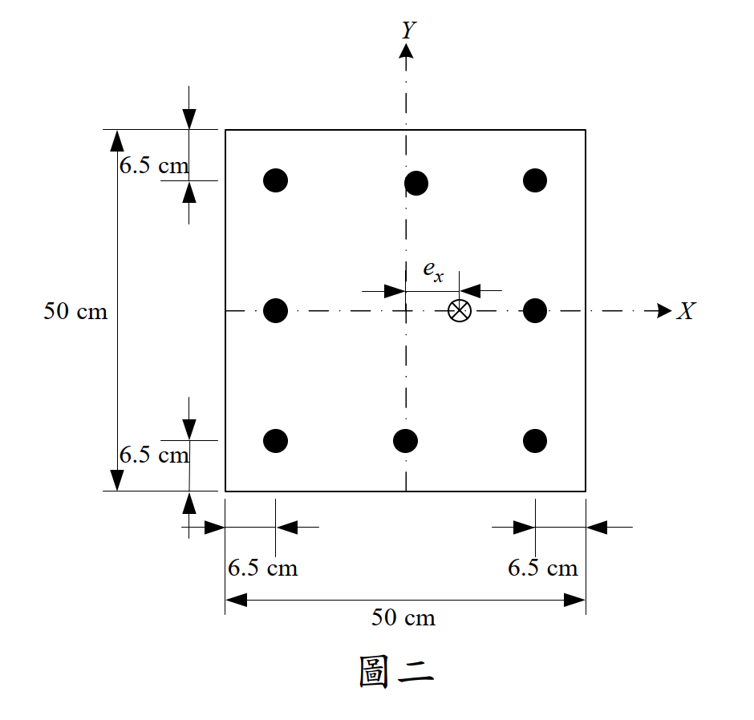

# RC-2021-2 題目正本

> 本檔只記錄**考卷上寫了什麼、圖上畫了什麼**，不含任何解法。解析見同資料夾 `RC-2021-2.md`。
> 判讀清單已經使用者確認（凍結）；本檔原則上不再修改（改動須回考卷原圖並記 log）。

| 項目 | 內容 |
|------|------|
| 考卷 | `raw/exams/RC-2021_鋼筋混凝土設計與預力.pdf` 第 2 頁（頁次 4－2），第二題 |
| 考年 | 民國 110 年（2021） |
| 配分 | 25 分 |
| 附圖 | `RC-2021-2-fig-1.png`（圖二） |
| 判讀狀態 | **已確認**（2026-11-14 使用者確認；無不確定項；轉錄 2026-11-14；PyMuPDF 110 dpi 全頁目視＋抽出文字核對，附圖 400 dpi 放大，鋼筋位置讀 PDF 向量座標；盲讀後才比對既有解析） |

## 1. 考卷原文（逐字）

> 二、已知一方形柱採用如圖二所示斷面，配置有 8 根 D25（#8，$A_b$ = 5.067 cm²）縱向鋼筋，承受偏心軸壓力，所使用混凝土 $f'_c$ = 280 kgf/cm²，$E_c=12000\sqrt{f'_c}$，鋼筋 $f_y$ = 4200 kgf/cm²，$E_s$ = 2.04×10⁶ kgf/cm²，若該斷面破壞時，中性軸與最大混凝土壓應變處之距離為 14.5 cm，試求該柱破壞時之軸壓力偏心距 $e_x$。（25 分）

## 2. 考卷給的公式、附表與參數

- 題文數值：8-D25（#8），$A_b=5.067$ cm²；$f'_c=280$ kgf/cm²；$E_c=12000\sqrt{f'_c}$（照錄）；$f_y=4200$ kgf/cm²；$E_s=2.04\times10^6$ kgf/cm²；$c=14.5$ cm。
- 卷首：「作答規範：依據內政部於民國 110 年 3 月 2 日公布之『混凝土結構設計規範』或中國土木水利工程學會『混凝土工程設計規範與解說（土木 401-100）』作答，未依上述規範作答，不予計分。」
- **沒有給**：$\varepsilon_{cu}$、$\beta_1$。
- 卷首注意事項：㈠可以使用電子計算器。㈡不必抄題，作答時請將試題題號及答案依照順序寫在試卷上，於本試題上作答者，不予計分。㈢本科目除專門名詞或數理公式外，應使用本國文字作答。

## 3. 附圖

圖面文字照錄：「Y」「X」「$e_x$」「6.5 cm」（四處）「50 cm」（兩處）「圖二」。

## 4. 判讀清單

| # | 項目 | 判讀 | 圖上／題文依據 | 把握 |
|---|------|------|---------------|------|
| 1 | 斷面 | 50×50 cm 方形 | 尺寸線（PDF 斷面 247.1–388.4 pt） | 確定 |
| 2 | 鋼筋配置 | 上排 3、下排 3、中間高度左右各 1，共 8-#8；最外鋼筋中心距各邊 6.5 cm → 沿 X 向三層：$x=6.5$ cm（3 根）、25 cm（2 根）、43.5 cm（3 根） | 6.5 cm 尺寸線；數圓點 | 確定 |
| 3 | 上排中間鋼筋位置 | 圖上畫在 Y 軸右側約 1.5 cm（x＝322.0 pt，斷面中心 317.75 pt；下排中間在 317.8 pt），判讀為畫圖偏差，與下排中間同在 Y 軸上 | PDF 座標 | 確定（解讀） |
| 4 | 載重位置與受壓側 | ⊗ 在 X 軸上、Y 軸右側 → 繞 Y 軸彎曲，右緣為最大壓應變處；$e_x$ 自 Y 軸（斷面中心）量起 | 圖二 | 確定 |
| 5 | 中性軸深度 | 自右緣量 $c=14.5$ cm | 題文 | 確定 |
| 6 | 「破壞時」 | 斷面達標稱強度（最大壓應變 $\varepsilon_{cu}$），$e_x=M_n/P_n$（斷面對稱，形心＝塑性中心） | 題文 | 確定（解讀） |
| 7 | $E_c=12000\sqrt{f'_c}$ | 題給，強度計算用不到 | 題文 | 確定 |
| 8 | 考卷沒有給 | $\varepsilon_{cu}$、$\beta_1$ 需依規範自行採用 | 題文 | 確定 |

---

*轉錄：2026-11-14（RC-U1-2 題目正本推廣・批 1）*

*確認：2026-11-14 使用者確認（RC-U1-2 題目正本推廣・批 1，關卡一）*
