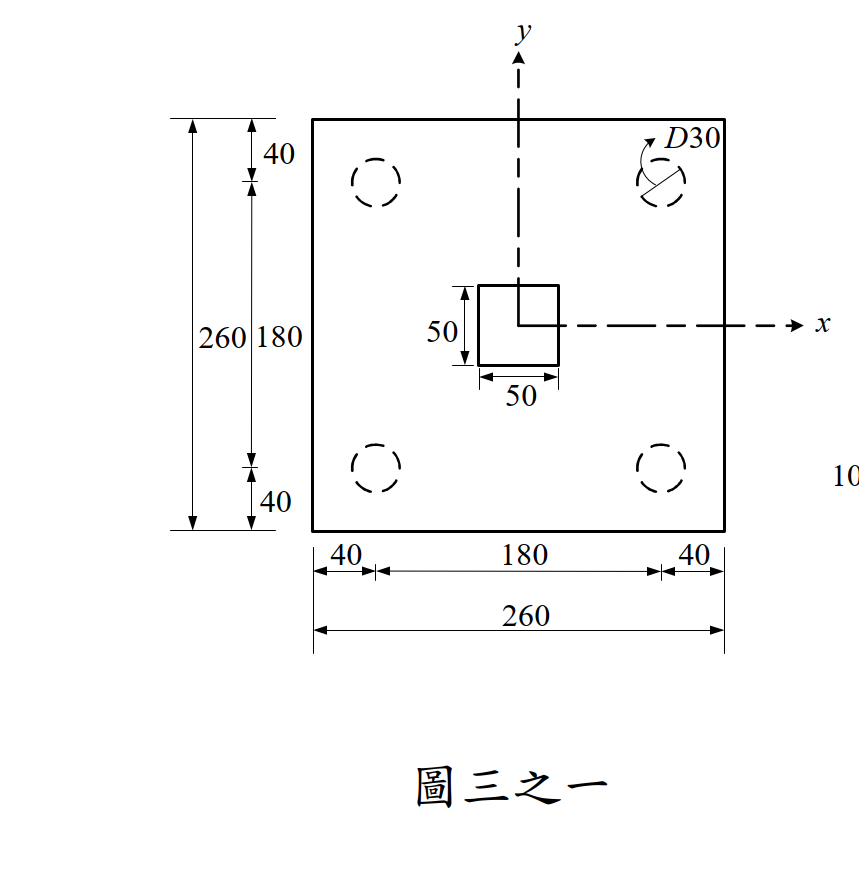
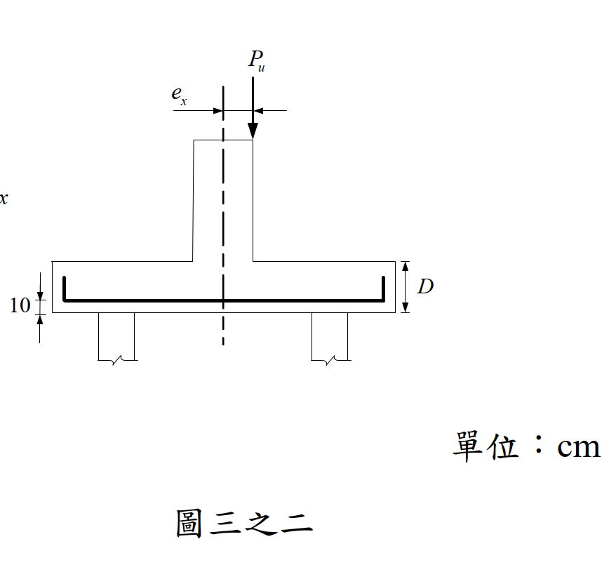

# RC-2021-3 題目正本

> 本檔只記錄**考卷上寫了什麼、圖上畫了什麼**，不含任何解法。解析見同資料夾 `RC-2021-3.md`。
> 判讀清單已經確認（凍結）；本檔原則上不再修改（改動須回考卷原圖並記 log）。

| 項目 | 內容 |
|------|------|
| 考卷 | `raw/exams/RC-2021_鋼筋混凝土設計與預力.pdf` 第 3 頁（頁次 4－3），第三題 |
| 考年 | 民國 110 年（2021） |
| 配分 | 20 分 |
| 附圖 | `RC-2021-3-fig-1.png`（圖三之一：樁帽平面；右緣夾帶圖三之二的「10」字樣）、`RC-2021-3-fig-2.png`（圖三之二：立面；左緣夾帶「x」字樣）；考卷為向量圖，尺寸以 PDF drawings 座標核對 |
| 判讀狀態 | **已確認**（2026-11-15 使用者授權依 Claude 建議確認；轉錄 2026-11-15；PyMuPDF 110 dpi 全頁目視，附圖 250–450 dpi 局部放大，向量圖以 PDF drawings 座標核對尺寸線端點；文字以 PDF 文字層核對；盲讀後才比對既有解析） |

## 1. 考卷原文（逐字）

> 三、單柱基樁之樁帽平面尺寸為 260×260 cm，樁帽厚度 $D$＝55 cm，柱斷面為 50×50 cm，基樁直徑 30 cm，如圖三之一，柱承受偏心載重，軸向力為 $P_u$＝100 tf，偏心距為 $e_x$，如圖三之二，基樁最大承壓軸力 $P_c$＝40 tf，基樁最大承拉軸力 $P_t$＝−10 tf，且設計樁帽時，混凝土 $f'_c$＝280 kgf/cm²，不設置剪力鋼筋，忽略樁帽自重，則柱載重最大容許偏心距 $e_x$ 為何？（20 分）
> [提示]計算基樁軸力時，可假設樁帽為剛性體；
> 檢核雙向作用，$\dfrac{V_c}{\sqrt{f'_c}\,b_0d}=\begin{cases}0.265\times(2+\dfrac{4}{\beta_c})\\0.265\times(2+\dfrac{\alpha_sd}{b_0})\\1.06\end{cases}$
> 其中，$\beta_c$ 為柱長邊/柱短邊；檢核雙向作用時，$\alpha_s$ 取 40；檢核角隅基樁穿孔剪力強度時，$\alpha_s$ 取 20。

## 2. 考卷給的公式、附表與參數

- 卷首（第 1 頁）照錄：「作答規範：依據內政部於民國 110 年 3 月 2 日公布之「混凝土結構設計規範」或中國土木水利工程學會「混凝土工程設計規範與解說（土木 401-100）」作答，未依上述規範作答，不予計分。」
- 題文數值：樁帽 260×260 cm、厚 $D$＝55 cm；柱 50×50 cm；基樁直徑 30 cm；$P_u$＝100 tf；$P_c$＝40 tf（壓）、$P_t$＝−10 tf（拉）；$f'_c$＝280 kgf/cm²；不設剪力筋；忽略樁帽自重。
- 題目印出的公式（提示）：雙向作用 $V_c/(\sqrt{f'_c}\,b_0d)$ 取三式（如上，照錄）；雙向作用 $\alpha_s$＝40、角隅基樁穿孔 $\alpha_s$＝20。屬題目印出的規範公式，依現行規範換用（差異於解析 §5 註明）。
- **沒有給**：強度折減因數 $\phi$、樁帽鋼筋、基樁埋入樁帽深度、單向剪力是否檢核。
- 卷首注意事項：㈠可以使用電子計算器。㈡不必抄題，作答時請將試題題號及答案依照順序寫在試卷上，於本試題上作答者，不予計分。㈢本科目除專門名詞或數理公式外，應使用本國文字作答。

## 3. 附圖

圖面文字照錄：圖三之一 `260`、`180`、`40`、`40`（左側）、`40`、`180`、`40`、`260`（下方）、`50`、`50`、`D30`、`x`、`y`；圖三之二 `Pu`、`ex`、`D`、`10`；`單位：cm`、`圖三之一`、`圖三之二`。

## 4. 判讀清單

「把握」標**不確定**者優先列；解讀類項目（題目用字的意思）另標「解讀」。標「依 Claude 建議確認」者，為使用者 2026-11-15 授權「要我確認的請依你建議」後定案。

| # | 項目 | 判讀 | 圖上／題文依據 | 把握 |
|---|------|------|---------------|------|
| 1 | 尺寸「10」 | 樁帽底面至底部主筋中心 10 cm → $d$＝55－10＝45 cm | PDF 座標：10 的兩條延伸線 y＝550.6、557.2；主筋線 y＝550.9；樁帽底面 y＝556.2 | 確定 |
| 2 | 樁位 | 4 支樁位於四角，樁中心距樁帽邊 40 cm → 以樁帽中心為原點 $(\pm90,\pm90)$ cm | PDF 座標：樁帽 x＝118.8～248.5（260 cm，0.499 pt/cm）；樁圓心 x＝138.8、228.6，y＝460.8、550.7（距邊 20.0 pt＝40 cm）；尺寸 40／180／40 延伸線對齊樁圓心 | 確定 |
| 3 | 「D30」 | 基樁直徑 30 cm（非鋼筋號數） | 題文「基樁直徑 30 cm」；圖上 D30 指向樁圓 | 確定 |
| 4 | 柱位置 | 柱 50×50 位於樁帽正中央 | PDF 座標：柱框 x＝171.2～196.2、y＝493.2～518.2，中心 (183.7, 505.7)＝樁帽中心 | 確定 |
| 5 | 偏心方向 | $e_x$ 沿 x 軸（由柱中心量至 $P_u$ 作用線）；圖上箭頭畫在柱面只是示意 | 圖三之二 $e_x$ 尺寸由中心虛線（x＝378.4）量到 $P_u$ 箭頭（x＝391.7） | 確定（解讀） |
| 6 | 樁軸力限制 | 壓力不得超過 40 tf、拉力不得超過 10 tf；樁帽視為剛體（線性分配） | 題文、提示 | 確定 |
| 7 | 穿孔剪力檢核 | 柱周雙向作用（$\alpha_s$＝40，$\beta_c$＝1）與角隅基樁穿孔（$\alpha_s$＝20）兩者皆須檢核；不設剪力筋 | 提示 | 確定 |
| 8 | 樁帽厚 | $D$＝55 cm（頂面至底面） | 圖三之二 D 尺寸延伸線 y＝533.3、556.3 對齊樁帽頂、底面 | 確定 |
| 9 | 自重 | 忽略樁帽自重 | 題文 | 確定 |
| 10 | 考卷沒有給 | $\phi$、基樁埋入深度、樁帽配筋、單向剪力是否檢核 | 全題 | 確定 |

---

*轉錄：2026-11-15（RC-U3-1／U3-2 題目正本推廣・批 1）*

*確認：2026-11-15 使用者授權依 Claude 建議確認（RC-U3-1／U3-2 題目正本推廣・批 1，關卡一）*
