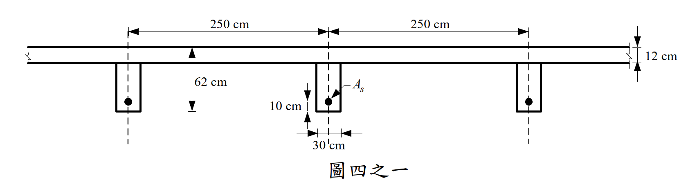
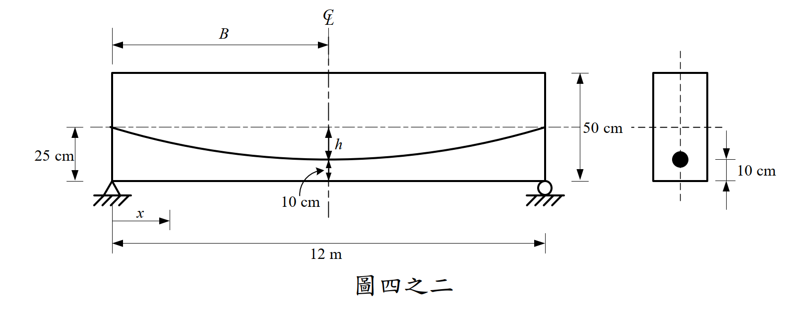

# RC-2021-4 題目正本

> 本檔只記錄**考卷上寫了什麼、圖上畫了什麼**，不含任何解法。解析見同資料夾 `RC-2021-4.md`。
> 判讀清單已經使用者確認（凍結）；本檔原則上不再修改（改動須回考卷原圖並記 log）。

| 項目 | 內容 |
|------|------|
| 考卷 | `raw/exams/RC-2021_鋼筋混凝土設計與預力.pdf` 第 4 頁，第四題；作答規範見第 1 頁 |
| 考年 | 民國 110 年（2021） |
| 配分 | 25 分 |
| 附圖 | `RC-2021-4-fig-1.png`（圖四之一：合成斷面）、`RC-2021-4-fig-2.png`（圖四之二：立面與鋼腱線形） |
| 判讀狀態 | **已確認**（2026-11-14 使用者確認；影響答案項目使用者選擇：#7 讀法①——預力與全部載重皆以合成斷面計算；轉錄 2026-11-14；PyMuPDF 110 dpi 全頁目視＋抽出文字核對，附圖讀 PDF 繪圖座標；盲讀後才比對既有解析） |

## 1. 考卷原文（逐字）

> 四、圖四之一簡支梁結構由後拉法預鑄預力矩形梁與場鑄板組合而成，梁與板間設置足夠之剪力筋連結，梁跨度 12 m，矩形梁斷面 30 cm × 50 cm，每支預力梁間之中心距離為 250 cm，預力鋼腱採拋物線配置如圖四之二所示，場鑄板之厚度為 12 cm。預力梁與場鑄板混凝土均採 $f'_c = 350\ \mathrm{kgf/cm^2}$，容許壓應力為 $0.6f'_c$，容許拉應力為 $1.6\sqrt{f'_c}$。每支梁施預力時之油壓預力 $F_i = 300$ tf，梁中點處之有效預力 $F_e = 0.7F_i$。假設簡支梁之靜載重（含自重）為 1.6 tf/m，試計算該簡支梁可承載之最大均布活載重，計算斷面性質時可忽略預力鋼腱之貢獻。（25 分）
> [提示] T 型梁翼板之有效板寬不得超過該梁跨度之 1/4；梁腹每側懸出之有效翼板寬度不得超過翼板厚之 8 倍或該梁與鄰梁間淨距之 1/2。

## 2. 考卷給的公式、附表與參數

- 題文數值：跨度 12 m；預鑄梁 $30 \times 50$ cm；梁中心距 250 cm；場鑄板厚 12 cm；梁、板 $f'_c=350$；容許壓應力 $0.6f'_c$、容許拉應力 $1.6\sqrt{f'_c}$（未註明適用階段）；$F_i=300$ tf、跨中 $F_e=0.7F_i$；靜載重（含自重）1.6 tf/m。
- 提示：有效翼寬三項限制（跨度 1/4、每側 8 倍板厚、每側淨距 1/2），照錄如上。
- 第 1 頁作答規範：依據內政部於民國 110 年 3 月 2 日公布之「混凝土結構設計規範」或中國土木水利工程學會「混凝土工程設計規範與解說（土木 401-100）」作答，未依上述規範作答，不予計分。
- **沒有給**：靜載重中哪些由預鑄梁單獨承受、哪些由合成斷面承受（施工支撐）；施預力（transfer）階段是否要檢核；容許拉應力適用的階段。
- 卷首注意事項：可以使用電子計算器。不必抄題，作答時請將試題題號及答案依照順序寫在試卷上，於本試題上作答者，不予計分。本科目除專門名詞或數理公式外，應使用本國文字作答。

## 3. 附圖

圖面文字照錄：圖四之一 `250 cm`、`250 cm`、`12 cm`、`62 cm`、`10 cm`、`A_s`、`30 cm`、`圖四之一`；圖四之二 `B`、`C̸L`（中心線）、`25 cm`、`h`、`50 cm`、`10 cm`（跨中）、`10 cm`（斷面）、`x`、`12 m`、`圖四之二`。

## 4. 判讀清單

「把握」標**不確定**者請優先確認；解讀類項目（題目用字的意思）另標「解讀」。

| # | 項目 | 判讀 | 圖上／題文依據 | 把握 |
|---|------|------|---------------|------|
| 1 | 62 cm 的量測基準 | **板頂到梁底** = 12＋50 | 62 cm 尺寸線 x≈177.7，由 y＝335.0（板頂）到 y＝384.5（梁底）；板為 335.0–347.4（PDF 座標）；圖未依比例 | 確定 |
| 2 | 預鑄梁 | $30 \times 50$ cm 矩形，置於板下 | 題文、30 cm 尺寸線 | 確定 |
| 3 | 梁距 | 中心距 250 cm → 淨距 220 cm | 250 cm 尺寸線端點對齊三條梁中心虛線（x＝128.8、282.7、436.8） | 確定 |
| 4 | 鋼腱線形 | 拋物線；兩端在**梁高一半**（距梁底 25 cm，即預鑄梁形心，端部偏心 0）；跨中距梁底 10 cm → 跨中垂距 $h=15$ cm | 圖四之二：25 cm 尺寸線對齊水平虛線與梁底，鋼腱端點落在虛線；跨中 10 cm 尺寸 | 確定 |
| 5 | 圖中 $A_s$ 標記 | 圖四之一的實心圓（標 $A_s$）即預力鋼腱位置，非普通鋼筋 | 與圖四之二斷面圖「10 cm」同位置；題文「計算斷面性質時可忽略預力鋼腱之貢獻」 | 確定（解讀） |
| 6 | 有效預力 | 跨中 $F_e = 0.7 \times 300 = 210$ tf | 題文 | 確定 |
| 7 | 施工階段與載重分配 | 考卷**沒有寫**預力與靜載重 1.6 tf/m 作用在預鑄梁單獨斷面或合成斷面（題文只說「後拉法預鑄預力矩形梁」「梁與板間設置足夠之剪力筋連結」）。預鑄梁一般在吊裝前施拉，預力作用於預鑄梁斷面 | 題文 | 不確定（影響答案）；使用者確認（選擇見頭表判讀狀態） |
| 8 | 容許應力適用 | 壓 $0.6f'_c$、拉 $1.6\sqrt{f'_c}$ 一組值，梁與板相同 $f'_c$；考卷未分階段 | 題文 | 確定（照考卷原文） |
| 9 | 有效翼寬 | 依提示三項取小（跨度 1/4、每側 8 倍板厚、每側淨距 1/2） | 題文提示 | 確定 |
| 10 | 考卷沒有給 | 施工支撐／載重分階段、施預力階段檢核要求 | 全題 | 確定（作答須自行假設） |

---

*轉錄：2026-11-14（RC-U4-1 題目正本推廣・批 1）*

*確認：2026-11-14 使用者確認（RC-U4-1 題目正本推廣・批 1，關卡一）*
