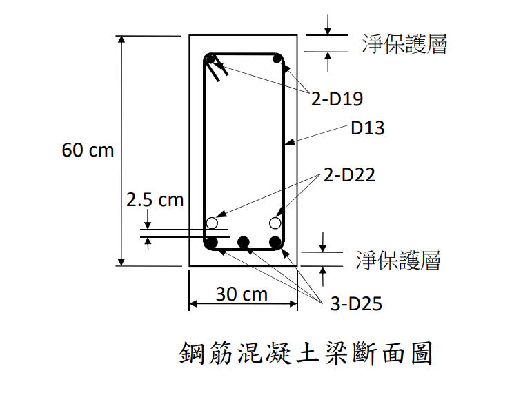

# RC-2022-1 題目正本

> 本檔只記錄**考卷上寫了什麼、圖上畫了什麼**，不含任何解法。解析見同資料夾 `RC-2022-1.md`。
> 判讀清單已經使用者確認（凍結）；本檔原則上不再修改（改動須回考卷原圖並記 log）。

| 項目 | 內容 |
|------|------|
| 考卷 | `raw/exams/RC-2022_鋼筋混凝土設計與預力.pdf` 第 2 頁（頁次 4－2），第一題；表 1、表 2 在第 1 頁 |
| 考年 | 民國 111 年（2022） |
| 配分 | 25 分 |
| 附圖 | `RC-2022-1-fig-1.png`（鋼筋混凝土梁斷面圖） |
| 判讀狀態 | **已確認**（2026-11-13 使用者確認；轉錄 2026-11-13，PyMuPDF 110 dpi 全頁目視＋抽出文字核對，附圖 400 dpi＋PDF 向量座標；盲讀後才比對既有解析） |

## 1. 考卷原文（逐字）

> 一、下圖所示梁斷面之拉力筋為 3-D25 和 2-D22，壓力筋為 2-D19。混凝土抗壓強度 f'c = 280 kgf/cm²、鋼筋降伏強度 fy = 5600 kgf/cm²，淨保護層 c = 4 cm，試求該斷面之設計彎矩強度 φMn。（25 分）

## 2. 考卷給的公式、附表與參數

- 卷首：本科目試題之作答規範：中國土木水利工程學會「混凝土工程設計規範與解說」（土木 401-100），未依規範作答，不予計分。
- 第 1 頁表 1　CNS 竹節鋼筋之標稱尺度（照錄本題用到的列）：

| 竹節鋼筋稱號 | 標稱直徑 $d_b$（cm） | 標稱面積 $A_b$（cm²） |
|---|---|---|
| D13 | 1.27 | 1.267 |
| D19 | 1.91 | 2.865 |
| D22 | 2.22 | 3.871 |
| D25 | 2.54 | 5.067 |

（表 1 另列 D10、D16、D29、D32；表 2「每層之最大鋼筋數目與梁之關係表」註：表中之梁肋筋是採用 D13，粒料直徑小於 2.5 cm。）

- 題文數值：$f'_c=280$、$f_y=5600$ kgf/cm²；淨保護層 4 cm。
- **沒有給**：$E_s$、$\varepsilon_{cu}$、$\beta_1$、$\phi$；$d$、$d'$ 須由圖上配筋自行推算。
- 卷首注意事項：㈠可以使用電子計算器；㈡不必抄題；㈢除專門名詞或數理公式外，應使用本國文字作答。

## 3. 附圖

圖面文字照錄：`60 cm`、`30 cm`、`淨保護層`（上、下各一）、`2-D19`、`D13`、`2-D22`、`2.5 cm`、`3-D25`、`鋼筋混凝土梁斷面圖`。

## 4. 判讀清單

「把握」標**不確定**者請優先確認；解讀類項目（題目用字的意思）另標「解讀」。

| # | 項目 | 判讀 | 圖上／題文依據 | 把握 |
|---|------|------|---------------|------|
| 1 | 斷面 | 矩形 $b=30$、$h=60$ cm | 30 cm、60 cm 尺寸線對齊外框 | 確定 |
| 2 | 淨保護層 | 4 cm，由斷面面量到**箍筋外緣**（頂、底皆是） | 題文「淨保護層 c = 4 cm」；PDF 向量：下方保護層兩線 y = 292.8（梁底）、285.1–285.7（箍筋底）；上方 164.5（梁頂）、173.4–174.0（箍筋頂） | 確定 |
| 3 | 箍筋 | D13 | 圖上引線標 D13 指向箍筋 | 確定 |
| 4 | 拉力筋下層 | 3-D25，貼箍筋底 | 實心圓三顆在底層 | 確定 |
| 5 | 拉力筋上層 | 2-D22，位於兩側 D25 正上方 | 空心圓 x 與兩側 D25 圓心相同 | 確定 |
| 6 | 2.5 cm | **兩層鋼筋之間的淨距**（D22 底緣到 D25 頂緣），不是中心距 | PDF 向量：2.5 cm 兩條延伸線 y = 272.4–272.9（D22 圓底 272.5）、276.6–277.1（D25 圓頂 276.6） | 確定 |
| 7 | 壓力筋 | 2-D19，位於頂部兩角、貼箍筋 | 圖上頂角兩顆實心圓 | 確定 |
| 8 | 所求 | 設計彎矩強度 $\phi M_n$ | 題文 | 確定 |
| 9 | 考卷沒有給 | $E_s$、$\varepsilon_{cu}$、$\beta_1$、$\phi$；$d$、$d'$ 未直接標註 | 全題 | 確定 |

---

*轉錄：2026-11-13（RC-U1-1 題目正本推廣・批 2）*

*確認：2026-11-13 使用者確認（RC-U1-1 題目正本推廣・批 2，關卡一）*
