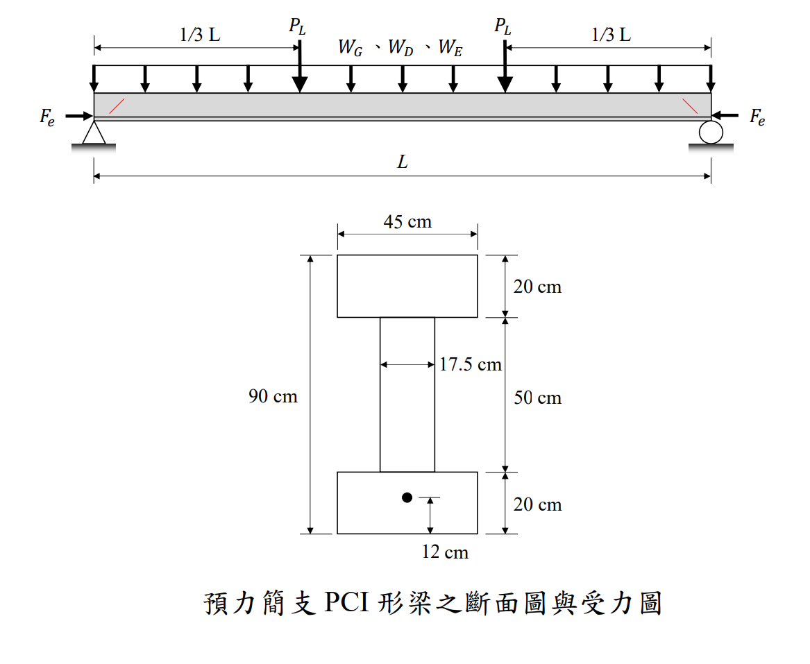

# RC-2022-3 題目正本

> 本檔只記錄**考卷上寫了什麼、圖上畫了什麼**，不含任何解法。解析見同資料夾 `RC-2022-3.md`。
> 判讀清單已經確認（凍結）；本檔原則上不再修改（改動須回考卷原圖並記 log）。

| 項目 | 內容 |
|------|------|
| 考卷 | `raw/exams/RC-2022_鋼筋混凝土設計與預力.pdf` 第 3 頁（頁次 4－3），第三題 |
| 考年 | 民國 111 年（2022） |
| 配分 | 25 分 |
| 附圖 | `RC-2022-3-fig-1.png`（預力簡支 PCI 形梁之斷面圖與受力圖；考卷只有這一張複合圖，**沒有第二張圖**） |
| 判讀狀態 | **已確認**（2026-11-15 使用者授權依 Claude 建議確認；轉錄 2026-11-15；PyMuPDF 110 dpi 全頁＋400–450 dpi 局部目視、文字層逐字核對、斷面以 PDF 向量座標量測；盲讀後才比對既有解析） |

## 1. 考卷原文（逐字）

> 三、如下圖所示之簡支預力混凝土梁跨徑 $L$ = 20 m，鋼筋混凝土之單位重 $\gamma$ = 2.4 tf/m³、混凝土強度 $f'_c$ = 420 kgf/cm²，主筋降伏強度 $f_y$ = 4200 kgf/cm²、肋筋降伏強度 $f_{yt}$ = 2800 kgf/cm²，有效預力 $F_e$ = 200 tf。今於地震後發現距離梁端支承約水平距離為一倍有效深度處出現腹剪裂縫，經查原設計階段所採用之垂直肋筋為 D10@15 cm，使用載重包括：自重 $W_G$、均佈靜載重 $W_D$ = 1.1 tf/m、集中活載重 $P_L$ = 25 tf，但未考慮垂直向地震力。今擬重新檢討，假設垂直向地震力為均佈載重，其值為自重 $W_G$ 與均佈靜載重 $W_D$ 兩者相加後的 25%，且仍使用 D10 當作垂直肋筋，請問肋筋間距 s 宜如何配置以避免產生腹剪破壞？（25 分）
>
> 預力簡支 PCI 形梁之斷面圖與受力圖

## 2. 考卷給的公式、附表與參數

- 簡支，$L=20$ m；$\gamma=2.4$ tf/m³；$f'_c=420$、$f_y=4200$、$f_{yt}=2800$ kgf/cm²；$F_e=200$ tf。
- 載重：自重 $W_G$（由斷面與 $\gamma$ 計算）、$W_D=1.1$ tf/m、$P_L=25$ tf（附圖兩處）、垂直地震力 $W_E=0.25(W_G+W_D)$（均佈）。
- 原設計 D10@15 cm 垂直肋筋；重新檢討仍用 D10。
- 卷首表 1（照錄本題相關列）：D10 標稱直徑 0.953 cm、標稱面積 0.7133 cm²。
- **沒有給**：載重組合與載重因數、肋筋肢數、有效深度數值（須由斷面推得）、下翼板寬度數值（見 #4）。
- 卷首：※注意：本科目試題之作答規範：中國土木水利工程學會「混凝土工程設計規範與解說」（土木401-100），未依規範作答，不予計分。注意事項：可以使用電子計算器。不必抄題，作答時請將試題題號及答案依照順序寫在試卷上，於本試題上作答者，不予計分。本科目除專門名詞或數理公式外，應使用本國文字作答。

## 3. 附圖

圖面文字照錄：1/3 L、P_L、W_G、W_D、W_E、P_L、1/3 L、F_e、F_e、L、45 cm、20 cm、17.5 cm、90 cm、50 cm、20 cm、12 cm、預力簡支 PCI 形梁之斷面圖與受力圖。

## 4. 判讀清單

| # | 項目 | 判讀 | 圖上／題文依據 | 把握 |
|---|------|------|---------------|------|
| 1 | 下翼板寬度 | **45 cm**（與上翼板同寬）。考卷未標註；PDF 向量座標：上翼板與下翼板矩形皆 x＝260.4～337.9 pt（77.5 pt），上翼板寬 45 cm → 1.72 pt/cm；腹板 30.3 pt＝17.6 cm、各層高 34.5／85.7／34.2 pt＝20／50／20 cm，比例一致 | 向量座標 | 確定（解讀，影響答案；2026-11-15 使用者授權依 Claude 建議確認） |
| 2 | 12 cm | **鋼腱形心距梁底** 12 cm（尺寸線上端對齊黑點右側短線、下端對齊梁底），不是下翼板寬；向量量測鋼腱中心距底 20.1 pt＝11.7 cm | 400 dpi；向量座標 | 確定 |
| 3 | 載重組合 | 考卷沒有給；依現行規範各載重組合取控制者——含地震的 $1.2D+1.0E+1.0L$（$E$ 為 $W_E$）與 $1.2D+1.6L$ 都要檢核；$W_E$ 不可再乘靜載重因數 | 題文未給組合 | 確定（解讀；依本庫「規範版本」規則） |
| 4 | 斷面其餘尺寸 | 上翼板 45×20；腹板 17.5×50；下翼板厚 20；全深 90；左右對稱，鋼腱在中線 | 附圖尺寸；向量座標（腹板中心＝翼板中心 299.2 pt） | 確定 |
| 5 | 鋼腱線形 | **直線**，全長距底 12 cm；$F_e$ 於兩端水平作用於鋼腱高度 → 無垂直分量 | 受力圖：鋼腱為貼近梁底的水平線，$F_e$ 箭頭水平 | 確定 |
| 6 | 有效深度 | $d_p=90-12=78$ cm（≥ 0.8h＝72）；裂縫在距支承約一倍有效深度處 | #2；題文 | 確定（解讀） |
| 7 | 集中載重位置 | 兩個 $P_L$，分別在距左、右支承 $L/3$ | 受力圖兩個 1/3 L 尺寸 | 確定 |
| 8 | 支承與均佈載重 | 左鉸右滾；$W_G$、$W_D$、$W_E$ 皆全跨均佈 | 受力圖 | 確定 |
| 9 | 肋筋肢數 | 考卷沒有給；D10 垂直肋筋一般為雙肢（$A_v=2\times0.7133$），須明列 | 卷首表 1 | 確定（解讀） |
| 10 | 所求 | 依腹剪強度檢討，求 D10 垂直肋筋間距 $s$ | 題文 | 確定 |

---

*轉錄：2026-11-15（RC-U4-2+U4-3+U4-4 題目正本推廣・批 1）*

*確認：2026-11-15 使用者授權依 Claude 建議確認（RC-U4-2+U4-3+U4-4 題目正本推廣・批 1，關卡一）*
